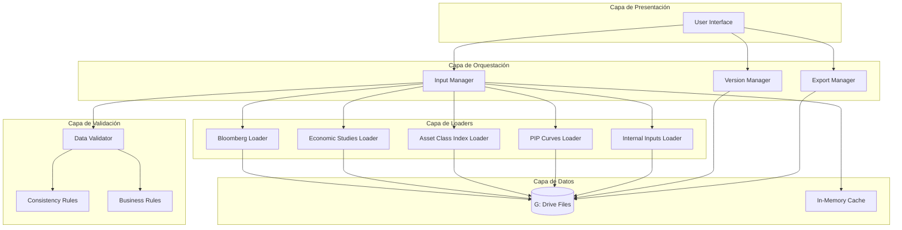

# Design Document: AXIS Portfolio Inputs Integration

## Overview

AXIS (Asset-Liability eXecution & Investment Simulator) Fase 1 es un sistema de integración de datos que consolida inputs externos e internos desde archivos almacenados en la unidad G: para alimentar el modelo de proyecciones de portafolio de la Gerencia Financiera del sector asegurador colombiano.

### Purpose

El propósito de este sistema es automatizar la carga, validación y consolidación de datos de múltiples fuentes heterogéneas (Bloomberg, Estudios Económicos, Índices Asset Class, Curvas PIP, y seis tipos de inputs internos) para generar proyecciones precisas del portafolio bajo diferentes vistas analíticas (ramo, compañía, asset class, clasificación contable, solvencia, régimen de inversiones).

### Scope

Esta Fase 1 se enfoca exclusivamente en la integración de inputs al modelo de proyecciones. El alcance incluye:

- **Lectura de archivos**: Procesamiento de archivos Excel/CSV desde la unidad G: (no APIs ni bases de datos)
- **Validación de datos**: Verificación de integridad, consistencia y calidad de inputs
- **Consolidación**: Agregación de datos según vistas analíticas
- **Versionado**: Persistencia y auditoría de configuraciones de inputs
- **Exportación/Importación**: Intercambio de datos en formatos estándar

**Fuera de alcance en Fase 1**:
- Motor de proyecciones financieras
- Visualizaciones avanzadas y dashboards
- Integración con sistemas transaccionales
- APIs REST o servicios web

### Key Design Decisions

1. **Arquitectura basada en archivos**: Se utiliza la unidad G: como fuente única de datos, evitando dependencias de bases de datos o APIs externas. Esto simplifica el despliegue y permite trabajar con infraestructura existente.

2. **Patrón Loader-Validator-Manager**: Cada fuente de datos tiene un Loader especializado que conoce su formato específico, un Data_Validator centralizado que aplica reglas de negocio, y un Input_Manager que orquesta el flujo completo.

3. **Vistas analíticas como primera clase**: El sistema modela explícitamente las seis vistas de portafolio (ramo, compañía, asset class, clasificación contable, solvencia, régimen de inversiones) como dimensiones de agregación, permitiendo análisis multidimensional.

4. **Versionado basado en carpetas**: Se utiliza un esquema de carpetas con timestamps en la unidad G: para versionar inputs, evitando dependencias de sistemas de control de versiones externos.

5. **Validación en dos niveles**: Validación estructural (formato, tipos de datos) en los Loaders y validación semántica (reglas de negocio, consistencia) en el Data_Validator.

6. **Tolerancia a fallos**: El sistema implementa reintentos automáticos para errores de red, guardado automático de progreso, y permite ejecución parcial con advertencias.

## Architecture

### High-Level Architecture

El sistema sigue una arquitectura de capas con separación clara de responsabilidades:



### Component Interaction Flow

```mermaid
sequenceDiagram
    participant User
    participant UI
    participant InputManager
    participant Loader
    participant DataValidator
    participant GDrive
    participant Cache
    
    User->>UI: Solicita cargar inputs
    UI->>InputManager: load_inputs(source_type, file_path)
    InputManager->>Loader: read_file(file_path)
    Loader->>GDrive: Accede archivo en G:
    GDrive-->>Loader: Datos crudos
    Loader->>Loader: Parse formato (Excel/CSV)
    Loader-->>InputManager: Datos estructurados
    InputManager->>DataValidator: validate(data, rules)
    DataValidator->>DataValidator: Validación estructural
    DataValidator->>DataValidator: Validación semántica
    DataValidator-->>InputManager: Resultado validación
    alt Validación exitosa
        InputManager->>Cache: Almacena datos
        InputManager-->>UI: Success
        UI-->>User: Datos cargados
    else Errores críticos
        InputManager-->>UI: Error report
        UI-->>User: Muestra errores
    else Advertencias
        InputManager-->>UI: Warning report
        UI->>User: Solicita confirmación
        User->>UI: Confirma continuar
        InputManager->>Cache: Almacena datos
        InputManager-->>UI: Success with warnings
    end
