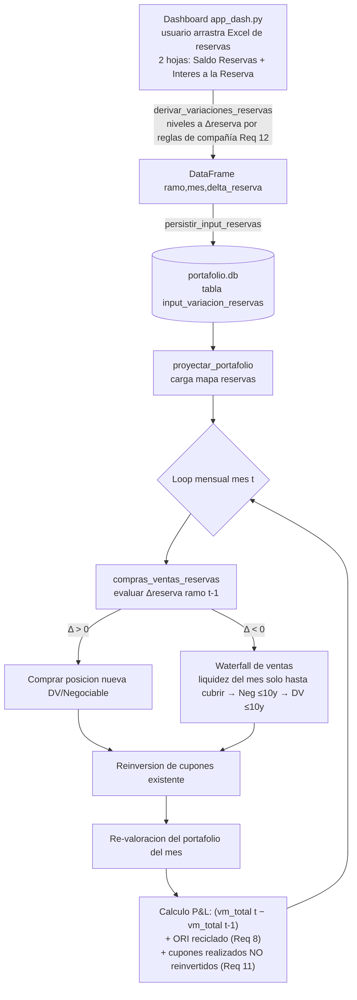

# Design Document

## Overview

Esta funcionalidad integra en el motor de proyección de renta fija
(`scripts/motor_proyeccion.py`) la ejecución automática de compras y ventas de
títulos de RF dirigidas por la variación mensual de la reserva técnica de cada
ramo. El input de reservas es un **archivo Excel de dos hojas** (`Saldo Reservas` e
`Interés a la Reserva`) con **niveles mensuales** (Enero..Diciembre), NO una
variación pre-calculada. Al cargarlo en el dashboard (`app_dash.py`), el sistema
**deriva** la variación mensual de reserva por ramo (mes contra mes, aplicando las
reglas por compañía del Requirement 12) y **persiste la variación derivada** en la
tabla SQLite `input_variacion_reservas`. La forma persistida `(ramo, mes,
delta_reserva)` **no cambia**: la derivación ocurre en el momento de carga/persistencia
y el motor sigue consumiendo la misma Δreserva derivada aguas abajo. En cada mes de la
proyección,
por ramo, el motor evalúa la variación de reserva del mes anterior (convención de
**mes caído**) y decide:

- **Comprar** un título nuevo (posición nueva) si la reserva aumentó.
- **Vender** títulos en cascada (waterfall) si la reserva disminuyó, reciclando el
  ORI de los DV al P&L realizado.

El diseño respeta las convenciones del proyecto (SQLite `portafolio.db`, pandas,
arquitectura basada en scripts, capa `comun/`) y **no introduce frameworks nuevos**.
La lógica se acopla al loop mensual existente de `proyectar_portafolio()`, en un
punto anterior a la reinversión de cupones, y reutiliza `valorar_titulo()` para
valorar tanto las compras como los títulos que se venden.

### Objetivos de diseño

1. Aislar la nueva lógica en un módulo dedicado (`scripts/compras_ventas_reservas.py`)
   con funciones puras y testeables, evitando inflar el loop del motor.
2. Integrarse mediante un único punto de enganche dentro del loop mensual, sin
   romper el comportamiento actual cuando no hay input de reservas.
3. Mantener el P&L todo a mercado (consistente con el resto del motor) y sumar el
   ORI reciclado de ventas DV al P&L realizado.
4. Procesar cada ramo de forma independiente.

### Decisiones clave y su justificación

- **Módulo separado, no lógica embebida**: el loop de `proyectar_portafolio()` ya
  es extenso (~800 líneas). La lógica de compras/ventas se implementa como funciones
  puras en un módulo aparte que recibe el `portafolio_activo`, el mapa de variaciones
  de reserva y el contexto del mes (fecha, sendas, UVR/TRM). Esto favorece la
  testabilidad (property-based testing sobre funciones puras) y sigue el patrón de
  `reinvertir_cupon()` (funciones auxiliares fuera del loop).
- **Evaluación al inicio del mes (mes caído)**: se evalúa `Δreserva(ramo, t-1)` al
  comenzar a procesar el mes `t`, **antes** de la reinversión de cupones. El
  requirement justifica esta convención (menos reproceso que revertir reinversiones
  al cierre).
- **Universo de compra desde `hist_pip`**: los títulos comprables (TES UVR / TUVT y
  TF) se seleccionan desde `hist_pip` a la `fecha_pip` de corte, que ya contiene
  `nemo`, `codigo_isin`, `fecha_vencimiento`, `cupon`, `rendimiento`,
  `frecuencia_pago_cupon`, `moneda`. Es la misma fuente que usa el motor para
  enriquecer rendimientos.
- **ORI aproximado como `valor_mercado − valor_tir`**: coherente con el Glosario del
  requirements y con el uso de `valor_tir`/`valor_mercado` que ya lleva cada `Titulo`.
- **Clasificación de ramos configurable y gestionada desde el dashboard (no
  hardcodeada, sin dependencia de `init_db.py`)**: la clasificación de cada ramo
  (si es de reserva matemática y, en su caso, con qué instrumento compra) se almacena
  en una tabla de configuración (`config_ramos_reserva`), siguiendo el patrón de
  parámetros/mapeos del proyecto. Decisiones asociadas:
  - **La tabla NO pertenece a `init_db.py`.** `init_db.py` es un *bootstrap*
    destructivo de un solo uso (ejecuta `DB_PATH.unlink()` y recrea todo desde cero)
    que corre una única vez al pasar a producción; no se re-ejecuta para agregar un
    ramo. Por eso la tabla se crea de forma **idempotente** (`CREATE TABLE IF NOT
    EXISTS`) desde la **capa de aplicación**, mediante un helper
    (`asegurar_tabla_config_ramos(conn)`) invocado perezosamente por el dashboard (al
    abrir la pestaña *Ajustes*) y por el motor la primera vez que lee la tabla. La
    tabla se autocrea en el primer uso y **persiste entre corridas**; nunca se elimina
    ni se reinicializa.
  - **Sin conjunto por defecto hardcodeado; siembra inicial por DATO (Opción A).** El
    motor y el dashboard NO llevan un conjunto histórico por defecto en código
    (`CONFIG_RAMOS_RESERVA_DEFECTO` fue eliminado): un *fallback* hardcodeado en el
    flujo contradice el objetivo de que la clasificación no esté en código. La
    clasificación inicial se realiza como **carga de datos de un solo uso** mediante el
    script `tools/sembrar_clasificacion_ramos.py`, que escribe cada ramo con el mismo
    mecanismo del dashboard (`persistir_clasificacion_ramo`: normalización + validación
    + UPSERT parametrizado). Así el estado inicial vive como DATO en la tabla, no como
    lógica en el motor. El script es idempotente y conservador (no pisa ediciones
    posteriores salvo `--forzar`).
  - **Un ramo sin fila = "sin clasificar".** La ausencia de fila para un ramo no se
    interpreta como "no es reserva matemática"; significa que el ramo **aún no ha sido
    clasificado**. El motor **requiere** clasificación antes de operar un ramo: para un
    ramo sin clasificar con variación de reserva ≠ 0, el motor **omite** la
    compra/venta de ese ramo ese mes y emite una advertencia de que hay ramos
    pendientes por clasificar en la pestaña *Ajustes* (no asume "no matemática" ni
    aborta la corrida).
  - **Clasificación por dato, no por literales.** La tabla captura, por ramo, si es
    reserva matemática y el instrumento (TES UVR / TF), de modo que el caso especial de
    Vida Individual-Matemática (que compra TF) se distinga por dato y no por un
    `if ramo == "VIDA ..."`.
- **Parámetros de plazo configurables (nodo de compra y plazo máximo de venta), mismo
  patrón que `config_ramos_reserva` (Req 13)**: los dos números de plazo que hoy están
  fijos en el código —el nodo objetivo de compra para ramos que no son de reserva
  matemática (hoy literal `5` años) y el plazo máximo elegible para vender en el waterfall
  (hoy literal `10` años)— se externalizan a una tabla de configuración
  (`config_parametros_reservas`) editable desde el dashboard. Decisiones asociadas:
  - **Misma arquitectura que `config_ramos_reserva`.** La tabla se crea de forma
    **idempotente** (`CREATE TABLE IF NOT EXISTS`) desde la **capa de aplicación** con un
    helper `asegurar_tabla_parametros_reservas(conn)`, **NO** desde `init_db.py` (bootstrap
    destructivo de un solo uso). La invocan perezosamente el dashboard (al abrir el panel
    avanzado de *Ajustes*) y el motor (antes de leer). Persiste entre corridas.
  - **Arranca con los valores por defecto (5 y 10).** A diferencia de
    `config_ramos_reserva` (que arranca vacía), cuando falta un parámetro se aplica su
    valor por defecto, de modo que **sin intervención del usuario el comportamiento es
    idéntico al de los literales fijos actuales** (Req 13.2). Los defaults son
    `nodo_compra_no_matematica_anios = 5` y `plazo_max_venta_anios = 10`.
  - **Lectura única por corrida.** El motor lee los parámetros una sola vez al inicio de
    cada corrida con `cargar_parametros_reservas(ruta_db) -> ParametrosReservas` (dataclass
    con los dos campos) y los propaga a las funciones de selección/venta; no se releen por
    mes ni se hardcodean literales.
  - **Valores tratados como no confiables.** Cada valor almacenado se valida (numérico y
    **positivo**); un valor faltante, no numérico o no positivo cae al **valor por
    defecto** correspondiente **sin abortar** la corrida (Req 13.6).
  - **Ubicación en UI avanzada/oculta.** Los controles de edición viven en una sección
    **avanzada u oculta por defecto** (panel colapsable dentro de la pestaña *Ajustes*), no
    en la vista principal de uso diario (Req 13.5).

## Architecture

### Ubicación en el flujo



**Nota sobre el P&L del mes.** Hoy el motor calcula el P&L de cada mes como un
delta de saldos: `pnl_mercado_mes = vm_total(t) − vm_total(t-1)` y
`pnl_tir_mes = vtir_total(t) − vtir_total(t-1)` (bloque "── 4. Calcular P&L ──" del
loop). El ingreso por cupón **ya se reconoce** en ese delta de forma indirecta vía
reinversión: `detectar_cupones()` halla el cupón y por cada uno se crea un `Titulo`
nuevo con `es_reinversion=True` y `valor_mercado = monto_total`, que se agrega a
`portafolio_activo`; como el VM de ese título entra en `vm_total(t)`, el cupón queda
capturado (el bono original baja su VM al pagar el cupón y el título de reinversión
recoge ese monto). El diseño de Req 11 **no introduce** un cálculo nuevo de cupones:
preserva ese reconocimiento para el caso en que el flujo se **desvía al waterfall** en
lugar de reinvertirse (ver "Corrección por cupón realizado no reinvertido").

### Punto de integración en el loop mensual

Dentro de `proyectar_portafolio()`, al comienzo de la iteración del mes `t` (después
de detectar cupones/vencimientos y **antes** del bloque "── 2. Reinvertir cada cupón ──"),
se inserta una llamada a la nueva función de orquestación por ramo:

```python
# ── 1C. Compras/Ventas por variación de reserva (mes caído: usa t-1) ──
if mapa_reservas:  # solo si hay input; si no, comportamiento actual intacto
    resultado_cvr = aplicar_compras_ventas_reservas(
        portafolio_activo=portafolio_activo,
        mapa_reservas=mapa_reservas,
        mes=mes,
        fecha_mes=fecha_mes,
        universo_compra=universo_compra,   # precargado de hist_pip
        sendas=sendas,
        valor_uvr=_senda_uvr[mes],
        trm=_senda_trm[mes],
        serie_ipc=serie_ipc,
        config_ramos=config_ramos,          # cargado una vez con cargar_ramos_reserva_matematica
        parametros=parametros,              # cargado una vez con cargar_parametros_reservas (nodo/plazo configurables, Req 13)
    )
    portafolio_activo = resultado_cvr.portafolio        # con compras añadidas y ventas retiradas
    liquidez_bloqueada = resultado_cvr.liquidez_consumida  # flujos usados en waterfall
    ori_reciclado_mes += resultado_cvr.ori_reciclado    # se suma al P&L realizado
    # Cupones detectados que NO se reinvirtieron por consumirse en el waterfall.
    # Se suman explícitamente al P&L (mercado y TIR) para no "perder" el flujo,
    # ya que no existe título de reinversión que lo represente (Req 11).
    cupones_no_reinvertidos_mes += sum(resultado_cvr.cupones_no_reinvertidos.values())
```

La `liquidez_bloqueada` por ramo se descuenta de los flujos disponibles para la
reinversión de cupones de ese ramo/mes (Requirement 10.2), y el `ori_reciclado_mes`
se acumula para el cálculo de P&L realizado del mes.

**Corrección por cupón realizado no reinvertido (Req 11).** Cuando el waterfall consume
la liquidez del mes de un ramo (paso `MONTHLY_LIQUIDITY`), parte de esa liquidez son
pagos de cupón de RF que, al desviarse a cubrir la disminución de reserva, **no** generan
título de reinversión. El bono original igualmente baja su VM al pagar el cupón, y como
el motor **no modela una cuenta de caja**, ese monto desaparecería silenciosamente de
`vm_total(t)` y subestimaría el P&L. Para preservar el reconocimiento existente del
cupón (invariante de no-pérdida), `aplicar_compras_ventas_reservas` calcula, por ramo, el
monto de cupón detectado en el mes que fue **desviado al waterfall y no reinvertido** y lo
expone en `ResultadoCompraVenta.cupones_no_reinvertidos`. El motor acumula ese monto en
`cupones_no_reinvertidos_mes` y lo suma como partida explícita en el cálculo de P&L del
mes, **tanto a mercado como a TIR** (Req 11.4):

```text
cupones_realizados_no_reinvertidos(t) = cupones_detectados(t) − cupones_reinvertidos(t)

pnl_mercado_mes = (vm_total(t)   − vm_total(t-1))   + ori_reciclado_mes
                                                    + cupones_realizados_no_reinvertidos(t)

pnl_tir_mes     = (vtir_total(t) − vtir_total(t-1))                       # ORI ya es vm−vtir
                                                    + cupones_realizados_no_reinvertidos(t)
```

**No doble conteo (Req 11.3).** Solo se suma la porción **no reinvertida**. Los cupones
que sí se reinvierten ya entran al P&L a través del `valor_mercado` del título de
reinversión incluido en `vm_total(t)`; sumarlos aquí los contaría dos veces. Por eso la
corrección usa `cupones_detectados − cupones_reinvertidos` y reutiliza los datos que el
motor ya lleva (`cupones_por_titulo_mes` / `cupones_cobrados_mes` y `n_reinversiones_mes`)
junto con la `liquidez_consumida` por ramo del waterfall, sin inventar un mecanismo de
seguimiento paralelo. La corrección de cupón (Req 11) y el ORI reciclado (Req 8) son
**dos términos aditivos distintos** del P&L del mes.

Antes del loop mensual, junto con `mapa_reservas` y `universo_compra`, el motor carga
una sola vez la configuración de ramos de reserva:
`config_ramos = cargar_ramos_reserva_matematica(ruta_db)`. Esta carga primero **asegura
el esquema de forma idempotente** (`asegurar_tabla_config_ramos(conn)` con `CREATE TABLE
IF NOT EXISTS`, sin dependencia de `init_db.py`) y luego lee la clasificación existente.
La estructura resultante clasifica cada ramo presente en la tabla (reserva matemática o
no) y su instrumento de compra por dato. Como la tabla arranca vacía y no hay conjunto
por defecto, un ramo que no tenga fila queda **sin clasificar**.

También una sola vez antes del loop, el motor carga los **parámetros de plazo
configurables** con `parametros = cargar_parametros_reservas(ruta_db)` (Req 13). Esta carga
asegura el esquema idempotentemente (`asegurar_tabla_parametros_reservas(conn)`, sin
dependencia de `init_db.py`) y devuelve un `ParametrosReservas` con
`nodo_compra_no_matematica_anios` y `plazo_max_venta_anios`; ante valor ausente, no
numérico o no positivo aplica el **valor por defecto** (5 y 10 respectivamente) sin abortar.
Estos valores se propagan a la selección de compra (nodo objetivo para ramos no
matemáticos) y a la elegibilidad por plazo en la venta (plazo máximo del waterfall), en
lugar de literales `5`/`10` en el código.

Durante el loop, para un ramo con variación de reserva ≠ 0 que esté **sin clasificar**,
el motor **omite** las operaciones de compra/venta por reserva de ese ramo ese mes y
registra/emite una advertencia de clasificación pendiente (indicando revisar la pestaña
*Ajustes* del dashboard). Solo los ramos **clasificados** operan: `es_reserva_matematica
= true` ⇒ DV + instrumento de mayor plazo según su configuración (TES UVR de mayor plazo
o TF de mayor plazo); `es_reserva_matematica = false` ⇒ Negociable + TES UVR nodo 5 años.

### Módulos afectados

| Módulo | Cambio |
|--------|--------|
| `scripts/compras_ventas_reservas.py` (**nuevo**) | Lógica pura de decisión, selección de títulos, waterfall, cálculo de ORI reciclado. |
| `scripts/motor_proyeccion.py` | Punto de integración en el loop; carga del mapa de reservas, del universo de compra, de la clasificación de ramos (`cargar_ramos_reserva_matematica`, que asegura el esquema idempotentemente al leer) y de los **parámetros de plazo configurables** (`cargar_parametros_reservas`, que asegura el esquema idempotentemente y aplica defaults 5/10 ante valores ausentes/inválidos, Req 13) al inicio de la corrida; **omite** los ramos sin clasificar (variación ≠ 0 sin fila en `config_ramos_reserva`) emitiendo advertencia de clasificación pendiente; ajuste de reinversión para respetar liquidez bloqueada; suma de ORI reciclado al P&L; **suma de la corrección por cupón realizado no reinvertido (`cupones_no_reinvertidos`) al `pnl_mercado_mes` y al `pnl_tir_mes`** en el bloque "── 4. Calcular P&L ──" (invariante de no-pérdida, Req 11). |
| `init_db.py` | `CREATE TABLE IF NOT EXISTS input_variacion_reservas`. **NO** gestiona `config_ramos_reserva` ni `config_parametros_reservas` (bootstrap destructivo de un solo uso; ambas tablas de configuración se crean desde la capa de aplicación, no aquí). |
| `app_dash.py` | Callback de carga del **Excel de reservas** (upload del workbook de dos hojas): lee ambas hojas, **deriva** la variación mensual por ramo con `derivar_variaciones_reservas(...)` (reglas por compañía del Req 12) usando el conjunto de ramos presentes en `portafolio_clasificado`, y persiste la variación derivada con `persistir_input_reservas` + lectura con reintento. **Nueva pestaña *Ajustes*** que crea la tabla `config_ramos_reserva` de forma idempotente (`asegurar_tabla_config_ramos`), calcula y muestra los ramos **pendientes por clasificar** (ramos del portafolio y grupos derivados —`DEMÁS RAMOS BOLÍVAR`, `DEMÁS RAMOS COMERCIALES`, `CAPITALIZADORA`— sin fila en la tabla), y persiste la clasificación del usuario (`clasificar_ramo`/`persistir_clasificacion_ramo`) con query parametrizada. **Panel avanzado/colapsable** (oculto por defecto, fuera de la vista principal) con dos inputs para los parámetros de plazo configurables (`nodo_compra_no_matematica_anios`, `plazo_max_venta_anios`), que asegura `config_parametros_reservas` idempotentemente (`asegurar_tabla_parametros_reservas`) y persiste con `persistir_parametros_reservas(...)` (validación numérica/positiva + reintento ante `database is locked`, error genérico al UI ante fallo) (Req 13). |
| `comun/db.py` | Se reutiliza `get_conn()` para el acceso a `portafolio.db` desde el dashboard (persistencia de reservas, aseguramiento de esquema y persistencia/lectura de la clasificación). |

## Components and Interfaces

### 1. Carga del Excel, derivación de la variación y persistencia (dashboard → DB)

El callback del `dcc.Upload` recibe ahora el **workbook Excel de dos hojas** (`Saldo
Reservas` e `Interés a la Reserva`). El flujo es: (a) **derivar** la variación mensual
por ramo desde los niveles de ambas hojas con `derivar_variaciones_reservas(...)`
aplicando las reglas por compañía del Requirement 12, y (b) **persistir** el DataFrame
resultante `(ramo, mes, delta_reserva)` con `persistir_input_reservas(...)`. La forma de
la tabla `input_variacion_reservas` **no cambia**: lo que se persiste es la variación ya
derivada, de modo que `cargar_mapa_reservas` y toda la lógica aguas abajo del motor
permanecen intactas (el motor sigue consumiendo la Δreserva derivada).

El workbook se trata como **entrada no confiable**: se validan los nombres de las hojas,
se normalizan las etiquetas de ramo, se coercionan los valores a numérico y se ignoran
las filas TOTAL (salvo `TOTAL CAPI`, que se usa para el agregado Capitalizadora).

```python
def derivar_variaciones_reservas(
    ruta_excel_o_bytes: str | bytes,
    ramos_portafolio: set[str],
) -> pd.DataFrame:
    """
    Lee el Excel de reservas (hojas 'Saldo Reservas' e 'Interés a la Reserva'),
    deriva la variación mensual por ramo mes contra mes según las reglas por compañía
    del Requirement 12 y devuelve un DataFrame con columnas EXACTAS
    {ramo, mes, delta_reserva} listo para persistir_input_reservas.

    Entrada NO confiable (allowlist / normalización):
      - Valida que existan las hojas 'Saldo Reservas' e 'Interés a la Reserva'
        (nombres esperados); ante hojas faltantes lanza ErrorInputReservas.
      - Cada hoja tiene una columna-etiqueta inicial precedida de una columna en blanco;
        el ramo es la etiqueta y las 12 columnas de mes son Enero..Diciembre.
      - Normaliza etiquetas de ramo (strip/upper) y coerciona valores a numérico
        (pd.to_numeric(errors='coerce') → NaN tratado como 0.0, Req 1.4 / 12).
      - Ignora las filas TOTAL de bloque (TOTAL BOLIVAR, TOTAL COMERCIALES,
        TOTAL COMPAÑIAS) y las cabeceras de bloque; usa TOTAL CAPI SOLO para el
        agregado Capitalizadora.

    Derivación (mes t vs mes t-1), por compañía (Req 12.3-12.6):
      - Comerciales:   variación(t) = saldo(t) − saldo(t-1)                 (sin interés)
      - Bolívar:       variación(t) = (saldo(t) − saldo(t-1))
                                      − (interés(t) − interés(t-1))
                       Bolívar sin línea de interés ⇒ interés = 0 ⇒ Δsaldo.
      - Capitalizadora (ramo único 'CAPITALIZADORA', ignorando sus ramos individuales):
                       variación(t) = (TOTAL_CAPI(t) − TOTAL_CAPI(t-1))
                                      − (interés_capi(t) − interés_capi(t-1))

    Agrupación 'demás ramos' (Req 12.7, 12.8), usando ramos_portafolio (normalizados).
    ramos_portafolio es el conjunto de ramos del PORTAFOLIO INICIAL de la corrida
    (portafolio_clasificado, el punto de partida antes de proyectar el primer mes), NO el
    estado al final del horizonte ni de un mes intermedio proyectado:
      - Ramo de Bolívar/Comerciales PRESENTE en ramos_portafolio ⇒ ramo individual con
        su propia variación derivada.
      - Ramos de Bolívar/Comerciales NO presentes ⇒ se SUMAN por compañía en
        'DEMÁS RAMOS BOLÍVAR' y 'DEMÁS RAMOS COMERCIALES'.

    El resultado incluye, como filas (ramo, mes, delta_reserva): cada ramo individual del
    portafolio, los agregados 'DEMÁS RAMOS BOLÍVAR'/'DEMÁS RAMOS COMERCIALES' y el
    agregado 'CAPITALIZADORA' (Req 12.9, 12.10).
    """


def persistir_input_reservas(df: pd.DataFrame, *, reintentos: int = 3) -> None:
    """
    Valida y persiste la variación DERIVADA de reservas en input_variacion_reservas.
    Recibe el DataFrame producido por derivar_variaciones_reservas (la derivación ya
    ocurrió); esta función NO cambia de forma respecto al diseño previo.

    Validaciones (allowlist de columnas, tipos, rangos):
      - columnas requeridas: {ramo, mes, delta_reserva}; se rechazan claves extra.
      - ramo: str no vacío, normalizado (strip/upper).
      - mes: fecha 'YYYY-MM' o entero de offset; validado y normalizado.
      - delta_reserva: float finito (permite negativos y positivos).
    Sigue el patrón de senda_tasa_repo (df.to_sql(..., if_exists='replace')) con queries
    parametrizadas. Reintenta la escritura ante 'database is locked' (backoff simple).
    Lanza ErrorPersistenciaReservas si agota reintentos (el callback notifica al UI).
    """
```

**Dependencia con el portafolio (`ramos_portafolio`).** La agrupación "demás ramos"
y el universo de clasificación dependen de qué ramos están presentes en el **portafolio
inicial de la corrida** (no el estado al final del horizonte ni de un mes intermedio). El
conjunto `ramos_portafolio` se obtiene de los ramos DISTINTOS de `portafolio_clasificado`
—el **punto de partida** de la proyección, antes de proyectar el primer mes—, normalizados
(`strip`/`upper`). Es la **misma** fuente que alimenta la proyección y la pestaña
*Ajustes*, y NO se recalcula a partir del portafolio proyectado de un mes `t` ni del estado
final: un ramo que aparezca o desaparezca durante la proyección (por compras/ventas) **no**
altera la partición individual vs. "demás ramos", que queda fijada por el portafolio
inicial (Req 12.7). Como la derivación ocurre en el momento de la carga, si el portafolio
**inicial** cambia entre corridas (nuevos ramos presentes o ramos que dejan de estar en el
punto de partida) puede ser necesario **re-derivar** volviendo a cargar el Excel para que
la partición refleje el portafolio inicial vigente. La tabla persistida
`input_variacion_reservas` conserva la última derivación cargada.

### 2. Carga del mapa de reservas (motor)

```python
def cargar_mapa_reservas(
    ruta_db: str,
    fecha_inicio: date,
    meses_horizonte: int,
) -> dict[str, dict[int, float]]:
    """
    Lee input_variacion_reservas y devuelve {ramo: {mes_offset: delta_reserva}}.
    mes_offset es el número de mes relativo a fecha_inicio (t-1, t, ...).
    Ramos/meses sin registro NO se incluyen → el consumidor asume Δ=0 (Req 1.4, 10.3).
    Devuelve {} si la tabla no existe o está vacía (comportamiento motor actual).
    """
```

### 3. Orquestación por mes (motor → módulo nuevo)

```python
@dataclass
class ResultadoCompraVenta:
    portafolio: list[Titulo]        # portafolio actualizado (compras +, ventas -)
    liquidez_consumida: dict[str, float]  # por ramo: flujo del mes bloqueado por waterfall
    ori_reciclado: float            # ORI de DV vendidos, a sumar al P&L realizado
    # Por ramo: monto de cupón de RF detectado en el mes que se DESVIÓ al waterfall y
    # NO se reinvirtió (cupón detectado − cupón reinvertido del ramo). El motor lo suma
    # como partida explícita al P&L a mercado y a TIR para preservar el reconocimiento
    # del cupón sin doble conteo (invariante de no-pérdida, Req 11.2, 11.3, 11.4).
    cupones_no_reinvertidos: dict[str, float]
    compras: list[Titulo]
    ventas: list[Titulo]

def aplicar_compras_ventas_reservas(
    portafolio_activo: list[Titulo],
    mapa_reservas: dict[str, dict[int, float]],
    mes: int,
    fecha_mes: date,
    universo_compra: "UniversoCompra",
    sendas: dict,
    valor_uvr: float,
    trm: float,
    serie_ipc: pd.DataFrame | None,
    config_ramos: "ConfigRamosReserva",
    parametros: "ParametrosReservas",
) -> ResultadoCompraVenta:
    """
    Para cada ramo con Δreserva(t-1) != 0, de forma independiente (Req 9):
      - Si el ramo NO está clasificado (sin fila en config_ramos_reserva) → OMITE la
        compra/venta de ese ramo ese mes y registra advertencia de clasificación
        pendiente (revisar pestaña Ajustes). No se asume "no matemática" ni se aborta.
      - Si el ramo está clasificado:
          * Δ > 0 → comprar_por_reserva(..., config_ramos=config_ramos, parametros=parametros)  (Req 3, 4)
          * Δ < 0 → vender_por_reserva(..., parametros=parametros)   (Req 5, 6, 7, 8)
    parametros (ParametrosReservas) transporta el nodo de compra no matemática y el plazo
    máximo de venta configurables (Req 13); se carga una sola vez por corrida con
    cargar_parametros_reservas(ruta_db) y se propaga a la selección de compra y a la
    elegibilidad por plazo en la venta en lugar de literales 5/10.
    Δ = 0 o ausente → no-op para ese ramo (Req 2.5, 10.3).
    config_ramos se carga una sola vez por corrida con
    cargar_ramos_reserva_matematica(ruta_db), que asegura el esquema idempotentemente y
    construye la clasificación SOLO a partir de las filas de la tabla (sin default
    hardcodeado). El resultado expone también los ramos omitidos por clasificación
    pendiente para que el motor pueda emitir la advertencia agregada.
    """
```

### 4. Lógica de compra

#### Clasificación de ramos (cargada desde la tabla, no hardcodeada, sin default)

La clasificación de cada ramo — si es de reserva matemática y con qué instrumento
compra — se carga desde la tabla `config_ramos_reserva` al inicio de la corrida. No
hay conjunto por defecto ni semilla: la tabla arranca **vacía** y se puebla desde el
dashboard. Agregar/actualizar un ramo es un cambio de **dato**, no de código. Un ramo
que no tenga fila queda **sin clasificar** (no equivale a "no matemática").

```python
from enum import Enum

class InstrumentoCompra(Enum):
    TES_UVR = "TES_UVR"   # TUVT
    TF      = "TF"        # Tasa Fija (caso especial: Vida Individual-Matemática)

@dataclass(frozen=True)
class ConfigRamosReserva:
    """
    Clasificación de ramos cargada desde config_ramos_reserva (poblada por el
    dashboard). Se construye únicamente a partir de las filas de la tabla; no hay
    conjunto por defecto hardcodeado.

    - es_reserva_matematica_por_ramo: {ramo_normalizado: bool} para cada ramo con fila
      en la tabla. Un ramo AUSENTE de este mapa está "sin clasificar".
    - instrumento_por_ramo: {ramo_normalizado: InstrumentoCompra} solo para ramos con
      es_reserva_matematica == True (el instrumento solo es significativo en ese caso).
    """
    es_reserva_matematica_por_ramo: dict[str, bool]
    instrumento_por_ramo: dict[str, InstrumentoCompra]

    def esta_clasificado(self, ramo: str) -> bool:
        """True si el ramo tiene fila en la tabla (fue clasificado por el usuario)."""
        return _normalizar_ramo(ramo) in self.es_reserva_matematica_por_ramo

    def es_reserva_matematica(self, ramo: str) -> bool | None:
        """
        True/False según la clasificación almacenada; None si el ramo está SIN
        clasificar. El motor NO debe tratar None como False: debe omitir el ramo.
        """
        return self.es_reserva_matematica_por_ramo.get(_normalizar_ramo(ramo))

    def instrumento(self, ramo: str) -> InstrumentoCompra:
        # Solo se consulta para ramos de reserva matemática ya clasificados.
        return self.instrumento_por_ramo.get(_normalizar_ramo(ramo), InstrumentoCompra.TES_UVR)


def asegurar_tabla_config_ramos(conn) -> None:
    """
    Crea config_ramos_reserva de forma IDEMPOTENTE (`CREATE TABLE IF NOT EXISTS`) desde
    la capa de aplicación. La invocan perezosamente el dashboard (al abrir Ajustes) y
    el motor (antes de leer la tabla). NO la crea init_db.py. Nunca elimina ni siembra
    datos: la tabla persiste entre corridas y arranca vacía.
    """

def cargar_ramos_reserva_matematica(ruta_db: str) -> ConfigRamosReserva:
    """
    Asegura el esquema (asegurar_tabla_config_ramos) y lee config_ramos_reserva,
    devolviendo un ConfigRamosReserva construido SOLO con las filas de la tabla.

    Comportamiento:
      - Query parametrizada de solo lectura sobre una allowlist fija de columnas
        (ramo, es_reserva_matematica, instrumento). Nunca se interpola SQL.
      - Cada fila se trata como entrada NO confiable: se normaliza el ramo
        (strip/upper), se interpreta es_reserva_matematica como booleano y, cuando es
        True, se valida el instrumento contra el enum InstrumentoCompra; filas con ramo
        vacío o (siendo reserva matemática) instrumento no reconocido se descartan
        (log de advertencia), sin abortar la corrida.
      - Si la tabla está vacía, el resultado es un ConfigRamosReserva vacío: TODOS los
        ramos quedan "sin clasificar" (NO hay fallback a un conjunto histórico).
    """

def _normalizar_ramo(ramo: str) -> str:
    """Normaliza un ramo para comparación estable: str(ramo).strip().upper()."""
```

#### Parámetros de plazo configurables (nodo de compra y plazo máximo de venta, Req 13)

Los dos números de plazo que hoy están fijos en el código se externalizan a la tabla
`config_parametros_reservas` (mismo patrón idempotente que `config_ramos_reserva`, sin
dependencia de `init_db.py`). El motor los lee **una vez por corrida** en un dataclass
`ParametrosReservas` y los propaga a la selección de compra y a la elegibilidad por plazo
en la venta. A diferencia de la clasificación de ramos, aquí **sí** hay valores por
defecto: un parámetro ausente o inválido cae a su default (5 / 10) sin abortar, de modo que
sin intervención del usuario el comportamiento es idéntico al de los literales actuales.

```python
NODO_COMPRA_NO_MATEMATICA_ANIOS_DEFECTO: float = 5.0
PLAZO_MAX_VENTA_ANIOS_DEFECTO: float = 10.0

@dataclass(frozen=True)
class ParametrosReservas:
    """
    Parámetros de plazo configurables leídos de config_parametros_reservas (Req 13).
      - nodo_compra_no_matematica_anios: nodo objetivo (años) para la compra de ramos que
        NO son de reserva matemática (por defecto 5). Usado por seleccionar_tes_uvr_5y /
        comprar_por_reserva.
      - plazo_max_venta_anios: plazo máximo (años) elegible para vender en el waterfall
        (por defecto 10). Usado por vender_por_reserva / seleccionar_titulo_a_vender y los
        filtros ≤ plazo_max de los pasos NEGOCIABLES/DV.
    Ambos son floats positivos; con los defaults (5 y 10) el comportamiento reproduce
    exactamente el de los literales fijos previos (Req 13.2).
    """
    nodo_compra_no_matematica_anios: float = NODO_COMPRA_NO_MATEMATICA_ANIOS_DEFECTO
    plazo_max_venta_anios: float = PLAZO_MAX_VENTA_ANIOS_DEFECTO


def asegurar_tabla_parametros_reservas(conn) -> None:
    """
    Crea config_parametros_reservas de forma IDEMPOTENTE (`CREATE TABLE IF NOT EXISTS`)
    desde la capa de aplicación. La invocan perezosamente el dashboard (al abrir el panel
    avanzado de Ajustes) y el motor (antes de leer). NO la crea init_db.py. Nunca elimina
    datos: la tabla persiste entre corridas. No siembra filas; la ausencia de una clave se
    resuelve con el valor por defecto en la lectura.
    """

def cargar_parametros_reservas(ruta_db: str) -> ParametrosReservas:
    """
    Asegura el esquema (asegurar_tabla_parametros_reservas) y lee
    config_parametros_reservas, devolviendo un ParametrosReservas. El motor la llama UNA
    sola vez al inicio de la corrida (Req 13.3, 13.4).

    Entrada NO confiable (Req 13.6): cada valor almacenado se valida como numérico y
    ESTRICTAMENTE POSITIVO. Si una clave falta, no es numérica o no es positiva, se aplica
    su valor por defecto (5 para el nodo de compra, 10 para el plazo máximo de venta) SIN
    abortar la corrida. Query parametrizada de solo lectura sobre una allowlist fija de
    claves ({'nodo_compra_no_matematica_anios', 'plazo_max_venta_anios'}); claves
    desconocidas se ignoran (log de advertencia, sin volcar datos sensibles).
    """

def persistir_parametros_reservas(
    nodo_compra_no_matematica_anios: float,
    plazo_max_venta_anios: float,
    *, reintentos: int = 3,
) -> None:
    """
    Persiste (INSERT/UPSERT parametrizado) los dos parámetros en
    config_parametros_reservas tras asegurar el esquema
    (asegurar_tabla_parametros_reservas). Lo invoca el panel avanzado/colapsable de la
    pestaña Ajustes (Req 13.5).

    Validaciones (allowlist de claves, tipos, rangos):
      - allowlist de claves: {nodo_compra_no_matematica_anios, plazo_max_venta_anios};
        se rechazan claves extra.
      - cada valor: numérico finito y ESTRICTAMENTE POSITIVO; en caso contrario se rechaza
        (o se sustituye por el default, según la política del callback) sin persistir un
        valor inválido.
    Reintenta ante `sqlite3.OperationalError: database is locked` con backoff simple; ante
    fallo agotados los reintentos, notifica un error genérico al UI y registra el detalle
    en log estructurado (sin PII).
    """
```

#### Pestaña *Ajustes* del dashboard: pendientes y persistencia

La pestaña *Ajustes* de `app_dash.py` gestiona la clasificación. Muestra **solo** los
ramos del portafolio que **aún no** están clasificados; los ya clasificados no aparecen
(no se re-editan desde esta lista de pendientes).

Además, la pestaña *Ajustes* incluye un **panel avanzado/colapsable, oculto por defecto**
(fuera de la vista principal de uso diario, Req 13.5) con dos inputs numéricos para los
parámetros de plazo configurables: `nodo_compra_no_matematica_anios` (por defecto 5) y
`plazo_max_venta_anios` (por defecto 10). Al abrirlo asegura el esquema
(`asegurar_tabla_parametros_reservas`) y precarga los valores vigentes con
`cargar_parametros_reservas`; al guardar persiste con `persistir_parametros_reservas(...)`
(validación numérica/positiva + reintento ante `database is locked`, error genérico al UI
ante fallo). Los valores editados se aplican en la **siguiente corrida** del motor
(Req 13.4).

```python
def ramos_pendientes_por_clasificar(
    ramos_portafolio: set[str], config_ramos: ConfigRamosReserva,
) -> list[str]:
    """
    Pendientes = ramos DISTINTOS del portafolio proyectado/activo (normalizados)
    MENOS los ramos que ya tienen fila en config_ramos_reserva. Al persistir la
    clasificación de un ramo, este desaparece de la lista.
    """

def persistir_clasificacion_ramo(
    ramo: str, es_reserva_matematica: bool, instrumento: InstrumentoCompra | None,
    *, reintentos: int = 3,
) -> None:
    """
    Persiste (INSERT/UPSERT parametrizado) una fila en config_ramos_reserva tras
    asegurar el esquema (asegurar_tabla_config_ramos). Validaciones:
      - allowlist de columnas (ramo, es_reserva_matematica, instrumento); se rechazan
        claves extra.
      - ramo: normalizado (strip/upper), no vacío.
      - es_reserva_matematica: booleano.
      - instrumento: obligatorio y validado contra InstrumentoCompra SOLO cuando
        es_reserva_matematica es True; NULL en caso contrario.
    Reintenta ante 'database is locked' (backoff simple). Ante fallo agotados los
    reintentos, notifica un error genérico al UI y registra el detalle en log
    estructurado (sin volcar datos sensibles).
    """
```

#### Selección del título a comprar

```python
def comprar_por_reserva(
    ramo: str, monto: float, fecha_mes: date,
    universo_compra: "UniversoCompra", config_ramos: ConfigRamosReserva,
    parametros: "ParametrosReservas", ...,
) -> Titulo:
    """
    Selecciona el título a comprar según la clasificación cargada del ramo (Req 3, 4).
    Solo se invoca para ramos YA CLASIFICADOS: el orquestador omite los ramos sin
    clasificar antes de llegar aquí, de modo que config_ramos.es_reserva_matematica(ramo)
    nunca es None en este punto.

    El nodo objetivo de compra para ramos que NO son de reserva matemática se toma de
    parametros.nodo_compra_no_matematica_anios (configurable, por defecto 5 años, Req 13),
    NO de un literal 5 en el código.

    La clasificación se resuelve por DATO, no por literales hardcodeados:
      - config_ramos.es_reserva_matematica(ramo) → True  ⇒ reserva matemática:
          * clasificación 'Disp. Venta' (DV)
          * instrumento según config_ramos.instrumento(ramo):
              - InstrumentoCompra.TES_UVR → TES UVR (TUVT) de MAYOR plazo al vencimiento.
              - InstrumentoCompra.TF      → TF de MAYOR plazo al vencimiento (caso
                especial, p. ej. Vida Individual-Matemática).
      - config_ramos.es_reserva_matematica(ramo) → False ⇒ demás ramos:
          * TES UVR (TUVT) con plazo cercano al nodo configurable
            parametros.nodo_compra_no_matematica_anios (por defecto 5 años); si no hay un
            plazo exactamente igual al nodo, el de plazo MAYOR más cercano a ese nodo,
            clasificado 'Negociable'.
    Crea una POSICIÓN NUEVA (id único, no aumenta nominal existente), asignada al
    ramo/compañía/portafolio del ramo, con nominal derivado del precio a fecha_mes,
    y valor_mercado == monto == Δreserva positiva (Req 3.3, 3.4, 3.5, 3.6).
    """
```

`aplicar_compras_ventas_reservas` recibe `config_ramos` (cargado una vez por corrida
mediante `cargar_ramos_reserva_matematica`) y, para cada ramo con Δreserva ≠ 0,
comprueba primero `config_ramos.esta_clasificado(ramo)`. Si el ramo **no** está
clasificado, omite sus operaciones de compra/venta ese mes y registra la advertencia de
clasificación pendiente; solo propaga a `comprar_por_reserva`/`vender_por_reserva` los
ramos clasificados. Así, ni la pertenencia a reserva matemática ni la elección de
instrumento dependen de literales en el código.

Selección del universo de compra (precargada una vez por corrida):

```python
@dataclass
class UniversoCompra:
    tes_uvr: pd.DataFrame   # TUVT de hist_pip (nemo LIKE 'TUVT%'), con plazo, rendimiento
    tf: pd.DataFrame        # TF de deuda pública de hist_pip

def cargar_universo_compra(ruta_db: str, fecha_pip: str | None) -> UniversoCompra: ...
def seleccionar_tes_uvr_largo(universo, fecha_mes) -> dict: ...      # mayor plazo
def seleccionar_tes_uvr_5y(universo, fecha_mes, nodo_anios: float) -> dict: ...
    # nodo configurable (por defecto 5y); elige el de plazo MAYOR más cercano al nodo.
    # nodo_anios proviene de ParametrosReservas.nodo_compra_no_matematica_anios (Req 13);
    # el nombre '5y' se conserva por retrocompatibilidad, pero el nodo NO es un literal.
def seleccionar_tf_largo(universo, fecha_mes) -> dict: ...           # mayor plazo TF
```

### 5. Lógica de venta (waterfall)

```python
from enum import Enum
class PasoWaterfall(Enum):
    MONTHLY_LIQUIDITY = 1   # liquidez de RF del mes (vencimientos + amort + cupones)
    NEGOCIABLES = 2         # venta de Negociables RF plazo ≤ plazo_max_venta_anios
    DV = 3                  # venta de DV RF plazo ≤ plazo_max_venta_anios

def vender_por_reserva(
    ramo: str, monto_a_cubrir: float, portafolio_ramo: list[Titulo],
    liquidez_mes_ramo: float, fecha_mes: date, parametros: "ParametrosReservas", ...,
) -> "ResultadoVenta":
    """
    Cubre monto_a_cubrir en el orden estricto (Req 5.1). El plazo máximo elegible de venta
    (plazo_max) se toma de parametros.plazo_max_venta_anios (configurable, por defecto 10
    años, Req 13), NO de un literal 10:
      1. MONTHLY_LIQUIDITY: consume liquidez del mes del ramo hasta cubrir; el paso 1
         SOLO aplica cuando el paso actual es MONTHLY_LIQUIDITY (Req 5.2).
      2. NEGOCIABLES: vende Negociables RF con plazo ≤ plazo_max (Req 5.4).
      3. DV: vende DV RF con plazo ≤ plazo_max (Req 5.6).
    Se detiene apenas la liquidez acumulada cubre monto_a_cubrir (Req 5.7).
    En el paso DV, si el requerido excede lo disponible, vende exactamente lo
    disponible (Req 5.6).

    RETENCIÓN PARCIAL (Req 5.9): en el paso MONTHLY_LIQUIDITY se retiene (no se
    reinvierte) SOLO el monto necesario para cubrir la disminución de reserva, es decir
    liquidez_consumida[ramo] = min(liquidez_mes_ramo, monto_a_cubrir). El excedente de la
    liquidez del mes por encima de ese monto NO se bloquea: queda disponible para la
    reinversión normal. La regla NO es "no reinvertir nada del mes", sino "no reinvertir
    hasta completar la disminución".

    SIN ORDEN DE PRELACIÓN DENTRO DEL PASO 1 (Req 5.10): la liquidez del mes
    (vencimientos + amortizaciones + cupones) se trata como un MONTO AGREGADO a cubrir;
    no se prescribe un orden de consumo entre esos flujos y el monto cubierto es
    independiente del orden. Por tanto la porción de cupón realizado NO reinvertido se
    determina por MONTO/proporción, no por un orden de consumo: es el cupón de RF del
    ramo contenido en la liquidez efectivamente retenida (acotado a
    min(cupon_mes_ramo, liquidez_consumida[ramo])), a partir de cupones_por_titulo_mes /
    la liquidez de cupón del ramo. Ese monto no genera título de reinversión, por lo que
    el motor debe sumarlo explícitamente al P&L (mercado y TIR) para no perderlo
    (invariante de no-pérdida, Req 5.8, 11.2, 11.3).
    """
```

Selección de títulos a vender (Req 6, 7):

```python
def seleccionar_titulo_a_vender(
    candidatos: list[Titulo], monto_pendiente: float, plazo_max_anios: float,
) -> Titulo:
    """
    Elige el título (plazo ≤ plazo_max_anios) cuyo valor_mercado se acerque más al
    pendiente. plazo_max_anios proviene de ParametrosReservas.plazo_max_venta_anios
    (configurable, por defecto 10 años, Req 13), NO de un literal 10.
    """

def ordenar_dv_por_ori(candidatos_dv: list[Titulo], fecha_venta: date) -> list[Titulo]:
    """
    Ordena DV por ORI acumulado (vm − vtir) descendente (Req 7.1): primero mayor
    ganancia y, cuando ninguno tiene ganancia, menor pérdida (el orden descendente
    cubre ambos casos con una sola regla, sin fallback por plazo).
    Excluye del universo de venta DV los títulos con 0 días al vencimiento (Req 7.2).
    """
```

### 6. Reciclaje de ORI al P&L (Req 8)

Al vender un título DV, se calcula `ori = valor_mercado − valor_tir` a `fecha_mes` y
se acumula en `ResultadoCompraVenta.ori_reciclado`, que el motor suma inmediatamente
al P&L realizado del mes. La venta de un Negociable reconoce su cambio a mercado
directamente en el P&L (sin ORI). Vender = retirar el título del portafolio y sumar
su `valor_mercado` a la liquidez generada del ramo (Req 6.4).

### 7. Corrección por cupón realizado no reinvertido (Req 11)

Esta corrección es un término **distinto e independiente** del reciclaje de ORI (Req 8):
el ORI reciclado proviene de vender títulos DV, mientras que esta corrección proviene de
cupones de RF cuyo flujo se consumió en el waterfall (paso `MONTHLY_LIQUIDITY`) en lugar
de reinvertirse.

Por cada ramo con disminución de reserva, el módulo determina el monto de cupón de RF del
mes que fue **desviado al waterfall y no reinvertido** y lo acumula en
`ResultadoCompraVenta.cupones_no_reinvertidos[ramo]`. El cálculo reutiliza datos ya
existentes en el motor:

```text
cupones_no_reinvertidos(ramo) = cupones_detectados(ramo, mes) − cupones_reinvertidos(ramo, mes)
```

donde `cupones_detectados` proviene de `detectar_cupones()` / `cupones_por_titulo_mes` y
`cupones_reinvertidos` son los cupones que sí generaron un `Titulo` con
`es_reinversion=True` ese mes para el ramo. El motor suma el total de
`cupones_no_reinvertidos` al P&L del mes **tanto a mercado como a TIR** (Req 11.4). Como
solo se suma la porción no reinvertida, los cupones reinvertidos —que ya entran al P&L a
través del VM de su título de reinversión— **no se cuentan dos veces** (Req 11.3). Cuando
no hay disminución de reserva (todo se reinvierte con normalidad), esta corrección es cero
y el P&L es idéntico al del motor actual (Req 11.1, 11.5).

## Data Models

### Excel de reservas (fuente / input crudo, NO persistido tal cual)

El input que carga el usuario es el archivo `Inputs_Reservas e interes a la
reserva.xlsx` (en la raíz del repo como ejemplo). Es la **fuente** de niveles a partir
de la cual se **deriva** la variación; es distinto de la tabla persistida
`input_variacion_reservas` (que guarda la variación ya derivada). Contiene **dos hojas**:

**Hoja `Saldo Reservas`** — niveles de saldo mensuales, organizada en bloques por
compañía. Hay una columna en blanco inicial; la columna-etiqueta contiene el nombre del
ramo y las 12 columnas siguientes son los meses `Enero..Diciembre`:

```text
(col blanco) | BOLIVAR            | Enero | Febrero | ... | Diciembre   ← cabecera bloque Bolívar
             | RIESGOS PROFESIONALES-MATEMATICA | ...                   ← ramos (filas)
             | PENSIONES LEY 100                | ...
             | ... (ramos Bolívar) ...
             | TOTAL BOLIVAR      | ...                                 ← fila TOTAL (ignorada)
             | COMERCIALES        | Enero | ... | Diciembre             ← cabecera bloque Comerciales
             | SOAT / AUTOMOVILES / ... (ramos Comerciales)
             | TOTAL COMERCIALES  | ...                                 ← fila TOTAL (ignorada)
             | CAPITALIZADORA     | Enero | ... | Diciembre             ← cabecera bloque Capitalizadora
             | DABUENAVIDA / MAGNATE / GANAMAS  (ramos individuales, IGNORADOS)
             | TOTAL CAPI         | ...                                 ← se USA para el agregado
             | TOTAL COMPAÑIAS    | ...                                 ← fila TOTAL (ignorada)
```

- Bloques: `BOLIVAR`, `COMERCIALES`, `CAPITALIZADORA`.
- Filas TOTAL por bloque: `TOTAL BOLIVAR`, `TOTAL COMERCIALES`, `TOTAL CAPI`,
  `TOTAL COMPAÑIAS`. Todas se **ignoran** en la derivación por ramo **excepto
  `TOTAL CAPI`**, que es el saldo usado para el agregado Capitalizadora (Req 12.6).
- Los ramos individuales del bloque `CAPITALIZADORA` (DABUENAVIDA, MAGNATE, GANAMAS)
  **no se usan**; Capitalizadora se trata como un único ramo agregado.

**Hoja `Interés a la Reserva`** — niveles de interés mensuales; **solo** algunas líneas
de Bolívar tienen interés, más una línea `Capitalizadora`. Comerciales **no** tiene
interés (interés = 0):

```text
(col blanco) | Interés a la Reserva | Enero | ... | Diciembre          ← cabecera
             | Capitalizadora       | ...                              ← interés del agregado Capi
             | Bolivar              | ...                              ← sub-cabecera de sección
             | PENSIONES LEY 100                          | ...        ← líneas de interés Bolívar
             | PREVISIONALES DE INVALIDEZ Y SOBREVIVENCIA | ...
             | RIESGOS PROFESIONALES-MATEMATICA           | ...
             | PREVISIONAL - NEGOCIO PERÚ                 | ...
             | VIDA INDIVIDUAL - MATEMÁTICA               | ...
             | TOTAL COMPAÑIAS      | ...                              ← fila TOTAL (ignorada)
```

- Los nombres de las líneas de interés **coinciden** con los ramos de la hoja de saldo
  (mismo texto tras normalizar `strip`/`upper`), lo que permite emparejar saldo↔interés.
- Un ramo de Bolívar **sin** línea de interés usa interés = 0 (Req 12.5).
- La línea `Capitalizadora` provee el interés del agregado Capitalizadora (Req 12.6).

Ambas hojas contienen **niveles** (no variaciones): la variación se deriva mes contra
mes en `derivar_variaciones_reservas` (Req 12.2, 12.3) y solo la **variación derivada**
se persiste en `input_variacion_reservas`.

### Tabla `input_variacion_reservas` (nueva)

```sql
CREATE TABLE IF NOT EXISTS input_variacion_reservas (
    ramo           TEXT    NOT NULL,   -- ramo normalizado (upper/strip)
    mes            TEXT    NOT NULL,   -- 'YYYY-MM' del mes de la variación
    delta_reserva  REAL    NOT NULL,   -- Δreserva mes a mes (positivo=aumento, negativo=disminución)
    fecha_carga    TEXT,               -- timestamp de la carga
    PRIMARY KEY (ramo, mes)
);
```

- La variación es **mes a mes**, no nivel acumulado (Req 1.3).
- Soporta valores positivos y negativos (Req 1.5).
- Ausencia de fila (ramo, mes) ⇒ Δ = 0 en la lectura (Req 1.4).
- **Lo persistido es la variación YA DERIVADA** desde el Excel de dos hojas
  (`derivar_variaciones_reservas`, Req 12.10). La derivación ocurre en el momento de
  carga/persistencia; el motor (`cargar_mapa_reservas` y lógica aguas abajo) sigue
  consumiendo esta Δreserva derivada **sin cambios**. El `ramo` puede ser un ramo
  individual del portafolio o un ramo/grupo derivado (`DEMÁS RAMOS BOLÍVAR`,
  `DEMÁS RAMOS COMERCIALES`, `CAPITALIZADORA`).

### Tabla `config_ramos_reserva` (nueva, gestionada desde la aplicación)

Almacena la **clasificación por ramo** que gestiona el usuario desde la pestaña
*Ajustes*. Representa tanto los ramos de reserva matemática como los que **no** lo son;
la ausencia de fila para un ramo significa **"sin clasificar"** (no "no matemática").

```sql
CREATE TABLE IF NOT EXISTS config_ramos_reserva (
    ramo                   TEXT    NOT NULL,   -- ramo normalizado (upper/strip)
    es_reserva_matematica  INTEGER NOT NULL,   -- 0/1 (booleano)
    instrumento            TEXT,               -- 'TES_UVR' | 'TF' (enum InstrumentoCompra); NULL si es_reserva_matematica = 0
    PRIMARY KEY (ramo)
);
```

- **Creación idempotente desde la capa de aplicación**: la tabla se crea con
  `CREATE TABLE IF NOT EXISTS` mediante `asegurar_tabla_config_ramos(conn)`, invocado
  perezosamente por el dashboard (al abrir *Ajustes*) y por el motor (antes de leer).
  **`init_db.py` NO crea ni siembra esta tabla** (es un bootstrap destructivo de un
  solo uso que no se re-ejecuta para agregar ramos). La tabla persiste entre corridas.
- **Sin conjunto por defecto en código; siembra inicial por dato (Opción A)**: el motor
  y el dashboard no aplican ningún conjunto por defecto (`CONFIG_RAMOS_RESERVA_DEFECTO`
  fue eliminado). El estado inicial se carga una sola vez con
  `tools/sembrar_clasificacion_ramos.py` (siembra como DATO vía
  `persistir_clasificacion_ramo`). Tras la siembra, el dashboard solo lista como
  pendientes los ramos NUEVOS que aún no tengan fila; al guardarlos se agregan a la
  tabla. Actualizar/agregar un ramo es un cambio de **dato**, no de código.
- **Semántica de columnas**:
  - `ramo`: clave primaria, normalizado (`strip`/`upper`) al escribir y al leer.
  - `es_reserva_matematica`: `1` ⇒ compra DV + instrumento de mayor plazo; `0` ⇒
    compra Negociable + TES UVR nodo 5 años.
  - `instrumento`: `TES_UVR` | `TF`, **obligatorio solo cuando
    `es_reserva_matematica = 1`** (distingue por dato el caso especial de Vida
    Individual-Matemática, que compra `TF`); `NULL` cuando `es_reserva_matematica = 0`.
- **Allowlist de columnas**: lectura y escritura operan únicamente sobre
  `{ramo, es_reserva_matematica, instrumento}` con queries parametrizadas; se
  rechazan/ignoran columnas o valores inesperados. El instrumento se valida contra el
  enum `InstrumentoCompra`.
- **Ramos sin fila = sin clasificar**: el motor **requiere** clasificación antes de
  operar; un ramo sin fila con variación ≠ 0 se **omite** ese mes con advertencia de
  pendiente (ver Error Handling), nunca se asume "no matemática".

### Tabla `config_parametros_reservas` (nueva, gestionada desde la aplicación, Req 13)

Almacena los **parámetros de plazo configurables** que el usuario edita desde el panel
avanzado/colapsable de la pestaña *Ajustes*: el nodo objetivo de compra para ramos que no
son de reserva matemática y el plazo máximo elegible para vender en el waterfall. Se
modela como un **almacén clave-valor** (`clave TEXT PK`, `valor REAL`), que permite añadir
futuros parámetros sin cambiar el esquema:

```sql
CREATE TABLE IF NOT EXISTS config_parametros_reservas (
    clave  TEXT NOT NULL,   -- 'nodo_compra_no_matematica_anios' | 'plazo_max_venta_anios'
    valor  REAL NOT NULL,   -- valor numérico positivo (años)
    PRIMARY KEY (clave)
);
```

- **Creación idempotente desde la capa de aplicación**: se crea con
  `CREATE TABLE IF NOT EXISTS` mediante `asegurar_tabla_parametros_reservas(conn)`,
  invocado perezosamente por el dashboard (al abrir el panel avanzado) y por el motor
  (antes de leer). **`init_db.py` NO crea ni siembra esta tabla.** Persiste entre corridas.
- **Defaults aplicados en la lectura (no como semilla)**: la tabla puede arrancar sin
  filas; `cargar_parametros_reservas` aplica el **valor por defecto** de cada clave ausente
  (`nodo_compra_no_matematica_anios = 5`, `plazo_max_venta_anios = 10`), de modo que sin
  intervención del usuario el comportamiento sea idéntico al de los literales fijos
  actuales (Req 13.2).
- **Allowlist de claves**: lectura y escritura operan únicamente sobre la allowlist
  `{nodo_compra_no_matematica_anios, plazo_max_venta_anios}` con queries parametrizadas;
  claves desconocidas se ignoran/rechazan.
- **Valores no confiables (Req 13.6)**: cada `valor` se valida como numérico y
  **estrictamente positivo**; un valor faltante, no numérico o no positivo se sustituye por
  su default **sin abortar** la corrida.

### Estructura en memoria del mapa de reservas

`dict[str, dict[int, float]]` → `{ramo: {mes_offset: delta_reserva}}`, donde
`mes_offset` es el número de mes relativo a `fecha_inicio`. Para procesar el mes `t`
se consulta `mapa[ramo].get(t - 1, 0.0)` (mes caído).

### Reutilización del dataclass `Titulo`

Las compras crean instancias de `Titulo` (mismo dataclass del motor) con:
`es_reinversion=False`, `id_posicion` único (p. ej. `CVR_{ramo}_{mes}_{nemo}`),
`clasificacion` = `'Disp. Venta'` o `'Negociable'` según regla, `valor_mercado`=monto,
`ramo/compania/portafolio` heredados del ramo. Las ventas retiran instancias del
`portafolio_activo`.

## Correctness Properties

*A property is a characteristic or behavior that should hold true across all valid
executions of a system-essentially, a formal statement about what the system should
do. Properties serve as the bridge between human-readable specifications and
machine-verifiable correctness guarantees.*

Las propiedades siguientes se derivan de los criterios de aceptación testeables
(ver prework). Las funciones de decisión, selección, waterfall, ordenamiento y
reciclaje de ORI son puras (reciben portafolio + mapa de reservas + contexto y
devuelven un resultado), lo que las hace ideales para property-based testing.

### Property 1: Round-trip de persistencia del input de reservas

*For any* conjunto de registros válidos de variación de reserva (ramo, mes,
Δreserva), persistirlos y luego recargarlos mediante `cargar_mapa_reservas` debe
devolver exactamente los mismos valores de Δreserva por (ramo, mes).

**Validates: Requirements 1.1**

### Property 2: La variación se interpreta mes a mes (no acumulada)

*For any* secuencia de variaciones mensuales de un ramo, la decisión de compra/venta
del mes `t` debe usar el valor almacenado de `Δreserva(ramo, t-1)` tal cual, y nunca
una suma acumulada de meses anteriores.

**Validates: Requirements 1.3**

### Property 3: Convención de mes caído

*For any* mapa de reservas y mes `t`, el valor de variación consultado para decidir
las operaciones del mes `t` de un ramo debe ser exactamente el `Δreserva` registrado
para ese ramo en el mes `t-1`.

**Validates: Requirements 2.1**

### Property 4: Mapeo de decisión por signo de la variación

*For any* ramo y variación de reserva del mes `t-1`: si es positiva el resultado
debe contener una compra y cero ventas por reserva para ese ramo; si es negativa
debe activar el waterfall de ventas y ninguna compra; si es cero o ausente el
resultado debe ser un no-op para ese ramo.

**Validates: Requirements 2.3, 2.4, 2.5, 1.4**

### Property 5: Corrección de la compra (instrumento, plazo, clasificación, metadatos, fecha)

*For any* configuración `ConfigRamosReserva`, ramo **ya clasificado** y variación
positiva, el título creado debe: (a) ser del instrumento indicado por la configuración
(`config.instrumento(ramo)` — TF o TES UVR/TUVT — cuando el ramo es de reserva
matemática según `config.es_reserva_matematica(ramo)`; TES UVR/TUVT para los demás
ramos clasificados), (b) tener la clasificación derivada de la configuración (DV cuando
el ramo es de reserva matemática, Negociable en caso contrario), (c) heredar ramo,
compañía y portafolio del ramo origen, y (d) valorarse a la fecha del mes `t`. La
selección de instrumento y clasificación depende únicamente de la clasificación cargada
de la tabla, nunca de literales hardcodeados; los ramos sin clasificar no llegan a esta
función (ver Property 21).

**Validates: Requirements 3.1, 3.2, 3.5, 3.6, 4.4, 4.5**

### Property 6: Selección de plazo máximo para ramos de reserva matemática

*For any* universo de TES UVR (o TF para Vida Individual-Matemática) en `hist_pip`,
el título seleccionado para un ramo de reserva matemática debe ser el de mayor plazo
al vencimiento disponible en ese universo.

**Validates: Requirements 3.1, 3.2**

### Property 7: Selección del nodo de compra configurable para los demás ramos

*For any* universo de TES UVR en `hist_pip` y *for any* nodo objetivo configurable
`nodo = parametros.nodo_compra_no_matematica_anios` (por defecto 5 años), el título
seleccionado para un ramo que no es de reserva matemática debe ser el de plazo cercano al
`nodo`; y cuando no exista un plazo de exactamente `nodo` años, debe ser el de plazo
**mayor** más cercano al `nodo` (nunca uno de plazo menor al `nodo` si existe alguno de
plazo mayor). Con el default `nodo = 5` esta selección coincide con el comportamiento fijo
previo de nodo 5 años.

**Validates: Requirements 4.1, 4.2, 13.7**

### Property 8: El monto de la compra iguala la variación positiva de reserva

*For any* ramo con variación positiva `Δ`, el `valor_mercado` de la posición creada
debe ser igual a `Δ`.

**Validates: Requirements 3.3, 4.3**

### Property 9: La compra es una posición nueva

*For any* portafolio y compra por reserva, el número de posiciones debe aumentar en
exactamente uno, la nueva posición debe tener un `id_posicion` único, y el `nominal`
de todas las posiciones preexistentes debe permanecer sin cambios.

**Validates: Requirements 3.4, 9.2**

### Property 10: Orden y terminación del waterfall de ventas

*For any* ramo con variación negativa, portafolio y liquidez del mes, el sistema debe
consumir fuentes de liquidez en el orden estricto MONTHLY_LIQUIDITY → Negociables →
DV, de modo que un paso posterior solo se use cuando el paso anterior se ha agotado;
el consumo de liquidez del mes solo ocurre en el paso MONTHLY_LIQUIDITY; y el proceso
se detiene tan pronto la liquidez acumulada cubre la disminución de reserva.

**Validates: Requirements 5.1, 5.2, 5.3, 5.5, 5.7**

### Property 11: Elegibilidad por plazo y cobertura exacta en ventas

*For any* venta ejecutada por el waterfall y *for any* plazo máximo configurable
`plazo_max = parametros.plazo_max_venta_anios` (por defecto 10 años), todo título vendido
debe tener plazo al vencimiento menor o igual a `plazo_max` (los de plazo mayor a
`plazo_max` nunca se venden); y cuando el monto disponible elegible es menor al requerido,
se vende exactamente todo lo disponible. Con el default `plazo_max = 10` la elegibilidad
coincide con el comportamiento fijo previo de ≤ 10 años.

**Validates: Requirements 5.4, 5.6, 6.3, 13.7**

### Property 12: Selección del título cuyo valor se acerca más al monto pendiente

*For any* conjunto de títulos elegibles (plazo ≤ 10 años) y monto pendiente por
cubrir, el título seleccionado para vender debe minimizar `|valor_mercado − pendiente|`
sobre el conjunto elegible.

**Validates: Requirements 6.1**

### Property 13: Venta de títulos completos

*For any* venta, cada título vendido se retira del portafolio en su totalidad; no debe
existir venta parcial del nominal (no quedan fracciones del título vendido en el
portafolio).

**Validates: Requirements 6.2**

### Property 14: Conservación de liquidez al vender

*For any* conjunto de títulos vendidos, la liquidez generada del ramo debe aumentar en
exactamente la suma de los `valor_mercado` de los títulos vendidos, y el portafolio
del ramo debe perder exactamente ese conjunto de títulos.

**Validates: Requirements 6.4**

### Property 15: Ordenamiento de DV por ORI descendente y exclusión de 0 días

*For any* conjunto de títulos DV elegibles, el orden de venta debe ser no creciente en
ORI acumulado (`valor_mercado − valor_tir`), de modo que se vendan primero los de mayor
ganancia y, cuando ninguno tiene ganancia, los de menor pérdida (una sola regla, sin
fallback por plazo); y ningún título con 0 días al vencimiento debe formar parte del
universo de venta DV.

**Validates: Requirements 7.1, 7.2, 7.3**

### Property 16: Reciclaje de ORI de DV al P&L realizado

*For any* conjunto de títulos vendidos, el ORI reciclado al P&L realizado debe ser
igual a la suma de `(valor_mercado − valor_tir)` de los títulos DV vendidos, y las
ventas de títulos Negociables deben aportar cero al ORI reciclado (su cambio va
directo al P&L a mercado).

**Validates: Requirements 8.1, 8.2, 8.3**

### Property 17: Independencia por ramo

*For any* mapa de reservas con múltiples ramos, el resultado por ramo debe ser igual
al de procesar ese ramo de forma aislada; y modificar la variación de un ramo no debe
alterar el resultado (portafolio ni liquidez) de ningún otro ramo.

**Validates: Requirements 9.1, 9.3**

### Property 18: La liquidez consumida por el waterfall no se reinvierte (retención parcial)

*For any* ramo con variación negativa, la liquidez del mes consumida por el paso
MONTHLY_LIQUIDITY debe ser exactamente `min(liquidez_del_mes, monto_a_cubrir)` (se
retiene solo hasta cubrir la disminución, no la totalidad del mes), y la liquidez del mes
reinvertible del ramo debe ser el excedente `max(0, liquidez_del_mes −
liquidez_consumida_por_waterfall)`.

**Validates: Requirements 10.2, 5.9**

### Property 26: El monto cubierto por el paso de liquidez del mes es independiente del orden de consumo

*For any* conjunto de flujos de liquidez del mes de un ramo (cupones, vencimientos,
amortizaciones) y monto a cubrir, el monto cubierto por el paso MONTHLY_LIQUIDITY y la
liquidez retenida deben ser idénticos para cualquier permutación del orden en que se
consuman esos flujos (no hay orden de prelación dentro del paso 1); asimismo, la porción
de cupón realizado no reinvertido reportada debe ser la misma bajo cualquier permutación
(se determina por monto/proporción, no por orden).

**Validates: Requirements 5.10**

### Property 19: Retrocompatibilidad (no-op sin input)

*For any* portafolio, cuando el mapa de reservas está vacío para el ramo/mes, la
aplicación de compras/ventas por reserva debe ser un no-op: el portafolio queda
idéntico y el ORI reciclado es cero (comportamiento del motor actual).

**Validates: Requirements 10.3**

### Property 20: Carga de la clasificación desde la tabla, sin default hardcodeado

*For any* contenido de la tabla `config_ramos_reserva` (filas válidas e inválidas, con
variaciones de mayúsculas/espacios, instrumentos no reconocidos y ramo vacío),
`cargar_ramos_reserva_matematica` debe producir un `ConfigRamosReserva` construido
**únicamente** a partir de las filas de la tabla, en el que: todo ramo esté normalizado
(`strip`/`upper`), `es_reserva_matematica` sea booleano, el instrumento sea un valor
válido de `InstrumentoCompra` cuando el ramo es de reserva matemática, y las filas con
ramo vacío o (siendo reserva matemática) instrumento no reconocido queden excluidas.
Cuando la tabla está vacía, el resultado debe ser un `ConfigRamosReserva` vacío
(`esta_clasificado(ramo)` es `False` para todo ramo); en ningún caso debe aparecer un
conjunto histórico por defecto.

**Validates: Requirements 3.1, 3.2, 4.1**

### Property 21: Los ramos sin clasificar con variación ≠ 0 se omiten con advertencia

*For any* mapa de reservas, portafolio y clasificación en la que un ramo con
`Δreserva(t-1) ≠ 0` **no** está clasificado (sin fila en `config_ramos_reserva`), la
aplicación de compras/ventas por reserva debe ser un no-op para ese ramo (portafolio de
ese ramo idéntico y ORI reciclado cero), el ramo debe reportarse como pendiente por
clasificar (advertencia emitida), y nunca debe comprarse ni venderse para ese ramo ni
tratarse como "no reserva matemática".

**Validates: Requirements 2.3, 2.4, 3.1, 4.1**

### Property 22: Creación idempotente del esquema sin destruir datos

*For any* estado de la tabla `config_ramos_reserva`, invocar
`asegurar_tabla_config_ramos` una o varias veces debe dejar el conjunto de filas
existentes sin cambios (idempotencia: nunca elimina ni siembra datos), garantizando que
la tabla se autocrea en el primer uso y persiste entre corridas.

**Validates: Requirements 3.1, 4.1**

### Property 23: Round-trip de persistencia de la clasificación

*For any* clasificación válida de un ramo (ramo, `es_reserva_matematica`, e instrumento
cuando `es_reserva_matematica` es True), persistirla con
`persistir_clasificacion_ramo` y recargarla con `cargar_ramos_reserva_matematica` debe
devolver la misma clasificación para ese ramo normalizado (mismo
`es_reserva_matematica` y mismo instrumento cuando aplica).

**Validates: Requirements 3.1, 3.2, 4.1**

### Property 24: Pendientes = ramos del portafolio menos los ya clasificados

*For any* conjunto de ramos del portafolio y clasificación cargada,
`ramos_pendientes_por_clasificar` debe devolver exactamente los ramos del portafolio
(normalizados) que no tienen fila en `config_ramos_reserva`; ningún ramo ya clasificado
debe aparecer en la lista de pendientes.

**Validates: Requirements 3.1, 4.1**

### Property 25: Invariancia del P&L del cupón bajo reinversión vs. consumo por el waterfall (no-pérdida, sin doble conteo)

*For any* portafolio y mes con pagos de cupón de RF, el P&L total atribuible al ingreso
por cupón —tanto a mercado (`pnl_mercado`) como a TIR (`pnl_tir`)— debe ser **idéntico**
ya sea que el cupón se reinvierta o que su flujo se consuma en el waterfall de ventas.
Es decir: cuando el cupón se desvía al waterfall (sin generar título de reinversión), la
corrección explícita añadida al P&L debe ser exactamente `cupones_detectados(t) −
cupones_reinvertidos(t)` (el monto no reinvertido), de modo que (a) el flujo del cupón no
se pierda pese a que el motor no modela una cuenta de caja, (b) los cupones que sí se
reinvierten —cuyo monto ya entra al P&L vía el `valor_mercado` de su título de
reinversión— **no** se cuenten dos veces (para un mes totalmente reinvertido la corrección
explícita es exactamente cero), y (c) la corrección se aplique de forma idéntica a
`pnl_mercado` y a `pnl_tir`.

**Validates: Requirements 11.1, 11.2, 11.3, 11.4, 11.5, 5.8, 8.4, 10.2**

### Property 27: Corrección de la derivación mes a mes por regla de compañía

*For any* datos de niveles de dos hojas (saldo mensual por ramo/bloque e interés mensual
por línea), la variación derivada por `derivar_variaciones_reservas` para cada ramo y mes
`t` debe ser exactamente la diferencia mes contra mes según la regla de su compañía
(interpretando ambas hojas como niveles, no como variaciones):

- **Comerciales**: `variación(t) = saldo(t) − saldo(t-1)` (sin término de interés).
- **Bolívar**: `variación(t) = (saldo(t) − saldo(t-1)) − (interés(t) − interés(t-1))`;
  cuando el ramo de Bolívar no tiene línea de interés, se usa `interés = 0` y la fórmula
  se reduce a `saldo(t) − saldo(t-1)`.
- **Capitalizadora**: la salida contiene un **único** ramo `CAPITALIZADORA` (los ramos
  individuales del saldo de esa compañía no aparecen) cuya
  `variación(t) = (TOTAL_CAPI(t) − TOTAL_CAPI(t-1)) − (interés_capi(t) − interés_capi(t-1))`,
  usando la fila `TOTAL CAPI` del saldo y la línea `Capitalizadora` del interés.

Un ramo/mes sin valor de saldo o de interés se trata como `0`. La salida son filas
`(ramo, mes, delta_reserva)` (las mismas que persiste `persistir_input_reservas` y
round-tripea la Property 1).

**Validates: Requirements 12.2, 12.3, 12.4, 12.5, 12.6, 12.10**

### Property 28: Conservación de la agrupación "demás ramos" por compañía

*For any* datos de niveles y conjunto de ramos presentes en el **portafolio inicial de la
corrida** (`ramos_portafolio` normalizados, tomado de `portafolio_clasificado` —el punto de
partida—, no del estado al final del horizonte ni de un mes intermedio), la partición que
produce `derivar_variaciones_reservas` debe conservar las variaciones por compañía:

- Todo ramo de Bolívar o Comerciales **presente** en `ramos_portafolio` aparece como un
  ramo **individual** en la salida, con su propia variación derivada (Property 27).
- Todo ramo de Bolívar o Comerciales **no presente** en `ramos_portafolio` **no** aparece
  individualmente; su variación se **suma** en el agregado por compañía
  (`DEMÁS RAMOS BOLÍVAR` o `DEMÁS RAMOS COMERCIALES`).
- Para cada compañía y cada mes, `variación(DEMÁS RAMOS <compañía>)(t)` es exactamente la
  **suma** de las variaciones derivadas de los ramos de esa compañía que no están en
  `ramos_portafolio` (conservación: nada se pierde ni se duplica al agrupar).
- El conjunto de ramos de la salida es exactamente: los ramos individuales del portafolio
  (Bolívar/Comerciales) ∪ `{DEMÁS RAMOS BOLÍVAR, DEMÁS RAMOS COMERCIALES}` (cuando existe
  al menos un ramo no presente de esa compañía) ∪ `{CAPITALIZADORA}`. Todos ellos son
  clasificables/operables como cualquier otro ramo (Properties 5, 20–24).

**Validates: Requirements 12.7, 12.8, 12.9**

### Property 29: Defaulting de parámetros y equivalencia con el comportamiento fijo

*For any* contenido de la tabla `config_parametros_reservas` (claves ausentes, valores no
numéricos, valores ≤ 0, claves desconocidas y valores válidos positivos),
`cargar_parametros_reservas` debe producir un `ParametrosReservas` en el que cada campo
sea: el valor persistido cuando es numérico y estrictamente positivo, o su **valor por
defecto** (`nodo_compra_no_matematica_anios = 5`, `plazo_max_venta_anios = 10`) en
cualquier otro caso (clave ausente, no numérica o no positiva), **sin** lanzar excepción.
Además, cuando ambos parámetros toman sus valores por defecto (5 y 10), la selección de
compra para ramos no matemáticos y la elegibilidad por plazo en la venta deben ser
**idénticas** a las del comportamiento fijo previo (nodo 5 años / plazo máximo 10 años).

**Validates: Requirements 13.1, 13.2, 13.3, 13.6**

### Property 30: La selección y la elegibilidad usan los valores configurados

*For any* `ParametrosReservas` con valores positivos arbitrarios y *for any* universo de
compra y portafolio: (a) el título comprado para un ramo que **no** es de reserva
matemática debe seleccionarse contra el nodo `parametros.nodo_compra_no_matematica_anios`
(plazo exactamente igual al nodo o, en su defecto, el de plazo mayor más cercano al nodo),
y (b) toda venta del waterfall debe excluir los títulos con plazo al vencimiento **mayor**
a `parametros.plazo_max_venta_anios` (ningún título con plazo > plazo máximo configurado se
vende). Es decir, la selección de compra y la elegibilidad de venta dependen de los
parámetros configurados y **no** de literales fijos 5/10 en el código; round-trip:
persistir un valor con `persistir_parametros_reservas` y recargarlo con
`cargar_parametros_reservas` devuelve el mismo valor positivo.

**Validates: Requirements 13.4, 13.7**

## Error Handling

- **Lectura/derivación del Excel (Req 1.6, 12)**: `derivar_variaciones_reservas` trata
  el workbook como **entrada no confiable**. Valida que existan las dos hojas esperadas
  (`Saldo Reservas`, `Interés a la Reserva`); ante hojas faltantes o layout irreconocible
  lanza `ErrorInputReservas` (mensaje genérico al UI, detalle en log estructurado sin
  PII). Normaliza etiquetas de ramo (`strip`/`upper`), coerciona valores a numérico con
  `pd.to_numeric(errors='coerce')` tratando `NaN`/celdas vacías como `0.0` (Req 1.4), e
  **ignora** las filas TOTAL de bloque salvo `TOTAL CAPI` (usada para el agregado
  Capitalizadora). No se interpola nada dinámico; solo se leen las hojas y columnas de la
  allowlist esperada (etiqueta + 12 meses).
- **Persistencia del input (Req 1.6)**: `persistir_input_reservas` recibe la variación
  **ya derivada**, valida el DataFrame (allowlist de columnas, tipos, `delta_reserva`
  finito) antes de escribir, usa `to_sql`/queries parametrizadas y reintenta ante
  `sqlite3.OperationalError: database is locked` con un backoff simple; si agota
  reintentos lanza `ErrorPersistenciaReservas`, que el callback del dashboard captura
  para notificar al usuario (mensaje genérico en UI, detalle en log estructurado, sin
  volcar PII).
- **Datos de mercado ausentes en la compra (Req 4.6)**: si un candidato de `hist_pip`
  no tiene `rendimiento`/fecha válida o `valorar_titulo` falla, se usa una tasa/fecha
  por defecto (patrón ya presente en el motor: `valorar_titulo` retorna VM anterior
  ante excepción) para no interrumpir la proyección del mes.
- **Decisión no disponible a tiempo (Req 2.6)**: si `aplicar_compras_ventas_reservas`
  lanza una excepción, el loop la captura, registra el fallo y continúa con la
  reinversión de cupones normal del mes (el motor no se detiene).
- **Éxito parcial compra vs reinversión (Req 10.4)**: la compra y la reinversión se
  ejecutan en bloques `try/except` independientes; un fallo en la reinversión no
  revierte una compra ya aplicada.
- **Corrección por cupón no reinvertido (Req 11)**: si el cálculo de
  `cupones_no_reinvertidos` de un ramo no puede completarse (p. ej. datos de cupón
  inconsistentes), el motor registra advertencia y usa `0.0` para ese ramo como valor
  seguro; esto puede subestimar el P&L de ese ramo/mes pero nunca lo sobreestima (evita
  doble conteo) y no detiene la corrida. El monto agregado se acota a la porción de
  liquidez de cupón efectivamente consumida por el waterfall, de modo que nunca supere
  el cupón detectado del mes.
- **Ramo sin universo de compra**: si no hay TUVT/TF elegible en `hist_pip`, se
  registra advertencia y se omite la compra de ese ramo/mes sin abortar la corrida.
- **Ramo sin clasificar (skip + advertencia)**: para un ramo con variación de reserva
  ≠ 0 que **no** tiene fila en `config_ramos_reserva`,
  `aplicar_compras_ventas_reservas` **omite** la compra/venta por reserva de ese ramo
  ese mes y registra/emite una advertencia agregada de que hay ramos pendientes por
  clasificar en la pestaña *Ajustes*. No se asume "no matemática" ni se aborta la
  corrida (comportamiento fail-safe: el resto de ramos y la reinversión de cupones
  continúan normalmente).
- **Clasificación de ramos (`config_ramos_reserva`)**:
  `cargar_ramos_reserva_matematica` primero asegura el esquema
  (`asegurar_tabla_config_ramos`, `CREATE TABLE IF NOT EXISTS`, sin dependencia de
  `init_db.py`) y trata el contenido de la tabla como entrada **no confiable**. Usa una
  **allowlist de columnas** (`ramo`, `es_reserva_matematica`, `instrumento`) con query
  parametrizada de solo lectura (nunca interpolación SQL), **normaliza** el ramo
  (`strip`/`upper`), interpreta `es_reserva_matematica` como booleano y **valida** el
  instrumento contra el enum `InstrumentoCompra` cuando el ramo es de reserva
  matemática. Las filas con ramo vacío o (siendo reserva matemática) instrumento no
  reconocido se descartan con log de advertencia (mensaje genérico, sin volcar datos
  sensibles), sin abortar la corrida. Si la tabla está vacía, el resultado es un
  `ConfigRamosReserva` vacío ⇒ todos los ramos quedan **sin clasificar** (NO hay
  fallback a un conjunto histórico).
- **Persistencia de la clasificación (dashboard)**: `persistir_clasificacion_ramo`
  asegura el esquema, valida contra la allowlist de columnas, normaliza el ramo, exige
  el instrumento solo cuando `es_reserva_matematica` es True (NULL en caso contrario),
  usa INSERT/UPSERT parametrizado y reintenta ante `database is locked`; agotados los
  reintentos, notifica un error genérico al UI y registra el detalle en log
  estructurado (sin PII).
- **Parámetros de plazo configurables (`config_parametros_reservas`, Req 13)**:
  `cargar_parametros_reservas` asegura el esquema
  (`asegurar_tabla_parametros_reservas`, `CREATE TABLE IF NOT EXISTS`, sin dependencia de
  `init_db.py`) y trata los valores almacenados como entrada **no confiable**. Usa una
  **allowlist de claves** (`nodo_compra_no_matematica_anios`, `plazo_max_venta_anios`) con
  query parametrizada de solo lectura (nunca interpolación SQL). Cada valor se coerciona a
  numérico y se exige **estrictamente positivo**; un valor faltante, no numérico o no
  positivo se sustituye por su **valor por defecto** (5 / 10) con log de advertencia, **sin
  abortar** la corrida (fail-safe: la corrida siempre dispone de parámetros válidos). La
  persistencia (`persistir_parametros_reservas`, desde el panel avanzado del dashboard)
  asegura el esquema, valida contra la allowlist y el rango positivo, usa INSERT/UPSERT
  parametrizado y reintenta ante `database is locked`; agotados los reintentos notifica un
  error genérico al UI y registra el detalle en log estructurado (sin PII).
- **Entradas no confiables**: tanto el **workbook Excel** (nombres de hoja, etiquetas de
  ramo, valores numéricos de saldo/interés) como el DataFrame derivado se tratan como no
  confiables; se validan las hojas esperadas, se normaliza (`strip`/`upper` de ramo/línea,
  parseo de mes, `pd.to_numeric(errors='coerce')` de niveles y delta) y se rechazan
  claves/columnas y filas inesperadas (filas TOTAL, cabeceras de bloque) antes de derivar
  y persistir.

## Testing Strategy

### Enfoque dual

- **Property tests**: verifican las 30 propiedades universales sobre funciones puras
  (derivación mes a mes de la variación por regla de compañía, conservación de la
  agrupación "demás ramos", decisión, selección de compra, carga de la clasificación
  desde la tabla, omisión de ramos sin clasificar, idempotencia del esquema, round-trip
  de persistencia de la clasificación, cómputo de pendientes, waterfall,
  selección/ordenamiento de venta, reciclaje de ORI, invariancia del P&L del cupón bajo
  reinversión vs. consumo por el waterfall, independencia por ramo, retrocompatibilidad,
  defaulting de los parámetros de plazo configurables y uso de esos parámetros en la
  selección de compra y la elegibilidad de venta).
- **Unit / integration tests**: verifican ejemplos concretos, wiring y casos de error
  no cubiertos por PBT.

### Librería de property-based testing

- Se usa **Hypothesis** (estándar de facto para PBT en Python; disponible en el
  ecosistema institucional JFrog, versión pineada exacta en `requirements.txt`). No se
  implementa PBT desde cero.
- Cada test de propiedad corre un **mínimo de 100 iteraciones**
  (`@settings(max_examples=100)`).
- Cada test se etiqueta con un comentario referenciando la propiedad del diseño, con
  el formato: `# Feature: compras-ventas-reservas, Property {n}: {texto}`.
- Se implementa **una** prueba de property-based por cada propiedad de corrección.

### Generadores (strategies)

- `niveles_reservas_dos_hojas()`: genera datos de niveles de las dos hojas para las
  propiedades de derivación (27) y agrupación (28). Produce, por compañía
  (BOLIVAR/COMERCIALES/CAPITALIZADORA), series mensuales de **saldo** por ramo y series
  de **interés** por línea (incluyendo el caso de ramos de Bolívar SIN línea de interés,
  Comerciales SIN interés, y las líneas `TOTAL CAPI`/`Capitalizadora`). Incluye celdas
  vacías/`NaN` (→ 0), variaciones positivas y negativas, y nombres con variaciones de
  mayúsculas/espacios para ejercitar la normalización. Puede materializarse como un
  workbook en memoria o como las estructuras que consume la derivación.
- `membresia_portafolio()`: genera conjuntos `ramos_portafolio` (normalizados) con
  distintas particiones respecto a los ramos generados: todos presentes, ninguno
  presente, y mezclas parciales por compañía, para ejercitar la partición individual vs.
  `DEMÁS RAMOS BOLÍVAR`/`DEMÁS RAMOS COMERCIALES` (Property 28).
- `titulos()`: genera `Titulo` con `clasificacion` en {Negociable, Disp. Venta,
  Vencimiento}, `fecha_vencimiento` que produce plazos a ambos lados de 10 años
  (incluye 0 días al vencimiento), `valor_mercado` y `valor_tir` que producen ORI
  positivo y negativo, y `ramo` de reserva matemática y de otros ramos.
- `universos_hist_pip()`: genera universos de TUVT y TF con plazos variados (incluye
  casos sin 5y exacto, solo plazos <5y, y solo plazos >5y) para las propiedades de
  selección (6, 7). Cubre `rendimiento`/fecha ausentes (Req 4.6).
- `mapas_reservas()`: genera `{ramo: {mes: delta}}` con deltas positivos, negativos y
  cero, ramos ausentes, y múltiples ramos (para independencia y mes caído).
- `meses_con_cupon()`: genera portafolios con títulos de RF que pagan cupón en el mes
  (montos de cupón variados, incluyendo cero y varios títulos que pagan a la vez) junto
  con una disminución de reserva del ramo suficiente para desviar total o parcialmente
  esos cupones al waterfall, para la propiedad de invariancia del P&L del cupón (25).
  Incluye el caso de mes totalmente reinvertido (Δreserva ≥ 0), en el que la corrección
  explícita debe ser exactamente cero (no doble conteo).
- `configs_ramos_reserva()`: genera instancias de `ConfigRamosReserva` con conjuntos
  de ramos variados (vacío, un solo ramo, muchos ramos; mezcla de
  `es_reserva_matematica` True/False; incluye ramos nuevos no históricos) y
  asignaciones de instrumento mixtas (TES_UVR y TF solo para ramos matemáticos), para
  las propiedades de selección de compra (5) y de pendientes (24). Incluye
  explícitamente ramos del portafolio SIN fila (sin clasificar) para la Property 21.
- `filas_config_ramos()`: genera filas crudas de `config_ramos_reserva` (mezcla de
  filas válidas e inválidas, con variaciones de mayúsculas/espacios, valores de
  `es_reserva_matematica`, instrumentos no reconocidos, ramo vacío, y el caso de tabla
  vacía) para la propiedad de carga sin default (20). Con tabla vacía, la config
  resultante debe dejar todos los ramos sin clasificar.
- `filas_parametros_reservas()`: genera filas crudas de `config_parametros_reservas` y/o
  instancias de `ParametrosReservas` para las propiedades de parámetros configurables
  (29, 30). Incluye: claves ausentes (tabla vacía → defaults 5/10), valores válidos
  positivos (enteros y flotantes), valores **inválidos** (cero, negativos, no numéricos,
  `NaN`/`inf`) que deben caer al default, y claves desconocidas que deben ignorarse.
  También genera pares de valores positivos arbitrarios para ejercitar que la selección de
  compra y la elegibilidad de venta usan el nodo/plazo configurado (no literales 5/10).

### Unit / integration tests (ejemplos y casos no-PBT)

- **12.1** (estructura del Excel): con el workbook de ejemplo `Inputs_Reservas e interes
  a la reserva.xlsx`, `derivar_variaciones_reservas` localiza las dos hojas
  (`Saldo Reservas`, `Interés a la Reserva`), los bloques por compañía, las 12 columnas
  de mes y las filas TOTAL, y produce filas `(ramo, mes, delta_reserva)` sin errores.
- **1.6 / 12** (workbook inválido): un Excel al que le falta una hoja o con layout
  irreconocible provoca `ErrorInputReservas` notificado al UI (detalle solo en log); un
  Excel con celdas vacías/no numéricas se coerciona a `0.0` sin crash.
- **12.6** (Capitalizadora agregada): un ejemplo con ramos individuales de Capitalizadora
  no vacíos verifica que la salida contiene un único ramo `CAPITALIZADORA` (los
  individuales no aparecen) con variación `ΔTOTAL_CAPI − Δinterés_capi`.
- **12.5** (Bolívar sin interés): un ramo de Bolívar sin línea de interés produce
  variación igual a `Δsaldo` (interés tratado como 0).
- **1.2** (esquema del registro): rechazo de registros con campos faltantes/extra.
- **1.6** (persistencia): DB bloqueada mockeada ⇒ reintento y luego error notificado.
- **2.2 / 2.6** (secuencia en el loop): compras/ventas antes de la reinversión; ante
  fallo de decisión, la reinversión continúa.
- **4.6** (mercado ausente): valoración con fallback sin crash.
- **10.1 / 10.4** (integración con reinversión): con Δ>0 coexisten reinversión y
  compra adicional; fallo de reinversión no revierte la compra.
- **Regresión del motor (10.3)**: una corrida con `input_variacion_reservas` vacía
  produce resultados idénticos a la línea base actual del motor.
- **Cupón desviado al waterfall (11.2)**: un ejemplo con un ramo cuya disminución de
  reserva consume un pago de cupón conocido verifica que `cupones_no_reinvertidos[ramo]`
  es igual al cupón detectado no reinvertido y que el P&L del mes (mercado y TIR) incluye
  esa partida además del delta de VM y del ORI reciclado.
- **Sin doble conteo (11.3)**: un mes con Δreserva ≥ 0 (todo se reinvierte con
  normalidad) verifica que la corrección explícita `cupones_no_reinvertidos` es cero, de
  modo que el P&L coincide con el del motor actual y el cupón reinvertido no se cuenta dos
  veces.
- **Tabla vacía al inicio (sin semilla)**: sobre una DB sin la tabla,
  `cargar_ramos_reserva_matematica` la crea idempotentemente y devuelve un
  `ConfigRamosReserva` vacío; todos los ramos quedan sin clasificar (no aparece ningún
  conjunto histórico).
- **Creación idempotente del esquema**: invocar `asegurar_tabla_config_ramos` varias
  veces sobre una DB temporal con filas preexistentes no elimina ni altera esas filas.
- **Skip de ramo sin clasificar**: con un ramo del portafolio con Δ ≠ 0 y sin fila en
  `config_ramos_reserva`, la corrida no compra/vende ese ramo, lo reporta como
  pendiente (advertencia) y continúa la reinversión de cupones sin crash.
- **Round-trip clasificar/persistir**: `persistir_clasificacion_ramo` (con
  `es_reserva_matematica` True + instrumento, y con False + instrumento NULL) seguido de
  `cargar_ramos_reserva_matematica` recupera la misma clasificación; tras persistir, el
  ramo desaparece de `ramos_pendientes_por_clasificar`.
- **Persistencia con DB bloqueada**: `persistir_clasificacion_ramo` con DB bloqueada
  mockeada ⇒ reintento y luego error genérico notificado al UI (detalle solo en log).
- **Validación de la clasificación**: `persistir_clasificacion_ramo` rechaza claves
  extra, ramo vacío, e instrumento no reconocido cuando `es_reserva_matematica` es True;
  acepta instrumento NULL cuando es False.
- **Parámetros por defecto (13.2, sin semilla)**: sobre una DB sin la tabla,
  `cargar_parametros_reservas` la crea idempotentemente y devuelve
  `ParametrosReservas(5, 10)`; una corrida con esos defaults reproduce el comportamiento
  fijo previo (nodo 5 años en compras no matemáticas, plazo máximo 10 años en ventas).
- **Parámetros inválidos → default (13.6)**: filas con valor cero, negativo o no numérico
  para `nodo_compra_no_matematica_anios`/`plazo_max_venta_anios` se sustituyen por su
  default sin abortar; una clave desconocida se ignora.
- **Round-trip de parámetros**: `persistir_parametros_reservas(nodo, plazo)` con valores
  positivos seguido de `cargar_parametros_reservas` recupera exactamente esos valores; el
  motor los usa en la **siguiente** corrida (13.3, 13.4).
- **Persistencia de parámetros con DB bloqueada**: `persistir_parametros_reservas` con DB
  bloqueada mockeada ⇒ reintento y luego error genérico notificado al UI (detalle solo en
  log).
- **Uso de parámetros editados (13.4, 13.7)**: con parámetros editados (p. ej. nodo 7 y
  plazo 8), un ejemplo verifica que la compra no matemática se selecciona contra el nodo 7
  y que el waterfall excluye títulos con plazo > 8 años, en lugar de los literales 5/10.
- **Creación idempotente del esquema de parámetros**: invocar
  `asegurar_tabla_parametros_reservas` varias veces sobre una DB con filas preexistentes no
  elimina ni altera esas filas.
