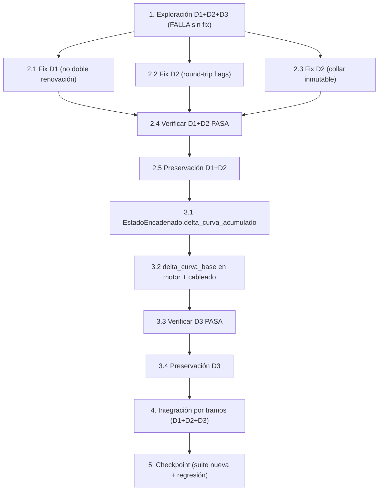

# Implementation Plan

Plan de implementación del bugfix de derivados por tramos: nominal (D1), flags de control (D2) y acumulación de curva (D3).

## Overview

> **Metodología de condición de bug (test-first).** Para cada defecto: primero una prueba
> de EXPLORACIÓN que FALLA en el código SIN corregir (confirma el bug), luego el fix
> dirigido, luego re-ejecución (debe PASAR) y verificación de PRESERVACIÓN.
>
> **Organización en olas separadas por defecto** (decisión del usuario): primero D1 (no
> doble renovación del nominal) y D2 (flags de control), que son los que inflan el P&G;
> DESPUÉS D3 (acumulación del delta de curva entre tramos), que es el más invasivo
> (toca el motor `valorar_portafolio_derivados`). Así D1+D2 pueden validarse de forma
> aislada antes de abordar D3.
>
> **Diseño a implementar (design.md):** marca `_es_renovacion`/`_renovado` + renovación
> CONDICIONADA (no re-renovar lo ya renovado); round-trip de flags con retipado booleano;
> `EstadoEncadenado.delta_curva_acumulado` + `valorar_portafolio_derivados(delta_curva_base=...)`
> que desplaza la curva de arranque, SIN tocar `_cargar_curvas` ni la valoración por contrato.

## Convención de ejecución (Windows / Google Drive) — OBLIGATORIA

```
python -m pytest "g:\Mi unidad\AXIS\AXIS\tests\<archivo>.py" ^
  --rootdir "g:\Mi unidad\AXIS\AXIS" -o addopts="" -p no:cacheprovider -q
```

- Hypothesis `@settings(deadline=None, max_examples=100)` (>=100 ejemplos); `suppress_health_check=[HealthCheck.too_slow]` si toca el fixture de BD.
- Escopar las pruebas a seams PUROS (renovación, round-trip del plano, acumulación de delta) para NO requerir `hist_pip`/`hist_curvas_derivados` (ausentes en el DB de prueba; falla pre-existente documentada en `docs/deuda-tecnica.md`).
- El terminal suele devolver exit code -1 aun en éxito — fiarse de la línea de resumen de pytest.
- Reglas del proyecto: SQL de solo lectura/parametrizado (sin concatenación de input), logs genéricos sin datos sensibles, firmas retrocompatibles (parámetros/columnas nuevos con default), sin defaults de negocio hardcodeados.

---

## Tasks

- [x] 1. Escribir pruebas de EXPLORACIÓN de los tres defectos (ANTES del fix)
  - **Property 1/2/3: Bug Condition** — nominal, flags y curva acumulada
  - **CRÍTICO**: estas pruebas DEBEN FALLAR en el código sin corregir; la falla confirma los bugs. NO arreglar prueba ni código cuando fallen.
  - **NOTA**: codifican el comportamiento esperado post-fix; validarán el fix cuando pasen (tareas 2.4, 3.3, 4.3).
  - Crear `tests/test_derivados_nominal_encadenamiento.py`.
  - **D1 — nominal (Property 1)**: construir un plano de forwards/opciones YA renovado (filas con marca de renovación) e inyectarlo como `posiciones_iniciales`; afirmar que el nominal vivo del tramo NO crece por re-renovación respecto del conservado. Hoy FALLA (crece). Escopar al seam de renovación (`_renovar_fwds`/`_renovar_opciones`) sin requerir curvas de mercado.
  - **D2 — flags (Property 2)**: (a) persistir y recargar un plano de opciones con `_renovado=True`/`_collar_id`/`_call_resuelto`; afirmar tipo booleano preservado tras `cargar_plano_derivados_proy`/`_normalizar_plano_opts` (hoy quedan int 0/1 -> FALLA). (b) afirmar que un collar ya renovado NO se re-marca `_renovado=False` al re-renovar (hoy FALLA). (c) afirmar que los forwards exponen `_es_renovacion` para distinguir original de renovado (hoy no existe -> FALLA).
  - **D3 — curva acumulada (Property 3)**: cadena de 2 tramos con deltas; afirmar que la curva de arranque del tramo 1 = `base + delta_acum(tramo 0)` (hoy arranca en `base` sin acumular -> FALLA). Escopar al helper de acumulación y al parámetro `delta_curva_base` del motor (unit-level, sin curvas completas).
  - Ejecutar sobre el código SIN corregir con la convención Windows/Drive.
  - **EXPECTED OUTCOME**: las pruebas FALLAN (correcto — prueban que los bugs existen).
  - Documentar los contraejemplos (nominal creciente, flag int/reseteado, curva sin acumular).
  - _Requirements: 1.1, 1.2, 1.3, 1.4, 1.5, 1.6, 1.7, 1.8, 1.9, 1.10, 1.11, 1.12_

- [x] 2. OLA 1 — Fix D1 (no doble renovación del nominal) + D2 (flags de control)

  - [x] 2.1 D1 — Marcar renovaciones y condicionar la renovación
    - En `valoracion_derivados.py` `_renovar_fwds` (~L1164-1211): emitir columna `_es_renovacion` (`False` en las filas base originales, `True` en los bloques generados).
    - En `_renovar_opciones` (~L1258-1322): conservar/usar `_renovado` como marca; NO forzar `_renovado=False` sobre filas que llegan con `_renovado=True`.
    - En el bloque de renovación (~L1962-1991): condicionar — si el plano recibido (`posiciones_iniciales`) trae filas marcadas como renovación, NO re-sembrar bloques sobre ellas; renovar solo lo necesario para cubrir el horizonte del tramo desde las posiciones vivas originales.
    - Mantener el `nominal` conservado (sin acumulación espuria); logs genéricos.
    - _Bug_Condition: isBugCondition(X) por nominal (plano ya renovado se re-renueva)_
    - _Expected_Behavior: nominal_vivo(F', i) == conservado; no monotónicamente creciente por encadenar (P1)_
    - _Preservation: tramo 0 (plano fresco, sin marca) renueva una vez igual que hoy_
    - _Requirements: 2.1, 2.2, 2.3, 2.4_

  - [x] 2.2 D2 — Preservar flags en el round-trip del plano
    - En `valoracion_derivados.py` `_normalizar_plano_opts` (~L1697-1710): restaurar `_renovado`/`_call_resuelto` a `bool` y `_collar_id` a str/None tras leer de SQLite.
    - En `scripts/proyeccion_tramos.py` `persistir_plano_derivados_proy`/`cargar_plano_derivados_proy` (~L1088-1174): asegurar que `_es_renovacion` (fwds) y los flags de opts se escriban/lean; retipar al recargar; mantener SQL parametrizado e idempotencia por corte.
    - Defaults retrocompatibles: si la columna no existe (planos previos al fix), asumir `False`/original.
    - _Bug_Condition: isBugCondition(X) por flags (int 0/1, reseteo, forwards sin marca)_
    - _Expected_Behavior: flags_recargados == flags_persistidos (bool); forwards distinguen original/renovado (P2)_
    - _Preservation: round-trip no altera planos sin las columnas nuevas_
    - _Requirements: 2.5, 2.6, 2.7, 2.8_

  - [x] 2.3 D2 — No re-resolver ni re-marcar collares ya renovados
    - En `_renovar_opciones`: garantizar que un collar que llega `_renovado=True` NO re-entra al solver ni cambia su `strike` (inmutabilidad), y conserva `_collar_id`/`_call_resuelto`.
    - _Bug_Condition: isBugCondition(X) (collar renovado re-marcado _renovado=False)_
    - _Expected_Behavior: collar renovado permanece _renovado=True y strike inmutable (P2)_
    - _Preservation: contrato de tests/test_inmutabilidad_collar_renovado.py y test_no_regresion_opciones_existentes.py_
    - _Requirements: 2.6_

  - [x] 2.4 Verificar que las pruebas de EXPLORACIÓN de D1 y D2 ahora PASAN
    - **Property 1/2: Expected Behavior** — nominal conservado y flags preservados
    - **IMPORTANTE**: re-ejecutar las MISMAS pruebas D1/D2 de la tarea 1 — NO escribir nuevas.
    - Ejecutar con la convención Windows/Drive (p. ej. `-k "d1 or d2 or nominal or flag or renov"`).
    - **EXPECTED OUTCOME**: las pruebas D1/D2 PASAN (bugs de nominal y flags resueltos).
    - _Requirements: 2.1, 2.2, 2.3, 2.4, 2.5, 2.6, 2.7_

  - [x] 2.5 Verificar PRESERVACIÓN tras D1+D2 (sin regresiones)
    - Re-ejecutar `tests/test_inmutabilidad_collar_renovado.py` y `tests/test_no_regresion_opciones_existentes.py`.
    - **EXPECTED OUTCOME**: PASAN (collar inmutable; opciones existentes fuera del solver; `_renovar_opciones` solo añade filas).
    - _Requirements: 3.2, 3.3_

- [x] 3. OLA 2 — Fix D3 (acumulación del delta de curva entre tramos)

  - [x] 3.1 Encadenar el delta de curva acumulado en `EstadoEncadenado`
    - En `scripts/proyeccion_tramos_multiactivo.py` `EstadoEncadenado` (~L895): añadir campo `delta_curva_acumulado: dict | None = None` (default None, retrocompatible).
    - Añadir helper puro `acumular_delta_curva(prev, delta_tramo) -> dict` que suma por tipo (`delta_tes_cop`, `delta_tes_uvr`, `delta_fed_bps`, `delta_10t_bps`).
    - En `app_dash._ejecutar_escenario_por_tramos` (~L8191-8205): al cerrar el tramo i, poblar `estado_previo.delta_curva_acumulado = acumular_delta_curva(prev, delta_tramo(i))`.
    - _Bug_Condition: isBugCondition(X) por curva (no acumula)_
    - _Expected_Behavior: delta_acum(i) == delta_acum(i-1) + delta_tramo(i) (P3)_
    - _Preservation: campo con default None preserva a todos los llamadores; tramo 0 sin acumulado_
    - _Requirements: 2.9, 2.10_

  - [x] 3.2 Aplicar el delta base acumulado en el motor y cablearlo en el orquestador
    - En `valoracion_derivados.py` `valorar_portafolio_derivados` (firma ~L1729-1749): añadir `delta_curva_base: dict | None = None` (default = comportamiento actual). Si se provee, SUMARLO a las curvas EA cargadas ANTES del escalado por `progreso` del tramo (desplazamiento base de arranque), SIN tocar `_cargar_curvas`.
    - En `app_dash._correr_derivados_tramo` (~L7520-7651): aceptar `delta_curva_base=None` y pasarlo al motor.
    - En `app_dash._ejecutar_escenario_por_tramos` (~L8218-8223): pasar `delta_curva_base = estado_previo.delta_curva_acumulado` (None en el tramo 0 -> comportamiento actual).
    - _Bug_Condition: isBugCondition(X) (curva de arranque == base fija sin acumulado)_
    - _Expected_Behavior: curva_arranque(F', i) == base + delta_acum(0..i-1); consistente con punta a punta (P3)_
    - _Preservation: delta_curva_base=None reproduce el comportamiento actual (punta a punta y tramo 0 inalterados)_
    - _Requirements: 2.9, 2.10, 2.11_

  - [x] 3.3 Verificar que las pruebas de EXPLORACIÓN de D3 ahora PASAN
    - **Property 3: Expected Behavior** — curva acumulada continua
    - **IMPORTANTE**: re-ejecutar las MISMAS pruebas D3 de la tarea 1 — NO escribir nuevas.
    - Ejecutar con la convención Windows/Drive (p. ej. `-k "d3 or curva or acum"`).
    - **EXPECTED OUTCOME**: las pruebas D3 PASAN (curva de arranque del tramo i refleja el delta acumulado 0..i-1).
    - _Requirements: 2.9, 2.10, 2.11_

  - [x] 3.4 Verificar PRESERVACIÓN tras D3 (retrocompatibilidad del motor)
    - Afirmar que `valorar_portafolio_derivados` con `delta_curva_base=None` reproduce EXACTAMENTE el comportamiento actual (tramo 0 y punta a punta inalterados).
    - Re-ejecutar las suites de regresión de collar (inmutabilidad, opciones existentes) por si el nuevo parámetro afecta alguna ruta.
    - **EXPECTED OUTCOME**: PASAN (sin regresiones).
    - _Requirements: 3.1, 3.4, 3.5, 3.6_

- [x] 4. Prueba de integración — flujo por tramos con derivados vivos (D1+D2+D3)
  - **Property 1/2/3: Fix Checking (integración)**
  - Correr el flujo por tramos (2026/2027/2028) con derivados vivos y renovaciones encadenadas:
    - Afirmar que el nominal vivo se CONSERVA entre tramos (no crece por re-renovación) — D1.
    - Afirmar que los flags de collares sobreviven el round-trip y los collares renovados permanecen inmutables — D2.
    - Afirmar que la curva de valoración del tramo i arranca en `base + delta_acum(0..i-1)` y que la relación forwards vs. opciones ya NO está sesgada por nominal doble-contado — D1+D3.
  - Comparación tramos vs. punta a punta con los MISMOS inputs de shift/delta: trayectoria de curva consistente.
  - Si el motor completo requiere `hist_pip`/`hist_curvas_derivados` ausentes, escopar la integración a los seams encadenados (plano + delta acumulado) sin exigir las curvas; documentar la limitación.
  - _Requirements: 2.1, 2.2, 2.3, 2.4, 2.5, 2.6, 2.9, 2.10, 2.11_

- [x] 5. Checkpoint — suite nueva + suites de regresión en verde
  - Ejecutar la suite nueva `tests/test_derivados_nominal_encadenamiento.py` (D1, D2, D3, integración).
  - Ejecutar las suites de regresión con la convención Windows/Drive:
    - `tests/test_inmutabilidad_collar_renovado.py` (inmutabilidad del collar renovado).
    - `tests/test_no_regresion_opciones_existentes.py` (opciones existentes fuera del solver).
    - `tests/test_tramos_multiactivo_integracion.py`, `tests/test_tramos_multiactivo_orquestador.py`, `tests/test_tramos_multiactivo_smoke.py` (orquestación por tramos — clasificar fallos pre-existentes por fixtures de mercado ausentes vs. regresiones nuevas).
    - `tests/test_trm_inicial_tramo_consistente.py` (spec B, spot del tramo 0 sin cambios).
  - Asegurar que todas las pruebas pasan o que los fallos son pre-existentes documentados (no nuevos). Si aparece una regresión inesperada, consultar al usuario antes de modificar más código.
  - _Requirements: 3.1, 3.2, 3.3, 3.4, 3.5, 3.6_

---

## Task Dependency Graph



### Execution Waves

```json
{
  "waves": [
    {
      "wave": 1,
      "description": "Prueba test-first: exploración de los 3 defectos (falla sin fix).",
      "tasks": ["1"]
    },
    {
      "wave": 2,
      "description": "OLA 1 — Fix D1 (no doble renovación) y D2 (flags). Las subtareas tocan renovación y round-trip; pueden implementarse en paralelo.",
      "tasks": ["2.1", "2.2", "2.3"]
    },
    {
      "wave": 3,
      "description": "Verificación de la OLA 1: D1+D2 pasan y preservación sin regresiones.",
      "tasks": ["2.4", "2.5"]
    },
    {
      "wave": 4,
      "description": "OLA 2 — Fix D3 (acumulación del delta de curva). Más invasivo; se aborda tras validar D1+D2.",
      "tasks": ["3.1", "3.2"]
    },
    {
      "wave": 5,
      "description": "Verificación de la OLA 2: D3 pasa y retrocompatibilidad del motor.",
      "tasks": ["3.3", "3.4"]
    },
    {
      "wave": 6,
      "description": "Integración extremo a extremo del flujo por tramos con los 3 defectos corregidos.",
      "tasks": ["4"]
    },
    {
      "wave": 7,
      "description": "Checkpoint: suite nueva completa + suites de regresión en verde.",
      "tasks": ["5"]
    }
  ]
}
```

## Notes

- **Olas separadas por defecto** (decisión del usuario): D1+D2 (olas 2-3) se implementan y validan ANTES de D3 (olas 4-5). Así, si D3 (que toca el motor) resulta delicado, D1+D2 ya quedan verificados de forma aislada.
- **Property 1 (nominal)** -> tareas 1, 2.1, 2.4, 4. **Property 2 (flags)** -> tareas 1, 2.2, 2.3, 2.4, 2.5, 4. **Property 3 (curva acumulada)** -> tareas 1, 3.1, 3.2, 3.3, 4. **Property 4 (preservación)** -> tareas 2.5, 3.4, 5.
- **Superficie mínima**: no se toca la valoración de un contrato individual, ni el solver del collar, ni `_cargar_curvas`. Todas las firmas nuevas (`_es_renovacion`, `delta_curva_base`, `EstadoEncadenado.delta_curva_acumulado`) son retrocompatibles con default; punta a punta y tramo 0 quedan inalterados.
- **Entorno de pruebas**: escopar a seams puros (renovación, round-trip, acumulación) por los fixtures de mercado ausentes (`hist_pip`/`hist_curvas_derivados`); esos fallos de integración completa son pre-existentes documentados en `docs/deuda-tecnica.md`, no regresiones de este fix.
- Reglas de seguridad/estilo en todas las tareas de implementación: SQL de solo lectura/parametrizado, logs genéricos, firmas retrocompatibles, sin defaults de negocio hardcodeados.
