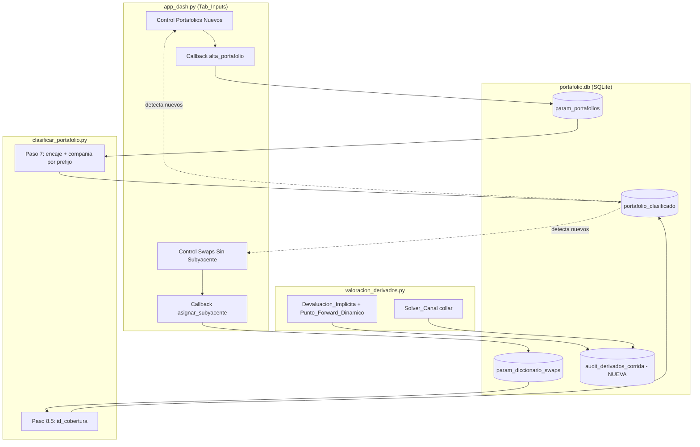

# Design Document

## Overview

Esta funcionalidad agrupa cuatro mejoras de escalabilidad y correctitud sobre AXIS (Python + Dash + SQLite), más un alcance transversal de esquema y trazabilidad:

1. **Alta de portafolios de Porfin nuevos** (ramo, tipo, excluir) desde el `Tab_Inputs` del dashboard (Req 1).
2. **Asignación de subyacente a swaps nuevos** desde el `Tab_Inputs` (Req 2).
3. **Devaluación implícita dinámica de forwards** derivada del diferencial de tasas COP–USD, con punto forward de descuento recalculado por corte (Req 3), reemplazando `dev_forecast` plano y los puntos `FWPCOP` estáticos de PIP.
4. **Solver de canal del collar por prima cero** ("buscar objetivo") que resuelve el strike de la Call reutilizando las curvas `r/q` ya proyectadas al mes del corte (Req 4), reemplazando el `canal_opc` fijo.
5. **Consistencia transversal** (Req 5): preservar el esquema exacto de las tablas `param_*`/`hist_*`, escrituras parametrizadas y atómicas, trazabilidad auditable y no-regresión de la clasificación.

El principio rector es de **cambio quirúrgico**: los módulos de cálculo (`clasificar_portafolio.py`, `valoracion_derivados.py`, `libro_de_funciones.py`) preservan sus contratos de retorno y su esquema de tablas. Los altas de portafolios y swaps escriben en las tablas **existentes** (`param_portafolios`, `param_diccionario_swaps`) sin alterar su esquema. La única tabla nueva es la de auditoría de la corrida de derivados.

### Detección de "nuevos" (patrón común Req 1 y Req 2)

Tanto el alta de portafolios como la asignación de subyacentes de swaps siguen el **mismo patrón de UI**, análogo al `detectar_incompletos` ya presente en `app_dash.py`: el control aparece **solo cuando hay elementos nuevos** en el portafolio del corte, con el identificador ya resuelto, pidiendo únicamente los atributos faltantes.

- **Portafolio_Nuevo**: `portafolio_porfin` presente en el portafolio del corte pero ausente de `param_portafolios`. Se piden Ramo, Tipo, Excluir.
- **Swap_Sin_Subyacente**: `id_posicion` de swap presente en el corte pero ausente de `param_diccionario_swaps`. Se piden sus Subyacentes.

### Mapeo componente → requisito

| Componente | Módulo | Requisitos |
|---|---|---|
| Detección + UI de portafolios nuevos + callback de alta | `app_dash.py` | 1.1–1.7, 1.10, 5.2, 5.5 |
| Ramo/Tipo/Excluir y compañía por prefijo en clasificación (existente) | `clasificar_portafolio.py` | 1.8, 1.9, 5.4 |
| Detección + UI de swaps sin subyacente + callback de asignación | `app_dash.py` | 2.1–2.7, 2.9, 5.2, 5.5 |
| Id_Cobertura desde diccionario (existente, se valida no-regresión) | `clasificar_portafolio.py` | 2.8, 5.4 |
| Devaluación implícita y punto forward dinámico | `valoracion_derivados.py` | 3.1–3.12 |
| Solver de canal del collar | `valoracion_derivados.py`, `libro_de_funciones.py` | 4.1–4.11 |
| Registro de auditoría persistido | `valoracion_derivados.py`, tabla nueva | 3.11, 4.10, 5.3 |
| Preservación de esquema y atomicidad | todos | 5.1–5.5 |

## Architecture

### Vista de alto nivel



### Cómo encajan los cambios por módulo

**`app_dash.py`** — Se agregan dos bloques al layout de `layout_inputs` que aparecen **solo cuando hay elementos nuevos** en el portafolio del corte (patrón `detectar_incompletos`), reutilizando el patrón ya existente (`dash_table.DataTable` editable + botón guardar + callback que persiste, tal como `guardar_diccionario`/`guardar_calificaciones`). Los nuevos callbacks:
- Detectan los Portafolio_Nuevo / Swap_Sin_Subyacente comparando el portafolio del corte contra `param_portafolios` / `param_diccionario_swaps`.
- Validan entrada (campos requeridos, existencia de subyacentes en el portafolio del corte, no duplicar identificadores ya registrados).
- Persisten con **consultas parametrizadas** (nunca concatenando valores en el SQL — Req 5.2), escribiendo en las tablas existentes `param_portafolios` (`portafolio_porfin`, `ramo`, `tipo`, `excluir`) y `param_diccionario_swaps` (`id_posicion`, `Subyacente`).
- Envuelven las escrituras en una **transacción atómica** con `rollback` ante error (Req 5.5).
- Devuelven un mensaje de confirmación o de error específico.

Se corrige además una desviación de seguridad ya presente en `guardar_diccionario` (nombre de columna interpolado con f-string): los nuevos callbacks usan nombres de columna de un **allowlist fijo** y valores siempre por binding.

**`clasificar_portafolio.py`** — **No cambia**. El paso 7 sigue derivando la compañía por prefijo (Req 1.9) y calculando el encaje a partir de `ramo`/`tipo` de `param_portafolios`; al haber filas nuevas registradas desde el dashboard, las recoge automáticamente (Req 1.8). El paso 8.5 (id_cobertura) y el 6.6 (Estructuras) tampoco cambian su lógica; solo se benefician de tener más filas en `param_diccionario_swaps` (Req 2.8). Se verifica no-regresión por snapshot (Req 5.4).

**`valoracion_derivados.py`** — Es donde se concentra el cálculo. Se agregan funciones puras nuevas (devaluación implícita, punto forward dinámico, solver de canal) y se modifican los puntos de integración dentro de `valorar_portafolio_derivados`:
- `_renovar_fwds` y el bloque de forwards nuevos del método 3 pasan a calcular `tasa_negociada` con `Devaluacion_Implicita` (con `dev_forecast` como fallback).
- `_valorar_fwds_corte` pasa a calcular `fwdcop` con `Punto_Forward_Dinamico` por corte en vez de leer `fwd_cop` estático.
- `_renovar_opciones` deja de usar `canal_opc` fijo para los collares renovados: pasa a fijar el strike Call vía `Solver_Canal`. **Nota importante:** hoy `_renovar_opciones` se llama **una sola vez fuera del loop de cortes**, pero las curvas `r/q` proyectadas dependen del mes del corte. Ver "Momento de creación del collar" abajo.
- Se acumulan `Registro_Auditoria` en memoria durante la corrida y se persisten al final en la tabla nueva `audit_derivados_corrida` (Req 3.11, 4.10, 5.3).

**`libro_de_funciones.py`** — Se agregan funciones puras auxiliares: conversión tasa nominal↔EA, EA↔continua, prima neta del collar (envoltorio sobre `precio_bs_signed`). No se modifica ninguna firma existente (`valorar_fwds`, `precio_bs_signed`, `delta_bs` intactas — Req 3.12, 4.11).

### Momento de creación del collar renovado (decisión de diseño clave)

El Req 4.3/4.4 exige que el strike Call se fije en el **momento de creación** del collar renovado usando las curvas de ese momento, y que luego sea **inmutable**. Hoy `_renovar_opciones` crea el plano de renovaciones una vez, fuera del loop. Para satisfacer 4.3/4.4 sin re-implementar la proyección de curvas:

- La creación de un collar renovado se realiza **en el corte cuya fecha coincide con la fecha de constitución** del collar (el mes `m` en que "nace"). En ese corte ya están construidas `r_df_corte`/`q_df_corte` (Curva_R_Corte/Curva_Q_Corte), por lo que el solver las reutiliza directamente.
- Una vez resuelto el strike Call, se **persiste en el plano** (`opts_plan`) y no se recalcula: en cortes posteriores el collar es una `Opcion_Existente` más para efectos de valoración (solo se revalúa, sus características son inmutables — Req 4.4).
- Esto se implementa memoizando por `id` de collar renovado: si el strike Call ya fue resuelto, no se vuelve a resolver.

Esta estrategia mantiene idéntico el comportamiento de las `Opciones_Existentes` de `hist_opciones` (nunca pasan por el solver — Req 4.3, no-regresión).

## Components and Interfaces

### 1. Dashboard — `app_dash.py`

#### 1.1 Layout (dentro de `layout_inputs`)

Dos secciones nuevas, cada una con: `dash_table.DataTable` editable, inputs de alta, botón guardar, `html.Div` de mensaje. Compañía se ofrece como `dcc.Dropdown` restringido al conjunto permitido (Req 1.6).

```python
COMPANIAS_VALIDAS = ('Capitalizadora', 'Bolívar', 'Comerciales', 'Sin Compañía')
```

#### 1.2 Callbacks nuevos (firmas)

```python
@callback(Output('msg-alta-portafolio', 'children'),
          Output('tabla-portafolios-nuevos', 'data'),
          Input('btn-alta-portafolio', 'n_clicks'),
          State('tabla-portafolios-nuevos', 'data'),   # filas: portafolio_porfin (fijo), ramo, tipo, excluir
          State('sel-corte-activo', 'value'),           # fecha_reporte del corte
          prevent_initial_call=True)
def alta_portafolio(n_clicks, filas, fecha_corte) -> "tuple[html.Span, list]":
    """Da de alta cada Portafolio_Nuevo con Ramo/Tipo/Excluir. Valida, persiste parametrizado y atómico."""
```

```python
@callback(Output('msg-asignar-subyacente', 'children'),
          Output('tabla-swaps-sin-subyacente', 'data'),
          Input('btn-asignar-subyacente', 'n_clicks'),
          State('tabla-swaps-sin-subyacente', 'data'),  # filas: id_posicion (fijo), subyacentes (texto)
          State('sel-corte-activo', 'value'),            # fecha_reporte del corte
          prevent_initial_call=True)
def asignar_subyacente(n_clicks, filas, fecha_corte) -> "tuple[html.Span, list]":
    """Asigna subyacentes a cada Swap_Sin_Subyacente. Valida existencia en el portafolio del corte."""
```

#### 1.3 Funciones de detección y validación puras (módulo helper `comun/validaciones_inputs.py`)

Se aíslan como **puras** para poder testearlas con property-based testing:

```python
def normalizar_id(valor: str) -> str:
    """Recorta espacios iniciales y finales. Normaliza a str."""

def detectar_portafolios_nuevos(portafolios_corte: set[str],
                                registrados: set[str]) -> list[str]:
    """Portafolio_Nuevo = portafolios del corte (normalizados) ausentes de param_portafolios. (Req 1.1, 1.2)"""

def detectar_swaps_sin_subyacente(swaps_corte: set[str],
                                  registrados: set[str]) -> list[str]:
    """Swap_Sin_Subyacente = swaps del corte ausentes de param_diccionario_swaps. (Req 2.1, 2.2)"""

def validar_alta_portafolio(porfin: str, ramo: str, tipo: str, excluir: str,
                            existentes: set[str]) -> tuple[bool, str, dict]:
    """
    Retorna (ok, mensaje, payload_normalizado).
    - Rechaza si ramo/tipo vacíos o solo espacios (Req 1.5).
    - Rechaza si excluir no ∈ {'SI','NO'} (Req 1.4).
    - Rechaza si porfin normalizado ya existe (Req 1.6).
    payload_normalizado = {'portafolio_porfin', 'ramo', 'tipo', 'excluir'}
    """

def parsear_subyacentes(raw) -> list[str]:
    """Parsea texto/lista a lista de ids normalizados, descartando vacíos."""

def validar_asignacion_swap(id_swap: str, subyacentes: list[str],
                            ids_portafolio_corte: set[str],
                            swaps_registrados: set[str]) -> tuple[bool, str, dict]:
    """
    Retorna (ok, mensaje, payload).
    - Rechaza si 0 subyacentes (Req 2.5).
    - Rechaza si nº subyacentes fuera de [1, 50] (Req 2.1).
    - Rechaza (identificando cada faltante) si algún subyacente no existe en el corte (Req 2.4).
    - Rechaza si el swap ya está registrado (Req 2.6).
    payload = {'id_posicion', 'Subyacente'}  # Subyacente = ids unidos por '|'
    """
```

#### 1.4 Persistencia parametrizada y atómica (Req 5.2, 5.5)

```python
def persistir_portafolio(conn, payload: dict) -> None:
    """
    Inserta en param_portafolios (portafolio_porfin, ramo, tipo, excluir) dentro de UNA transacción.
    Todos los valores por binding (?). Nombres de columna de allowlist fijo.
    Ante excepción: rollback y re-raise.
    """

def persistir_subyacente(conn, payload: dict) -> None:
    """
    Inserta en param_diccionario_swaps (id_posicion, Subyacente) dentro de UNA transacción.
    Subyacente = ids unidos por '|'. Valores por binding (?). Ante excepción: rollback y re-raise.
    """
```

- `param_portafolios` recibe `portafolio_porfin`, `ramo`, `tipo`, `excluir` — su esquema existente completo, sin alterarlo (Req 1.3, 1.10).
- `param_diccionario_swaps` recibe `id_posicion`, `Subyacente` — esquema intacto (Req 2.3, 2.9).
- Se usa `with conn:` (context manager de sqlite3, commit/rollback automático) o `BEGIN`/`COMMIT`/`ROLLBACK` explícito.
- **No se crea ninguna tabla nueva** para estos dos requisitos.

### 2. Clasificador — `clasificar_portafolio.py` (sin cambios)

El Clasificador **no se modifica**. Se apoya en el comportamiento existente:

- **Paso 7 (encaje + compañía)**: la compañía se sigue derivando por prefijo (`np.select` con `str.startswith` '01'/'02'/'03', default 'Sin Compañía') — Req 1.9. El encaje se calcula a partir de `estado`, `tipo` y `ramo` de `param_portafolios`; al registrarse filas nuevas desde el dashboard, el merge las recoge y asigna Ramo/Tipo a las posiciones correspondientes (Req 1.8).
- **Paso 6.6 (Estructuras) y 8.5 (id_cobertura)**: sin cambios; recogen automáticamente las filas nuevas de `param_diccionario_swaps` para asignar el Id_Cobertura del swap y sus subyacentes (Req 2.8).

Se verifica no-regresión con un snapshot de `portafolio_clasificado` sobre insumos iguales (Req 5.4).

### 3. Valorador de derivados — `valoracion_derivados.py`

#### 3.1 Funciones puras nuevas (auditables y testeables)

```python
def tasa_ea(tasa_nom_pct: np.ndarray, dias: np.ndarray) -> np.ndarray:
    """Tasa_EA: (1 + tasa_nom/100 * dias/360)^(365/dias) - 1.  (Req 3.3)"""

def devaluacion_implicita(swtibr_ea: float, lutibr_ea: float) -> float:
    """((1 + SWTIBR_EA)/(1 + LUTIBR_EA)) - 1.  (Req 3.3)"""

def dev_valida(dev: float) -> bool:
    """True si dev es finita y está en [-0.5, 2.0].  (Req 3.8)"""

def punto_forward_dinamico(trm: float, dev: float, dias: float) -> float:
    """TRM*(1+dev)^(dias/365) - TRM.  (Req 3.6)"""

def shift_lutibr_por_plazo(plazo_dias: np.ndarray, shift_fed_bps: float,
                           shift_10t_bps: float) -> np.ndarray:
    """
    Interpola linealmente el Shift_FED por plazo entre ancla corta (1 día = FED)
    y ancla larga (3650 días = tesoros 10a); flat más allá de 10 años. Retorna en %.
    (Req 3.4)
    """

def curva_proyectada_pct(curva_pct: pd.DataFrame, shift_pct_por_plazo: np.ndarray,
                         progreso: float) -> pd.DataFrame:
    """
    Suma a la tasa (en %) el shift escalado por progreso (m/N). Senda lineal mensual.
    Nunca se aplica a FWPCOP. (Req 3.4, 3.5)
    """
```

Fórmula de devaluación (Req 3.3) evaluada al plazo `dias` del forward, con curvas SWTIBR/LUTIBR ya proyectadas al mes:

```
SWTIBR_EA = tasa_ea(SWTIBR_proy(dias), dias)
LUTIBR_EA = tasa_ea(LUTIBR_proy(dias), dias)
Devaluacion_Implicita = (1 + SWTIBR_EA) / (1 + LUTIBR_EA) - 1
```

Con fallback (Req 3.9): si no hay curva al plazo, o el resultado no es finito, o cae fuera de `[-0.5, 2.0]` (Req 3.8), se usa `dev_forecast`.

#### 3.2 Orquestador de devaluación por corte

```python
def calcular_dev_y_punto_forward(dias: float, trm_corte: float,
                                 swtibr_proy: pd.DataFrame, lutibr_proy: pd.DataFrame,
                                 dev_forecast: float) -> tuple[float, float, dict]:
    """
    Retorna (dev_usada, punto_forward, registro_auditoria).
    registro_auditoria = {plazo_dias, trm_corte, swtibr_ea, lutibr_ea, dev, punto_forward, uso_fallback}
    (Req 3.1, 3.2, 3.6, 3.9, 3.11)
    """
```

#### 3.3 Integración en el flujo de forwards

- **`_renovar_fwds`** (firma ampliada, retrocompatible por defecto): reemplaza
  `tasa_negociada = trm * (1 + dev_forecast)^(100/365)` por, para cada renovación de 100 días,
  la `Devaluacion_Implicita` al plazo 100 días en el mes de la fecha de constitución, con `dev_forecast` como fallback.
- **Forwards nuevos método 3** (bloque en el loop): reemplaza `(1 + dev_forecast)^(93/365)` por `Devaluacion_Implicita` al plazo 93 días.
- **`_valorar_fwds_corte`**: en lugar de `_merge_curva(df, fwd_cop, 'dias', 'fwdcop')` con `fwd_cop` estático de PIP, calcula `fwdcop = punto_forward_dinamico(trm_val, dev(dias), dias)` **por fila** (por plazo del corte al vencimiento), preservando la firma de `valorar_fwds` (se le pasa el `fwdcop` calculado — Req 3.6, 3.7). La identidad `last_trm + fwdcop = TRM*(1+dev)^(dias/365)` queda garantizada por construcción.

#### 3.4 Solver de canal del collar

En `libro_de_funciones.py`:

```python
def prima_neta_collar(k_call: float, k_put: float, trm: float,
                      vol_put: float, vol_call: float, t: float,
                      r: float, q: float, nominal: float,
                      sentido_put: str, sentido_call: str) -> float:
    """
    Prima neta = precio_bs_signed(Put) + precio_bs_signed(Call), con signos por sentido.
    Reutiliza precio_bs_signed sin cambiar su firma. (Req 4.2)
    """
```

En `valoracion_derivados.py`:

```python
def resolver_canal_collar(k_put: float, trm: float, interpol_vol,
                          r_corte, q_corte, dias: float, nominal: float,
                          sentido_put: str, sentido_call: str,
                          tolerancia: float, max_iter: int,
                          canal_opc_fallback: float) -> tuple[float, float, bool]:
    """
    Resuelve k_call tal que |prima_neta_collar| <= tolerancia mediante Brent
    (scipy.optimize.brentq) sobre f(k_call) = prima_neta_collar(...), que es
    monótona en k_call. Bracketing: [k_put, k_put + canal_opc_fallback * factor].
    Retorna (k_call_resuelto, prima_neta, uso_fallback).
    No convergencia / sin cambio de signo → fallback k_call = k_put + canal_opc. (Req 4.1, 4.5, 4.7)
    """
```

- Usa `interpol_vol(strike, dias)` para vol de cada pata, y `r_corte`/`q_corte` (Curva_R_Corte/Curva_Q_Corte ya proyectadas — Req 4.2, 4.3). No re-implementa la proyección.
- Método numérico: **Brent** (`scipy.optimize.brentq`) por robustez, con bisección como respaldo si no hay cambio de signo en el bracket. `scipy` ya es dependencia del proyecto (`norm` de `scipy.stats` en `libro_de_funciones.py`).
- `max_iter`, `tolerancia`, `canal_opc` son parámetros de `valorar_portafolio_derivados` (Req 4.6, 4.8, 4.9).

#### 3.5 Firma ampliada de `valorar_portafolio_derivados` (retrocompatible)

Se **agregan** parámetros keyword con defaults; el orden y los parámetros existentes no cambian, y el retorno preserva su contrato `{'opciones','forwards','activos','swaps'}` (Req 3.12, 4.11):

```python
def valorar_portafolio_derivados(
    ...,                                  # parámetros existentes intactos
    dev_forecast: float = 0.085,          # existente; ahora fallback (Req 3.10)
    canal_opc: float = 1650,              # existente; ahora fallback (Req 4.9)
    tolerancia_prima: float = 1.0,        # NUEVO (Req 4.6)  rango [0.0001, 1000.0]
    max_iter_canal: int = 100,            # NUEVO (Req 4.8)  rango [1, 1000]
    persistir_auditoria: bool = True,     # NUEVO: controla escritura de auditoría
    corrida_id: str = None,               # NUEVO: id de corrida para agrupar auditoría
) -> dict:
```

Al final de la corrida, si `persistir_auditoria`, se escriben los `Registro_Auditoria` acumulados en `audit_derivados_corrida` (Req 5.3), en una transacción atómica.

## Data Models

Se crea **una sola tabla nueva** (auditoría de derivados). Las altas de portafolios y de subyacentes escriben en las tablas **existentes**, sin alterar su esquema (Req 1.10, 2.9, 5.1). Esquemas actuales (verificados en el código):

- `param_portafolios(portafolio_porfin, ramo, tipo, excluir)` — usada por `clasificar_portafolio.py` (ramo/tipo) y por `portfolio_loader_beta.py` (excluir). El alta escribe las cuatro columnas.
- `param_diccionario_swaps(id_posicion, Subyacente)` — `Subyacente` admite múltiples ids unidos por '|'. La asignación escribe ambas columnas.

**No se crea ninguna tabla para Req 1 y Req 2**: la compañía se sigue derivando por prefijo en el Clasificador, por lo que no se persiste.

### Tabla nueva: `audit_derivados_corrida` (Registro_Auditoria)

Un registro por cálculo de devaluación/punto forward (Req 3.11) y por resolución de solver (Req 4.10). Consultable tras la corrida sin re-ejecutar (Req 5.3).

```sql
CREATE TABLE IF NOT EXISTS audit_derivados_corrida (
    corrida_id          TEXT NOT NULL,     -- agrupa una corrida completa
    tipo_registro       TEXT NOT NULL,     -- 'FORWARD_DEV' | 'COLLAR_SOLVER'
    fecha_constitucion  DATE,              -- forwards
    mes_proyeccion      INTEGER,           -- m (días desde el corte)
    plazo_dias          INTEGER,
    trm_corte           REAL,
    swtibr_ea           REAL,              -- forwards
    lutibr_ea           REAL,              -- forwards
    dev                 REAL,              -- forwards
    punto_forward       REAL,              -- forwards
    shift_tes_bps       REAL,              -- collar (acumulado aplicado)
    shift_fed_bps       REAL,              -- collar (acumulado aplicado)
    strike_put          REAL,              -- collar
    strike_call         REAL,              -- collar (resuelto)
    prima_neta          REAL,              -- collar
    uso_fallback        INTEGER NOT NULL   -- 0/1
);
```

Los campos no aplicables al tipo de registro quedan `NULL`. La escritura usa `executemany` con binding (Req 5.2) y transacción atómica (Req 5.5).

## Correctness Properties

*Una propiedad es una característica o comportamiento que debe cumplirse en todas las ejecuciones válidas de un sistema — esencialmente, un enunciado formal de lo que el sistema debe hacer. Las propiedades son el puente entre las especificaciones legibles por humanos y las garantías de correctitud verificables por máquina.*

Las propiedades se derivan de las funciones **puras** aisladas en el diseño (validación de entrada, fórmulas de devaluación/punto forward, solver de canal, prima neta, proyección de curvas) y de invariantes de persistencia/clasificación. Las tasas, TRM, plazos y curvas se generan aleatoriamente en rangos financieramente razonables.

### Property 1: Detección de nuevos y validación de alta de portafolio

*Para todo* conjunto de portafolios del corte y conjunto de portafolios ya registrados, `detectar_portafolios_nuevos` devuelve exactamente los portafolios del corte (normalizados) ausentes de los registrados. *Para todo* `portafolio_porfin`, `ramo`, `tipo`, `excluir` y conjunto de existentes: `validar_alta_portafolio` acepta si y solo si `ramo` y `tipo` no son vacíos ni solo espacios, `excluir ∈ {'SI','NO'}` y el `portafolio_porfin` normalizado no está en los existentes; cuando acepta, el payload contiene el `portafolio_porfin` normalizado y `ramo`/`tipo`/`excluir` dados.

**Validates: Requirements 1.1, 1.2, 1.3, 1.4, 1.5, 1.6**

### Property 2: Detección de swaps nuevos y validación de asignación de subyacentes

*Para todo* conjunto de swaps del corte y conjunto de swaps registrados, `detectar_swaps_sin_subyacente` devuelve exactamente los swaps del corte ausentes de los registrados. *Para todo* `id_posicion` de swap, lista de subyacentes, conjunto de ids del portafolio del corte y conjunto de swaps registrados: `validar_asignacion_swap` acepta si y solo si la lista tiene entre 1 y 50 subyacentes, todos existen en el corte y el swap no está registrado; cuando acepta, `payload['Subyacente'] == '|'.join(subyacentes_normalizados)`; cuando rechaza por subyacentes ausentes, el mensaje contiene exactamente los ids ausentes.

**Validates: Requirements 2.1, 2.2, 2.3, 2.4, 2.5, 2.6**

### Property 3: Compañía derivada por prefijo (sin regresión)

*Para todo* conjunto de posiciones con su código de `portafolio`, la compañía asignada por el Clasificador es la derivada por prefijo ('01'→Capitalizadora, '02'→Bolívar, '03'→Comerciales, cualquier otro→Sin Compañía), idéntica al comportamiento actual, independientemente de las altas realizadas desde el dashboard.

**Validates: Requirements 1.9, 5.4**

### Property 4: No-regresión de la clasificación (ramo/tipo e id_cobertura)

*Para todo* `portafolio_clasificado`, `param_portafolios` y `param_diccionario_swaps`: toda posición cuyo `portafolio` coincide con un `portafolio_porfin` recibe su `ramo` y `tipo`; y cada swap y sus subyacentes reciben el `id_cobertura` acorde al diccionario, produciendo las mismas asignaciones de encaje e id_cobertura que el comportamiento previo con los mismos insumos.

**Validates: Requirements 1.8, 2.8, 5.4**

### Property 5: Preservación de esquema de tablas param_*

*Para toda* secuencia de altas de portafolios o de asignaciones de subyacentes, el conjunto de columnas, su orden y su tipo declarado en `param_portafolios` y en `param_diccionario_swaps` permanecen exactamente iguales a los previos a la operación.

**Validates: Requirements 1.10, 2.9, 5.1**

### Property 6: Escritura parametrizada resistente a inyección

*Para todo* valor de entrada (incluyendo cadenas con comillas simples/dobles, `;`, `--` u otras secuencias SQL), la persistencia enlaza los valores como parámetros: tras la escritura el valor almacenado es la cadena literal de entrada (normalizada) y ninguna otra fila ni el esquema de la tabla resultan alterados.

**Validates: Requirements 5.2**

### Property 7: Atomicidad de las escrituras (rollback)

*Para toda* operación de alta de portafolio o asignación de subyacentes que falle antes de completarse, el estado de la tabla afectada tras el fallo es idéntico al estado previo a la operación (rollback total, sin escrituras parciales) y su esquema se preserva.

**Validates: Requirements 5.5**

### Property 8: Fórmula de la tasa negociada del forward

*Para todo* `TRM > 0`, `dev` finita y `dias > 0`, la tasa negociada de un forward renovado o nuevo es exactamente `TRM * (1 + dev)^(dias / 365)`.

**Validates: Requirements 3.1, 3.2**

### Property 9: Devaluación implícita por paridad de tasas

*Para todo* par de tasas nominales SWTIBR y LUTIBR y todo `dias > 0`: `SWTIBR_EA = (1 + SWTIBR_nom/100 * dias/360)^(365/dias) - 1`, análogamente `LUTIBR_EA`, y `Devaluacion_Implicita = (1 + SWTIBR_EA) / (1 + LUTIBR_EA) - 1`.

**Validates: Requirements 3.3**

### Property 10: Proyección lineal del shift por progreso e interpolación por plazo

*Para todo* shift total `S` (pbs), horizonte `N` meses y mes `m`, el shift acumulado aplicado a la tasa en % es `S/100 * m/N`; y para todo plazo entre las anclas del Shift_FED, el shift interpolado es la interpolación lineal entre el ancla corta (1 día, FED) y el ancla larga (3650 días, tesoros 10a), con clamp plano fuera del rango.

**Validates: Requirements 3.4**

### Property 11: El shift nunca se aplica a los puntos forward en pesos

*Para todo* shift y toda curva de entrada, tras construir la Curva_Tasa_Proyectada los valores del indicador `FWPCOP` (puntos forward en pesos) quedan idénticos a los originales; solo cambian las tasas en % de SWTIBR y LUTIBR.

**Validates: Requirements 3.5**

### Property 12: Punto forward dinámico e identidad de descuento

*Para todo* `TRM > 0`, `dev` finita y `dias > 0`, `Punto_Forward_Dinamico = TRM * (1 + dev)^(dias / 365) - TRM`, y por tanto `TRM + Punto_Forward_Dinamico = TRM * (1 + dev)^(dias / 365)`.

**Validates: Requirements 3.6, 3.7**

### Property 13: Un forward recién constituido a mercado vale aproximadamente cero

*Para todo* forward cuyo strike es `TRM_corte * (1 + dev)^(dias / 365)` valorado en su fecha de constitución con el `fwdcop` dinámico correspondiente, su valoración es aproximadamente cero (dentro de tolerancia numérica), tanto para sentido Compra como Venta.

**Validates: Requirements 3.7**

### Property 14: Rango de validez de la devaluación

*Para todo* valor `dev`, `dev_valida(dev)` es verdadero si y solo si `dev` es finita y `-0.5 <= dev <= 2.0`.

**Validates: Requirements 3.8**

### Property 15: Fallback a dev_forecast

*Para toda* entrada en la que no exista curva al plazo, la derivación produzca un valor no finito o el resultado quede fuera de `[-0.5, 2.0]`, `calcular_dev_y_punto_forward` devuelve `dev_forecast` como devaluación usada y marca `uso_fallback = True`.

**Validates: Requirements 3.9**

### Property 16: Contenido del registro de auditoría de forwards

*Para todo* cálculo de devaluación/punto forward, el `Registro_Auditoria` producido contiene fecha de constitución, mes de proyección, plazo en días, TRM del corte, SWTIBR_EA, LUTIBR_EA, devaluación resultante, punto forward y el indicador de uso de fallback.

**Validates: Requirements 3.11**

### Property 17: El solver produce un collar de prima neta acotada

*Para todo* `k_put`, volatilidad, plazo `t`, tasas `r`/`q` del corte y nominal en rangos financieros donde exista solución en el bracket, `resolver_canal_collar` devuelve un `k_call` tal que la prima neta del collar cumple `|prima_neta| <= tolerancia`, donde `prima_neta = precio_bs_signed(Put) + precio_bs_signed(Call)` con los signos por sentido y por pata.

**Validates: Requirements 4.1, 4.2, 4.5**

### Property 18: No-regresión de las opciones existentes

*Para todo* conjunto de opciones cargadas desde `hist_opciones` (strike dado), su precio y su delta calculados con la funcionalidad activa son idénticos a los calculados por el comportamiento actual; las opciones existentes nunca pasan por el `Solver_Canal`.

**Validates: Requirements 4.3**

### Property 19: Inmutabilidad del collar renovado tras su creación

*Para todo* collar renovado, una vez fijado su `k_call` en la fecha de constitución, en todos los cortes posteriores su strike de la Put, strike de la Call, nominal, sentido, tipo Call/Put y fechas de constitución y vencimiento permanecen idénticos; solo cambia su valoración.

**Validates: Requirements 4.4**

### Property 20: Fallback del solver ante no convergencia

*Para toda* entrada en la que el solver no encuentre solución dentro del bracket o del máximo de iteraciones, `resolver_canal_collar` devuelve `k_call = k_put + canal_opc`, marca `uso_fallback = True` y no lanza excepción (la corrida no se interrumpe).

**Validates: Requirements 4.7**

### Property 21: Contenido del registro de auditoría del solver

*Para toda* resolución del solver de canal, el `Registro_Auditoria` producido contiene el mes de proyección, el Shift_TES y el Shift_FED acumulados aplicados, el strike de la Put, el strike de la Call resuelto, la prima neta resultante y el indicador de uso de fallback.

**Validates: Requirements 4.10**

### Property 22: Round-trip de persistencia de la auditoría

*Para toda* lista de `Registro_Auditoria` generada durante una corrida, tras persistirla en `audit_derivados_corrida` y releerla filtrando por `corrida_id`, el conjunto de registros leídos es igual al conjunto generado (sin re-ejecutar la valoración).

**Validates: Requirements 5.3**

### Property 23: Preservación del contrato de retorno del valorador

*Para toda* corrida de `valorar_portafolio_derivados`, el valor retornado es un diccionario con las claves `{'opciones', 'forwards', 'activos', 'swaps'}` y cada DataFrame conserva las columnas producidas por el comportamiento previo.

**Validates: Requirements 3.12, 4.11**

## Error Handling

### Dashboard (Req 1, 2, 5.2, 5.5)

- **Validación previa a escritura**: toda entrada pasa por las funciones puras de validación antes de tocar la DB. Si la validación falla, se retorna un `html.Span` de error específico (campo faltante, duplicado, id inexistente con la lista de faltantes) y **no** se abre transacción de escritura.
- **Escritura atómica**: se usa `with conn:` (sqlite3 hace commit al salir sin excepción y rollback si la hay). Ante cualquier excepción de DB se captura, se hace rollback implícito/explícito, se registra el error internamente y se muestra un mensaje genérico al usuario ("La operación no se completó"), sin filtrar detalles de la excepción (evita fuga de información).
- **Parametrización estricta**: valores siempre por binding `?`; nombres de columna desde un allowlist constante. Se corrige el patrón previo de `guardar_diccionario` que interpolaba el nombre de columna.

### Valorador de derivados (Req 3, 4)

- **Fallback de devaluación** (Req 3.9): ausencia de curva al plazo, valor no finito o fuera de `[-0.5, 2.0]` ⇒ se usa `dev_forecast` y se marca `uso_fallback`. Nunca se propaga excepción por un forward individual.
- **Fallback del solver** (Req 4.7): sin cambio de signo en el bracket o no convergencia dentro de `max_iter_canal` ⇒ `k_call = k_put + canal_opc`, `uso_fallback = True`, la corrida continúa. Se captura `ValueError`/`RuntimeError` de `brentq`.
- **Validación de parámetros de entrada**: `dev_forecast ∈ [-0.5, 2.0]`, `tolerancia_prima ∈ [0.0001, 1000.0]`, `max_iter_canal ∈ [1, 1000]`. Fuera de rango ⇒ se ajusta al límite (clamp) o se levanta `ValueError` con mensaje claro al inicio de `valorar_portafolio_derivados` (fail-fast, antes del loop).
- **Persistencia de auditoría**: la escritura final en `audit_derivados_corrida` es atómica; si falla, no invalida el resultado en memoria retornado (la valoración ya está completa), pero se registra el fallo. La creación de tablas nuevas usa `CREATE TABLE IF NOT EXISTS` (idempotente).

### Numérico

- Las fórmulas EA↔continua y de devaluación se protegen contra `dias <= 0` (se filtran los forwards vencidos antes, como hoy) y contra bases negativas en potencias.
- Los `NaN`/`inf` resultantes de curvas incompletas se detectan con `np.isfinite` y disparan el fallback.

## Testing Strategy

**Enfoque dual**: pruebas por ejemplo (unit) para casos concretos, integración de UI y configuración; pruebas basadas en propiedades (PBT) para las fórmulas puras, validaciones e invariantes.

**PBT aplica** aquí porque el núcleo de las mejoras son funciones puras con espacio de entrada amplio (tasas, TRM, plazos, curvas, listas de ids): devaluación implícita, punto forward, proyección de curvas, solver de canal, prima neta y validadores de entrada. La capa de UI Dash y la configuración de parámetros se cubren con pruebas por ejemplo.

### Librería y configuración PBT

- **Librería**: **Hypothesis** (property-based testing estándar de Python; disponible en el JFrog institucional). No se implementa PBT desde cero.
- **Runner**: `pytest`.
- **Iteraciones**: mínimo **100** por propiedad (`@settings(max_examples=100)`).
- **Etiquetado**: cada test de propiedad lleva un comentario con el formato
  `# Feature: escalabilidad-derivados-portafolios, Property {n}: {texto}` y referencia la propiedad del diseño.
- **Versión fijada** en `requirements.txt` (versión exacta, sin `^`/`~`/`*`, conforme a la política de dependencias).

### Mapa de propiedades → pruebas

| Propiedad | Tipo | Módulo bajo prueba |
|---|---|---|
| 1, 2 | PBT | validadores puros (`comun/validaciones_inputs.py`) |
| 3, 4 | PBT | `clasificar_portafolio.py` (compañía por prefijo + merge ramo/tipo/id_cobertura) sobre DataFrames sintéticos |
| 5, 6, 7 | PBT | persistencia (DB SQLite temporal en memoria/tempfile) |
| 8, 9, 12, 14 | PBT | fórmulas puras en `libro_de_funciones.py`/`valoracion_derivados.py` |
| 10, 11 | PBT | proyección de curvas |
| 13, 17, 18, 19, 20 | PBT | valoración/solver con curvas sintéticas |
| 15, 16, 21, 22 | PBT | auditoría y fallbacks |
| 23 | PBT (invariante) | `valorar_portafolio_derivados` con datos mínimos |

### Pruebas por ejemplo (unit / integración)

- **UI Dash** (Req 1.1, 1.2, 1.7, 2.2, 2.8): verificar que `layout_inputs` contiene los controles nuevos y que los callbacks devuelven el mensaje de confirmación con el identificador afectado. Se prueban invocando los callbacks directamente (no requiere navegador).
- **Configuración de parámetros** (Req 3.10, 4.6, 4.8, 4.9): defaults `dev_forecast=0.085`, `canal_opc=1650`, `tolerancia_prima=1.0`, `max_iter_canal=100`, y validación de rangos.
- **Edge cases**: lista de subyacentes vacía (Req 2.5), forwards vencidos (dias<=0), curvas incompletas, entradas adversarias de inyección SQL.
- **Regresión de clasificación** (Req 5.4): snapshot de `portafolio_clasificado` sobre insumos iguales comparado contra baseline (compañía por prefijo inalterada).

### Datos de prueba

- Generadores de Hypothesis para tasas (`floats` en % razonables, p.ej. 0–30), plazos (`integers` 1–3650), TRM (`floats` 2000–6000), listas de ids (`lists` de `text`/`integers`), y curvas sintéticas (DataFrames con `Nombre_Indicador`, `Plazo_en_Dias`, `Valor`).
- Persistencia probada contra una DB SQLite temporal (`tempfile`), nunca contra `portafolio.db` real; limpieza de temporales al finalizar.
- No se usan secretos ni PII en datos de prueba; se emplean identificadores genéricos.
