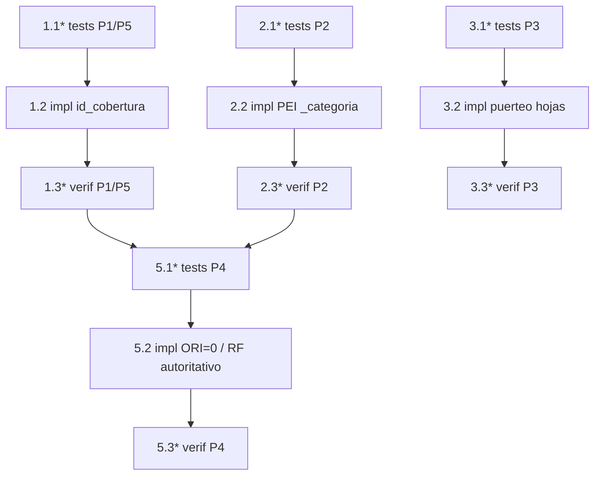

# Implementation Plan: excel-por-tramos-consistencia

## Overview

Corrección quirúrgica de cuatro defectos de consistencia del informe Excel en modo por tramos,
preservando intacto el modo punta a punta y las internas del motor de valoración (salvo la
propagación mínima de `id_cobertura`). El plan es **test-first**: para cada defecto se escriben
primero las pruebas (propiedad + ejemplo), luego el cambio quirúrgico, y por último se re-ejecutan
las mismas pruebas para verificar.

Convención de ejecución (Windows / Google Drive, el usuario corre los comandos de larga duración
manualmente):

```
python -m pytest "g:\Mi unidad\AXIS\AXIS\tests\test_<nombre>.py" ^
  --rootdir "g:\Mi unidad\AXIS\AXIS" -o addopts="" -p no:cacheprovider
```

- Pruebas en `tests/`, con `pytest` + `hypothesis` ya presentes; reutilizar fixtures y BD de ejemplo.
- `@settings(deadline=None)` en todos los tests de Hypothesis; mínimo **100 iteraciones** por propiedad.
- Si un test toca un fixture de BD, suprimir `HealthCheck.too_slow` (`suppress_health_check=[HealthCheck.too_slow]`).
- Cada test de propiedad lleva el tag `Feature: excel-por-tramos-consistencia, Property {N}: {texto}`.
- Sin dependencias nuevas, sin defaults hardcoded, logs genéricos, consultas BD parametrizadas `mode=ro`.

## Tasks

- [ ] 1. Defecto 1 — Herencia de `id_cobertura` en cupones reinvertidos

  - [ ]* 1.1 Escribir primero las pruebas de herencia de `id_cobertura` (P1) y regresión del motor (P5)
    - Crear `tests/test_property_id_cobertura_reinversion.py` con `pytest` + `hypothesis`.
    - **Property 1: Herencia de `id_cobertura` y condición de subyacente** — generar un `Titulo` origen con `id_cobertura` vacío/no vacío + un cupón; reinvertir por `reinvertir_cupon` y por la ruta de vencimiento; afirmar `nuevo.id_cobertura == origen.id_cobertura` y que `es_subyacente` derivado (vía `construir_rf_detalle`) sea verdadero si y solo si `bool(str(id_cobertura).strip())`.
    - **Property 5: Regresión del motor — campos inalterados salvo `id_cobertura`** — comparar todos los campos del `Titulo` reinvertido contra el `Titulo` construido con la ruta previa (snapshot sin el cambio); única diferencia permitida: `id_cobertura`.
    - Nota de estado esperado: antes del cambio (tarea 1.2) P1 debe **FALLAR** (el cupón reinvertido llega con `id_cobertura=""`); P5 debe **PASAR** salvo por el campo `id_cobertura` que aún no se propaga.
    - `@settings(deadline=None)`, ≥100 ejemplos; `suppress_health_check=[HealthCheck.too_slow]` si se toca el fixture de BD para `construir_rf_detalle`.
    - _Requirements: 1.1, 1.2, 1.3, 1.4, 1.5, 5.2_
    - _Property: P1, P5_

  - [ ] 1.2 Propagar `id_cobertura` en los dos constructores de `Titulo` reinvertido
    - En `scripts/motor_proyeccion.py::reinvertir_cupon` (~L705-731) añadir `id_cobertura=original.id_cobertura` al constructor `Titulo(...)`.
    - En la reinversión por vencimiento (~L1067-1095) añadir `id_cobertura=titulo.id_cobertura` al constructor `Titulo(...)`.
    - No tocar ningún otro campo ni la lógica de valoración; mantener los cupones plegados en el padre vía `_cupones_cobrados` (no se crean filas nuevas en `rf_detalle`).
    - _Requirements: 1.1, 1.2, 1.3, 1.4, 1.5, 5.2_
    - _Property: P1, P5_

  - [ ]* 1.3 Verificar — re-ejecutar `tests/test_property_id_cobertura_reinversion.py`
    - Confirmar que P1 y P5 ahora **PASAN** (herencia correcta; único campo diferente `id_cobertura`).
    - _Requirements: 1.1, 1.2, 1.3, 1.4, 1.5, 5.2_
    - _Property: P1, P5_

- [ ] 2. Defecto 2 — Categoría propia PEI separada de RV Local

  - [ ]* 2.1 Escribir primero las pruebas de partición PEI (P2) y los casos de `_categoria`
    - Crear `tests/test_property_categoria_pei.py` con `pytest` + `hypothesis`.
    - **Property 2: PEI particionado fuera de RV Local** — generar colecciones de posiciones RV locales mezclando PEI/no-PEI por corte; construir el resumen; afirmar que ninguna posición con `asset_class_definitivo='PEI'` cae en "RV Local", que el total de "RV Local" = Σ P&G de RV locales no-PEI (COLCAP) y el total de "PEI" = Σ P&G de posiciones PEI, en todos los tramos con PEI.
    - Añadir tests de ejemplo (unit): `_categoria("RENTA_VARIABLE", moneda, "PEI", es_subyacente=False, es_pei=True)` → "PEI"; RV local no-PEI → "RV Local"; subyacente → "Subyacentes de Swaps"; y que `_mapa_clasificacion` deriva `es_pei` de `asset_class_definitivo`.
    - Nota de estado esperado: antes del cambio (2.2) P2 y los ejemplos PEI deben **FALLAR** (hoy el PEI cae en "RV Local").
    - `@settings(deadline=None)`, ≥100 ejemplos; `suppress_health_check=[HealthCheck.too_slow]` si se toca el fixture de BD.
    - _Requirements: 2.1, 2.2, 2.3, 2.4, 2.5, 5.7_
    - _Property: P2_

  - [ ] 2.2 Añadir rama "PEI" a la clasificación de categoría
    - En `tools/export_resumen_tramos.py::_categoria` añadir parámetro `es_pei: bool = False` y rama RV: si `es_pei or asset_class.upper()=='PEI'` → "PEI"; en otro caso "RV Internacional"/"RV Local" según moneda.
    - En `_mapa_clasificacion` derivar columna booleana `es_pei` desde `asset_class` (que ya proviene de `asset_class_definitivo`): `df["es_pei"] = df["asset_class"].astype(str).str.strip().str.upper().eq("PEI")`, con default defensivo `False` si falta la columna.
    - Enrutar el bucle RV de `_resumen_no_rf` a través de `_categoria` usando el flag `es_pei` resuelto por especie desde `df_clasif`, de modo que una especie PEI nunca se agregue bajo "RV Local".
    - PEI identificado solo por el dato `asset_class_definitivo='PEI'` (sin literales de especie embebidos).
    - _Requirements: 2.1, 2.2, 2.3, 2.4, 2.5, 5.7_
    - _Property: P2_

  - [ ]* 2.3 Verificar — re-ejecutar `tests/test_property_categoria_pei.py`
    - Confirmar que P2 y los ejemplos de `_categoria`/`_mapa_clasificacion` ahora **PASAN**; "RV Local" queda solo con COLCAP y "PEI" aparece en los cortes con posiciones PEI.
    - _Requirements: 2.1, 2.2, 2.3, 2.4, 2.5_
    - _Property: P2_

- [ ] 3. Defecto 3 — Omisión de hojas incorrectas del store en modo por tramos

  - [ ]* 3.1 Escribir primero la prueba de puerteo de hojas por modo (P3)
    - Crear `tests/test_property_puerteo_hojas_tramos.py` con `pytest` + `hypothesis`.
    - **Property 3: Puerteo de hojas del store según el modo** — generar un store con claves `derivados`, `rv`, `alternativos`, `creditos` y `parametros.modo`; invocar la escritura del Excel; afirmar que con `modo=='por_tramos'` el libro NO contiene `Derivados`, `RV_Mensual`, `Alt_Mensual`, `Creditos` ni `Creditos_Tramos`, y que con `modo=='punta_a_punta'` las cuatro hojas SÍ están presentes.
    - Añadir test de ejemplo: lectura de `modo` desde `data['parametros']['modo']` y fallback a `'punta_a_punta'` cuando falta el campo (sin alterar el flujo por tramos).
    - Nota de estado esperado: antes del cambio (3.2) la rama `por_tramos` debe **FALLAR** (hoy las cuatro hojas se escriben siempre que hay datos en el store).
    - `@settings(deadline=None)`, ≥100 ejemplos.
    - _Requirements: 3.1, 3.2, 3.4, 3.5, 5.1, 5.7_
    - _Property: P3_

  - [ ] 3.2 Puertear las cuatro `to_excel` del store por modo en `descargar_resultados_excel`
    - En `app_dash.py::descargar_resultados_excel` (~L8919-9015) leer una vez `_modo = str((data.get('parametros') or {}).get('modo') or 'punta_a_punta')` y `_es_por_tramos = (_modo == 'por_tramos')`.
    - Guardar con `not _es_por_tramos and data.get(...)` las cuatro escrituras: `Derivados`, `RV_Mensual`, `Alt_Mensual`, `Creditos`.
    - No tocar las demás hojas del store ni las series `*_Tramos` de la Vía A; no crear `Creditos_Tramos`.
    - _Requirements: 3.1, 3.2, 3.3, 3.4, 3.5, 5.1, 5.3, 5.7_
    - _Property: P3_

  - [ ]* 3.3 Verificar — re-ejecutar `tests/test_property_puerteo_hojas_tramos.py`
    - Confirmar que P3 ahora **PASA**: hojas omitidas en por tramos, intactas en punta a punta.
    - _Requirements: 3.1, 3.2, 3.4, 3.5, 5.1_
    - _Property: P3_

- [ ] 4. Checkpoint intermedio — Defectos 1, 2 y 3 estables
  - Ensure all tests pass, ask the user if questions arise.

- [ ] 5. Defecto 4 — Reconciliación de `TotalCategoria`/`ResumenPyG` con el detalle por título
  (depende de los Defectos 1 y 2: el ruteo de subyacentes y PEI debe estar en su lugar para que
  la reconciliación RF sea significativa)

  - [ ]* 5.1 Escribir primero la prueba de reconciliación RF y ORI=0 en no-RF (P4)
    - Crear `tests/test_property_reconciliacion_total_categoria.py` con `pytest` + `hypothesis`.
    - **Property 4: Reconciliación RF y ORI=0 en no-RF** — generar `rf_detalle` sintético por corte (columnas `id_posicion, moneda, asset_class, es_subyacente, clasificacion, pyg, ori, total_resultado`); construir `ResumenPyG`/`TotalCategoria`; afirmar que, por categoría RF, Σ P&G y Σ ORI de `TotalCategoria_<corte>` coinciden (tolerancia float64) con Σ P&G y Σ ORI del `rf_detalle` de las mismas categorías; y que toda fila no-RF cumple `ORI == 0` y `total_resultado == P&G`.
    - Incluir casos con subyacentes (categoría "Subyacentes de Swaps") y con PEI para verificar coherencia con los Defectos 1 y 2.
    - `@settings(deadline=None)`, ≥100 ejemplos; `suppress_health_check=[HealthCheck.too_slow]` si se toca el fixture de BD.
    - _Requirements: 4.1, 4.2, 4.3, 4.4, 4.6_
    - _Property: P4_

  - [ ] 5.2 Formalizar ORI=0 en no-RF y mantener `_resumen_rf` autoritativo desde `rf_detalle`
    - En `tools/export_resumen_tramos.py::_resumen_no_rf` fijar explícitamente `"ori": 0.0` y `"total_resultado" == pyg` en todas las filas no-RF (RV/Alt/derivados), documentando como limitación conocida que no-RF reporta ORI=0 y todo el resultado en P&G.
    - Confirmar que `_resumen_rf` sigue consumiendo el mismo `rf_detalle` por título (fuente única) y que el ruteo de categoría usa `_categoria` sobre el `es_subyacente` del propio `rf_detalle` y el `asset_class`/PEI (coherente con Defectos 1 y 2).
    - No añadir fuentes nuevas ni recalcular RF por otra vía; `TotalCategoria` permanece como `groupby("Categoría")` de `ResumenPyG` en `tools/exportar_excel_tramos.py` (sin cambios ahí).
    - Mantener intacta la regla contable NEG/DV/VC de `scripts/rf_contable_mensual.py`.
    - _Requirements: 4.1, 4.2, 4.3, 4.4, 4.5, 4.6, 5.4_
    - _Property: P4_

  - [ ]* 5.3 Verificar — re-ejecutar `tests/test_property_reconciliacion_total_categoria.py`
    - Confirmar que P4 ahora **PASA**: RF reconcilia por categoría dentro de tolerancia y no-RF tiene ORI=0.
    - _Requirements: 4.1, 4.2, 4.3, 4.4, 4.6_
    - _Property: P4_

- [ ] 6. Checkpoint final — Suite nueva + regresión existente en verde
  - Ejecutar la suite nueva: `test_property_id_cobertura_reinversion.py`, `test_property_categoria_pei.py`, `test_property_puerteo_hojas_tramos.py`, `test_property_reconciliacion_total_categoria.py`.
  - Ejecutar las suites de regresión que deben seguir en verde: `tests/test_proyeccion_tramos.py`, `tests/test_tramos_multiactivo_*.py`, `tests/test_property_rf_mensual_por_tramos.py`, `tests/test_orquestador_consolidacion.py`.
  - Ensure all tests pass, ask the user if questions arise.

## Notes

- Las subtareas marcadas con `*` son de prueba (propiedad/ejemplo/verificación) y pueden omitirse para un MVP más rápido, aunque el flujo es test-first y se recomienda ejecutarlas.
- Cada tarea referencia requisitos específicos y la propiedad del diseño que valida (P1–P5).
- Los checkpoints aseguran validación incremental; el checkpoint final cubre regresión (Req 5).
- Las pruebas de propiedad (Hypothesis) validan las cinco propiedades universales del diseño; las pruebas de ejemplo cubren wiring y casos borde (`modo`, `asset_class_definitivo`, `mode=ro`).
- Orden de dependencias: Defectos 1, 2 y 3 son independientes y se pueden abordar en paralelo; el Defecto 4 va después de 1 y 2 porque su reconciliación RF depende del ruteo de subyacentes (Req 1) y PEI (Req 2).
- Reglas del proyecto honradas: sin valores por defecto hardcoded (PEI por `asset_class_definitivo='PEI'`, modo por `data['parametros']['modo']`, subyacente por `id_cobertura`), logs genéricos sin datos sensibles, y consultas BD parametrizadas de solo lectura (`mode=ro`).

## Task Dependency Graph



```json
{
  "waves": [
    { "id": 0, "tasks": ["1.1", "2.1", "3.1"] },
    { "id": 1, "tasks": ["1.2", "2.2", "3.2"] },
    { "id": 2, "tasks": ["1.3", "2.3", "3.3"] },
    { "id": 3, "tasks": ["5.1"] },
    { "id": 4, "tasks": ["5.2"] },
    { "id": 5, "tasks": ["5.3"] }
  ]
}
```
