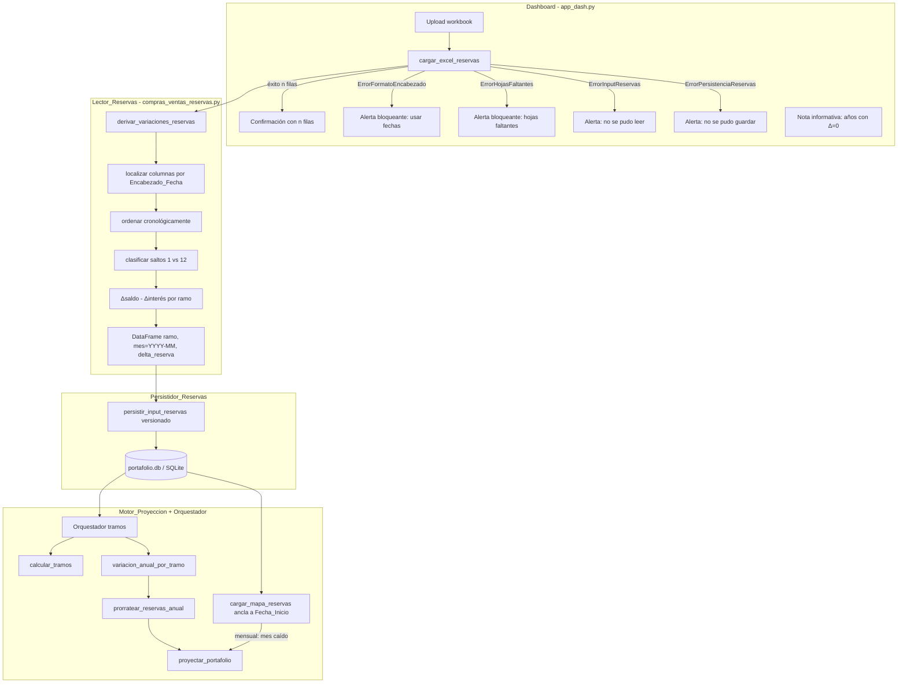
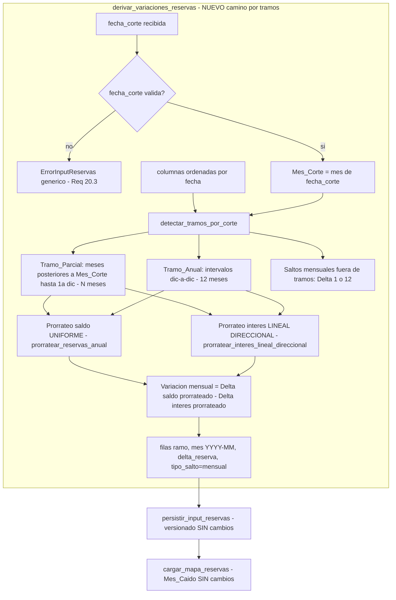

# Documento de Diseño

## Overview

Esta funcionalidad rehace la lectura y persistencia del insumo de **variación de reservas** que alimenta al `Motor_Proyeccion` para dirigir la compra/venta mensual de renta fija por ramo. El cambio es quirúrgico: se conserva la arquitectura de dos hojas, los `Diccionarios_Mapeo`, la maquinaria de tramos (`calcular_tramos`, `prorratear_reservas_anual`) y las rutas de consumo del motor.

El problema raíz es que el lector actual (`derivar_variaciones_reservas`) localiza las columnas de datos buscando el texto literal `"ENERO"` y exige exactamente 12 columnas contiguas Enero..Diciembre (`_localizar_columna_etiqueta`, `_MESES_ORDEN`). El archivo real de negocio trae **encabezados de fecha** (datetime) con un patrón MIXTO: todos los meses del año en curso y luego solo diciembre de los años siguientes (p. ej. `2026-06, 2026-07, …, 2026-12, 2027-12, 2028-12`). Con ese archivo el lector falla y aborta.

El rediseño introduce cuatro cambios coordinados:

1. **Lectura por `Encabezado_Fecha`.** El `Lector_Reservas` localiza las columnas de datos por encabezados de tipo fecha, deriva mes/año de cada columna, las ordena cronológicamente y procesa el número de columnas presente (sin exigir 12). Rechaza con error específico los encabezados con nombre de mes u otros formatos.

2. **Clasificación de saltos.** Para cada par de columnas consecutivas, el lector clasifica el salto por diferencia de meses: `1` → `Salto_Mensual` (variación mensual); `12` → `Salto_Anual` (variación diciembre-a-diciembre). Cualquier otra diferencia es un error de formato.

3. **Persistencia versionada con mes absoluto.** El `Persistidor_Reservas` guarda cada variación con `mes` como `Mes_Absoluto` (`"YYYY-MM"`) derivado del `Encabezado_Fecha`, y crea una `Versión_Carga` nueva con marca temporal en lugar de sobrescribir. El `Cargador_Mapa_Reservas` selecciona siempre la versión más reciente y ancla el mes absoluto a la `Fecha_Inicio_Proyeccion` con la convención `Mes_Caído`.

4. **Conexión anual↔tramos y alertas del dashboard.** El `Orquestador` construye `variacion_anual_por_tramo` a partir de los `Salto_Anual` derivados y la reparte con `prorratear_reservas_anual`. El `Dashboard` muestra alertas bloqueantes y específicas por causa (formato de encabezado, hojas faltantes, error de lectura, error de persistencia) y una nota informativa no bloqueante para años sin columna.

### Extensión NUEVA — coexistencia de dos disposiciones (Req 14–20)

> **Estado.** Los cuatro cambios anteriores (Req 1–13) **ya están implementados** en `scripts/compras_ventas_reservas.py` (`_localizar_columnas_fecha`, `_clasificar_saltos`, `_construir_saldos_por_ramo_fecha`, `_construir_intereses_fecha`, `_fila_niveles_por_fecha`, `derivar_variaciones_reservas`, `persistir_input_reservas`, `cargar_mapa_reservas`, `cargar_variacion_anual_por_ano`), en `app_dash.py` (`cargar_excel_reservas`, `_ejecutar_escenario_por_tramos`) y en `scripts/proyeccion_tramos.py` (`calcular_tramos`, `prorratear_reservas_anual`). Esta extensión **añade** el `Layout_Por_Tramo` **sin modificar** el comportamiento del `Layout_Mensual` ya en producción.

El insumo real también puede llegar en una disposición DISTINTA que debe **COEXISTIR** con la mensual. Ambas usan `Encabezado_Fecha`. La nueva `Layout_Por_Tramo` representa, tras un punto de partida (`Mes_Corte`), una única columna por fecha destino que corresponde a un `Periodo_Acumulado` a prorratear entre N meses (no un solo mes). El rediseño añade cinco piezas:

1. **El `Lector_Reservas` recibe la `Fecha_Corte` (Req 15.1).** Hoy `derivar_variaciones_reservas(ruta_excel_o_bytes, ramos_portafolio)` **NO** recibe la fecha de corte. Se **añade** un parámetro opcional `fecha_corte` (retrocompatible: `None` ⇒ comportamiento mensual actual intacto). El `Dashboard` (`cargar_excel_reservas`) pasa la `Fecha_Corte` del sidebar (`sidebar-fecha-inicio`).

2. **Detección del `Tramo_Parcial` por la `Fecha_Corte` (Req 14.3, 15).** El `Mes_Corte` (mes de la `Fecha_Corte`) es el **nivel base** y NO se proyecta. El `Tramo_Parcial` abarca los meses POSTERIORES al `Mes_Corte` hasta la primera columna de diciembre destino inclusive (N meses). Un salto desde el `Mes_Corte` hasta esa primera columna de diciembre (p. ej. julio→dic = 5 meses) que hoy `_clasificar_saltos` **rechazaría** (Δ∉{1,12}) ahora se reconoce como el `Tramo_Parcial`; los saltos **fuera** del `Tramo_Parcial` siguen admitiendo solo 1 o 12 meses (Req 15.6, 15.7).

3. **Doble prorrateo por hoja (Req 16, 17, 18).** La hoja de **saldo** trae un `Nivel_Saldo` de fin de periodo → `Δsaldo_periodo = Nivel_Saldo(dic) − Nivel_Saldo(Mes_Corte)` prorrateado **UNIFORME** (reutiliza `prorratear_reservas_anual`). La hoja de **interés** trae un `Interes_Acumulado_Periodo` → prorrateo **LINEAL DIRECCIONAL** cuyo sentido depende del **signo de `Δsaldo_periodo`** (≥0 creciente pesos 1..N; <0 decreciente pesos N..1); la suma == interés acumulado. La `Variación_Reserva` mensual sigue siendo `Δsaldo mensual − Δinterés mensual` y se etiqueta con `Mes_Absoluto` "YYYY-MM".

4. **Reutilización (Req 19).** `calcular_tramos` delimita tramos; `prorratear_reservas_anual` es el `Prorrateo_Uniforme` del saldo; se **añade** una función NUEVA `prorratear_interes_lineal_direccional` para el interés. Motor y persistencia versionada **sin cambios**.

5. **Entrada no confiable (Req 20).** Coerción a finito (no numérico/vacío→0), normalización de etiquetas, `Fecha_Corte` inválida → error genérico, consultas parametrizadas — consistente con Req 13.

**Decisión clave (ambigüedad resuelta).** ¿Cómo decide el lector si el primer salto a diciembre es un `Tramo_Parcial` (acumulado, prorrateado) o simplemente parte de una serie mensual? **La decisión se basa exclusivamente en la relación con la `Fecha_Corte`:** la columna de diciembre que sigue INMEDIATAMENTE a la columna del `Mes_Corte` define el `Tramo_Parcial`. Si `fecha_corte is None` (o no hay columna de diciembre inmediatamente posterior al `Mes_Corte`), **no hay `Tramo_Parcial`** y el lector opera en modo `Layout_Mensual` puro (Δ∈{1,12}), preservando el comportamiento actual. Los meses del `Tramo_Parcial` y del `Tramo_Anual` se emiten como **deltas mensuales** con `tipo_salto = 'mensual'` (son deltas mensuales DENTRO de un tramo), de modo que el `Persistidor_Reservas`, el `Cargador_Mapa_Reservas` y el `Orquestador` existentes los consuman por la **misma ruta `Mes_Caído`** sin cambios.

### Hallazgos de la investigación del código existente

- `derivar_variaciones_reservas(ruta_excel_o_bytes, ramos_portafolio) -> DataFrame[ramo, mes, delta_reserva]` ya calcula `Δsaldo − Δinterés` por ramo con los `Diccionarios_Mapeo`. Todo el aparato de agregación por ramo (`_construir_saldos_por_ramo`, `_construir_intereses`, agrupación Capitalizadora vía `TOTAL CAPI`) es reutilizable **sin cambios**. Lo único que cambia es cómo se localizan y ordenan las columnas de datos y cómo se etiqueta el `mes` de salida.
- El `mes` de salida hoy es un **offset entero** (2..12). La tabla `input_variacion_reservas` ya declara `mes TEXT` con `PRIMARY KEY (ramo, mes)`, y `_normalizar_mes_reserva` **ya acepta `"YYYY-MM"`**. Es decir, el esquema soporta el mes absoluto; el cambio es de contenido, no de tipo.
- `cargar_mapa_reservas` hoy convierte `mes` a `int` y descarta lo que no sea entero. Debe evolucionar para interpretar `"YYYY-MM"`, anclarlo a `Fecha_Inicio_Proyeccion` y devolver el offset mensual con `Mes_Caído` (offset del mes de proyección `t` ← variación de `t-1`).
- La persistencia actual es **destructiva** (`DELETE FROM input_variacion_reservas` + `INSERT OR REPLACE`). El versionado exige preservar cargas previas (nueva tabla o columna de versión).
- `motor_proyeccion.proyectar_portafolio` acepta `mapa_reservas` como override `{ramo: {mes_offset: delta}}` y lo consume con mes caído en el bloque `1C`. El `Orquestador` de tramos (`app_dash.py`) ya usa `prorratear_reservas_anual` para tramos anuales, pero hoy `variacion_anual_por_tramo=None`. Esa es la conexión pendiente (Req 8).

## Architecture

### Componentes y flujo



### Principios de diseño

- **Reutilización sobre reescritura (Req 12).** La lógica de agregación por ramo, los `Diccionarios_Mapeo`, `calcular_tramos` y `prorratear_reservas_anual` no se reimplementan. El motor conserva sus rutas mensual (`Mes_Caído`) y por tramos (`Prorrateo_Anual`).
- **Entrada no confiable (Req 13).** Todo el contenido del archivo se trata como no confiable: coerción numérica finita (no numérico/vacío → 0), normalización de etiquetas (`strip`/`upper`), consultas parametrizadas exclusivamente, y descarte de filas inválidas con advertencia genérica que no vuelca contenido.
- **Errores de dominio tipados.** Se separan las causas de fallo en excepciones distintas para que el `Dashboard` muestre mensajes específicos y accionables (Req 11).
- **Eje temporal derivado del archivo (Req 4).** No se asume un mes de inicio fijo; el eje sale de las fechas de los encabezados.

### Decisiones de diseño y su justificación

**Decisión 1 — Persistencia versionada mediante nueva tabla `input_variacion_reservas_versiones` + tabla de metadatos.**
En lugar de sobrescribir, se persiste cada carga con un `version_id` y un `fecha_carga` (timestamp ISO-8601 con precisión de segundos, suficiente para ordenar). El `Cargador_Mapa_Reservas` selecciona `MAX(fecha_carga)` (desempatando por `version_id`). Justificación: cumple Req 6 (auditoría) sin romper el esquema histórico; se conserva `input_variacion_reservas` como vista/compatibilidad si algún consumidor la lee directamente. Alternativa descartada: columna `version` en la tabla actual con PK `(ramo, mes)` — imposible, la PK impediría múltiples versiones de la misma `(ramo, mes)`.

**Decisión 2 — `mes` como `Mes_Absoluto` `"YYYY-MM"`.**
El esquema ya usa `mes TEXT` y `_normalizar_mes_reserva` ya valida `"YYYY-MM"`. Se estandariza la salida del lector en ese formato, derivándolo del `Encabezado_Fecha`. Justificación: elimina la ambigüedad del offset relativo (Req 5) y permite distinguir múltiples diciembres (`"2026-12"` ≠ `"2027-12"`, Req 5.3/9.4).

**Decisión 3 — Anclaje en la lectura (`cargar_mapa_reservas`), no en la persistencia.**
La persistencia guarda el mes calendario absoluto tal como viene del archivo; el mapeo a offset de proyección con `Mes_Caído` ocurre al leer, en función de la `Fecha_Inicio_Proyeccion` de la corrida. Justificación: un mismo insumo persistido sirve para corridas con distintas fechas de inicio (Req 7), sin re-persistir.

**Decisión 4 — Detección de fecha robusta.**
Una celda de encabezado se considera `Encabezado_Fecha` si es `datetime`/`date`/`pd.Timestamp`, o si `pd.to_datetime(valor, errors="coerce")` no es `NaT` **y** el valor no es puramente numérico ni un nombre de mes. Justificación: evita falsos positivos (un offset entero `1` no debe interpretarse como fecha) y falsos negativos (fechas serializadas por Excel).

### Arquitectura de la extensión NUEVA (Layout_Por_Tramo)

El `Layout_Por_Tramo` se resuelve **dentro** de `derivar_variaciones_reservas`, reutilizando toda la maquinaria de localización/lectura por fecha ya existente. El único punto de bifurcación es la **clasificación de saltos**: cuando se recibe `fecha_corte` y la primera columna de diciembre sigue al `Mes_Corte`, ese salto se marca como `Tramo_Parcial` (prorrateo) en vez de rechazarse.



**Decisión 5 — La `Fecha_Corte` viaja como parámetro opcional del lector (no como estado global).**
Se **añade** `fecha_corte: object | None = None` a `derivar_variaciones_reservas`. `None` ⇒ ruta `Layout_Mensual` idéntica a la actual (retrocompatibilidad total, Req 14.2). El `Dashboard` toma la fecha del `State('sidebar-fecha-inicio', 'date')` y la pasa al lector. Justificación: el mismo insumo persistido sirve para distintas corridas; el corte es un dato de la corrida, no del archivo. Alternativa descartada: leer la fecha desde la DB dentro del lector — acoplaría el lector al estado de la corrida y complicaría las pruebas.

**Decisión 6 — La disposición se decide por la relación salto↔`Mes_Corte`, no por una bandera del archivo.**
No hay metadato en el workbook que declare la disposición. El lector la infiere: si `fecha_corte` está presente y existe una columna cuyo salto desde el `Mes_Corte` es a la primera columna de diciembre (Δ meses ∉ {1,12}), ese salto es el `Tramo_Parcial`. Cualquier otra combinación con saltos ∈ {1,12} es `Layout_Mensual`. Justificación: cumple Req 14.3/15 sin cambiar el formato del archivo ni exigir configuración del usuario.

**Decisión 7 — Los meses de un tramo se emiten como filas mensuales (`tipo_salto = 'mensual'`).**
Tras prorratear un `Tramo_Parcial`/`Tramo_Anual`, el lector emite **una fila por mes** del tramo con su `Mes_Absoluto` "YYYY-MM" y `tipo_salto = 'mensual'`. Justificación: el `Persistidor_Reservas`, `cargar_mapa_reservas` (ruta `Mes_Caído`) y el `Orquestador` ya saben consumir filas mensuales por `Mes_Absoluto`; así el `Layout_Por_Tramo` reutiliza la ruta mensual completa **sin tocar** persistidor, cargador ni motor. **Consecuencia deliberada:** en el `Layout_Por_Tramo` NO se emiten filas `tipo_salto = 'anual'`; el prorrateo ya ocurre en el lector, por lo que la ruta `variacion_anual_por_tramo`/`prorratear_reservas_anual` del orquestador **no** se usa para este layout (se reutiliza `prorratear_reservas_anual` DENTRO del lector como implementación del `Prorrateo_Uniforme`). Esto es consistente con el diseño existente: el orquestador sigue leyendo por `Mes_Caído` la versión persistida.

## Components and Interfaces

### Lector_Reservas (`scripts/compras_ventas_reservas.py`)

**Nuevas excepciones de dominio (separan causas para el dashboard, Req 11.4):**

```python
class ErrorFormatoEncabezado(ErrorInputReservas):
    """Encabezados no son fechas (p. ej. nombres de mes) o hay un salto de meses
    distinto de 1/12 entre columnas consecutivas. Mensaje genérico."""

class ErrorHojasFaltantes(ErrorInputReservas):
    """Falta 'Saldo Reservas' o 'Interés a la Reserva'. Distinto de formato."""
```

Ambas heredan de `ErrorInputReservas` para preservar retrocompatibilidad de captura, pero permiten discriminar la causa.

**Funciones nuevas / modificadas:**

```python
def _es_encabezado_fecha(valor: object) -> bool:
    """True si la celda es una fecha reconocible (datetime/date/Timestamp o texto
    parseable a fecha que NO sea numérico ni nombre de mes)."""

def _localizar_columnas_fecha(df: pd.DataFrame) -> tuple[int, int, list[tuple[int, date]]]:
    """Localiza la columna-etiqueta y las columnas de datos por Encabezado_Fecha.
    Devuelve (fila_encabezados, col_etiqueta, columnas) donde `columnas` es una
    lista de (indice_columna, primer_dia_del_mes) ORDENADA cronológicamente.
    Reglas:
      - Recorre las filas superiores buscando la que contenga >= 2 celdas fecha.
      - La col_etiqueta es la primera columna de texto a la izquierda del primer
        Encabezado_Fecha.
      - Si detecta nombres de mes ('ENERO'...) en la fila de encabezados en lugar
        de fechas -> ErrorFormatoEncabezado.
      - Si no hay ninguna columna con Encabezado_Fecha -> ErrorFormatoEncabezado.
    """

def _clasificar_saltos(columnas: list[tuple[int, date]]) -> list[tuple[int, int, str, date]]:
    """Para columnas consecutivas ya ordenadas, devuelve para cada salto
    (col_desde, col_hasta, tipo, mes_absoluto_hasta) con tipo en {'mensual','anual'}.
    Δmeses == 1 -> 'mensual'; Δmeses == 12 -> 'anual'; cualquier otro -> ErrorFormatoEncabezado."""
```

`derivar_variaciones_reservas` se refactoriza para:
1. Validar hojas (`_validar_hojas`) → `ErrorHojasFaltantes` si faltan (antes: `ErrorInputReservas` genérico).
2. Localizar columnas de fecha por hoja y **ordenar** cronológicamente.
3. Clasificar cada salto; para cada salto derivar `Δsaldo − Δinterés` por ramo respecto de la columna anterior (reutiliza `_variacion_mes_a_mes` generalizado a cualquier par de columnas).
4. Etiquetar `mes` como el `Mes_Absoluto` (`"YYYY-MM"`) de la **columna destino** del salto.
5. Devolver `DataFrame[ramo, mes, delta_reserva, tipo_salto]` — se añade `tipo_salto` (`'mensual'`/`'anual'`) para que el orquestador pueda separar saltos anuales (Req 8). La persistencia ignora columnas fuera de su allowlist.

**Firma de retorno (ampliada, retrocompatible por nombres de columna):**

```python
def derivar_variaciones_reservas(
    ruta_excel_o_bytes: "str | bytes",
    ramos_portafolio: "set[str]",  # conservado por compatibilidad; se ignora
) -> "pd.DataFrame":  # columnas: ramo, mes (YYYY-MM), delta_reserva, tipo_salto
    ...
```

### Lector_Reservas — extensión Layout_Por_Tramo (NUEVO, `scripts/compras_ventas_reservas.py`)

**Cambio de firma (Req 15.1) — retrocompatible:**

```python
def derivar_variaciones_reservas(
    ruta_excel_o_bytes: "str | bytes",
    ramos_portafolio: "set[str]",          # conservado por compatibilidad; se ignora
    fecha_corte: "object | None" = None,   # NUEVO — Fecha_Corte del dashboard
) -> "pd.DataFrame":                        # columnas: ramo, mes (YYYY-MM), delta_reserva, tipo_salto
    ...
```

- `fecha_corte is None` ⇒ **ruta `Layout_Mensual` EXACTAMENTE la actual** (sin cambios observables, Req 14.2). Todo el aparato UNCHANGED (`_localizar_columnas_fecha`, `_construir_saldos_por_ramo_fecha`, `_construir_intereses_fecha`, `_clasificar_saltos`, `_variacion_mes_a_mes`) se reutiliza.
- `fecha_corte` presente pero inválida (no coercible a fecha) ⇒ `ErrorInputReservas` genérico **antes** de dimensionar tramos o derivar (Req 20.3). No se vuelca el valor.

**Funciones NUEVAS:**

```python
def detectar_tramos_por_corte(
    columnas: "list[tuple[int, date]]",   # (indice_columna, primer_dia_del_mes) ordenadas asc
    mes_corte: "date",                    # primer día del Mes_Corte (mes de la Fecha_Corte)
) -> "list[Segmento]":
    """
    Segmenta las columnas ordenadas en tramos según la Fecha_Corte (Req 14.3, 15).

    Reglas:
      - Localiza la columna del Mes_Corte (nivel BASE, NO se proyecta — Req 15.2). Si el
        Mes_Corte no está entre las columnas, se usa como base sintética el nivel de la
        última columna <= Mes_Corte.
      - TRAMO_PARCIAL (Req 15.3): desde la columna inmediatamente posterior al Mes_Corte
        hasta la PRIMERA columna de diciembre destino inclusive. N = meses(Mes_Corte→dic).
        Solo se crea si esa primera columna destino es un diciembre y N != 1 (si N==1 es
        un simple Salto_Mensual del Layout_Mensual).
      - TRAMO_ANUAL (Req 15.5): cada intervalo diciembre-a-diciembre posterior (12 meses).
      - MENSUAL (Req 15.6): saltos de 1 mes fuera del Tramo_Parcial se tratan como
        Salto_Mensual del Layout_Mensual.
      - Columnas mensuales ANTERIORES al Mes_Corte (Req 15.8): se conservan como columnas
        mensuales válidas (Δ=1) SIN error; sus offsets caerán < 1 y Mes_Caído los omite.
      - Salto fuera del Tramo_Parcial con Δ meses ∉ {1,12} ⇒ ErrorFormatoEncabezado
        (Req 15.7).

    Returns:
        Lista de `Segmento(tipo, mes_base, meses)` donde `tipo ∈ {'parcial','anual','mensual'}`,
        `mes_base` es el Mes_Absoluto del nivel base del segmento y `meses` es la lista
        ordenada de Mes_Absoluto (destino) que abarca el segmento (N para parcial,
        12 para anual, 1 para mensual).
    """

def prorratear_interes_lineal_direccional(
    interes_acumulado: float,     # Interes_Acumulado_Periodo (columna destino de interés)
    n_meses: int,                 # N meses del tramo (>= 1)
    delta_saldo_periodo: float,   # Δsaldo_periodo; su SIGNO fija la dirección
    tolerancia: float = 1e-6,
) -> "list[float]":
    """
    Prorrateo_Lineal_Direccional del interés (Req 17). NUEVA función (distinta del
    Prorrateo_Uniforme). Devuelve N deltas mensuales de interés cuyo orden depende del
    signo de `delta_saldo_periodo`:

      - delta_saldo_periodo >= 0 → CRECIENTE: peso del mes i (i=1..N) = i.
        delta_i = interes_acumulado * i / (1+2+...+N)                     (Req 17.2)
      - delta_saldo_periodo <  0 → DECRECIENTE: peso del mes i (i=1..N) = N-i+1.
        delta_i = interes_acumulado * (N-i+1) / (1+2+...+N)               (Req 17.3)

    Invariante (Req 17.4): sum(deltas) == interes_acumulado dentro de `tolerancia`,
    preservando el SIGNO del interés acumulado (solo se invierte el ORDEN de los pesos).
    El residuo de redondeo se acumula en el último mes (i=N para creciente; el de menor
    peso para decreciente) para preservar la suma exacta, igual que prorratear_reservas_anual.

    Ejemplos (Req 17.5/17.6): interes_acumulado=75, N=5 →
      creciente:  [5, 10, 15, 20, 25];  decreciente: [25, 20, 15, 10, 5].

    Entrada NO confiable: interes_acumulado y delta_saldo_periodo se coercionan a float
    finito (Req 20.1); n_meses < 1 ⇒ ValueError.
    """
```

**Orquestación interna de `derivar_variaciones_reservas` con `fecha_corte` (por ramo de portafolio):**

1. Reutiliza `_construir_saldos_por_ramo_fecha` / `_construir_intereses_fecha` (UNCHANGED) para obtener `{ramo: {Mes_Absoluto: nivel}}` de saldo e interés.
2. `mes_corte = _primer_dia_del_mes(fecha_corte)`; `segmentos = detectar_tramos_por_corte(columnas_saldo, mes_corte)`.
3. Para cada `ramo` y cada `Segmento`:
   - `tipo == 'mensual'`: como hoy, `Δsaldo − Δinterés` del salto de 1 (o 12) mes, `tipo_salto` correspondiente.
   - `tipo ∈ {'parcial','anual'}` (N = `len(segmento.meses)`):
     - `Δsaldo_periodo = nivel_saldo(dic destino) − nivel_saldo(mes_base)` (Req 16.2).
     - Saldo mensual: `prorratear_reservas_anual({ramo: Δsaldo_periodo}, N)[ramo]` ⇒ N deltas uniformes (Req 16.3, 16.6). *Reutiliza la maquinaria existente como `Prorrateo_Uniforme`.*
     - Interés mensual: `interes_acum = nivel_interes(dic destino)` interpretado como acumulado del periodo (Req 17.1); `prorratear_interes_lineal_direccional(interes_acum, N, Δsaldo_periodo)` ⇒ N deltas direccionales (Req 17.2–17.4, 17.7).
     - `Variación_Reserva[mes_i] = Δsaldo_mensual_i − Δinteres_mensual_i` (Req 18.1); una fila por mes con `mes = Mes_Absoluto(mes_i)` "YYYY-MM" (Req 18.5) y `tipo_salto = 'mensual'` (Decisión 7).
4. Capitalizadora: mismo tratamiento usando `saldo_total_capi`/`interes_capi`.
5. Devuelve el mismo `DataFrame[ramo, mes, delta_reserva, tipo_salto]` que ya espera `persistir_input_reservas`.

> **Nota sobre el interés del periodo.** En el `Layout_Por_Tramo` la columna destino de interés es el `Interes_Acumulado_Periodo` (una variación ya acumulada, no un nivel, Req 17.1). Por eso se usa **directamente** como monto a prorratear, a diferencia del `Layout_Mensual` donde el interés es un nivel y se deriva por resta. El nivel base de interés del `Mes_Corte` no interviene en el monto acumulado (el acumulado ya es la variación del periodo).

### Persistidor_Reservas (`scripts/compras_ventas_reservas.py`) — UNCHANGED

> El `Layout_Por_Tramo` **no cambia** el persistidor (Req 19.5): recibe el mismo `DataFrame[ramo, mes, delta_reserva, tipo_salto]` con filas mensuales y lo versiona igual.

```python
def persistir_input_reservas(df: "pd.DataFrame", *, reintentos: int = 3) -> int:
    """Crea una Versión_Carga nueva (no sobrescribe). Devuelve el número de filas
    persistidas (para el mensaje del dashboard, Req 11.5).
    - Valida allowlist de columnas {ramo, mes, delta_reserva} (tipo_salto opcional,
      se ignora si viene).
    - `mes` se valida con _normalizar_mes_reserva EXIGIENDO formato 'YYYY-MM'
      (Req 5.4): año de 4 dígitos, mes 01-12; otros valores -> ValueError.
    - Inserta en input_variacion_reservas_versiones con un version_id nuevo y
      fecha_carga ISO-8601. Preserva versiones anteriores (Req 6.1, 6.2).
    - Filas con delta no finito -> se descartan con advertencia genérica (Req 13.4).
    - Consultas parametrizadas; reintentos ante 'database is locked'."""
```

### Cargador_Mapa_Reservas (`scripts/compras_ventas_reservas.py`)

```python
def cargar_mapa_reservas(
    ruta_db: str,
    fecha_inicio: object,      # Fecha_Inicio_Proyeccion
    meses_horizonte: int,
) -> dict[str, dict[int, float]]:
    """Lee la Versión_Carga MÁS RECIENTE y devuelve {ramo: {mes_offset: delta}}.
    - Selecciona MAX(fecha_carga) (Req 6.3).
    - Para cada fila (ramo, mes='YYYY-MM', delta): ancla el Mes_Absoluto a
      fecha_inicio aplicando Mes_Caído -> el delta del mes calendario M se asigna
      al offset de proyección t tal que el mes de proyección t-1 == M (Req 7.1, 7.2).
    - Meses fuera de [1, meses_horizonte] se omiten (el motor asume Δ=0, Req 7.3, 10.1).
    - Filas con mes no 'YYYY-MM' o delta no finito -> descarte con advertencia."""

def cargar_variacion_anual_por_ano(ruta_db: str) -> dict[int, dict[str, float]]:
    """Lee la Versión_Carga más reciente y devuelve, SOLO para los Salto_Anual,
    {ano_diciembre: {ramo: delta_anual}}. Usado por el Orquestador para construir
    variacion_anual_por_tramo (Req 8.1, 8.2)."""
```

> Nota: como la tabla no persiste `tipo_salto`, la distinción mensual/anual en lectura se reconstruye por la diferencia entre `Mes_Absoluto` consecutivos del mismo ramo, o bien se persiste `tipo_salto` como columna adicional en la tabla de versiones (ver Data Models). Se elige **persistir `tipo_salto`** para evitar reconstrucción ambigua.

### Orquestador (`app_dash.py`)

Se conecta la variación anual a los tramos en la ruta por tramos (`_ejecutar_proyeccion_por_tramos`):

```python
# Antes: variacion_anual_por_tramo=None
# Ahora: construir a partir de cargar_variacion_anual_por_ano + calcular_tramos
variacion_anual_por_ano = cargar_variacion_anual_por_ano(str(DB_PATH))
variacion_anual_por_tramo = [
    variacion_anual_por_ano.get(tramo.fecha_corte.year, {})
    for tramo in tramos
]
```

Para tramos con periodicidad anual, el orquestador ya llama `prorratear_reservas_anual(variacion, sub_horizonte)` (Req 8.3). `calcular_tramos` sigue delimitando los tramos (Req 8.4, 9). Los años sin columna en el insumo producen `{}` → Δ=0 (Req 10.1) y disparan la nota informativa del dashboard (Req 10.2).

**Impacto del `Layout_Por_Tramo` en el Orquestador (Req 19.4) — SIN cambios.** Como el `Layout_Por_Tramo` emite filas **mensuales** ya prorrateadas por `Mes_Absoluto` (Decisión 7), el orquestador las consume por la ruta mensual existente (`cargar_mapa_reservas` + `Mes_Caído`) — la MISMA rama `else` (periodicidad `'mensual'`) del bucle de `_ejecutar_escenario_por_tramos`. No se requiere ninguna modificación en `_ejecutar_escenario_por_tramos`, `calcular_tramos`, `prorratear_reservas_anual` ni el motor: el prorrateo del layout por tramos ocurre **antes** de persistir, dentro del `Lector_Reservas`.

### Dashboard (`cargar_excel_reservas`, `app_dash.py`)

**Cambio NUEVO (Req 15.1) — pasar la `Fecha_Corte` al lector.** Hoy el callback tiene firma `cargar_excel_reservas(contents, filename)` y decorador con `Input('upload-reservas','contents')` + `State('upload-reservas','filename')`. Se **añade** `State('sidebar-fecha-inicio', 'date')` para obtener la `Fecha_Corte` de la corrida y pasarla al lector:

```python
@callback(
    Output('msg-upload-reservas', 'children'),
    Input('upload-reservas', 'contents'),
    State('upload-reservas', 'filename'),
    State('sidebar-fecha-inicio', 'date'),   # NUEVO — Fecha_Corte
    prevent_initial_call=True,
)
def cargar_excel_reservas(contents, filename, fecha_corte):   # NUEVO parámetro
    ...
    fc = pd.to_datetime(fecha_corte).date() if fecha_corte else None
    df = derivar_variaciones_reservas(BytesIO(contenido_bytes), ramos_port, fecha_corte=fc)
    n = persistir_input_reservas(df)
```

- Si `fecha_corte` es `None` (el usuario no ha elegido corte) ⇒ el lector opera en `Layout_Mensual` puro (retrocompatibilidad). Un valor no coercible a fecha lo detecta el lector como `ErrorInputReservas` genérico (Req 20.3) y el `Dashboard` muestra la alerta de lectura existente.
- El resto del callback (discriminación de excepciones y mensajes) **no cambia**.

El callback discrimina por tipo de excepción y devuelve alertas específicas y bloqueantes:

```python
except ErrorHojasFaltantes:
    return _alerta("❌ El archivo debe contener las hojas «Saldo Reservas» e "
                   "«Interés a la Reserva».")           # Req 11.2
except ErrorFormatoEncabezado:
    return _alerta("❌ Los encabezados de columna deben ser FECHAS (no nombres de "
                   "mes ni otros formatos). Verifica el archivo.")  # Req 11.1
except ErrorInputReservas:
    return _alerta("❌ No se pudo leer el archivo de reservas.")     # Req 11.4
except ErrorPersistenciaReservas:
    return _alerta("❌ No se pudo guardar la variación de reservas.")# Req 11.4
# éxito:
return _ok(f"✅ Variación de reservas cargada ({n} filas).")        # Req 11.5
```

El componente que muestra la alerta bloqueante impide que la corrida proceda con ese archivo (Req 11.3): mientras haya alerta de error, el estado del insumo queda inválido y el botón de proyección no consume una versión recién fallida.

## Data Models

### `Encabezado_Fecha` (en memoria)

Representa una columna de datos localizada:

| Campo | Tipo | Descripción |
|-------|------|-------------|
| `indice_columna` | `int` | Índice 0-based de la columna en la hoja |
| `mes_absoluto` | `date` | Primer día del mes/año del encabezado (normalizado) |

### Salto entre columnas (en memoria)

| Campo | Tipo | Descripción |
|-------|------|-------------|
| `col_desde` | `int` | Columna cronológicamente anterior |
| `col_hasta` | `int` | Columna cronológicamente posterior |
| `tipo` | `str` | `'mensual'` (Δ=1 mes) o `'anual'` (Δ=12 meses) |
| `mes_absoluto` | `str` | `"YYYY-MM"` de la columna destino |

### Segmento de tramo (en memoria, NUEVO — Layout_Por_Tramo)

Resultado de `detectar_tramos_por_corte`. Describe un tramo a prorratear o un salto mensual:

| Campo | Tipo | Descripción |
|-------|------|-------------|
| `tipo` | `str` | `'parcial'` (N meses), `'anual'` (12 meses) o `'mensual'` (1 mes) |
| `mes_base` | `date` | `Mes_Absoluto` del nivel base (para `'parcial'` es el `Mes_Corte`; NO se proyecta) |
| `meses` | `list[date]` | `Mes_Absoluto` destino que abarca el segmento (N para parcial, 12 anual, 1 mensual), ordenados ascendente; el último es la columna destino (p. ej. diciembre) |

Invariantes: para `'parcial'`, `len(meses) == N` y `meses[-1].month == 12`; todos los `meses` son estrictamente posteriores a `mes_base` (Req 15.2/15.3). Para `'anual'`, `len(meses) == 12`.

### DataFrame de variación derivada (salida del lector)

| Columna | Tipo | Descripción |
|---------|------|-------------|
| `ramo` | `str` | Ramo de portafolio (destino del `Diccionario_Mapeo`, normalizado) |
| `mes` | `str` | `Mes_Absoluto` `"YYYY-MM"` de la columna destino del salto |
| `delta_reserva` | `float` | `Δsaldo − Δinterés` finito |
| `tipo_salto` | `str` | `'mensual'` o `'anual'` |

### Esquema SQLite versionado

Nueva tabla de versiones (creación idempotente desde la capa de aplicación, `CREATE TABLE IF NOT EXISTS`):

```sql
CREATE TABLE IF NOT EXISTS input_variacion_reservas_versiones (
    version_id   INTEGER NOT NULL,   -- identificador de la Versión_Carga
    ramo         TEXT    NOT NULL,
    mes          TEXT    NOT NULL,    -- Mes_Absoluto 'YYYY-MM'
    delta_reserva REAL   NOT NULL,
    tipo_salto   TEXT    NOT NULL,    -- 'mensual' | 'anual'
    fecha_carga  TEXT    NOT NULL,    -- ISO-8601, precisión de segundos
    PRIMARY KEY (version_id, ramo, mes)
);
CREATE INDEX IF NOT EXISTS ix_ivrv_carga
    ON input_variacion_reservas_versiones (fecha_carga);
```

- `version_id` se asigna como `MAX(version_id) + 1` dentro de la transacción de carga (o timestamp monotónico). Permite múltiples versiones de la misma `(ramo, mes)` (imposible con la PK `(ramo, mes)` histórica).
- La versión más reciente se obtiene por `MAX(fecha_carga)` (Req 6.3, 6.4), desempatando por `MAX(version_id)`.
- La tabla histórica `input_variacion_reservas` se conserva para compatibilidad; opcionalmente el persistidor también refresca esa tabla con la última versión para consumidores que aún la lean directamente.

### Anclaje `Mes_Absoluto` → offset de proyección (lectura)

Dado `fecha_inicio` (mes de proyección `t=1`), el `Mes_Caído` aplica: la variación del mes calendario `M` se usa en el mes de proyección `t` donde el mes calendario de `t-1` es `M`. En offsets:

```
offset_proyeccion(M) = meses_entre(mes(fecha_inicio), M) + 1
```

Solo se conservan offsets en `[1, meses_horizonte]`; el resto se omite (Δ=0).

## Correctness Properties

*Una propiedad es una característica o comportamiento que debe cumplirse en todas las ejecuciones válidas del sistema: una afirmación formal de lo que el sistema debe hacer. Las propiedades son el puente entre las especificaciones legibles por humanos y las garantías de correctitud verificables por máquina.*

### Reflexión de propiedades (consolidación)

Tras el prework se consolidaron redundancias:

- **Clasificación de saltos:** 3.1 (mensual) y 3.2 (anual) se combinan en una sola propiedad de clasificación por Δmeses. 3.3 (patrón mixto) queda cubierta por esa clasificación aplicada a secuencias.
- **Inyectividad de meses absolutos:** 5.3 y 9.4 son la misma propiedad (diciembres de años distintos → claves distintas) → una sola propiedad.
- **No-destrucción de versiones:** 6.1 y 6.2 se combinan (crear versión nueva preservando previas).
- **Omisión → Δ=0:** 7.3 y 10.1 son la misma invariante (ramo/mes ausente ⇒ no aparece en el mapa ⇒ motor asume 0) → una sola propiedad.
- **Eje temporal derivado de fechas:** 4.2/4.3 se subsumen en 4.4 (independencia del mes de inicio). 5.2 se subsume en la cadena 1.2 + persistencia.
- **Anclaje + Mes_Caído:** 7.1 y 7.2 se combinan en una propiedad de anclaje con desfase.
- **Conexión anual↔tramo:** 8.1 y 8.2 se combinan (agrupar por año y asignar al tramo del año).

Los criterios de UI/mensajería (10.2, 10.3, 11.1–11.5, 12.4) se cubren con tests basados en ejemplos; los de arquitectura/reutilización (8.4, 9.1, 12.1, 12.3, 13.3) con smoke tests; se documentan en la Estrategia de Pruebas y no como propiedades.

### Property 1: Localización de columnas por Encabezado_Fecha

*Para cualquier* hoja cuyos encabezados contengan un conjunto de celdas de fecha en posiciones y valores arbitrarios (más columnas de ruido no-fecha), el `Lector_Reservas` localiza exactamente ese conjunto de columnas de datos y ninguna otra.

**Validates: Requirements 1.1, 1.4**

### Property 2: Derivación y orden cronológico del eje temporal

*Para cualquier* conjunto de `Encabezado_Fecha` presentado en orden arbitrario, el `Lector_Reservas` deriva para cada columna el `Mes_Absoluto` igual a `(año, mes)` de su fecha, devuelve las columnas ordenadas cronológicamente ascendente, y el primer mes coincide con el mínimo de las fechas; el resultado depende solo de las fechas y no del mes de inicio.

**Validates: Requirements 1.2, 1.3, 4.1, 4.4**

### Property 3: Clasificación de saltos por diferencia de meses

*Para cualquier* par de columnas consecutivas ordenadas cronológicamente, el `Lector_Reservas` clasifica el salto como `'mensual'` si difieren en 1 mes y como `'anual'` si difieren en 12 meses; para una secuencia con los meses del año en curso seguida de diciembres de años siguientes, todos los saltos del año en curso son mensuales y los diciembre-a-diciembre son anuales.

**Validates: Requirements 3.1, 3.2, 3.3**

### Property 4: Saltos inválidos señalan error de formato

*Para cualquier* par de columnas consecutivas cuya diferencia en meses no sea 1 ni 12, y *para cualquier* hoja cuyos encabezados sean nombres de mes o no contengan ninguna fecha reconocible, el `Lector_Reservas` lanza `ErrorFormatoEncabezado` y no deriva variaciones.

**Validates: Requirements 2.1, 2.2, 2.3, 3.4**

### Property 5: Hojas faltantes señalan un error distinto del de formato

*Para cualquier* workbook al que le falte la hoja "Saldo Reservas" o "Interés a la Reserva", el `Lector_Reservas` lanza `ErrorHojasFaltantes`, que es un tipo distinto de `ErrorFormatoEncabezado`.

**Validates: Requirements 2.4**

### Property 6: Variación como Δsaldo − Δinterés homologada por los Diccionarios_Mapeo

*Para cualquier* par de columnas consecutivas con niveles de saldo e interés por etiqueta, la variación derivada por cada ramo de portafolio es igual a `(saldo_hasta − saldo_desde) − (interés_hasta − interés_desde)` agregada según los `Diccionarios_Mapeo` (etiquetas al mismo destino se suman; destino vacío se ignora), respecto de la columna cronológicamente anterior.

**Validates: Requirements 3.5, 12.2**

### Property 7: Normalización de etiquetas insensible a ruido

*Para cualquier* etiqueta de ramo con variaciones de espacios en blanco y mayúsculas/minúsculas, el `Lector_Reservas` produce el mismo ramo de salida que su forma canónica normalizada (`strip`/`upper`), antes de aplicar los `Diccionarios_Mapeo`.

**Validates: Requirements 13.2**

### Property 8: Coerción de valores no numéricos a cero

*Para cualquier* celda de saldo o interés cuyo valor sea vacío o no numérico, el nivel usado por el `Lector_Reservas` para esa posición es `0.0` (coerción a numérico finito), sin abortar la derivación.

**Validates: Requirements 13.1**

### Property 9: Persistencia con Mes_Absoluto válido y rechazo de meses mal formados

*Para cualquier* DataFrame de variación válido, tras persistir, todo valor de `mes` recuperado cumple el patrón `"YYYY-MM"` (año de cuatro dígitos, mes 01–12); y *para cualquier* valor de mes que no cumpla ese patrón, el `Persistidor_Reservas` lo rechaza con `ValueError` sin persistir.

**Validates: Requirements 5.1, 5.4**

### Property 10: Inyectividad de meses absolutos para diciembres de años distintos

*Para cualquier* conjunto de columnas de diciembre pertenecientes a años distintos, el `Persistidor_Reservas` almacena cada una con un `Mes_Absoluto` distinto (`"2026-12"`, `"2027-12"`, …), de modo que múltiples diciembres nunca colisionan en la misma clave.

**Validates: Requirements 5.3, 9.4**

### Property 11: Descarte de filas no coercionables sin afectar a las válidas

*Para cualquier* DataFrame que mezcle filas con `delta_reserva` no finito (NaN/inf/no numérico) y filas válidas, el `Persistidor_Reservas` descarta únicamente las filas inválidas (registrando una advertencia genérica) y persiste todas las válidas.

**Validates: Requirements 13.4**

### Property 12: Versionado no destructivo y selección de la más reciente

*Para cualquier* secuencia de cargas sucesivas, cada carga crea una `Versión_Carga` nueva con marca temporal preservando todas las versiones anteriores, y el `Cargador_Mapa_Reservas` entrega siempre el contenido de la versión con la marca temporal más reciente.

**Validates: Requirements 6.1, 6.2, 6.3**

### Property 13: Anclaje del Mes_Absoluto con convención Mes_Caído

*Para cualquier* `Fecha_Inicio_Proyeccion` y variación persistida en un `Mes_Absoluto` `M`, el `Cargador_Mapa_Reservas` ubica su delta en el offset de proyección `t` tal que el mes calendario de `t-1` es igual a `M`, conservando solo los offsets dentro de `[1, meses_horizonte]`.

**Validates: Requirements 7.1, 7.2**

### Property 14: Ramo/mes ausente se omite (motor asume Δ=0)

*Para cualquier* ramo o mes sin variación persistida (incluidos años del horizonte sin columna en el insumo), la clave correspondiente no aparece en el mapa devuelto por el `Cargador_Mapa_Reservas`, de modo que el `Motor_Proyeccion` asume `Δ=0`.

**Validates: Requirements 7.3, 10.1**

### Property 15: Construcción de la variación anual por tramo desde los Salto_Anual

*Para cualquier* conjunto de `Salto_Anual` derivados, el `Orquestador` agrupa la variación anual por el año de su diciembre destino y asigna a cada tramo la variación anual del año de su fecha de corte (o vacío si ese año no tiene salto anual).

**Validates: Requirements 8.1, 8.2**

### Property 16: Prorrateo anual conserva la suma

*Para cualquier* variación anual por ramo y cualquier `sub_horizonte ≥ 1`, la suma de los deltas mensuales que produce `prorratear_reservas_anual` para cada ramo es igual a su variación anual (dentro de la tolerancia), preservando la invariante al conectar los `Salto_Anual` a los tramos.

**Validates: Requirements 8.3**

### Reflexión de propiedades — extensión Layout_Por_Tramo (Req 14–20)

Tras el prework de los criterios NUEVOS se consolidó:

- **Detección de tramos por corte:** 14.3, 15.1, 15.2, 15.3, 15.5, 15.6 y 18.5 se combinan en **una** propiedad (Prop 17) de detección y membresía por `Fecha_Corte`.
- **Coexistencia / no-regresión mensual:** 14.1 y 14.2 → **una** propiedad (Prop 18).
- **Salto inválido fuera del `Tramo_Parcial`:** 15.7 → **una** propiedad de error (Prop 19).
- **Columnas mensuales pre-corte no rechazadas:** 15.8 → **una** propiedad (Prop 20).
- **Prorrateo uniforme de saldo:** 16.1–16.4, 16.6 → **una** propiedad de invariante de suma con el encuadre de diferencia de niveles (Prop 21).
- **Prorrateo lineal direccional de interés:** 17.1–17.4, 17.7 → **una** propiedad que cubre suma invariante **y** dirección-por-signo en ambas ramas (Prop 22).
- **Variación mensual combinada:** 18.1 → **una** propiedad (Prop 23).
- Entrada no confiable del layout por tramos (20.1, 20.2, 20.4) queda **subsumida** por las Propiedades 7 y 8 y el smoke de consultas parametrizadas (mismo persistidor/lector); 20.3 (`Fecha_Corte` inválida) se cubre con test de ejemplo/edge en la Estrategia de Pruebas.
- Ejemplos concretos (15.4, 16.5, 17.5, 17.6, 18.2, 18.3) → tests basados en ejemplos. Reutilización/arquitectura (14.4, 18.4, 19.1, 19.2, 19.4, 19.5) → smoke tests.

### Property 17: Detección y membresía del tramo por la Fecha_Corte

*Para cualquier* conjunto de columnas de fecha ordenadas y *cualquier* `Fecha_Corte` cuyo `Mes_Corte` esté seguido por una columna de diciembre destino, el `Lector_Reservas` define el `Tramo_Parcial` como los meses estrictamente posteriores al `Mes_Corte` hasta esa columna de diciembre inclusive (N = meses(`Mes_Corte`→dic)); el `Mes_Corte` es el nivel base y no genera fila propia; cada intervalo diciembre-a-diciembre posterior es un `Tramo_Anual` de 12 meses; y todas las filas emitidas de un tramo tienen `Mes_Absoluto` "YYYY-MM" consecutivos dentro del tramo.

**Validates: Requirements 14.3, 15.1, 15.2, 15.3, 15.5, 15.6, 18.5**

### Property 18: Coexistencia — el Layout_Mensual no cambia

*Para cualquier* insumo en `Layout_Mensual` (saltos de 1 y 12 meses) y *cualquier* `Fecha_Corte` que no produzca un `Tramo_Parcial` (o `fecha_corte = None`), el `DataFrame` de variación derivada es idéntico al que produce la ruta mensual existente (mismas filas `ramo, mes, delta_reserva, tipo_salto`).

**Validates: Requirements 14.1, 14.2**

### Property 19: Salto inválido fuera del Tramo_Parcial señala error

*Para cualquier* secuencia del `Layout_Por_Tramo` en la que un salto FUERA del `Tramo_Parcial` difiera en un número de meses distinto de 1 y de 12, el `Lector_Reservas` lanza `ErrorFormatoEncabezado` y no deriva variaciones.

**Validates: Requirements 15.7**

### Property 20: Columnas mensuales pre-corte no se rechazan y las omite Mes_Caído

*Para cualquier* conjunto de columnas mensuales (Δ=1 mes) anteriores al `Mes_Corte`, el `Lector_Reservas` las lee sin señalar error; sus `Mes_Absoluto` producen offsets de proyección `< 1` al anclarse a la `Fecha_Inicio_Proyeccion`, por lo que `cargar_mapa_reservas` los omite (el `Motor_Proyeccion` asume Δ=0 para esos meses).

**Validates: Requirements 15.8**

### Property 21: Prorrateo uniforme del saldo conserva la suma

*Para cualquier* `Nivel_Saldo` base (`Mes_Corte`) y de fin de periodo (columna destino) y *cualquier* `N ≥ 1`, el `Lector_Reservas` calcula `Δsaldo_periodo = Nivel_Saldo(destino) − Nivel_Saldo(base)` y lo reparte con `Prorrateo_Uniforme` (`prorratear_reservas_anual`) de modo que la suma de los N deltas mensuales de saldo es igual a `Δsaldo_periodo` (dentro de la tolerancia), tanto para el `Tramo_Parcial` (N) como para cada `Tramo_Anual` (12).

**Validates: Requirements 16.1, 16.2, 16.3, 16.4, 16.6**

### Property 22: Prorrateo lineal direccional del interés — suma invariante y dirección por signo

*Para cualquier* `Interes_Acumulado_Periodo`, *cualquier* `N ≥ 1` y *cualquier* `Δsaldo_periodo`, `prorratear_interes_lineal_direccional` produce N deltas mensuales cuya suma es igual al `Interes_Acumulado_Periodo` (dentro de la tolerancia, preservando su signo); si `Δsaldo_periodo ≥ 0` los pesos son crecientes (mes `i` proporcional a `i`) y si `Δsaldo_periodo < 0` los pesos son decrecientes (mes `i` proporcional a `N−i+1`); invertir el signo de `Δsaldo_periodo` invierte el ORDEN de los deltas sin alterar su suma. Aplica al `Tramo_Parcial` (N) y a cada `Tramo_Anual` (12).

**Validates: Requirements 17.1, 17.2, 17.3, 17.4, 17.7**

### Property 23: Variación de reserva mensual = Δsaldo prorrateado − Δinterés prorrateado

*Para cualquier* tramo del `Layout_Por_Tramo`, la `Variación_Reserva` de cada mes es igual al delta mensual de saldo (`Prorrateo_Uniforme`) menos el delta mensual de interés (`Prorrateo_Lineal_Direccional`) de ese mes; y la suma de las `Variación_Reserva` mensuales del tramo es igual a `Δsaldo_periodo − Interes_Acumulado_Periodo`.

**Validates: Requirements 18.1**

## Error Handling

La jerarquía de excepciones separa causas para que el `Dashboard` muestre mensajes específicos (Req 11.4):

```
ErrorInputReservas               (base, ya existente — lectura/validación del workbook)
├── ErrorFormatoEncabezado       (nuevo — encabezados no-fecha o salto de meses ∉ {1,12})
└── ErrorHojasFaltantes          (nuevo — falta "Saldo Reservas" o "Interés a la Reserva")

ErrorPersistenciaReservas        (ya existente — fallo de escritura tras reintentos)
```

Reglas de manejo:

- **Mensajes genéricos, detalle solo en log.** Ninguna excepción vuelca contenido del archivo ni valores de celda (Req 13.4). El log del servidor registra advertencias genéricas (p. ej. "salto de meses no soportado entre dos columnas") sin datos sensibles.
- **Fallo por hojas faltantes** se detecta primero (`_validar_hojas`) y lanza `ErrorHojasFaltantes` antes de intentar localizar columnas (Req 2.4, 11.2).
- **Fallo de formato** (`ErrorFormatoEncabezado`) se lanza cuando no hay `Encabezado_Fecha`, cuando los encabezados son nombres de mes, o cuando un salto entre columnas consecutivas no es de 1 ni 12 meses (Req 2.2, 2.3, 3.4, 11.1).
- **Fallo de lectura del archivo** (workbook corrupto/ilegible) se normaliza a `ErrorInputReservas` genérico (Req 11.4).
- **Fallo de persistencia** reintenta ante `database is locked` con backoff y, agotados los reintentos, lanza `ErrorPersistenciaReservas` (Req 11.4).
- **Bloqueo de la corrida.** Ante cualquier alerta de error, el estado del insumo queda inválido y la corrida de proyección no procede con ese archivo (Req 11.3). La persistencia versionada solo crea una versión cuando la derivación y validación fueron exitosas, por lo que un archivo mal formado nunca produce una versión consumible.
- **Años sin columna en el insumo** NO son error: el motor asume `Δ=0` (Req 10.1) y el `Dashboard` muestra una **nota informativa** (no bloqueante) que enumera los años afectados (Req 10.2, 10.3).
- **Filas inválidas** (delta no finito) se descartan individualmente sin abortar la carga (Req 13.4).

### Manejo de errores del Layout_Por_Tramo (NUEVO)

- **`Fecha_Corte` inválida (Req 20.3).** Si el lector recibe una `fecha_corte` no coercible a fecha, lanza `ErrorInputReservas` genérico **antes** de dimensionar tramos o derivar variaciones; el mensaje no vuelca el valor recibido. El `Dashboard` muestra la alerta de lectura existente ("No se pudo leer el archivo de reservas").
- **Salto inválido fuera del `Tramo_Parcial` (Req 15.7).** Reutiliza la misma causa `ErrorFormatoEncabezado` que el `Layout_Mensual`: solo se admiten saltos de 1 o 12 meses fuera del tramo parcial. Dentro del `Tramo_Parcial`, el salto `Mes_Corte`→diciembre (Δ∉{1,12}) es válido por definición y NO es error.
- **Coerción de niveles/acumulados (Req 20.1).** `Nivel_Saldo` e `Interes_Acumulado_Periodo` no numéricos/vacíos → 0.0 (reutiliza `_fila_valores_columnas`), sin abortar.
- **Retrocompatibilidad.** `fecha_corte = None` no puede introducir errores nuevos: el camino es idéntico al actual.

## Testing Strategy

Se aplica un enfoque dual (pruebas unitarias/ejemplo + pruebas basadas en propiedades) porque el núcleo del lector, persistidor y cargador son transformaciones de datos con propiedades universales (clasificación por fechas, round-trips, invariantes de suma, versionado). Las capas de UI, orquestación y reutilización se cubren con ejemplos y smoke tests.

### Property-Based Testing

- **Librería:** [`hypothesis`](https://hypothesis.readthedocs.io/) (estándar en Python, ya compatible con el stack del proyecto). No se implementa PBT desde cero.
- **Iteraciones:** mínimo **100** por prueba de propiedad.
- **Etiquetado:** cada test de propiedad se implementa con un ÚNICO test y se etiqueta con un comentario que referencia la propiedad del diseño, con el formato:
  `# Feature: lectura-reservas-encabezados-fecha, Property {N}: {texto de la propiedad}`
- **Generadores clave:**
  - *Fechas de encabezado:* fechas de primer día de mes en rangos realistas (2020–2040), en orden aleatorio, con posibilidad de columnas de ruido no-fecha.
  - *Patrón mixto:* generador compuesto que produce [meses `m0..12` del año `Y`, luego `dic(Y+1), dic(Y+2), …`] para ejercitar la clasificación mensual/anual.
  - *Niveles por ramo:* saldos/intereses por etiqueta homologable, incluyendo etiquetas con ruido de espacios/case (Prop 7) y celdas no numéricas/vacías (Prop 8).
  - *Meses inválidos:* años ≠ 4 dígitos, mes `00`/`13`, texto libre (Prop 9).
  - *Historial de versiones:* secuencias de cargas con contenidos distintos (Prop 12).
  - *Anclaje:* `Fecha_Inicio_Proyeccion` y meses absolutos arbitrarios (Prop 13, 14).
- **Cobertura de propiedades:** una prueba por cada una de las Propiedades 1–23.
- **Model-based:** la Propiedad 6 usa una implementación de referencia trivial de `Δsaldo − Δinterés` para comparar contra el lector.

#### Generadores y pruebas del Layout_Por_Tramo (Propiedades 17–23, NUEVO)

- *Corte + patrón por tramos:* generador compuesto que produce un `Mes_Corte` (mes `t`), N meses posteriores hasta un diciembre destino (N ∈ 2..12), y opcionalmente diciembres anuales posteriores; ejercita la detección del `Tramo_Parcial` y de los `Tramo_Anual` (Prop 17), incluyendo columnas mensuales anteriores al `Mes_Corte` (Prop 20).
- *Prorrateo uniforme de saldo (Prop 21):* niveles base y destino arbitrarios (incluidos negativos y ceros), N ∈ 1..12; se verifica `sum(deltas) == Δsaldo_periodo` dentro de tolerancia.
- *Prorrateo lineal direccional de interés (Prop 22):* `Interes_Acumulado_Periodo` arbitrario (positivo, negativo, cero), N ∈ 1..12, y `Δsaldo_periodo` de ambos signos; se verifica la suma invariante, la monotonía de pesos (creciente/decreciente) y que invertir el signo de `Δsaldo_periodo` **invierte el orden** de los deltas sin cambiar la suma.
- *Variación mensual combinada (Prop 23):* se verifica por mes `reserva_i == saldo_i − interes_i` y `Σ reserva == Δsaldo_periodo − Interes_Acumulado_Periodo`.
- *Salto inválido fuera del tramo (Prop 19):* generador que inserta un salto Δ∉{1,12} fuera del `Tramo_Parcial`; se espera `ErrorFormatoEncabezado`.
- *Coexistencia (Prop 18):* generador de `Layout_Mensual` puro; se compara la salida con `fecha_corte=None` vs. con una `Fecha_Corte` que no crea tramo parcial → deben ser idénticas.

### Unit / Example Tests

- **Mensajería del Dashboard (Req 11.1–11.5, 10.2, 10.3):** una prueba por causa de error inyectando cada excepción y verificando el mensaje específico y el estado bloqueante; una prueba de éxito verificando la confirmación con el número de filas; una prueba de la nota informativa no bloqueante para años sin columna.
- **No-regresión del motor (Req 12.4):** correr `proyectar_portafolio` con un `mapa_reservas` mínimo por la ruta mensual (mes caído) y por la ruta por tramos (prorrateo), verificando el consumo.
- **Casos límite del eje temporal (Req 4.2):** archivo Enero–Diciembre y archivo que empieza en un mes distinto de enero.
- **Precisión del timestamp (Req 6.4):** verificar que `fecha_carga` es ISO-8601 ordenable.
- **Ejemplos trabajados del Layout_Por_Tramo (NUEVO):**
  - *Saldo (Req 16.5):* base 100 (jul-2026) → 150 (dic-2026), N=5 ⇒ deltas de saldo `[10,10,10,10,10]` (niveles 110,120,130,140,150).
  - *Interés creciente (Req 17.5):* `Interes_Acumulado_Periodo=75`, N=5, `Δsaldo≥0` ⇒ `[5,10,15,20,25]`.
  - *Interés decreciente (Req 17.6):* `Interes_Acumulado_Periodo=75`, N=5, `Δsaldo<0` ⇒ `[25,20,15,10,5]`.
  - *Variación combinada creciente (Req 18.2):* saldo `+10/mes` e interés `5,10,15,20,25` ⇒ variación `[5,0,-5,-10,-15]`.
  - *Variación combinada decreciente (Req 18.3):* con interés `25,20,15,10,5`.
  - *Dimensionado del tramo parcial (Req 15.4):* `Fecha_Corte`=31-jul-2026, primera columna dic-2026 ⇒ N=5, meses `2026-08..2026-12`, base `2026-07`.
- **`Fecha_Corte` inválida (Req 20.3):** pasar una fecha no coercible ⇒ `ErrorInputReservas` genérico, sin derivar.

### Smoke Tests

- **Reutilización/arquitectura (Req 8.4, 9.1, 12.1, 12.3):** verificar que el orquestador delega en `calcular_tramos` y `prorratear_reservas_anual` (sin fijar el número de tramos) y que se leen ambas hojas y las tablas de mapeo existentes.
- **Consultas parametrizadas (Req 13.3):** verificar que las escrituras usan placeholders `?`, con un caso que persiste una etiqueta con caracteres tipo inyección y comprueba que se almacena literal (sin ejecutar SQL).
- **Reutilización del Layout_Por_Tramo (Req 19.1, 19.2, 19.4, 19.5):** verificar que el prorrateo de saldo del layout por tramos delega en `prorratear_reservas_anual` como `Prorrateo_Uniforme`, que el interés usa la función NUEVA `prorratear_interes_lineal_direccional`, que las filas emitidas son mensuales (`tipo_salto='mensual'`) y se persisten por el `persistir_input_reservas` versionado sin cambios, y que el motor las consume por la ruta `Mes_Caído` existente.
- **Homologación por diccionarios en el layout por tramos (Req 18.4):** verificar que saldo e interés se homologan con los `Diccionarios_Mapeo` (reutilizando `_construir_saldos_por_ramo_fecha`/`_construir_intereses_fecha`) antes de combinar los prorrateos.
- **Consultas parametrizadas del layout por tramos (Req 20.4):** subsumido por el smoke de Req 13.3 (mismo persistidor).

### No-regresión

Las funciones reutilizadas (`prorratear_reservas_anual`, `calcular_tramos`, agregación por ramo, `_normalizar_ramo`) ya cuentan con pruebas en sus features. Esta funcionalidad añade pruebas nuevas para los cambios de lectura por fecha, clasificación de saltos, versionado y anclaje, sin duplicar la cobertura existente.
