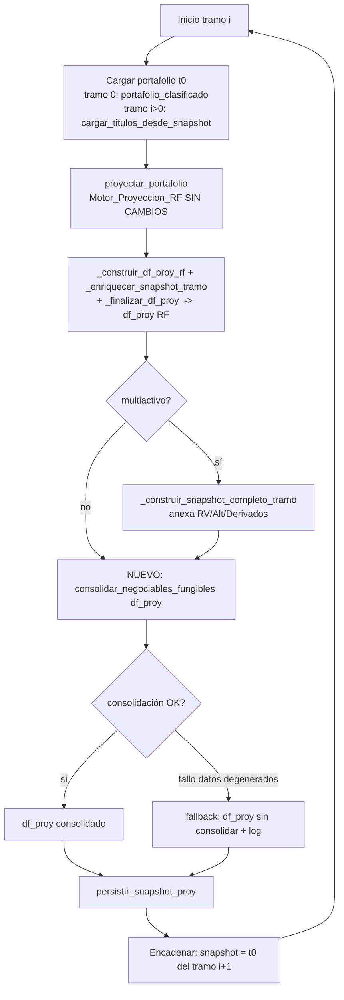

# Design Document

## Overview

Esta feature introduce la **consolidación de reinversiones Negociables fungibles** al cierre de cada tramo del modo de proyección `por_tramos`, con el objetivo de controlar el crecimiento explosivo del conteo de títulos de Renta Fija (RF) en el encadenamiento tramo→tramo y hacer computable el tercer tramo del horizonte (p. ej. 2026→2028).

El diseño respeta cuatro invariantes de arquitectura ya establecidos en el proyecto:

1. **El `Motor_Proyeccion_RF` (`proyectar_portafolio`) NO se modifica.** La consolidación es una optimización de **orquestación**, aplicada DESPUÉS de la corrida del motor y ANTES de persistir el snapshot del tramo (Req 5.3).
2. **La lógica vive en una función pura en `scripts/`** (`scripts/proyeccion_tramos.py`), nunca en `app_dash.py` (Req 5.1, 5.2). `app_dash.py` solo la invoca.
3. **No-regresión numérica.** La consolidación suma nominales/VM/VTIR por grupo fungible; no revalora. La equivalencia se verifica con el arnés `tools/equivalencia_motor_rf.py` contra un baseline capturado antes del cambio (Req 3).
4. **Restricción inviolable:** los títulos a TIR (`Vencimiento`, `Disp. Venta`) NUNCA se agrupan; tampoco las filas no-RF ni los subyacentes de swap (Req 2).

El punto de inserción exacto en el orquestador `_ejecutar_escenario_por_tramos(...)` es el bloque "5. Construir df_proy del tramo y persistir el snapshot": después de `_finalizar_df_proy(...)` (y de `_construir_snapshot_completo_tramo(...)` en modo multiactivo), y justo antes de `ptr.persistir_snapshot_proy(conn, df_proy, tramo.fecha_corte)`. La consolidación opera sobre el `DataFrame` `df_proy` (filas de cierre del tramo), que es la entrada natural de la función pura.

### Decisión clave: consolidar sobre el DataFrame de cierre, no sobre `list[Titulo]`

El cierre del tramo ya está materializado como `df_proy` (un `DataFrame` con la allowlist de columnas `_COLUMNAS_PROY`) justo antes de persistirse. Consolidar a nivel de `DataFrame` tiene ventajas decisivas:

- **Mínima superficie de cambio:** se intercepta un único punto (una línea de invocación en el orquestador), sin tocar el motor ni la reconstrucción `cargar_titulos_desde_snapshot`.
- **Cobertura automática del multiactivo:** `df_proy` puede incluir filas no-RF (RV/Alt/Derivados) con su `clase_origen`; la función pura las ignora por diseño (Req 2.4).
- **Columnas estables:** las claves de fungibilidad (`especie`, `isin`, `fecha_vencimiento`, `tasa_facial`, `periodicidad`, `tipo_tasa`, `moneda`) ya están en la allowlist persistida, y `clasificacion_contable`, `clase_origen`, `id_cobertura` permiten aplicar las exclusiones.
- **Transparencia en el encadenamiento:** el snapshot persistido es autosuficiente; `cargar_titulos_desde_snapshot` reconstruye el `Titulo_Consolidado` igual que cualquier otro título, anclando los cupones al vencimiento (ver "Corrección de cupones", Req 4).

## Architecture

### Flujo del orquestador por tramo (con consolidación)



El recuadro **G** es el único punto nuevo. Todo lo demás permanece idéntico. El modo `punta_a_punta` no pasa por este flujo, por lo que queda intacto (Req 6.1, 6.2).

### Ubicación del código

| Elemento | Ubicación | Cambio |
|---|---|---|
| `consolidar_negociables_fungibles(df, *, tolerancia)` | `scripts/proyeccion_tramos.py` (módulo nuevo de funciones puras) | **Nuevo** |
| `_clave_fungibilidad(fila)` (helper interno) | `scripts/proyeccion_tramos.py` | **Nuevo** |
| `ResumenConsolidacion` (dataclass de diagnóstico) | `scripts/proyeccion_tramos.py` | **Nuevo** |
| Invocación de la consolidación | `app_dash.py`, `_ejecutar_escenario_por_tramos`, bloque "5. Construir df_proy" | **1 bloque nuevo** |
| `proyectar_portafolio` (motor RF) | `scripts/motor_proyeccion.py` | **Sin cambios (Req 5.3)** |
| `cargar_titulos_desde_snapshot` | `scripts/proyeccion_tramos.py` | **Sin cambios** (reconstruye el consolidado como cualquier título) |
| Arnés de equivalencia | `tools/equivalencia_motor_rf.py` | **Sin cambios** (se usa tal cual para `baseline`/`check`) |

### Pureza y aislamiento (Req 5)

`consolidar_negociables_fungibles` es una función pura:
- **Sin I/O:** no abre conexiones ni lee/escribe archivos. Recibe un `DataFrame` y devuelve un `DataFrame` nuevo (no muta la entrada).
- **Sin estado global:** no usa variables de módulo mutables; `logger.warning` es el único efecto observable para datos degenerados (sin volcar contenido sensible, Req 5.4).
- **Determinista:** para una misma entrada produce la misma salida (orden de salida estable, ver Data Models).

## Components and Interfaces

### 1. `consolidar_negociables_fungibles` (función pura — `scripts/proyeccion_tramos.py`)

```python
def consolidar_negociables_fungibles(
    df,                      # pandas.DataFrame con filas de cierre del tramo (allowlist _COLUMNAS_PROY)
    *,
    tolerancia: float = 1e-9,
) -> tuple["pd.DataFrame", "ResumenConsolidacion"]:
    """
    Colapsa los Titulo_Negociable fungibles del DataFrame de cierre en un único
    Titulo_Consolidado por Grupo_Fungible, dejando intactas TODAS las demás filas.

    Entrada NO confiable: normaliza/coerciona los campos de la Clave_Fungibilidad y
    descarta filas inválidas con logger.warning genérico (sin volcar contenido).

    Returns:
        (df_consolidado, resumen) donde:
          - df_consolidado: DataFrame nuevo (no muta la entrada) con las mismas columnas.
          - resumen: ResumenConsolidacion con conteos antes/después para el diagnóstico.
    """
```

Reglas de la función (pseudocódigo):

```
particionar las filas en:
  - CONSOLIDABLES: clase_origen RF (TITULO o vacío) AND clasificacion_contable == Negociable
                   AND id_cobertura vacío
  - INTOCABLES:    todo lo demás (TIR, no-RF, subyacentes de swap, filas inválidas)

para cada fila CONSOLIDABLE:
    clave = _clave_fungibilidad(fila)        # None si algún campo no coerciona
    si clave is None:
        mover la fila a INTOCABLES (fallback por fila; nunca se pierde) + logger.warning
    si no:
        agrupar la fila bajo clave

para cada grupo con >= 2 miembros:
    emitir Titulo_Consolidado:
        nominal      = suma(nominal del grupo)
        valor_mercado= suma(valor_mercado del grupo)
        valor_tir    = suma(valor_tir del grupo)
        atributos de la Clave_Fungibilidad = los comunes del grupo
        fecha_emision = regla documentada (ver Data Models / Req 4.2)
        id_posicion   = id determinista del grupo (ver Data Models)
para cada grupo con exactamente 1 miembro:
    emitir la fila sin cambios (Req 1.6)

df_consolidado = INTOCABLES + consolidados + singletons, en orden estable
```

### 2. `_clave_fungibilidad` (helper interno)

```python
def _clave_fungibilidad(fila) -> tuple | None:
    """
    Construye la Clave_Fungibilidad normalizada de una fila Negociable, o None si algún
    componente no es coercionable (la fila se tratará como intocable).

    Clave = (especie, isin, fecha_vencimiento_iso, tasa_facial_red, periodicidad,
             tipo_tasa, moneda, tipo_bono)
    """
```

Normalización (entrada no confiable, Req 5.4):
- Texto (`especie`, `isin`, `periodicidad`, `tipo_tasa`, `moneda`): `str(x).strip().upper()`.
- `fecha_vencimiento`: a ISO `YYYY-MM-DD`; si no parsea → `None`.
- `tasa_facial`: a `float` finito y **redondeado** a una precisión fija (p. ej. 10 decimales) para evitar que ruido de punto flotante impida agrupar tasas idénticas; si no es finito → `None`.
- `tipo_bono`: derivado como en `cargar_titulos_desde_snapshot` (UVR/IPC/YANKEE/TF) a partir de `asset_class_definitivo`/`moneda`/`tasa_referencia`, para garantizar que dos títulos con el MISMO precio por unidad de nominal compartan clave.

### 3. Invocación en el orquestador (`app_dash.py`)

Bloque nuevo entre la construcción del snapshot y su persistencia (fail-safe, Req 6.5):

```python
# ── 5c. Consolidar reinversiones Negociables fungibles (feature
#        optimizacion-agrupacion-negociables, Req 1/6). Fail-safe: si falla por datos
#        degenerados, se persiste el conjunto SIN consolidar (fallback no destructivo).
try:
    _n_antes = len(df_proy)
    df_proy, _resumen_cons = ptr.consolidar_negociables_fungibles(df_proy)
    print(f"[TRAMOS-CONSOLIDA] tramo {tramo.fecha_corte} "
          f"{_n_antes}->{len(df_proy)} filas; "
          f"grupos={_resumen_cons.n_grupos} colapsadas={_resumen_cons.n_colapsadas} "
          f"negociables={_resumen_cons.n_negociables} intocables={_resumen_cons.n_intocables}")
except Exception as _e_cons:
    print(f"[TRAMOS-CONSOLIDA] tramo {tramo.fecha_corte} "
          f"consolidación OMITIDA por error: {type(_e_cons).__name__} "
          f"(se persiste sin consolidar).")
```

El diagnóstico `[TRAMOS-CONSOLIDA]` es análogo al `[SNAPSHOT-DEDUP]` existente (Req 6.4) y no vuelca contenido sensible.

### 4. `ResumenConsolidacion` (dataclass de diagnóstico)

Objeto de solo lectura devuelto por la función pura para que el orquestador registre el diagnóstico sin que la función haga I/O.

## Data Models

### `ResumenConsolidacion`

```python
@dataclass(frozen=True)
class ResumenConsolidacion:
    n_entrada: int        # filas de entrada
    n_salida: int         # filas de salida
    n_negociables: int    # filas Negociables candidatas (RF, sin swap)
    n_intocables: int     # filas no consolidadas (TIR + no-RF + swap + inválidas)
    n_grupos: int         # grupos fungibles con >= 2 miembros
    n_colapsadas: int     # filas removidas por consolidación (= n_entrada - n_salida)
```

### `Clave_Fungibilidad`

Tupla ordenada y normalizada:

```
(especie, isin, fecha_vencimiento_iso, tasa_facial_redondeada,
 periodicidad, tipo_tasa, moneda, tipo_bono)
```

**Justificación de la clave:** dos `Titulo_Negociable` producen idéntico **precio de mercado por unidad de nominal** cuando comparten el flujo futuro por unidad y la misma curva/tipo de valoración. Esos factores quedan determinados por: el emisor del flujo y su cupón (`especie`, `isin`, `tasa_facial`), el calendario (`fecha_vencimiento` + `periodicidad`), la convención de tasa (`tipo_tasa`) y la curva/moneda de descuento (`moneda`, `tipo_bono`). La `fecha_emision` NO entra en la clave: para un Negociable el VM se ancla al **vencimiento** (los cupones se calculan hacia atrás desde `fecha_vencimiento` en `detectar_cupones` y la valoración usa `fecha_valuacion`), por lo que reinversiones de meses distintos con la misma clave son económicamente indistinguibles por unidad de nominal.

### Campos del `Titulo_Consolidado`

| Campo | Valor | Requisito |
|---|---|---|
| `nominal` | `Σ nominal` del grupo | Req 1.2 |
| `valor_mercado` | `Σ valor_mercado` del grupo | Req 1.3 |
| `valor_tir` | `Σ valor_tir` del grupo | Req 1.4 |
| `especie`, `isin`, `fecha_vencimiento`, `tasa_facial`, `periodicidad`, `tipo_tasa`, `moneda`, `tipo_bono`, `asset_class_definitivo` | comunes del grupo (de la clave) | Req 1.5 |
| `clasificacion_contable` | `Negociable` (invariante del grupo) | Req 1.5 |
| `fecha_emision` | **la MÍNIMA del grupo** (ver nota) | Req 4.2 |
| `id_posicion` | id sintético determinista: `CONS_<hash corto de la clave>` | — |
| columnas no incluidas en la clave y no sumables (p. ej. `tasa_compra`) | del miembro con mayor nominal, informativas | — |

**Nota sobre `fecha_emision` (Req 4.2):** el calendario de cupones del motor se **ancla al vencimiento**, no a `fecha_emision`; `fecha_emision` solo actúa como límite inferior (`detectar_cupones` corta cuando `fecha_cupon <= fecha_emision`). Elegir la **mínima** `fecha_emision` del grupo garantiza que el `Titulo_Consolidado` conserve TODOS los cupones futuros que cualquiera de los miembros habría cobrado (no se recorta ninguno), de modo que el cupón del período del consolidado iguala la suma de los cupones de los miembros dentro de la tolerancia (Req 4.3). Dado que para un Negociable el VM no depende de `fecha_emision` sino del precio por unidad y el nominal, la suma de VM también se preserva por linealidad (Req 4.4). Esta decisión y su acotación quedan documentadas aquí según exige Req 4.2.

### Clasificación de filas de entrada

| Condición de la fila | Tratamiento |
|---|---|
| `clase_origen ∈ {RENTA_VARIABLE, ALTERNATIVO, DERIVADO}` | INTOCABLE (Req 2.4) |
| `clasificacion_contable ∈ {Vencimiento, Disp. Venta}` (o contiene `Venc`/`Disp`/`Venta`) | INTOCABLE (Req 2.1, 2.2) |
| `id_cobertura` no vacío (subyacente de swap) | INTOCABLE (Req 2.5) |
| Clave no coercionable (datos degenerados) | INTOCABLE + `logger.warning` (Req 5.4) |
| `Negociable`, RF, sin swap, clave válida | CONSOLIDABLE |

## Correctness Properties

*Una propiedad es una característica o comportamiento que debe cumplirse en todas las ejecuciones válidas de un sistema: esencialmente, un enunciado formal de lo que el sistema debe hacer. Las propiedades son el puente entre las especificaciones legibles por humanos y las garantías de corrección verificables por máquina.*

PBT es apropiado aquí: `consolidar_negociables_fungibles` es una **función pura** sobre estructuras de datos (DataFrame de títulos), con **invariantes universales** (conservación de sumas, exclusiones inviolables, idempotencia) sobre un espacio de entrada amplio (combinaciones arbitrarias de títulos Negociables, a TIR, no-RF y subyacentes de swap). Las propiedades siguientes se derivan del prework.

### Property 1: Conservación de sumas por grupo (nominal, VM, VTIR)

*Para cualquier* conjunto de títulos de cierre de tramo, el `Titulo_Consolidado` que reemplaza a cada `Grupo_Fungible` tiene `nominal`, `valor_mercado` y `valor_tir` iguales a la suma de los respectivos valores de los miembros del grupo (dentro de la tolerancia), y los totales globales de `nominal`, `valor_mercado` y `valor_tir` del conjunto se conservan tras la consolidación.

**Validates: Requirements 1.2, 1.3, 1.4, 4.4**

### Property 2: Atributos de la clave preservados e invariantes del grupo

*Para cualquier* `Grupo_Fungible` con dos o más miembros, el `Titulo_Consolidado` resultante conserva idénticos todos los atributos de la `Clave_Fungibilidad` (especie, isin, vencimiento, tasa facial, periodicidad, tipo de tasa, moneda, tipo de bono) de los miembros, y su `clasificacion_contable` es `Negociable`.

**Validates: Requirements 1.5**

### Property 3: Los títulos a TIR y las filas no-RF nunca se alteran

*Para cualquier* conjunto de títulos, toda fila a TIR (`Vencimiento` o `Disp. Venta`) y toda fila no-RF (`RENTA_VARIABLE`, `ALTERNATIVO`, `DERIVADO`) aparece en la salida sin cambios (mismo `id_posicion`, `nominal`, `tasa_compra`, `valor_tir`) y nunca se fusiona con ninguna otra fila.

**Validates: Requirements 2.1, 2.2, 2.4**

### Property 4: Solo se fusionan Negociables con clave idéntica

*Para cualquier* par de `Titulo_Negociable` que difieran en al menos un componente de la `Clave_Fungibilidad`, la consolidación NO los fusiona (quedan como filas distintas en la salida).

**Validates: Requirements 2.3**

### Property 5: Los subyacentes de swap no se consolidan

*Para cualquier* `Titulo_Negociable` con `id_cobertura` no vacío, la consolidación lo deja intacto (no se fusiona con ningún otro título).

**Validates: Requirements 2.5**

### Property 6: Grupos unitarios inalterados

*Para cualquier* `Titulo_Negociable` cuya `Clave_Fungibilidad` no comparte ningún otro Negociable del conjunto, la consolidación deja ese título sin cambios.

**Validates: Requirements 1.6**

### Property 7: Idempotencia de la consolidación

*Para cualquier* conjunto de títulos, consolidar una vez y consolidar dos veces producen el mismo resultado (`consolidar(consolidar(x)) ≡ consolidar(x)`), porque tras la primera pasada cada grupo fungible ya tiene a lo sumo un miembro.

**Validates: Requirements 1.1, 1.2**

### Property 8: Equivalencia del cupón del período del consolidado

*Para cualquier* `Grupo_Fungible`, el cupón del período calculado sobre el `Titulo_Consolidado` (reconstruido como t0 del tramo siguiente) es igual a la suma de los cupones del mismo período de los miembros del grupo, dentro de la `Tolerancia_Equivalencia`.

**Validates: Requirements 4.1, 4.3**

## Error Handling

| Caso | Manejo | Requisito |
|---|---|---|
| Fila Negociable con componente de clave no coercionable (fecha/tasa inválida) | Se trata como INTOCABLE (no se consolida, no se pierde) y se emite `logger.warning` genérico sin volcar contenido | Req 5.4 |
| DataFrame vacío o sin columnas esperadas | La función devuelve el DataFrame tal cual con un `ResumenConsolidacion` de ceros (no lanza) | Req 6.5 |
| Excepción inesperada dentro de la consolidación | El orquestador la captura y **persiste el conjunto sin consolidar** (fallback no destructivo), dejando rastro `[TRAMOS-CONSOLIDA] ... OMITIDA por error` | Req 6.5 |
| Columna `clasificacion_contable`/`clase_origen`/`id_cobertura` ausente | Se asume el valor más conservador (RF Negociable sin swap solo si clasificación lo indica; ante ausencia de clasificación, intocable) | Req 2 |

La función pura **no** aborta la corrida: toda degeneración se degrada a "no consolidar esa fila/ese conjunto". El orquestador nunca interrumpe el encadenamiento por un fallo de consolidación.

## Testing Strategy

### Enfoque dual

- **Property-based tests** (biblioteca **Hypothesis**, ya presente en el proyecto — ver `scripts/.hypothesis/`): verifican las 8 propiedades universales sobre conjuntos generados de títulos (Negociables fungibles, Negociables con clave distinta, a TIR, no-RF, subyacentes de swap, grupos unitarios, duplicados).
- **Unit tests** (pytest): casos concretos y de borde — DataFrame vacío, un único grupo fungible grande, grupo con tasas que difieren por ruido de punto flotante, filas con clave degenerada (fallback), columnas ausentes.
- **Equivalencia numérica end-to-end:** `tools/equivalencia_motor_rf.py baseline` ANTES del cambio y `tools/equivalencia_motor_rf.py check` DESPUÉS, con tolerancia `1e-6` (Req 3.5, 3.6). La verificación del tercer tramo (Req 7) se hace corriendo el horizonte 2026→2028 por tramos y comprobando que los tres cortes persisten y que los dos primeros tramos permanecen dentro de la tolerancia respecto a la corrida de 2 tramos.

### Configuración de property tests

- Cada propiedad del documento se implementa con **un único** property-based test.
- Mínimo **100 iteraciones** por property test.
- Cada test se etiqueta con un comentario que referencia la propiedad del diseño, formato:
  `# Feature: optimizacion-agrupacion-negociables, Property {n}: {texto de la propiedad}`
- Generadores (`hypothesis.strategies`): `Titulo`/filas con especie/isin/moneda de un alfabeto acotado, fechas de vencimiento válidas, tasas faciales finitas, periodicidades del enum conocido, clasificación contable de `{Negociable, Vencimiento, Disp. Venta}`, `clase_origen` de `{TITULO, RENTA_VARIABLE, ALTERNATIVO, DERIVADO}`, `id_cobertura` opcional. Los generadores incluyen deliberadamente casos de borde (caracteres no-ASCII, nominales en los extremos finitos, grupos repetidos) para ejercitar la normalización y las exclusiones.

### Alcance de la verificación de equivalencia (Req 3, 7)

| Verificación | Herramienta | Criterio |
|---|---|---|
| VM / VTIR de cierre por tramo | `equivalencia_motor_rf.py check` + comparación de snapshots | ≤ `1e-6` relativo (Req 3.1, 3.2) |
| P&L mercado/TIR por mes (total y por grupo) | arnés + agregación por `Clave_Fungibilidad` | ≤ tolerancia (Req 3.3) |
| Cupones cobrados por mes | arnés | ≤ tolerancia (Req 3.4) |
| 3 tramos completan y persisten corte dic-2028 | corrida por tramos 2026→2028 | snapshot + Excel presentes (Req 7.1, 7.3) |
| Reducción material del conteo RF al inicio del tramo 3 | diagnóstico `[TRAMOS-CONSOLIDA]` | reducción ~7× objetivo (Req 7.2) |

> Nota de verificación: la equivalencia numérica solo puede confirmarse ejecutando el arnés contra la DB real; el diseño especifica el procedimiento, pero la confirmación efectiva ocurre en la fase de implementación/tareas.
