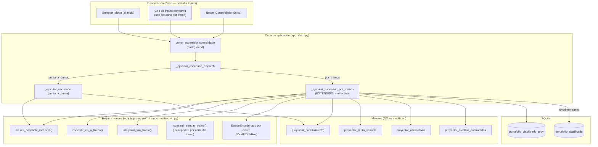
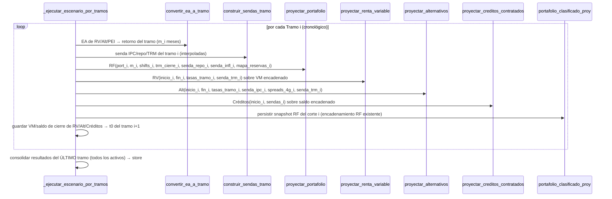

# Design Document: Proyección por Tramos Multiactivo

## Overview

AXIS ya tiene un modo `por_tramos` (feature `proyeccion-por-tramos`) que encadena corridas anuales del motor de **renta fija** (`proyectar_portafolio`), persistiendo un snapshot por corte en `portafolio_clasificado_proy`. Esta feature lo extiende en cinco frentes, sin reescribir lo que funciona:

1. **Multiactivo:** el orquestador por tramos ejecuta, por cada tramo, los CUATRO motores (RF, RV, Alternativos, Créditos) y los encadena.
2. **Inputs por tramo:** TRM, inflación, repo, retornos RV/Alternativos/PEI se capturan por tramo (uno por fin de año), como la tabla del usuario.
3. **Conversión EA → duración del tramo:** los retornos anuales se capitalizan a los meses del tramo (`(1+r)^(m/12)−1`).
4. **Repo e inflación por tramo propagados al motor RF** (arreglo de la brecha actual).
5. **Conteo de meses correcto** (12 para años completos) en AMBOS modos.

Más un cambio de UI: `Selector_Modo` al inicio de la pestaña Inputs, secciones divididas en columnas por tramo, y un `Boton_Consolidado` único (se eliminan los botones individuales por activo).

**Extensión (derivados por tramo + snapshot completo).** Dos frentes adicionales que esta extensión añade sobre lo ya construido:

6. **Derivados por tramo (Req 13):** el orquestador invoca el `Motor_Derivados` (`valorar_portafolio_derivados`) una vez por tramo, con la `fecha_corte`/`fecha_fin` del tramo, la `senda_trm` interpolada y los `Deltas_Curvas_Tramo` (Mov. TES COP/UVR + Δ Fed + Δ Tesoros 10Y) en `metodo_params`. Se añaden dos filas al grid por tramo (`tramo-fed`, `tramo-tesoros10y`). El motor es STATELESS: cada tramo se corre de forma independiente sobre el plano base de `hist_*` y sus renovaciones internas.
7. **Snapshot completo por tramo (Req 14):** el snapshot de cierre `portafolio_clasificado_proy` se amplía para persistir TODOS los activos (RF + RV + Alternativos + Derivados), distinguidos por `clase_origen`, sin romper la reconstrucción RF (que sigue filtrando solo filas RF).

**Principio de diseño rector (regla de consistencia del proyecto):** los cuatro motores de valoración (`proyectar_portafolio`, `proyectar_renta_variable`, `proyectar_alternativos`, `proyectar_creditos_contratados`) **NO se modifican en su lógica interna**. Toda la nueva orquestación vive en la capa de aplicación (`app_dash.py`) y en helpers nuevos, reutilizando el patrón ya establecido por `proyeccion_tramos.py` (dataclasses, queries parametrizadas, allowlist, snapshots idempotentes).

### Hallazgos del prework (anclados en el código real)

1. **Motor RF** — `proyectar_portafolio(..., meses_horizonte, ..., trm, trm_cierre, valor_uvr, valor_uvr_cierre, senda_inflacion, senda_repo, shift_*_bps, mapa_reservas)`. Ya recibe `senda_repo` y `senda_inflacion`; el orquestador por tramos actual NO se los pasa (solo TRM/UVR). Aquí se conectan (Req 7).

2. **Motor RV** — `proyectar_renta_variable(fecha_inicio:"YYYY-MM", fecha_fin:"YYYY-MM", escenarios_rv_local:{esc:tasa_EA}, escenarios_rv_intl:{esc:tasa_EA}, tasa_pei, ruta_db, senda_trm)`. Lee el portafolio de `portafolio_clasificado`; tasas EA; convierte MXWD a COP con `senda_trm` por corte.

3. **Motor Alternativos** — `proyectar_alternativos(fecha_inicio:"YYYY-MM", fecha_fin:"YYYY-MM", tasa_ea_local, tasa_ea_intl, ruta_db_portafolio, senda_ipc:{fecha:ipc_ea}, spreads_4g:{id:spread}, senda_trm)`. Los FCP 4G se indexan a IPC + spread (Ret Alternativos IPC de la tabla).

4. **Motor Créditos** — `proyectar_creditos_contratados(fecha_inicio:"YYYY-MM", df_creditos, df_senda_ipc, df_senda_ibr, df_senda_sofr, df_senda_trm)`. Cada crédito se proyecta hasta su vencimiento con sendas IPC/IBR/SOFR/TRM.

5. **Orquestador por tramos actual** — `_ejecutar_escenario_por_tramos(...)` en `app_dash.py`: trocea con `calcular_tramos`, encadena RF vía snapshots (`cargar_snapshot_proy` / `cargar_titulos_desde_snapshot`), arma `df_proy` con `_construir_df_proy_rf` + `_enriquecer_snapshot_tramo`, y expone el último al store. Es el punto de extensión.

6. **Conteo de meses (bug off-by-one)** — `proyeccion_tramos._meses_entre` usa `delta.years*12 + delta.months` (da 11 para un año completo). El orquestador consolidado punta a punta (`correr_escenario_consolidado`, ~línea 6343) usa la misma fórmula sin `+1`. Otras partes del código (`_calcular_uvr_cierre_desde_inflacion`, ~línea 2189, y varios callizados) ya usan la fórmula correcta `+ (1 if delta.days > 0 else 0)`.

7. **UI de inputs y controles por tramo** — `layout_inputs()` construye la pestaña; el `modo-proyeccion` (`dcc.RadioItems`) y `render_controles_por_tramo` generan hoy solo shifts RF por tramo (`{'type':'tramo-shift-cop','index':i}`, etc.). Los botones individuales son `btn-proy-alt`, `btn-proy-cred`, `btn-proy-rv` (o equivalentes) con sus callbacks.

### Hallazgos del prework — extensión derivados y snapshot completo

8. **Motor de derivados** — `valorar_portafolio_derivados(fecha_corte, fecha_fin, metodo, nivel_actual, activos_usd, portafolio_pesos, senda_trm, ..., metodo_params, ...)` en `valoracion_derivados.py`. Devuelve `dict` con 4 DataFrames `{'opciones','forwards','activos','swaps'}`. `calcular_pyg(resultados)` devuelve un DataFrame con `fecha_valoracion, tipo (Opciones/Forwards/Activos/Swaps), p_y_g`, donde el PyG es RELATIVO A BASE (valoración − primer valor por tipo), acumulado. Es **stateless por corrida**: lee posiciones de `hist_forwards`/`hist_opciones`/`hist_swaps WHERE fecha_reporte=?` y activos USD de `portafolio_clasificado WHERE clase_origen='TITULO' AND moneda NOT IN ('COP','UVR')`, y recalcula renovaciones internamente (`_renovar_fwds` en bloques de 100 días, `_renovar_opciones`).

9. **Deltas de curva que consume el motor** (verificado en `proyectar_curvas`/`shift_lutibr_por_plazo`): `metodo_params` acepta `delta_tes_cop: {plazo_dias: delta_ea}`, `delta_tes_uvr: {plazo_dias: delta_ea}`, `delta_fed_bps: float` (ancla corta 1 día de LUTIBR) y `delta_10t_bps: float` (ancla larga 3650 días de LUTIBR), interpolados linealmente por plazo. El modo punta a punta (`correr_escenario_consolidado`, ~línea 6720) ya construye estos deltas: shift TES paralelo (`bps/10000` por nodo `[30,90,180,365,730,1095,1825,2555,3650]`) y `delta_fed_bps`/`delta_10t_bps` tomados directamente como delta en bps de los inputs. Este es el patrón a REPLICAR por tramo.

10. **Orquestador por tramos deja `derivados=None`** (~línea 7796) — es el punto de extensión para Req 13.

11. **Snapshot RF (`portafolio_clasificado_proy`)** — allowlist FIJA `_COLUMNAS_PROY` en `scripts/proyeccion_tramos.py` (~líneas 241–260), con `clase_origen`, `asset_class_definitivo`, `valor_mercado`, etc. `persistir_snapshot_proy` escribe SOLO columnas de la allowlist (ausentes → NULL, extra → descartadas), toma `fecha_corte_proyeccion` del argumento, valida `valor_mercado`/`nominal` a float finito y usa parametrizadas. `cargar_titulos_desde_snapshot` reconstruye SOLO RF (filtra no-RF). Es el punto de extensión para Req 14.

---

## Architecture

### Diagrama de componentes



### Diagrama de secuencia — un tramo multiactivo



### Decisiones de arquitectura

**D1 — Reutilizar el encadenamiento RF existente; añadir encadenamiento paralelo para los otros 3 activos.** RF ya encadena vía snapshots en `portafolio_clasificado_proy` (spread efectivo de cierre → base del siguiente). RV, Alternativos y Créditos NO tienen snapshot equivalente; su "estado" es más simple: el **valor de mercado / saldo de cierre** de un tramo es el punto de partida del siguiente. Se introduce una estructura `EstadoEncadenado` en memoria (no requiere tabla nueva) que arrastra por activo el VM/saldo final de cada tramo.

*Justificación:* RF necesita persistencia por su reconstrucción autosuficiente de títulos (cupones, spread, vencimientos); RV/Alt/Créditos se valoran por retorno/tasa sobre un VM agregado, por lo que arrastrar el VM de cierre en memoria basta y evita crear tablas innecesarias.

**D2 — Los motores no-RF se llaman una vez por tramo con su sub-periodo.** Cada motor acepta `fecha_inicio`/`fecha_fin` en `"YYYY-MM"`. Para el tramo i se le pasa `[inicio_i, corte_i]` y las tasas del tramo i. El encadenamiento se logra escalando el VM inicial del motor al VM de cierre del tramo anterior.

*Justificación:* no se toca la lógica interna de los motores (Req 4, principio rector). El troceo temporal ya es soportado por sus parámetros `fecha_inicio`/`fecha_fin`.

**D3 — Conversión EA a la duración del tramo en la capa de orquestación.** Antes de llamar a RV/Alt, el orquestador convierte cada `Retorno_EA` del tramo a la duración del tramo con `convertir_ea_a_tramo(r_ea, m)` = `(1+r_ea)^(m/12) − 1`, y pasa ese retorno ya escalado al motor. Los motores siguen recibiendo "una tasa para el periodo".

*Justificación:* la conversión es una regla de negocio de orquestación (Req 5); mantenerla fuera del motor evita duplicar lógica y respeta que el motor no distingue tramos.

> **Matiz de implementación (a resolver en tasks):** los motores RV/Alt interpretan su tasa de entrada como **EA** y la capitalizan internamente por los meses del periodo (`(1+EA)^(1/12)` por mes). Para el tramo parcial hay dos formas equivalentes de lograr el retorno correcto del periodo: (a) pasar la tasa EA tal cual y dejar que el motor capitalice por `m` meses (que ya es `(1+EA)^(m/12)−1`), o (b) pre-convertir. Se elegirá (a) cuando el motor ya capitalice mensualmente por el número de meses del sub-periodo — lo cual, dado que recibe `fecha_inicio`/`fecha_fin` del tramo, produce exactamente `(1+EA)^(m/12)−1`. `convertir_ea_a_tramo` queda disponible para los activos/mecanismos que reciban un retorno de periodo cerrado. La tarea de diseño detallado verificará, por motor, cuál aplica, con tests del tramo parcial (5 meses) contra el valor esperado.

**D4 — Interpolación de TRM por tramo dentro de la senda.** La `TRM_Por_Tramo` es el nivel de cierre del tramo. Se construye una `senda_trm` por corte mensual interpolando linealmente desde la TRM de cierre del tramo anterior (o TRM t0 para el primero) hasta la TRM de cierre del tramo. Esa senda se pasa a RF (`trm`/`trm_cierre`), RV (`senda_trm`), Alt (`senda_trm`) y Créditos (`df_senda_trm`).

**D5 — Repo e inflación por tramo propagadas a los motores.** Se construyen `senda_repo` y `senda_inflacion` del tramo (planas al valor del tramo o interpoladas desde el cierre anterior) y se pasan a `proyectar_portafolio` (que ya las acepta pero hoy no las recibe en tramos), a Alternativos (`senda_ipc` para FCP 4G) y a Créditos (`df_senda_ipc`). Esto cierra la brecha del Req 7.

**D6 — Conteo de meses inclusivo unificado.** Se corrige `proyeccion_tramos._meses_entre` para usar `+ (1 if delta.days > 0 else 0)` y se corrige el orquestador consolidado punta a punta (`n_meses` ~línea 6343) con la misma fórmula. Se centraliza en un único helper `meses_horizonte_inclusivo(inicio, fin)` reutilizado por ambos caminos, evitando futuras divergencias (Req 10).

**D7 — UI: grid por tramo + botón único, sin tocar el motor de render de resultados.** El `Selector_Modo` sube al inicio. En `por_tramos`, `render_controles_por_tramo` se amplía para emitir, por tramo, TODAS las variables de `Inputs_Por_Tramo` (no solo los 4 shifts RF). Se elimina el binding de los botones individuales. El `Boton_Consolidado` reutiliza `correr_escenario_consolidado`, que ya consolida los 6 bloques en punta a punta; en por tramos se consolidan los del último tramo.

**D8 — Efecto moneda calculado en la orquestación, no en el motor.** El motor ya produce el `valor_mercado` COP por corte (con la mecánica USD→retorno→COP). El `Efecto_Moneda` por tramo se calcula en la capa de orquestación a partir de datos que el orquestador ya tiene: el VM inicial COP del tramo, la TRM de inicio y la TRM de cierre del tramo (de la `senda_trm` interpolada). Se añade como columnas del Excel de output para los activos internacionales, por tramo y total. *Justificación:* no requiere tocar los motores (Req 4, principio rector); el dato de TRM inicio/cierre por tramo ya vive en la orquestación (D4).

**D9 — Derivados por tramo con encadenamiento REAL del plano de posiciones (Opción B, Req 13).** El plano de posiciones VIVAS al cierre de un tramo (forwards/opciones/swaps no vencidos, incluidas las renovaciones que el motor generó internamente) es el plano de INICIO del tramo siguiente —análogo a cómo RF encadena su snapshot de cierre—. Para lograrlo sin contaminar la historia real:

1. **Estado de cierre en tablas de proyección SEPARADAS** (mismo patrón que `portafolio_clasificado_proy` para RF): se crean `hist_forwards_proy`, `hist_opciones_proy`, `hist_swaps_proy` (tablas NUEVAS, idempotentes por corte, parametrizadas). NUNCA se escribe en las `hist_*` reales (evita meter proyecciones en la historia reportada — preocupación explícita del negocio).

2. **Carga inyectable en el motor (cambio quirúrgico, retrocompatible).** `valorar_portafolio_derivados` recibe dos parámetros opcionales:
   - `posiciones_iniciales: dict | None` — si viene, el motor usa ESE plano (`{'fwds','opts','swaps'}`) como base en vez de leer de `hist_*`. Si es `None`, se comporta EXACTAMENTE como hoy (lee `hist_*` reales). Este es el ÚNICO cambio de firma/carga del motor; su lógica de renovación y valoración NO se toca.
   - `devolver_plano_cierre: bool = False` — si `True`, el dict de retorno incluye `plano_cierre = {'fwds','opts','swaps'}` con las posiciones VIVAS al `fecha_fin` (vencimiento > fecha_fin), extraídas de los planos ya proyectados/renovados que el motor construye internamente.

3. **Encadenamiento por tramo.** Para el tramo i:
   - `fecha_corte` = inicio del tramo, `fecha_fin` = `Fecha_Corte_Tramo`;
   - tramo 0: `posiciones_iniciales = None` (lee `hist_*` reales, el plano base real);
   - tramo i>0: `posiciones_iniciales` = el `plano_cierre` del tramo i-1 (cargado desde las tablas `_proy` de ese corte);
   - `senda_trm` = la senda interpolada del tramo (D4); `nivel_actual` = TRM de inicio del tramo;
   - `metodo_params` con los `Deltas_Curvas_Tramo` del tramo (patrón de punta a punta, hallazgo 9): `delta_tes_cop`/`delta_tes_uvr` como shift paralelo (`bps/10000` por nodo), `delta_fed_bps`/`delta_10t_bps` como delta directo en bps de las variables `tramo-fed`/`tramo-tesoros10y`.
   - Al cerrar el tramo i: se persiste el `plano_cierre` en `hist_*_proy` con `fecha_corte_proyeccion = Fecha_Corte_Tramo` (idempotente).

El `PyG_Derivados_Tramo` es lo que `calcular_pyg` devuelve para el sub-periodo del tramo. Las renovaciones ocurren dentro del motor tal como hoy. Los helpers de orquestación viven en la capa de aplicación: `_correr_derivados_tramo` (arma argumentos + inyecta plano previo + captura plano de cierre) y `persistir_plano_derivados_proy`/`cargar_plano_derivados_proy` (persistencia en las tablas `_proy`).

*Justificación:* encadena de verdad (el plano evoluciona tramo a tramo con sus renovaciones), respeta el patrón de tablas `_proy` de RF (no contamina la historia real), y el cambio en el motor es mínimo, aislado a la CARGA (no a la lógica de valoración/renovación) y 100% retrocompatible (sin `posiciones_iniciales`, comportamiento idéntico al actual).

> **Nota de alcance:** el cambio en `valorar_portafolio_derivados` se limita a: (a) usar `posiciones_iniciales` cuando se provee en lugar de `_cargar_posiciones`/`_cargar_swaps`; (b) opcionalmente devolver `plano_cierre`. La lógica interna de renovación (`_renovar_fwds`, `_renovar_opciones`), valoración por corte y construcción de `metodo_params` permanece INTACTA.

**D10 — Snapshot completo por tramo reutilizando `portafolio_clasificado_proy` y la allowlist (Req 14).** Al cierre de cada tramo, además de las filas RF que ya persiste, se anexan filas para RV, Alternativos y Derivados en el MISMO snapshot, distinguidas por `clase_origen`. Se construye un DataFrame unificado de cierre del tramo (`_construir_snapshot_completo_tramo`) que:
- toma las filas RF del `df_proy` de cierre (como hoy);
- añade las posiciones RV/Alt con su `valor_mercado` de cierre (del `EstadoEncadenado`/resultado del motor) y su `clase_origen` correspondiente;
- añade las posiciones de derivados con su `valor_mercado` de cierre (del resultado del `Motor_Derivados`), con un `clase_origen` de derivados;
- deja en NULL las columnas de la allowlist que no apliquen a un tipo de activo.

Se reutiliza `persistir_snapshot_proy` (que ya filtra por la allowlist, valida numéricos y usa parametrizadas). La allowlist `_COLUMNAS_PROY` se amplía SOLO si falta alguna columna imprescindible para representar RV/Alt/Derivados (a decidir en tasks; el núcleo `id_posicion`, `especie`, `emisor`, `moneda`, `valor_mercado`, `clase_origen`, `asset_class_definitivo`, `portafolio`, `compania` ya cubre lo esencial). **Invariante crítico:** `cargar_titulos_desde_snapshot` sigue filtrando SOLO las filas RF, de modo que anexar filas no-RF NO altera la reconstrucción de títulos del tramo siguiente (Req 14.4). *Justificación:* no crea tablas nuevas, respeta el patrón idempotente/parametrizado existente y aísla el encadenamiento RF de las filas informativas de los demás activos.

---

## Decisiones de corrección (bugs de la primera corrida real)

**D11 — `clase_origen='TITULO'` en la reconstrucción de tramos i>0 (Fix 1, Req 15).** `_titulos_a_dataframe_base` reconstruye el portafolio del tramo i>0 desde los objetos `Titulo` del snapshot anterior, pero no incluía `clase_origen`. En el tramo 0 la base viene de `SELECT * FROM portafolio_clasificado` (que ya trae `clase_origen`), por eso solo fallaba en i>0. **Corrección aplicada:** añadir `'clase_origen': 'TITULO'` al dict de cada fila reconstruida. Cambio de una línea, sin efectos sobre la valoración ni sobre la reconstrucción RF (que filtra por `asset_class`/`clase_origen` no-RF, y `TITULO` nunca se excluye). *Estado:* IMPLEMENTADO.

**D12 — Materialización efectiva del snapshot no-RF (Fix 2, Req 16).** Diagnóstico confirmado con datos: los `clase_origen` observados en el snapshot 2026 (`TITULO`/`FORWARD`/`OPCION`/`SWAP`) son los del `portafolio_clasificado` base copiados tal cual en el tramo 0; las etiquetas nuevas que `_construir_snapshot_completo_tramo` debería anexar (`DERIVADO`/`RENTA_VARIABLE`/`ALTERNATIVO`) NO aparecen en ningún corte. Es decir, la función de snapshot no-RF nunca agrega filas. Causas a resolver en tasks (requiere inspeccionar la salida real de cada motor):
- `_filas_cierre_no_rf` exige columnas `{col_id, 'fecha_proyeccion', 'valor_mercado'}`; si los DataFrames de RV/Alt usan otros nombres, devuelve `[]` en silencio. Hay que mapear a las columnas reales.
- `deriv_resultado['vm_cierre']` puede llegar vacío si las columnas de opciones/forwards/swaps no coinciden con lo que espera el adaptador.
- **Evitar duplicación:** en el tramo 0, los derivados del portafolio base YA están en el snapshot con sus etiquetas (`FORWARD`/`OPCION`/`SWAP`); si además se anexan los valorados por el motor con `DERIVADO`, se duplican. Se define una **fuente única por tipo y corte**: las posiciones no-RF del snapshot provienen SIEMPRE de la valoración del motor (etiquetas `DERIVADO`/`RENTA_VARIABLE`/`ALTERNATIVO`), y se excluyen las filas no-RF heredadas del `portafolio_clasificado` base para no duplicar. *Estado:* PENDIENTE (requiere inspección de salidas de motores + test).

**D13 — Rendimiento del encadenamiento sin alterar la valoración (Fix 3, Req 17).** Diagnóstico confirmado con datos de la corrida real:
- El motor NO recalcula el pasado: la valoración a TIR parte del `valor_tir` de cierre del tramo anterior (`valor_inv_base100 = (titulo.valor_tir/titulo.nominal)*100` y flujos desde `fecha_anterior`), no desde la emisión. No hay recomputo redundante que eliminar.
- No se arrastran vencidos: el 100% de las 44.986 filas de 2027 tienen vencimiento > corte (verificado).
- El costo es por **volumen** (≈45k títulos × 12 meses, valorados título-por-título en Python puro) y crece tramo a tramo por las reinversiones legítimas.

**Restricción inviolable (confirmada por el usuario):** los títulos a TIR (`Vencimiento`/`Disp. Venta`) NO se agrupan — cada reinversión tiene su tasa de compra única (6.2% vs 6.3%) y su costo amortizado individual. Por tanto, la optimización NO reduce el número de filas; ataca el costo por fila y el I/O:
- **Vectorización:** reescribir los bucles título-por-título (p. ej. el `for t in reinversiones` con `.iloc[0].to_dict()` en `_construir_df_proy_rf`, y los loops de valoración donde aplique) con operaciones de pandas/numpy, SIN cambiar la fórmula de valoración. Verificación: mismo resultado numérico sobre un caso de referencia, dentro de tolerancia.

  **Hallazgo de la corrida corta de medición (actualización del diagnóstico):** tras vectorizar `_construir_df_proy_rf` (speedup medido ~164x en esa etapa), una corrida de 2 tramos siguió tardando decenas de minutos con RAM baja (~250 MB) y CPU sostenida. Esto confirma que **el cuello de botella dominante NO es la construcción del snapshot sino el propio motor RF** (`proyectar_portafolio`). Su estructura es un doble bucle: `for mes in 1..N: for titulo in portafolio_activo: valorar_titulo(...)`, con DOS llamadas a `valorar_titulo` por título y mes (VM de mercado + VTIR). En el tramo 3 (~45.000 títulos × 12 meses × 2) son ~1.08 millones de llamadas en Python puro, cada una recalculando fechas de cupón, flujos e interpolaciones. **La próxima optimización de rendimiento debe atacar `valorar_titulo`/el doble bucle del motor** (vectorizar por grupos de títulos del mismo tipo de bono, o compilar con Numba las funciones numéricas calientes), NO el snapshot. Es un cambio mayor y delicado (corazón de la valoración, con ramas por tipo IPC/UVR/TF/Yankee), por lo que requiere un baseline numérico de referencia y verificación de equivalencia estricta antes de tocarlo.
- **I/O en lote + ubicación de la DB:** escribir el snapshot en lote y permitir (opcional, por configuración) que la DB viva fuera de un FS sincronizado en la nube; sin cambiar esquema ni contrato.
- **Instrumentación:** medir tiempo por motor y por tramo para atacar el componente más caro con datos.
- **Secuencia:** medir primero → vectorizar lo más caro → optimizar I/O. *Estado:* PENDIENTE; el número de posiciones seguirá creciendo con las reinversiones (inherente a la metodología), la optimización solo lo hace tolerable.

---

## Components and Interfaces

Los helpers puros nuevos viven en `scripts/proyeccion_tramos_multiactivo.py` (módulo nuevo, testeable), salvo el orquestador (en `app_dash.py`). La corrección de `_meses_entre` va en `scripts/proyeccion_tramos.py`.

### C1 — `meses_horizonte_inclusivo` (corrección del conteo)

```python
def meses_horizonte_inclusivo(inicio: date, fin: date) -> int:
    """
    Meses de un periodo [inicio, fin] con Conteo_Meses_Inclusivo:
      delta.years*12 + delta.months + (1 if delta.days > 0 else 0)
    Un año calendario completo (1-ene → 31-dic) devuelve 12 (no 11).
    Devuelve >= 0; el llamador aplica su mínimo (1).
    """
```
Se usa en `proyeccion_tramos._meses_entre` (reemplaza la fórmula sin `+1`) y en el orquestador consolidado punta a punta. (Req 10.1–10.4, 10.7)

### C2 — `convertir_ea_a_tramo`

```python
def convertir_ea_a_tramo(retorno_ea: float, meses_tramo: int) -> float:
    """
    Convierte un Retorno_EA a la duración del tramo:
        (1 + retorno_ea) ** (meses_tramo / 12) - 1
    meses_tramo == 12 → identidad (retorno_ea). meses_tramo < 12 → capitalización parcial.
    Coerciona retorno_ea a float finito (no numérico → 0.0); meses_tramo >= 1 (si no, ValueError).
    """
```
(Req 5.1–5.4)

### C3 — `interpolar_trm_tramo` / `construir_sendas_tramo`

```python
def interpolar_trm_tramo(trm_inicio: float, trm_cierre: float,
                         periodos: list[date]) -> dict[str, float]:
    """
    Senda TRM {'YYYY-MM-DD': trm} interpolada linealmente desde trm_inicio (nivel al
    inicio del tramo) hasta trm_cierre (TRM_Por_Tramo, nivel al corte) sobre los cortes
    mensuales del tramo. trm_inicio es la TRM de cierre del tramo anterior (o TRM t0).
    """

def construir_sendas_tramo(tramo, inputs_tramo, estado_previo) -> SendasTramo:
    """
    Devuelve las sendas del tramo (SendasTramo dataclass):
      - senda_trm:  interpolada al nivel de cierre del tramo (D4)
      - senda_ipc:  {fecha: ipc_ea} del tramo (Inflacion_Por_Tramo)
      - senda_repo: {fecha: repo_ea} del tramo (Repo_Por_Tramo)
      - senda_ibr / senda_sofr: para créditos (derivadas de repo/inflación o inputs)
    Reutiliza el patrón de construir_senda_trm_dict / _sendas_planas_tramo ya presentes.
    """
```
(Req 6, Req 7)

### C4 — `EstadoEncadenado` (encadenamiento no-RF en memoria)

```python
@dataclass
class EstadoEncadenado:
    """
    Estado de cierre por activo NO-RF que se arrastra entre tramos (D1).
      - vm_rv_por_posicion:  {id_posicion: VM_cierre}  (RV local/intl/PEI)
      - vm_alt_por_posicion: {id_posicion: VM_cierre}  (alternativos)
      - saldo_credito_por_id:{id_credito: saldo_cierre} (créditos)
    Para el tramo i>0, el VM inicial de cada motor se ESCALA al VM de cierre del tramo i-1.
    """
```
El escalado se aplica sobre el portafolio que el motor lee de `portafolio_clasificado`: se multiplica el VM inicial de cada posición por el factor `vm_cierre_prev / vm_inicial_original`, o se inyecta el VM de cierre como VM inicial del tramo. (Req 4.1, 4.2)

**Ecuación de encadenamiento (activos de retorno: RV local/intl, PEI, Alternativos):**

```
VM_inicio(tramo_i)  = VM_cierre(tramo_{i-1})
VM_cierre(tramo_i)  = VM_inicio(tramo_i) × (1 + retorno_tramo_i)
retorno_tramo_i     = (1 + retorno_EA_i) ^ (meses_i / 12) − 1      # convertir_ea_a_tramo
```

Encadenado sobre el horizonte (ejemplo de la tabla del usuario, tramo parcial ago-dic 2026 = 5 meses):

```
VM_cierre_2026 = VM_t0        × (1 + ret_EA_2026)^(5/12)
VM_cierre_2027 = VM_cierre_2026 × (1 + ret_EA_2027)      # 12 meses ⇒ identidad
VM_cierre_2028 = VM_cierre_2027 × (1 + ret_EA_2028)
```

**Mecanismo verificado en el código:** `proyectar_bloque` (RV y Alternativos) lee el VM inicial de la columna `valor_mercado` del portafolio recibido y compone por días reales (`(1+tasa_diaria)^días`), de modo que el VM de cierre de un tramo de `m` meses es `VM_inicio × (1+EA)^(m/12)`. Por tanto, el `Encadenamiento` se logra INYECTANDO el `VM_cierre(tramo_{i-1})` en la columna `valor_mercado` del portafolio que se pasa al motor en el tramo `i` (vía `EstadoEncadenado`); si no se inyectara, cada tramo arrancaría del VM original de `portafolio_clasificado` y NO habría encadenamiento.

**Componente cambiario (activos internacionales — MXWD, Alternativos intl):** para moneda ≠ COP el motor aplica `Valoracion_En_Moneda_Origen` con la `senda_trm` del tramo:
```
VM_inicio_origen = VM_inicio_COP / TRM_inicio_tramo
VM_cierre_COP    = VM_inicio_origen × (1 + ret_origen_tramo) × TRM_cierre_tramo
```
Es decir, el VM inicial pasa a moneda origen con la TRM de inicio del tramo, se le aplica el retorno del tramo en moneda origen, y se reconvierte a COP con la TRM de cierre del tramo. Esto ocurre en TODOS los tramos con su `TRM_Por_Tramo` (D4). El motor `proyectar_bloque` ya implementa exactamente esta mecánica (verificado: `vm_usd = VM_COP/trm_t0`; compone el retorno en USD; `VM_COP = vm_usd × trm_corte`). Los activos locales (COLCAP, PEI, Alt local) siguen la ecuación simple sin TRM.

**Discriminación del Efecto_Moneda en el Excel de output (D8):** para cada `Activo_Internacional` se descompone el PyG del tramo en dos componentes que suman el total:
```
Efecto_Moneda_tramo       = VM_inicio_origen × (TRM_cierre_tramo − TRM_inicio_tramo)
                          = (VM_inicio_COP / TRM_inicio_tramo) × ΔTRM_tramo
Efecto_Retorno_Activo     = PyG_total_tramo − Efecto_Moneda_tramo
PyG_total_tramo           = VM_cierre_COP − VM_inicio_COP
```
El `Efecto_Moneda` es la variación de la TRM del tramo aplicada al VM inicial en moneda origen (descomposición Opción A: la moneda se calcula sobre el capital inicial y el término cruzado retorno×ΔTRM queda dentro del `Efecto_Retorno_Activo`, de modo que la suma reconstruye el PyG total exactamente). Para activos locales el `Efecto_Moneda` es 0. Se reporta por tramo y con un total del horizonte. (Req 11.3–11.6)

**RF y Créditos NO usan esta ecuación de retorno:** RF encadena por su snapshot autosuficiente (spread efectivo de cierre, cupones, vencimientos, revaloración BVC); Créditos encadena por el saldo de cierre y sus intereses (IBR/IPC/SOFR). La fórmula `VM × (1+retorno)` aplica SOLO a los activos de retorno.

### C5 — `InputsPorTramo` (captura de UI)

```python
@dataclass(frozen=True)
class InputsPorTramo:
    inflacion_ea: float
    repo_ea: float
    mov_tes_cop_bps: float
    mov_tes_uvr_bps: float
    spread_corp_ipc_bps: float
    spread_corp_tf_bps: float
    trm_cierre: float
    ret_acc_local_ea: float
    ret_alt_local_ea: float
    ret_alt_intl_ea: float
    ret_alt_ipc_bps: float     # spread sobre IPC para FCP 4G
    pei_ea: float
    # Validación: cada campo se coerciona a float finito; ausencia → default documentado.
```
(Req 1, Req 11.1)

### C6 — `_ejecutar_escenario_por_tramos` (orquestador extendido)

Extiende el actual para, por cada tramo y tras la corrida RF ya existente, invocar los tres motores no-RF con las tasas convertidas del tramo, las sendas del tramo y el VM/saldo encadenado; **invocar el `Motor_Derivados` por tramo (C7)**; acumular sus resultados; **persistir el `Snapshot_Completo_Tramo` (C8)**; y al final consolidar los del último tramo en el store con las claves `rv`, `alternativos`, `creditos` y `derivados` (además de las de RF que ya expone). (Req 4, 8, 13, 14)

### C7 — `_correr_derivados_tramo` (adaptador de derivados por tramo)

```python
def _correr_derivados_tramo(
    tramo, inputs_tramo: "InputsPorTramo",
    senda_trm_tramo: dict[str, float], conn,
    metodo_deriv: int = 1, metodo_params_extra: dict | None = None,
) -> dict:
    """
    Invoca valorar_portafolio_derivados para UN tramo (D9), SIN modificar el motor.
      - fecha_corte = inicio del tramo, fecha_fin = Fecha_Corte_Tramo (YYYY-MM-DD)
      - nivel_actual = TRM de inicio del tramo (primer punto de la senda del tramo)
      - senda_trm = lista de niveles de la senda interpolada del tramo
      - metodo_params: Deltas_Curvas_Tramo del tramo:
          delta_tes_cop / delta_tes_uvr  = shift paralelo (bps/10000) por nodo
                                           [30,90,180,365,730,1095,1825,2555,3650]
          delta_fed_bps  = inputs_tramo.delta_fed_bps  (Delta_Fed_Tramo)
          delta_10t_bps  = inputs_tramo.delta_tesoros10y_bps (Delta_Tesoros10Y_Tramo)
    Devuelve {'pyg': [...registros calcular_pyg...], 'vm_cierre': {...por posición...}}.
    Lee activos_usd / portafolio_pesos de portafolio_clasificado (parametrizado), igual
    que el modo punta a punta. Errores → propaga con contexto de activo+corte (Req 13.7).
    """
```
(Req 13.1, 13.2, 13.3, 13.5, 13.6, 13.8)

Se añaden dos campos a `InputsPorTramo` (C5): `delta_fed_bps` y `delta_tesoros10y_bps` (bps, default 0.0), capturados por las nuevas filas del grid `tramo-fed` / `tramo-tesoros10y`.

### C8 — `_construir_snapshot_completo_tramo` + persistencia (Req 14)

```python
def _construir_snapshot_completo_tramo(
    df_proy_rf,                       # filas RF de cierre del tramo (como hoy)
    estado_encadenado,                # VM de cierre RV/Alt por posición
    resultado_derivados: dict | None, # VM de cierre de derivados del tramo
) -> "pd.DataFrame":
    """
    Une en un solo DataFrame las filas de cierre del tramo de RF + RV + Alternativos +
    Derivados, cada una con su `clase_origen`. Las columnas de la allowlist que no
    apliquen a un tipo de activo quedan NULL. NO altera las filas RF (encadenamiento).
    """
```
La persistencia reutiliza `persistir_snapshot_proy(conn, df_completo, fecha_corte)` (allowlist `_COLUMNAS_PROY`, validación numérica, parametrizadas, idempotencia por corte). La allowlist se amplía SOLO si falta una columna imprescindible; `cargar_titulos_desde_snapshot` NO cambia (sigue filtrando solo RF), preservando el invariante del Req 14.4. (Req 14.1–14.7)

### Mapa de trazabilidad interfaz → requisito

| Interfaz / cambio | Requisito(s) |
|---|---|
| `Selector_Modo` al inicio + grid por tramo (`render_controles_por_tramo` ampliado) | 1.1, 1.2, 2.1, 2.2, 2.3, 2.4 |
| `InputsPorTramo` + defaults + validación | 1.3, 11.1 |
| `Boton_Consolidado` reutiliza `correr_escenario_consolidado` | 3.1, 3.4 |
| Eliminación de botones/callbacks individuales | 3.2, 3.3, 9.2, 9.3 |
| `EstadoEncadenado` + invocación de los 4 motores por tramo | 4.1, 4.2, 4.3, 4.4 |
| `convertir_ea_a_tramo` | 5.1, 5.2, 5.3, 5.4 |
| `interpolar_trm_tramo` / `construir_sendas_tramo` (TRM) | 6.1, 6.2, 6.3 |
| `construir_sendas_tramo` (repo/inflación) → motores | 7.1, 7.2, 7.3, 7.4 |
| Consolidación del último tramo en el store | 8.1, 8.2, 8.3 |
| Dispatcher retrocompat + excepción de conteo | 9.1, 9.2, 9.3 |
| `meses_horizonte_inclusivo` en ambos orquestadores | 10.1–10.7 |
| Allowlist + parametrizadas + validación + no filtrado | 11.1, 11.2, 11.3, 11.4 |
| `_correr_derivados_tramo` + filas `tramo-fed`/`tramo-tesoros10y` + `Deltas_Curvas_Tramo` | 13.1, 13.2, 13.3, 13.4, 13.5, 13.6, 13.7, 13.8 |
| `_construir_snapshot_completo_tramo` + reuso de `persistir_snapshot_proy` + invariante RF | 14.1, 14.2, 14.3, 14.4, 14.5, 14.6, 14.7 |

---

## Data Models

No se crean tablas nuevas. Se reutiliza `portafolio_clasificado_proy` (encadenamiento RF, sin cambios) y el `Store_Dashboard` (`store-resultados-escenario`).

### Resultados consolidados en el store (por tramos)

```python
# Mismo contrato que hoy produce el modo punta a punta (renderizador sin cambios):
resultados = {
    "parametros": {"fecha_inicio", "fecha_fin", "modo": "por_tramos", "n_tramos"},
    "portafolio_proyectado": [...],   # snapshot RF del último tramo (ya existe)
    "rf_resumen": True,
    "derivados": [...],    # NUEVO en por_tramos (Req 13): PyG derivados (calcular_pyg)
    "simultaneas": ...,
    "rv": [...],           # NUEVO en por_tramos: resumen RV del último tramo
    "alternativos": [...], # NUEVO en por_tramos
    "creditos": [...],     # NUEVO en por_tramos
    "rv_detalle": ..., "alt_detalle": ...,  # opcional, como en punta a punta
}
```
(Req 8.1, 8.2, 13.6)

### Snapshot completo por tramo (Req 14)

No se crea tabla nueva; se reutiliza `portafolio_clasificado_proy`. Cada corte contiene filas de TODOS los activos, distinguidas por `clase_origen`:

```python
# Filas del Snapshot_Completo_Tramo (una fila por posición, por corte):
#   clase_origen = 'TITULO'          → RF (reconstruible por cargar_titulos_desde_snapshot)
#   clase_origen = <valor RV>        → RV local/intl/PEI  (valor_mercado de cierre, resto NULL/aplicable)
#   clase_origen = <valor ALT>       → Alternativos       (valor_mercado de cierre)
#   clase_origen = <valor DERIVADOS> → Opciones/Forwards/Swaps (valor_mercado de cierre)
# Columnas núcleo pobladas para todos: id_posicion, especie/emisor (si aplica), moneda,
#   valor_mercado, clase_origen, asset_class_definitivo, portafolio, compania,
#   fecha_corte_proyeccion. Columnas RF-específicas (spread_mercado, valor_tir,
#   fecha_emision, cupones) → NULL para no-RF.
```

**Ampliación de `_COLUMNAS_PROY`:** solo si se detecta una columna imprescindible ausente para RV/Alt/Derivados (a decidir en tasks tras inspeccionar el resultado de cada motor). El núcleo actual ya cubre `valor_mercado` + `clase_origen` + identificación. **Invariante (Req 14.4):** `cargar_titulos_desde_snapshot` filtra SOLO filas RF; anexar filas no-RF no cambia la reconstrucción de títulos.
(Req 14.1, 14.2, 14.3, 14.4, 14.5, 14.6, 14.7)

### Sendas por tramo

```python
@dataclass(frozen=True)
class SendasTramo:
    senda_trm: dict[str, float]    # {'YYYY-MM-DD': trm}
    senda_ipc: dict[str, float]    # {'YYYY-MM-DD': ipc_ea}
    senda_repo: dict[str, float]   # {'YYYY-MM-DD': repo_ea}
    senda_ibr: dict[str, float]    # créditos
    senda_sofr: dict[str, float]   # créditos (si aplica)
```

### Descomposición del efecto moneda (por activo internacional y tramo)

```python
@dataclass(frozen=True)
class EfectoMonedaTramo:
    id_posicion: str
    tramo_indice: int
    fecha_corte: str            # 'YYYY-MM-DD' del cierre del tramo
    vm_inicio_cop: float
    trm_inicio: float
    trm_cierre: float
    vm_inicio_origen: float     # vm_inicio_cop / trm_inicio
    pyg_total_cop: float        # VM_cierre_COP − VM_inicio_COP
    efecto_moneda_cop: float    # vm_inicio_origen * (trm_cierre − trm_inicio)
    efecto_retorno_cop: float   # pyg_total_cop − efecto_moneda_cop
# Para activos locales: trm_inicio == trm_cierre (o moneda COP) ⇒ efecto_moneda_cop = 0.
```

**Columnas del Excel de output (hoja de activos internacionales):** por cada activo internacional y tramo, además del VM: `VM inicial (COP)`, `TRM inicio`, `TRM cierre`, `VM inicial (USD)`, `PyG total (COP)`, `Efecto moneda (COP)`, `Efecto retorno (COP)`; más una fila/columna de total del horizonte por activo (suma de los efectos por tramo). (Req 11.3, 11.4, 11.5)

### Validación (entrada NO confiable, Req 11)

- Cada valor de `InputsPorTramo` se coerciona a float finito; no numérico/vacío → default documentado por campo, con `logger.warning` genérico (sin volcar el valor).
- TRM y retornos con rango razonable (TRM > 0; retornos en un rango amplio pero acotado); fuera de rango → default + warning.
- SQLite: solo consultas parametrizadas (los motores ya lo hacen; los helpers nuevos no tocan SQL salvo lectura del snapshot RF existente).

---

## Correctness Properties

Notación: `∀` = "para todo". **[PBT]** = testable con `hypothesis` (≥100 iteraciones). **[EJ]** = ejemplo/integración.

### Property 1: Conteo de meses inclusivo — año completo = 12 **[PBT]** (Req 10.1, 10.2, 10.3)
∀ `inicio` primer día de un mes y `fin = inicio + 1 año − 1 día` (o `31-dic` del mismo año desde `1-ene`): `meses_horizonte_inclusivo(inicio, fin) == 12`. Más en general, ∀ `(inicio, fin)`: el resultado equivale a `delta.years*12 + delta.months + (1 if delta.days>0 else 0)`.

**Validates: Requirements 10.1, 10.2, 10.3**

### Property 2: Consistencia dashboard ↔ motor **[PBT]** (Req 10.4, 10.5)
∀ tramo generado por `calcular_tramos`: el `sub_horizonte` mostrado y el `meses_horizonte` pasado al motor son el MISMO entero (se captura el argumento con un doble de motor).

**Validates: Requirements 10.4, 10.5**

### Property 3: Conversión EA es identidad en año completo **[PBT]** (Req 5.3)
∀ `r_ea` finito: `convertir_ea_a_tramo(r_ea, 12) == r_ea` (dentro de tolerancia).

**Validates: Requirements 5.3**

### Property 4: Conversión EA monótona y acotada por duración **[PBT]** (Req 5.2, 5.4)
∀ `r_ea > 0` y `1 ≤ m1 < m2 ≤ 12`: `convertir_ea_a_tramo(r_ea, m1) < convertir_ea_a_tramo(r_ea, m2)`; y `convertir_ea_a_tramo(r_ea, m) ≈ (1+r_ea)^(m/12)−1`. Caso trabajado: `r_ea=0.1433, m=5` ⇒ ≈ `(1.1433)^(5/12)−1`.

**Validates: Requirements 5.2, 5.4**

### Property 5: Interpolación TRM ancla extremos **[PBT]** (Req 6.1, 6.2)
∀ `trm_inicio, trm_cierre, periodos`: la senda es monótona entre extremos, su último valor es `trm_cierre`, y el primero está entre `trm_inicio` y el primer paso (interpolación lineal). El nivel de cierre del tramo i es el `trm_inicio` del tramo i+1.

**Validates: Requirements 6.1, 6.2, 6.3**

### Property 6: Encadenamiento no-RF usa el cierre anterior **[PBT]** (Req 4.2)
∀ secuencia de tramos con un doble de motor determinista: el VM/saldo inicial del activo en el tramo i es exactamente el VM/saldo de cierre registrado en `EstadoEncadenado` del tramo i-1.

**Validates: Requirements 4.1, 4.2**

### Property 7: Los cuatro motores se invocan por tramo **[PBT/EJ]** (Req 4.1)
∀ horizonte válido con dobles de motor: cada uno de RF, RV, Alternativos y Créditos se invoca exactamente una vez por tramo (`n_invocaciones == n_tramos`).

**Validates: Requirements 4.1**

### Property 8: Detención y reporte ante fallo de un tramo **[EJ]** (Req 4.4)
Si un motor falla en el tramo i, el orquestador detiene el encadenamiento, no expone resultado de fin de horizonte, y el mensaje identifica activo y `Fecha_Corte_Tramo` sin datos sensibles.

**Validates: Requirements 4.4**

### Property 9: Retrocompatibilidad de punta a punta (salvo conteo) **[EJ]** (Req 9.1)
Con inputs fijos, `punta_a_punta` produce el mismo contrato de resultados que hoy, excepto que el `meses_horizonte` refleja el `Conteo_Meses_Inclusivo` (12 en vez de 11 para año completo).

**Validates: Requirements 9.1, 10.6**

### Property 10: Consolidación incluye todos los activos **[EJ]** (Req 8.1, 8.2)
Tras una corrida `por_tramos`, el store contiene claves `rf_resumen`, `rv`, `alternativos`, `creditos` con datos del último tramo, en el mismo formato que consume el renderizador actual.

**Validates: Requirements 8.1, 8.2, 8.3**

### Property 11: Propagación de repo e inflación al motor **[PBT/EJ]** (Req 7.1, 7.2)
∀ tramo: el orquestador pasa a `proyectar_portafolio` una `senda_repo` y una `senda_inflacion` no vacías derivadas del `Repo_Por_Tramo`/`Inflacion_Por_Tramo` del tramo (capturadas con un doble de motor), en contraste con el comportamiento actual que no las pasa.

**Validates: Requirements 7.1, 7.2, 7.3**

### Property 12: Validación de inputs no confiables **[PBT]** (Req 12.1)
∀ `InputsPorTramo` con campos no numéricos/vacíos/no finitos: se sustituyen por el default documentado sin abortar; los valores válidos se conservan.

**Validates: Requirements 12.1**

### Property 13: Efecto moneda + efecto retorno reconstruyen el PyG **[PBT]** (Req 11.3, 11.4)
∀ `VM_inicio_COP` finito, `TRM_inicio > 0`, `TRM_cierre > 0` y `ret_origen` finito:
`Efecto_Moneda + Efecto_Retorno_Activo == PyG_total_tramo` (dentro de tolerancia), donde
`Efecto_Moneda = (VM_inicio_COP/TRM_inicio) × (TRM_cierre − TRM_inicio)` y
`PyG_total = VM_inicio_COP × [ (1+ret_origen)·TRM_cierre/TRM_inicio − 1 ]`.

**Validates: Requirements 11.3, 11.4**

### Property 14: Efecto moneda cero para activos locales **[PBT]** (Req 11.6)
∀ activo local (moneda COP): `Efecto_Moneda == 0` y `Efecto_Retorno_Activo == PyG_total`.

**Validates: Requirements 11.6**

### Property 15: Efecto moneda = ΔTRM × VM inicial en origen, por tramo **[PBT]** (Req 11.3, 11.5)
∀ tramo: el `Efecto_Moneda` reportado equivale a `VM_inicio_origen × (TRM_cierre_tramo − TRM_inicio_tramo)`; y el total del horizonte es la suma de los efectos por tramo.

**Validates: Requirements 11.3, 11.5**

### Property 16: El motor de derivados se invoca una vez por tramo con los argumentos del tramo **[PBT/EJ]** (Req 13.1)
∀ horizonte válido con un doble del `Motor_Derivados`: el motor se invoca exactamente una vez por tramo (`n_invocaciones == n_tramos`), y en el tramo i recibe `fecha_corte`/`fecha_fin` iguales al inicio/cierre del tramo i, `nivel_actual` igual al primer punto de la senda del tramo i, y `senda_trm` igual a la senda interpolada del tramo i.

**Validates: Requirements 13.1**

### Property 22: Retrocompatibilidad del motor y captura del plano de cierre **[PBT/EJ]** (Req 13.8, 13.3)
Sin `posiciones_iniciales` (`None`), `valorar_portafolio_derivados` produce EXACTAMENTE el mismo resultado que hoy (lee `hist_*`). Con `devolver_plano_cierre=True`, el `plano_cierre` devuelto contiene SOLO posiciones vivas al `fecha_fin` (vencimiento > `fecha_fin`).

**Validates: Requirements 13.8, 13.3**

### Property 21: Encadenamiento real del plano de derivados (cierre tramo i = inicio tramo i+1) **[PBT/EJ]** (Req 13.3, 13.9)
∀ secuencia de tramos: el `posiciones_iniciales` con el que se invoca el `Motor_Derivados` en el tramo i+1 es EXACTAMENTE el `plano_cierre` que el tramo i persistió en las tablas `_proy` (ida y vuelta idempotente por `cargar_plano_derivados_proy`/`persistir_plano_derivados_proy`); y el tramo 0 se invoca con `posiciones_iniciales=None` (lee `hist_*` reales).

**Validates: Requirements 13.3, 13.9**

### Property 17: Deltas de curva del tramo se construyen y pasan correctamente **[PBT]** (Req 13.4, 13.5)
∀ `InputsPorTramo`: `_correr_derivados_tramo` construye `metodo_params` tal que `delta_fed_bps == inputs.delta_fed_bps`, `delta_10t_bps == inputs.delta_tesoros10y_bps`, y `delta_tes_cop`/`delta_tes_uvr` son shifts paralelos `= mov_tes_*_bps/10000` en cada nodo estándar (mismo patrón que punta a punta).

**Validates: Requirements 13.4, 13.5**

### Property 18: Consolidación incluye derivados **[EJ]** (Req 13.6)
Tras una corrida `por_tramos`, el store contiene la clave `derivados` con registros (no `None`), en el mismo formato que produce `calcular_pyg` en punta a punta.

**Validates: Requirements 13.6, 13.2**

### Property 19: Snapshot completo contiene todos los activos sin romper la reconstrucción RF **[EJ]** (Req 14.1, 14.2, 14.4)
Tras cerrar un tramo, el `Snapshot_Completo_Tramo` persistido contiene filas con `clase_origen` de RF, RV, Alternativos y Derivados para ese corte; y `cargar_titulos_desde_snapshot` sobre ese corte reconstruye EXACTAMENTE el mismo conjunto de títulos RF que reconstruiría si el snapshot tuviera solo filas RF (las filas no-RF no afectan la reconstrucción).

**Validates: Requirements 14.1, 14.2, 14.4, 14.7**

### Property 20: Detención y reporte ante fallo de derivados en un tramo **[EJ]** (Req 13.7)
Si el `Motor_Derivados` falla en el tramo i, el orquestador detiene el encadenamiento, no expone resultado de fin de horizonte, y el mensaje identifica "Derivados" y la `Fecha_Corte_Tramo` sin datos sensibles.

**Validates: Requirements 13.7**

---

## Error Handling

| Situación | Manejo | Req |
|---|---|---|
| Horizonte < 1 mes | `calcular_tramos` lanza `HorizonteInvalidoError`; el orquestador reporta mensaje verificable | 10, existente |
| Falla un motor en el tramo i | Detener encadenamiento; mensaje "Falló {activo} en el tramo con cierre {fecha}"; no exponer fin de horizonte | 4.4 |
| Snapshot RF ausente para encadenar | `SnapshotAusenteError` → mensaje de corte faltante (comportamiento actual) | 4.3 |
| Input por tramo inválido | Coerción a default + `logger.warning` genérico; no aborta | 11.1, 11.4 |
| Valor macro fuera de rango | Default + warning genérico | 11.1 |
| Falla el `Motor_Derivados` en el tramo i | Detener encadenamiento; mensaje "Falló Derivados en el tramo con cierre {fecha}"; no exponer fin de horizonte | 13.7 |
| Módulo de derivados no disponible (`DERIVADOS_DISPONIBLE=False`) | `derivados` queda vacío/omitido con aviso genérico; el resto de activos continúa (mismo comportamiento que punta a punta) | 13.6 |
| Columna de allowlist ausente para un tipo de activo en el snapshot | Se guarda NULL sin abortar (comportamiento actual de `persistir_snapshot_proy`) | 14.3, 14.6 |

Todos los mensajes al usuario son genéricos (sin volcar contenido de portafolio ni trazas internas).

---

## Testing Strategy

- **PBT (hypothesis, ≥100 iteraciones):** Properties 1–7, 11, 12, 13–15, 16–17 (conteo de meses, conversión EA, interpolación TRM, encadenamiento, invocación por tramo, propagación repo/inflación, validación de inputs, efecto moneda, invocación del motor de derivados por tramo y construcción de deltas de curva). Dobles deterministas para los motores —incluido el `Motor_Derivados`— (no se corren los motores reales en PBT).
- **Ejemplos/integración [EJ]:** Properties 8, 9, 10, 18, 19, 20 — fallo por tramo, retrocompatibilidad punta a punta (con el fix de conteo), consolidación multiactivo en el store (incluida la clave `derivados`), snapshot completo con todos los activos sin romper la reconstrucción RF, y detención/reporte ante fallo de derivados. Caso trabajado de la tabla del usuario: tramos Ago-Dic 2026 (5 meses), 2027 (12), 2028 (12), con los valores de la tabla, verificando que el tramo parcial capitaliza EA a 5/12, que los activos se encadenan y que derivados se valora por tramo con sus `Deltas_Curvas_Tramo`.
- **UI:** unit tests de que el `Selector_Modo` al inicio genera el grid por tramo con una columna por tramo; de que el `Boton_Consolidado` dispara la corrida en ambos modos; y de que la eliminación de los botones individuales no deja callbacks colgados (el dashboard arranca).
- **Regresión:** la suite existente de `proyeccion-por-tramos` (calcular_tramos, prorrateo, snapshots) debe permanecer verde tras el fix de `_meses_entre` (ajustando los tests que asumían 11 meses para año completo).
- **Entorno:** procesos en background con salida a archivo temp (terminal PowerShell inestable, workspace en Google Drive); suprimir `HealthCheck.too_slow` cuando sea artefacto del entorno; no tocar `portafolio.db` real (DB temporal).

---

## Security & Compliance

- **Inyección SQL:** solo consultas parametrizadas; los helpers nuevos no construyen SQL con entrada externa; los motores ya usan parametrizadas.
- **Entrada no confiable:** todos los `InputsPorTramo` y sendas se validan/coercionan; defaults ante inválidos; sin volcar valores en logs.
- **No filtrado:** mensajes de error genéricos (activo + fecha de corte), sin contenido de portafolio ni trazas.
- **Dependencias:** no se introducen dependencias nuevas; se reutilizan `pandas`, `dateutil`, `hypothesis` (pineadas). Si alguna fuese necesaria, se fija versión exacta.
- **Separación de capas:** la orquestación vive en la capa de aplicación; los motores permanecen como valoración pura; la persistencia se mantiene vía la tabla existente.
