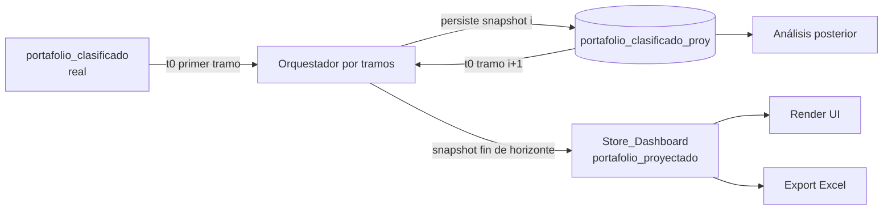
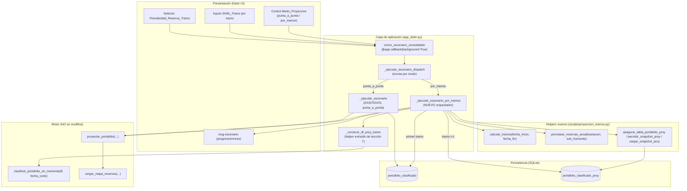

# Design Document: Proyección por Tramos

## Overview

AXIS proyecta hoy el portafolio de renta fija "de punta a punta": el orquestador (el
callback `correr_escenario_consolidado` → `_ejecutar_escenario` en `app_dash.py`)
calcula un horizonte en meses y llama **una sola vez** a
`proyectar_portafolio(...)` (`scripts/motor_proyeccion.py`) con un único juego de
shifts. El motor reparte esos shifts **linealmente** (`shift * mes / meses_horizonte`)
sobre un loop mensual, detecta cupones, procesa vencimientos, reinvierte, aplica
compras/ventas por variación de reserva y re-valora cada título. El resultado se arma
como `df_proy`, se reclasifica con `clasificar_portafolio_en_memoria(df_proy, fecha_end)`
y se expone en el store `store-resultados-escenario` (clave `portafolio_proyectado`).

Esta feature agrega un modo **`por_tramos`** que divide el horizonte en tramos por fin
de año y **encadena** corridas anuales: el cierre de un tramo es el estado inicial del
siguiente. Cada snapshot se **persiste** en una nueva tabla `portafolio_clasificado_proy`
(esquema idempotente desde la capa de aplicación, no en `init_db.py`) y el snapshot de
fin de horizonte se expone al store igual que hoy. El modo actual **`punta_a_punta`**
permanece por defecto y 100% retrocompatible. Adicionalmente, la periodicidad del input
de reservas puede ser `mensual` (default) o `anual` por tramo, afectando **solo** cómo se
deriva el `Mapa_Variaciones_Reserva` que consume el motor — **nunca** su paso mensual.

**Principio de diseño rector (regla de consistencia del proyecto):** el `Motor_Proyeccion`
**no se modifica**. Toda la nueva lógica vive en la capa de aplicación / helpers, replicando
los patrones ya existentes (esquema idempotente `asegurar_tabla_*`, queries parametrizadas,
allowlist de columnas, clasificación en memoria, background callback con `DiskcacheManager`).

### Hallazgos clave del prework (anclados en el código real)

1. **Firma y reparto lineal del motor** — `proyectar_portafolio(portafolio, fecha_inicio,
   meses_horizonte, sendas, overrides_reinversion, valor_uvr, valor_uvr_cierre, trm,
   trm_cierre, serie_ipc, senda_inflacion, shift_ipc_bps, shift_cop_bps, shift_uvr_bps,
   shift_fs_bps, shift_subyac_bps, shift_tesoros_bps, ipc_vigente_t0, senda_repo)`.
   El shift se aplica proporcional al mes: en el bloque de reinversión al vencimiento se
   ve `_si = (shift_cop_bps / 100.0) * mes / meses_horizonte` (y análogos para uvr/fs/
   subyac/ipc). **Implicación:** si a un tramo se le pasa su `Shifts_Tramo` (el movimiento
   de ESE periodo) junto con el `Sub_Horizonte` del tramo como `meses_horizonte`, el
   reparto lineal interno aplica el shift del tramo sobre los meses del tramo, sin tocar
   el motor (Req 3.3).

2. **Loop mensual** — `for mes in range(1, meses_horizonte + 1)` con
   `fecha_mes = fecha_inicio + relativedelta(months=mes)`. Cupones, vencimientos,
   reinversión, compras/ventas de reserva y re-valoración ocurren dentro de ese loop.
   El paso es mensual **siempre** (Req 9).

3. **Mapa de reservas** — `cargar_mapa_reservas(ruta_db, fecha_inicio, meses_horizonte)`
   devuelve `dict[str, dict[int, float]]` = `{ramo: {mes_offset: delta_reserva}}`. Meses
   ausentes = Δ=0 por convención del consumidor. El motor lo carga internamente (una sola
   vez por corrida) vía `from compras_ventas_reservas import cargar_mapa_reservas`.
   **Implicación:** para periodicidad `anual` no se toca el motor; se **precalcula** un
   mapa mensual prorrateado con el **mismo formato** `{ramo: {mes_offset: delta}}` y se
   inyecta al motor por tramo (ver Punto de diseño clave).

4. **Construcción de `df_proy` (sección 7 de `_ejecutar_escenario`)** — parte de
   `SELECT * FROM portafolio_clasificado`, elimina `ids_vencidos`, actualiza
   `valor_mercado` de los vivos con el VM del motor (`mask_rf`), concatena filas de
   reinversión (`df_reinv`), excluye colaterales/simultáneas y **reclasifica en memoria**
   con `clasificar_portafolio_en_memoria(df_proy, fecha_end)`. Este bloque se **extrae** a
   un helper reutilizable para poder invocarlo por tramo.

5. **Persistencia idempotente fuera de `init_db.py`** — patrón ya presente:
   `asegurar_tabla_config_ramos(conn)` / `asegurar_tabla_parametros_reservas(conn)` usan
   `CREATE TABLE IF NOT EXISTS`, no siembran datos, la tabla persiste entre corridas, y las
   lecturas usan queries parametrizadas con **allowlist fija** de columnas
   (`_COLUMNAS_CONFIG_RAMOS`, `_CLAVES_PARAMETROS_RESERVAS`). La nueva tabla replica ese
   patrón exacto.

6. **Clasificación en memoria** — `clasificar_portafolio_en_memoria(df, fecha_corte)`
   recalcula `tramo_plazo` y `asset_class_definitivo` sin DB; es la pieza que reclasifica
   cada snapshot a su `Fecha_Corte_Proyeccion`.

7. **Background callback ya migrado** — el callback está decorado con `background=True` y
   `running=[...]` (deshabilita el botón, muestra "⏳ Procesando…"). El progreso por tramo
   se emitirá vía `set_progress` (patrón estándar de Dash background callbacks). No se
   cambia la infraestructura de `DiskcacheManager`.

8. **Store como fuente de render/Excel** — el render (`renderizar_portafolio_proyectado`)
   y el export a Excel leen `data['portafolio_proyectado']` del store
   `store-resultados-escenario`. Retrocompatibilidad = mantener esa clave con el mismo
   formato (`df.to_dict('records')`).

---

## Punto de diseño clave: relación Store ↔ Tabla `portafolio_clasificado_proy`

Hoy el portafolio proyectado vive **solo en el store** del dashboard (no en tabla). Esta
feature introduce la tabla `portafolio_clasificado_proy`. La relación es:

| Aspecto | `Store_Dashboard` (`store-resultados-escenario`) | Tabla `portafolio_clasificado_proy` |
|---|---|---|
| Propósito | Render en UI + export a Excel (retrocompat) | Fuente del **encadenamiento** entre tramos y del análisis posterior |
| Contenido | Un único DataFrame: el portafolio proyectado a **fin de horizonte** | N snapshots, uno por `Fecha_Corte_Proyeccion` |
| Ciclo de vida | En memoria del navegador/worker; se sobreescribe cada corrida | Persistente entre corridas; se **reemplaza** al iniciar una nueva corrida por tramos |

Reglas explícitas:

- **Modo `punta_a_punta` (default, retrocompat):** la tabla **no se usa** ni se toca. El
  flujo es idéntico al actual: una corrida, `df_proy` → store. (Se permite que la tabla
  exista de corridas por tramos previas; no se lee ni se sobreescribe en este modo.)
- **Modo `por_tramos`:** por cada tramo se persiste su snapshot en la tabla (fuente del t0
  del tramo siguiente vía `cargar_snapshot_proy`). Al terminar, el snapshot del **último**
  tramo (fin de horizonte) se expone al store con la clave `portafolio_proyectado` — mismo
  formato que hoy — de modo que render y Excel funcionan sin cambios. La tabla conserva
  todos los cortes para análisis (Req 6.3).



---

## Architecture

### Diagrama de componentes



### Diagrama de secuencia — loop de tramos encadenados

```mermaid
sequenceDiagram
    participant CB as Callback (background)
    participant PT as _ejecutar_escenario_por_tramos
    participant CT as calcular_tramos
    participant DB as SQLite (pc / pc_proy)
    participant PR as prorratear_reservas_anual
    participant MP as proyectar_portafolio (motor)
    participant BD as _construir_df_proy_tramo
    participant ST as Store_Dashboard

    CB->>PT: modo=por_tramos, fecha_inicio, fecha_fin, shifts_por_tramo, periodicidad_por_tramo
    PT->>CT: calcular_tramos(fecha_inicio, fecha_fin)
    CT-->>PT: [Tramo(fecha_corte, sub_horizonte), ...] (N tramos)
    PT->>DB: asegurar_tabla_portafolio_proy(conn) + limpiar corrida previa
    loop por cada Tramo i (cronológico)
        PT->>CB: set_progress("Tramo i de N")
        alt i == 0
            PT->>DB: cargar portafolio_clasificado (t0 real)
        else i > 0
            PT->>DB: cargar_snapshot_proy(fecha_corte_{i-1})
            DB-->>PT: portafolio de cierre del tramo anterior
        end
        opt periodicidad_i == anual
            PT->>PR: prorratear_reservas_anual(variacion_i, sub_horizonte_i)
            PR-->>PT: {ramo: {mes_offset: delta}} mensual
        end
        PT->>MP: proyectar_portafolio(port_i, inicio_i, sub_horizonte_i, shifts_i, ...)
        MP-->>PT: resultados mensuales (VM, reinversiones, vencidos)
        PT->>BD: _construir_df_proy_tramo(port_base_i, resultados, fecha_corte_i)
        BD-->>PT: df_proy_i (reclasificado a fecha_corte_i)
        PT->>DB: persistir_snapshot_proy(df_proy_i, fecha_corte_i)
    end
    PT->>ST: exponer df_proy_N (fin de horizonte) como portafolio_proyectado
    PT-->>CB: (resultados, msg "Escenario por tramos completado: N tramos")
```



### Decisiones de arquitectura (con justificación)

1. **Encadenar corridas anuales en vez de modificar el motor.** El motor ya implementa el
   reparto lineal `shift * mes / meses_horizonte`. Un único juego de shifts sobre todo el
   horizonte no puede representar movimientos distintos por año. Encadenar corridas —cada
   una con su `Shifts_Tramo` y su `Sub_Horizonte`— logra shifts por periodo **reutilizando
   exactamente** el reparto lineal existente. Alternativa descartada: parametrizar el motor
   con una senda de shifts por mes → obligaría a cambiar la firma y la lógica interna
   (viola Req 1.5 y la regla de consistencia).

2. **Orquestar en la capa de aplicación (`app_dash.py` + helpers).** La preparación de
   inputs, el troceo del horizonte, la persistencia de snapshots y el encadenamiento son
   responsabilidades de orquestación, no de valoración. Mantenerlas en la capa de
   aplicación respeta la separación de capas (Presentación/Lógica/Persistencia) y deja el
   motor como una función pura de valoración reutilizable por ambos modos.

3. **Reutilizar `_ejecutar_escenario` para `punta_a_punta`.** Se introduce un dispatcher
   delgado (`_ejecutar_escenario_dispatch`) que enruta por `Modo_Proyeccion`; el modo
   default llama al `_ejecutar_escenario` **actual sin cambios**, garantizando resultado
   idéntico (Req 1.3).

4. **Tabla con esquema idempotente desde la app, no en `init_db.py`.** Se replica el patrón
   `asegurar_tabla_*` ya usado por `compras_ventas_reservas.py`. `init_db.py` es un
   bootstrap destructivo de un solo uso y no debe conocer esta tabla (Req 5.2).

5. **Prorrateo de reservas fuera del motor + inyección por parámetro opcional.** La
   periodicidad anual solo cambia la **derivación** del `Mapa_Variaciones_Reserva`. Se
   precalcula un mapa mensual prorrateado y se **inyecta** al motor vía el nuevo argumento
   opcional `mapa_reservas` de `proyectar_portafolio` (default `None` = comportamiento
   actual). Esto preserva el paso mensual y el formato que el motor ya consume, sin tocar su
   lógica de valoración (Req 7, 8, 9). Ver "Nota de inyección del mapa".

> **Nota de inyección del mapa (decisión confirmada — parámetro opcional):** hoy el motor
> llama internamente a `cargar_mapa_reservas(...)`. Para el modo `por_tramos` con
> periodicidad anual se necesita que el motor consuma el mapa **prorrateado** de ese tramo.
> Se resuelve con un **cambio mínimo y 100% retrocompatible al motor**: `proyectar_portafolio`
> recibe un nuevo argumento opcional `mapa_reservas: dict[str, dict[int, float]] | None = None`.
> - Si `mapa_reservas is None` (default), el motor llama a `cargar_mapa_reservas(...)`
>   **exactamente como hoy** → el modo `punta_a_punta` y la ejecución directa del motor no
>   cambian (Req 1.3, 1.5).
> - Si se pasa `mapa_reservas`, el motor lo usa tal cual (sin abrir la DB).
>
> Este cambio **no altera la lógica de valoración del motor** (cupones, vencimientos,
> reinversión, re-valoración, paso mensual): solo cambia el ORIGEN de un dato que el motor
> ya consume. Es preferible al patrón de "escribir/restaurar la tabla `input_variacion_reservas`"
> porque: (a) evita estado compartido temporal frágil ante fallos a mitad de corrida o
> concurrencia (relevante porque el escenario corre en un worker de background); (b) hace la
> inyección explícita y los tests triviales (se pasa el mapa directo, sin SQLite);
> (c) preserva el paso mensual del motor (Req 9). El orquestador, para un tramo `mensual`,
> puede pasar `mapa_reservas=None` (comportamiento actual) y para un tramo `anual` pasa el
> mapa prorrateado de `prorratear_reservas_anual`. Se valida en Testing con la property
> "el paso del motor sigue siendo mensual" y la de retrocompatibilidad de `punta_a_punta`.

---

## Components and Interfaces

Todos los helpers nuevos viven en `scripts/proyeccion_tramos.py` (módulo nuevo, aislado y
testeable), salvo el orquestador y el dispatcher que viven en `app_dash.py`. Todas las
firmas usan Python 3.12+ y type hints.

### Componente 1: `calcular_tramos`

**Propósito:** dividir el horizonte en tramos por fin de año calendario.

```python
from dataclasses import dataclass
from datetime import date

@dataclass(frozen=True)
class Tramo:
    indice: int              # 0-based, orden cronológico
    fecha_inicio: date       # inicio del tramo (t0 real o día siguiente al corte previo)
    fecha_corte: date        # Fecha_Corte_Proyeccion (fin de año o fin de horizonte)
    sub_horizonte: int       # meses entre fecha_inicio y fecha_corte (>= 1)

def calcular_tramos(fecha_inicio: date, fecha_fin: date) -> list[Tramo]:
    """
    Devuelve la lista de Tramo en orden cronológico ascendente.

    - Los cortes intermedios son el 31-dic de cada año calendario contenido.
    - El último corte es fecha_fin (aunque no sea fin de año).
    - sub_horizonte = meses(fecha_inicio_tramo, fecha_corte) con la MISMA fórmula que
      el orquestador actual: delta.years*12 + delta.months + (1 si delta.days>0).
    - Si el horizonte cae dentro de un único año → exactamente un Tramo.

    Raises:
        HorizonteInvalidoError: si el horizonte total < 1 mes (Req 2.5).
    """
```

### Componente 2: `prorratear_reservas_anual`

**Propósito:** convertir una variación **anual** de reserva por ramo en un
`Mapa_Variaciones_Reserva` mensual con imputación lineal.

```python
def prorratear_reservas_anual(
    variacion_anual_por_ramo: dict[str, float],
    sub_horizonte: int,
    tolerancia: float = 1e-6,
) -> dict[str, dict[int, float]]:
    """
    Reparte linealmente la variación anual de cada ramo entre los meses del tramo.

    - Salida en el formato que consume el motor: {ramo: {mes_offset: delta}}, con
      mes_offset en 1..sub_horizonte.
    - Invariante: sum(deltas de un ramo) == variacion_anual[ramo] (dentro de tolerancia).
      El posible residuo de redondeo se acumula en el último mes para preservar la suma.
    - Ramos con variación 0 o sin dato se omiten (motor asume Delta=0 para lo ausente).
    Entrada NO confiable: normaliza el ramo (strip/upper), coerciona delta a float finito;
    filas inválidas se descartan con log genérico (Req 12.3, 12.4).
    """
```

### Componente 3: Persistencia de snapshots (`portafolio_clasificado_proy`)

```python
import sqlite3
import pandas as pd

def asegurar_tabla_portafolio_proy(conn: sqlite3.Connection) -> None:
    """
    CREATE TABLE IF NOT EXISTS portafolio_clasificado_proy (idempotente, no siembra).
    Réplica del patrón asegurar_tabla_* de compras_ventas_reservas.py.
    NO se invoca desde init_db.py (Req 5.1, 5.2).
    """

def persistir_snapshot_proy(
    conn: sqlite3.Connection,
    df: pd.DataFrame,
    fecha_corte: date,
) -> int:
    """
    Persiste df como snapshot del corte fecha_corte en portafolio_clasificado_proy.

    - Escribe solo columnas de una ALLOWLIST fija (las de portafolio_clasificado +
      fecha_corte_proyeccion); columnas ausentes se rellenan con NULL, columnas extra se
      descartan (Req 12.2).
    - INSERT parametrizado por filas (executemany con placeholders '?'); nunca interpola
      SQL (Req 5.5, 12.1).
    - Devuelve el número de filas persistidas.
    """

def limpiar_snapshots_proy(conn: sqlite3.Connection) -> None:
    """
    DELETE FROM portafolio_clasificado_proy (sin WHERE con entrada externa) para reemplazar
    los snapshots de una corrida previa antes de escribir la nueva (Req 5.6).
    """

def cargar_snapshot_proy(
    conn: sqlite3.Connection,
    fecha_corte: date,
) -> pd.DataFrame:
    """
    Lee el snapshot de fecha_corte (SELECT columnas-allowlist WHERE
    fecha_corte_proyeccion = ? — parametrizado). Sirve de t0 del tramo siguiente (Req 4.2).

    Raises:
        SnapshotAusenteError: si no hay filas para fecha_corte (Req 11.2).
    """
```

### Componente 4: `_construir_df_proy_tramo` (helper extraído de la sección 7)

**Propósito:** encapsular la construcción del `df_proy` de un tramo, reutilizable por
ambos modos.

```python
def _construir_df_proy_tramo(
    df_base: pd.DataFrame,          # portafolio de inicio del tramo (pc real o snapshot)
    vm_motor_rf: dict[str, float],  # VM por id_posicion tras la corrida del motor
    ids_vencidos: set[str],
    filas_reinversion: list[dict],
    fecha_corte: date,
) -> pd.DataFrame:
    """
    Réplica exacta de la lógica actual (sección 7 de _ejecutar_escenario):
      1. copia df_base, elimina ids_vencidos
      2. actualiza valor_mercado de los vivos con vm_motor_rf
      3. concatena filas_reinversion
      4. excluye colaterales (recibido|enviado) y simultáneas (Repo_Simultanea)
      5. reclasifica con clasificar_portafolio_en_memoria(df, fecha_corte)
    """
```

### Componente 5: `_ejecutar_escenario_por_tramos` (orquestador nuevo)

```python
def _ejecutar_escenario_por_tramos(
    fecha_inicio, fecha_fin,
    shifts_por_tramo: list[dict],          # un Shifts_Tramo por tramo (índice = tramo)
    periodicidad_por_tramo: list[str],     # 'mensual' | 'anual' por tramo
    variacion_anual_por_tramo: list[dict], # {ramo: variacion_anual} por tramo (anual)
    *sendas_y_estado,                      # sendas, uvr/trm/ipc, etc. (como el actual)
    set_progress=None,
):
    """
    Orquesta el flujo encadenado (ver diagrama de secuencia):
      - calcular_tramos → lista de Tramo
      - asegurar_tabla + limpiar_snapshots_proy (reemplazo de corrida previa)
      - por cada tramo (cronológico): cargar t0, derivar mapa reservas (mensual|anual),
        invocar proyectar_portafolio con sub_horizonte y shifts del tramo,
        _construir_df_proy_tramo, persistir_snapshot_proy, set_progress
      - exponer el df_proy del último tramo al store (clave 'portafolio_proyectado')
    Manejo de errores por tramo según la tabla de Error Handling.
    """

def _ejecutar_escenario_dispatch(modo: str, *args, **kwargs):
    """
    Enruta por Modo_Proyeccion. modo='punta_a_punta' (default) → _ejecutar_escenario
    (EXISTENTE, sin cambios). modo='por_tramos' → _ejecutar_escenario_por_tramos.
    """
```

### Mapa de trazabilidad interfaz → requisito

| Interfaz / helper | Requisito(s) |
|---|---|
| `_ejecutar_escenario_dispatch` (control de modo) | 1.1, 1.2, 1.4 |
| `_ejecutar_escenario` reutilizado (default) | 1.3, 1.5 |
| `calcular_tramos` | 2.1, 2.2, 2.3, 2.4, 2.5 |
| `shifts_por_tramo` pasado al motor con `sub_horizonte` | 3.1, 3.2, 3.3, 3.4 |
| `cargar_snapshot_proy` / t0 por tramo | 4.1, 4.2, 4.5 |
| `_construir_df_proy_tramo` + `clasificar_portafolio_en_memoria` | 4.3, 4.4, 6.2 |
| `asegurar_tabla_portafolio_proy` | 5.1, 5.2, 5.3 |
| `persistir_snapshot_proy` | 5.4, 5.5, 6.3 |
| `limpiar_snapshots_proy` | 5.6 |
| Exposición del último snapshot al store | 6.1 |
| `periodicidad_por_tramo` (derivación del mapa) | 7.1, 7.2, 7.3, 7.4, 7.5 |
| `prorratear_reservas_anual` | 8.1, 8.2, 8.3, 8.4 |
| `proyectar_portafolio(..., mapa_reservas=None)` (arg opcional, default retrocompat) | 9.1, 9.2, 9.3, 1.3, 1.5 |
| Orquestador dentro del background callback + `set_progress` | 10.1, 10.2, 10.3 |
| Manejo de errores por tramo (detención + mensaje) | 11.1, 11.2, 11.3, 11.4 |
| Allowlist + queries parametrizadas + validación de entrada | 12.1–12.5 |
| Dependencias pineadas / reutilización | 13.1, 13.2, 13.3 |

---

## Data Models

### `portafolio_clasificado_proy` (nueva tabla)

Mismas columnas que `portafolio_clasificado` (creada dinámicamente por `to_sql` en la
clasificación diaria) más `fecha_corte_proyeccion`. La **allowlist** de columnas la controla
el código (no la introspección de entrada externa); las columnas exactas se derivan del
esquema vigente de `portafolio_clasificado` al asegurar la tabla.

```python
# Allowlist FIJA (literales controlados por el código). Núcleo estable requerido para
# encadenamiento (motor/clasificación) + análisis (Req 6.2):
_COLUMNAS_PROY = (
    "fecha_corte_proyeccion",   # NUEVA: identifica el corte (TEXT 'YYYY-MM-DD')
    "id_posicion", "especie", "emisor", "isin", "moneda",
    "fecha_vencimiento", "nominal", "valor_mercado", "tasa_compra", "tir",
    "estado", "portafolio", "compania", "ramo", "clasificacion_contable",
    "subtipo_vehiculo", "tasa_referencia", "tasa_facial", "tipo_tasa",
    "uso_tasa", "periodicidad", "base_anual",
    "asset_class_definitivo", "tramo_plazo",
    "clasificacion_solvencia", "categoria", "ponderacion",
    "numeral_regimen", "descripcion_regimen", "encaje", "clase_origen",
)
```

DDL idempotente (índice para acelerar la carga por corte):

```sql
CREATE TABLE IF NOT EXISTS portafolio_clasificado_proy (
    fecha_corte_proyeccion TEXT NOT NULL,
    id_posicion TEXT,
    especie TEXT,
    -- ... resto de columnas de la allowlist ...
    valor_mercado REAL,
    nominal REAL
);
CREATE INDEX IF NOT EXISTS ix_pcp_corte
    ON portafolio_clasificado_proy (fecha_corte_proyeccion);
```

**Reglas de validación (entrada NO confiable, Req 12.3):**
- `fecha_corte_proyeccion`: fecha ISO válida; se genera desde `Tramo.fecha_corte` (no del usuario).
- `valor_mercado`, `nominal`: coercionados a float finito; filas no coercionables se descartan con log genérico.
- Columnas fuera de la allowlist se **descartan**; columnas de la allowlist ausentes en el df → NULL.

### `Shifts_Tramo` (por tramo)

```python
@dataclass(frozen=True)
class ShiftsTramo:
    shift_cop_bps: float = 0.0
    shift_uvr_bps: float = 0.0
    shift_fs_bps: float = 0.0
    shift_ipc_bps: float = 0.0
    shift_subyac_bps: float = 0.0
    shift_tesoros_bps: float = 0.0
    trm_cierre: float | None = None
    valor_uvr_cierre: float | None = None
    senda_inflacion: list[float] | None = None
    senda_repo: list[float] | None = None
    # Semántica: movimiento del PERIODO del tramo (no acumulado). Se pasa tal cual al
    # motor junto con sub_horizonte del tramo (Req 3.2, 3.3).
```

**Validación (Req 12.3):** cada shift se coerciona a float finito; rango razonable de bps
validado por allowlist de campos; ausencia → 0.0 (Req 3.4).

### `Periodicidad_Reserva_Tramo` (por tramo)

```python
from enum import Enum
class PeriodicidadReserva(Enum):
    MENSUAL = "mensual"   # default
    ANUAL = "anual"
# Valor no reconocido → MENSUAL (conservador, retrocompat) con log genérico (Req 7.2, 12.3).
```

### `Mapa_Variaciones_Reserva`

```python
MapaReservas = dict[str, dict[int, float]]   # {ramo: {mes_offset: delta_reserva}}
# mensual: se deriva como hoy (cargar_mapa_reservas). anual: prorratear_reservas_anual.
# meses ausentes = Delta=0 por convención del consumidor (motor).
```

---

## Correctness Properties

Notación: `∀` = "para todo". Las propiedades marcadas **[PBT]** son testables con
`hypothesis`; las marcadas **[NO-PBT]** se cubren con pruebas de ejemplo/integración.

### Property 1: Retrocompatibilidad de `punta_a_punta` **[PBT]** (Req 1.3)
∀ inputs válidos: `_ejecutar_escenario_dispatch("punta_a_punta", args)` produce un
resultado **idéntico** a `_ejecutar_escenario(args)`. Se testea sobre el dispatcher aislado
(el motor real se sustituye por un doble determinista) verificando igualdad de la salida.

**Validates: Requirements 1.3**

### Property 2: Cobertura del horizonte sin solapamiento **[PBT]** (Req 2.1–2.4)
∀ `(fecha_inicio, fecha_fin)` con horizonte ≥ 1 mes, para `tramos = calcular_tramos(...)`:
- `tramos[0].fecha_inicio == fecha_inicio`
- `tramos[-1].fecha_corte == fecha_fin`
- ∀ i>0: `tramos[i].fecha_inicio == tramos[i-1].fecha_corte + 1 día` (contiguos, sin gaps ni solapes)
- todos los cortes intermedios son 31-dic
- orden cronológico estrictamente ascendente por `fecha_corte`

**Validates: Requirements 2.1, 2.2, 2.3, 4.5**

### Property 3: Un solo tramo si el horizonte cabe en un año **[PBT]** (Req 2.4)
∀ `(fi, ff)` con `fi.year == ff.year`: `len(calcular_tramos(fi, ff)) == 1` y
`tramos[0].sub_horizonte == meses(fi, ff)`.

**Validates: Requirements 2.4**

### Property 4: Rechazo de horizonte < 1 mes **[PBT]** (Req 2.5)
∀ `(fi, ff)` con horizonte < 1 mes: `calcular_tramos(fi, ff)` lanza `HorizonteInvalidoError`.

**Validates: Requirements 2.5**

### Property 5: Suma de deltas prorrateados = variación anual **[PBT]** (Req 8.1, 8.2)
∀ `variacion` (dict ramo→float finito) y `sub_horizonte ≥ 1`:
para `mapa = prorratear_reservas_anual(variacion, sub_horizonte)`,
∀ ramo con variación ≠ 0: `abs(sum(mapa[ramo].values()) - variacion[ramo]) <= tolerancia`.

**Validates: Requirements 8.1, 8.2**

### Property 6: Formato y dominio del mapa prorrateado **[PBT]** (Req 8.3, 8.4)
∀ salida de `prorratear_reservas_anual`: las claves de mes están en `1..sub_horizonte`;
todos los valores son floats finitos; ramos con variación 0 no aparecen.

**Validates: Requirements 8.3, 8.4**

### Property 7: Reparto lineal ≈ uniforme entre meses **[PBT]** (Req 8.1)
∀ `variacion` y `sub_horizonte`: la diferencia entre el delta máximo y mínimo de un ramo
(sobre los meses presentes) es ≤ tolerancia (salvo el ajuste de residuo en el último mes).

**Validates: Requirements 8.1**

### Property 8: Nº de snapshots persistidos = nº de tramos **[PBT]** (Req 5.4, integración con doble de motor)
∀ horizonte válido: tras una corrida `por_tramos`, `COUNT(DISTINCT fecha_corte_proyeccion)
en portafolio_clasificado_proy == len(tramos)`.

**Validates: Requirements 5.4, 6.3**

### Property 9: Encadenamiento usa el cierre del tramo anterior **[PBT]** (Req 4.1, 4.2)
∀ i>0: el t0 del tramo i cargado por el orquestador es exactamente el snapshot persistido
para `tramos[i-1].fecha_corte` (verificado con un doble de motor que marca las filas).

**Validates: Requirements 4.1, 4.2**

### Property 10: El paso del motor sigue siendo mensual **[PBT]** (Req 9.1, 9.3)
∀ tramo: el orquestador invoca `proyectar_portafolio` con `meses_horizonte ==
tramo.sub_horizonte` (entero ≥ 1) y **nunca** pasa un mapa cuyas claves de mes excedan
`sub_horizonte`. Se verifica capturando los argumentos del doble de motor.

**Validates: Requirements 9.1, 9.3**

### Property 11: Reemplazo de corrida previa **[PBT]** (Req 5.6)
∀ dos corridas consecutivas `por_tramos`: tras la segunda, la tabla contiene **solo** los
cortes de la segunda corrida (los de la primera fueron eliminados).

**Validates: Requirements 5.6**

### Property 12: Idempotencia del esquema **[PBT]** (Req 5.1)
∀ n ≥ 1 llamadas a `asegurar_tabla_portafolio_proy(conn)`: no lanza, no borra filas
existentes, la tabla existe al final.

**Validates: Requirements 5.1**

### Property 13: Seguridad de acceso a datos **[NO-PBT / ejemplo]** (Req 12.1, 12.2, 12.5)
Todas las sentencias SQL de la feature usan placeholders `?`; ninguna concatena/interpola
entrada. Se cubre con revisión + tests de ejemplo que inyectan valores hostiles en `ramo`
/ `fecha_corte` y verifican que se tratan como datos (no como SQL). **No es una propiedad
universal cuantificable**: se valida por inspección de código y casos representativos.

**Validates: Requirements 12.1, 12.2, 12.5**

### Propiedades NO PBT-testables y su cobertura
- **UI (Req 1.1, 3.1, 7.1, 10.2):** presencia del control de modo, inputs por tramo y
  reporte de progreso → **tests de ejemplo** de callbacks Dash (o smoke test manual) que
  verifican outputs de `running`/`set_progress`. No se cuantifican como propiedad.
- **Persistencia real en SQLite (Req 5.4, 6.3):** se cubre con P8/P11 usando la fixture
  `db_tmp` (SQLite temporal) — es "example-heavy" pero se ejecuta como property con
  generación de horizontes.
- **Mensajes de error genéricos sin datos sensibles (Req 11.4, 12.4, 12.5):** **test de
  ejemplo** que fuerza un fallo de tramo y verifica que el mensaje contiene la
  `fecha_corte` pero **no** filas del portafolio ni trazas internas.
- **Background callback / DiskcacheManager (Req 10.1):** integración/manual; el orquestador
  se testea de forma síncrona inyectando un `set_progress` falso.

---

## Error Handling

| # | Situación | Detección | Respuesta | Recuperación | Req |
|---|---|---|---|---|---|
| E1 | La corrida de un tramo falla (excepción del motor o de construcción de df) | `try/except` alrededor de la corrida del tramo en el orquestador | Detener el encadenamiento; mensaje al usuario que identifica la `Fecha_Corte_Proyeccion` del tramo fallido; **no** exponer resultado de fin de horizonte | Se conservan los snapshots de tramos ya completados en la tabla; el store no recibe resultado incompleto | 11.1, 11.3 |
| E2 | Snapshot del tramo anterior ausente (tramo i>0) | `cargar_snapshot_proy` lanza `SnapshotAusenteError` | Detener la corrida; mensaje de error verificable indicando el corte esperado | Sin exposición al store | 11.2 |
| E3 | Horizonte total < 1 mes | `calcular_tramos` lanza `HorizonteInvalidoError` | Rechazar la ejecución del modo por tramos con mensaje verificable **antes** de tocar la DB | Ninguna corrida iniciada | 2.5 |
| E4 | `variacion_anual` con delta no finito / ramo vacío | Validación en `prorratear_reservas_anual` | Descartar la fila con log genérico; continuar | Mapa parcial válido (motor asume Δ=0) | 8.4, 12.3, 12.4 |
| E5 | Periodicidad o modo con valor no reconocido | Validación por allowlist de enum | Usar default (`mensual` / `punta_a_punta`) con log genérico | Corrida continúa en modo seguro | 7.2, 12.3 |
| E6 | Fila de snapshot no coercionable (VM/nominal no numérico) al persistir | Validación en `persistir_snapshot_proy` | Descartar la fila con log genérico | Snapshot persiste el resto | 12.3, 12.4 |
| E7 | Error al asegurar/escribir la tabla (I/O, lock) | Excepción SQLite | Abortar corrida; mensaje genérico (sin traza ni datos sensibles) | Transacción no confirmada (rollback) | 11.4, 12.5 |
| E8 | Fallo al derivar mapa mensual (`cargar_mapa_reservas`) | `try/except` (patrón ya existente en el motor) | Mapa vacío → el tramo corre sin operar reservas | Retrocompatibilidad con el fail-safe actual | 7.3 |

**Regla transversal (Req 11.4, 12.5):** los mensajes al usuario y los logs son **genéricos**
(fecha de corte y conteos permitidos; nunca filas del portafolio, VMs individuales,
identificadores sensibles ni trazas internas). Las operaciones de escritura por corrida se
envuelven en transacción para que un fallo no deje la tabla en estado parcial inconsistente.

---

## Testing Strategy

**Framework:** `pytest` + `hypothesis` (pineado **`hypothesis==6.140.3`**, Req 13.2). No se
introducen dependencias nuevas: se reutilizan `pandas`, `sqlite3` (stdlib) y la suite
existente (Req 13.1, 13.3). Ubicación sugerida: `tests/test_proyeccion_tramos.py`.

### Unit / property tests (mínimo 100 iteraciones por property)

Configuración global por property: `@settings(max_examples=100, deadline=None)` (≥ 100
iteraciones, Req del proyecto). Cada test se **etiqueta** con la propiedad del diseño que
verifica (en el nombre y en un comentario `# Propiedad P#`).

| Test (nombre sugerido) | Propiedad | Estrategia `hypothesis` |
|---|---|---|
| `test_p2_cortes_cubren_horizonte_sin_solape` | P2 | fechas de inicio/fin generadas con `st.dates()` acotadas, horizonte ≥ 1 mes |
| `test_p3_un_solo_tramo_en_mismo_anio` | P3 | pares de fechas dentro del mismo año |
| `test_p4_rechaza_horizonte_menor_a_un_mes` | P4 | pares de fechas con < 1 mes de separación |
| `test_p5_suma_prorrateo_igual_variacion_anual` | P5 | `st.dictionaries(ramos, st.floats(allow_nan=False, allow_infinity=False))`, `sub_horizonte` en `st.integers(1, 24)` |
| `test_p6_formato_dominio_mapa_prorrateado` | P6 | idem P5 |
| `test_p7_reparto_uniforme` | P7 | idem P5 |
| `test_p8_n_snapshots_igual_n_tramos` | P8 | horizontes válidos + fixture `db_tmp` + doble de motor |
| `test_p9_encadenamiento_usa_cierre_anterior` | P9 | doble de motor que "marca" filas; verifica t0 del tramo i |
| `test_p10_paso_motor_mensual` | P10 | captura de args del doble de motor |
| `test_p11_reemplazo_corrida_previa` | P11 | dos corridas sobre `db_tmp` |
| `test_p12_idempotencia_esquema` | P12 | `st.integers(1, 10)` llamadas repetidas |
| `test_p1_retrocompat_punta_a_punta` | P1 | inputs generados; dispatcher con doble de motor determinista |

### Tests de ejemplo (no property)

- `test_p13_sql_parametrizado_valores_hostiles` (P13): inserta `ramo`/`fecha_corte` con
  comillas y `;DROP TABLE` y verifica que se tratan como datos.
- `test_e1_tramo_falla_reporta_corte_sin_datos_sensibles` (E1/Req 11.4): fuerza excepción en
  el doble de motor en el tramo 2 y verifica el mensaje (contiene la fecha de corte, no VMs
  ni trazas) y que el store no recibe resultado de fin de horizonte.
- `test_e2_snapshot_ausente` (E2): borra el snapshot previo y verifica `SnapshotAusenteError`.
- `test_ui_control_modo_default_punta_a_punta` (Req 1.2): smoke del callback/dispatch.

### Fixtures

```python
import sqlite3, pytest, pandas as pd

@pytest.fixture
def db_tmp(tmp_path):
    """SQLite temporal aislado por test. Crea portafolio_clasificado mínima y asegura
    portafolio_clasificado_proy (esquema idempotente). Se destruye al terminar el test."""
    ruta = tmp_path / "axis_test.db"
    conn = sqlite3.connect(ruta)
    # sembrar portafolio_clasificado mínimo (columnas de la allowlist)
    yield conn
    conn.close()
```

### Doble de motor (para P1, P8, P9, P10, P11 y E1)

Para no ejecutar la valoración BVC real en los property tests, se inyecta un **doble
determinista** de `proyectar_portafolio` (mismo contrato de firma/retorno) que:
- respeta `meses_horizonte` (permite verificar el paso mensual, P10),
- devuelve VM/reinversiones deterministas y "marca" filas (permite verificar el
  encadenamiento, P9),
- puede configurarse para lanzar en un tramo dado (E1).
El motor real **no se modifica**; el doble se pasa por parámetro/inyección al orquestador
(o vía `monkeypatch` del símbolo importado en el módulo del orquestador).

### Integration testing

- Una corrida `por_tramos` end-to-end sobre `db_tmp` con el doble de motor: valida P8, P9,
  P11 y la exposición del último snapshot al store en un solo flujo.
- Smoke test del modo `punta_a_punta` para confirmar que el dispatcher no altera el camino
  actual (P1 a nivel de integración).

## Security Considerations

- **Inyección SQL (Req 12.1):** todo acceso a `portafolio_clasificado_proy` e
  `input_variacion_reservas` usa placeholders `?` (patrón ya establecido en
  `compras_ventas_reservas.py`); nunca se interpola entrada en el texto SQL.
- **Allowlist de columnas (Req 12.2):** lectura y escritura restringidas a `_COLUMNAS_PROY`
  (literales del código); columnas fuera de la allowlist se descartan.
- **Entrada no confiable (Req 12.3, 12.4):** modo, shifts, periodicidad y filas leídas de la
  DB se validan por tipo/rango antes de usarse; valores inválidos se rechazan con
  advertencia genérica.
- **No filtración (Req 11.4, 12.5):** mensajes de usuario y logs no vuelcan datos del
  portafolio ni trazas internas.

## Dependencies

No se introducen dependencias nuevas. Se reutiliza el stack ya presente y pineado:
`pandas`, `numpy`, `python-dateutil`, `sqlite3` (stdlib), `dash==4.4.1`, y para pruebas
`pytest` + `hypothesis==6.140.3` (Req 13.1, 13.2, 13.3). Cualquier dependencia futura debe
declararse con versión exacta (sin `^`, `~`, `*`, `latest`).
```