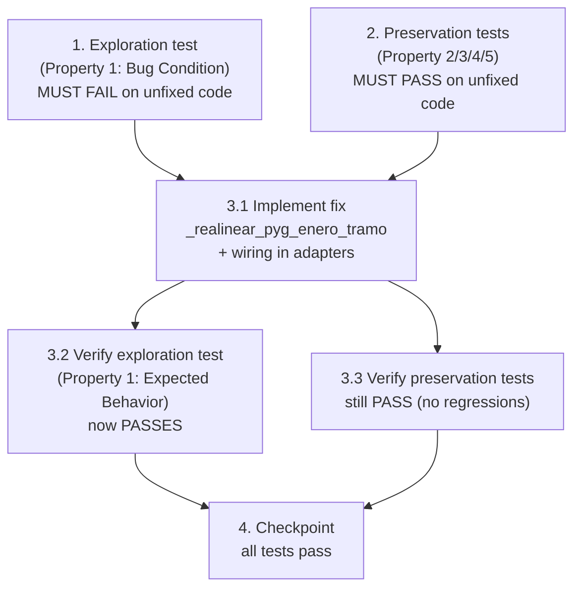

# Implementation Plan

## Overview

Bugfix: P&G de enero en tramos RV/Alt (`modo_proyeccion = "por_tramos"`). El fix vive en los
adaptadores del orquestador (`app_dash.py`), NO en los motores ni en RF. Se sigue la
metodología de condición del bug: primero exploración (prueba que FALLA en código sin
corregir), luego preservación (pruebas que PASAN en código sin corregir), luego el fix, y
finalmente verificación.

Pruebas en `tests/test_pyg_enero_tramos_rv_alt.py` (pytest + Hypothesis + `tests/conftest.py`
existente).

## Task Dependency Graph



```json
{
  "waves": [
    {
      "wave": 1,
      "description": "Exploration + preservation tests on UNFIXED code (parallel, no fix yet)",
      "tasks": ["1", "2"]
    },
    {
      "wave": 2,
      "description": "Implement the realignment fix in app_dash.py adapters",
      "tasks": ["3.1"]
    },
    {
      "wave": 3,
      "description": "Re-run the same tests to confirm fix and no regressions (parallel)",
      "tasks": ["3.2", "3.3"]
    },
    {
      "wave": 4,
      "description": "Final checkpoint",
      "tasks": ["4"]
    }
  ]
}
```

## Tasks

- [x] 1. Write bug condition exploration test (phantom-row counterexamples)
  - **Property 1: Bug Condition** - Distribución mensual correcta en tramos `indice > 0`
  - **CRITICAL**: This test MUST FAIL on unfixed code - failure confirms the bug exists
  - **DO NOT attempt to fix the test or the code when it fails** - the failure is the expected outcome of this task
  - **NOTE**: This test encodes the EXPECTED behavior (`F'`); it will validate the fix when it passes after task 3.1
  - **GOAL**: Surface counterexamples that demonstrate the phantom opening row in enero of tramos `indice > 0`
  - **Scoped PBT Approach**: encode as a Hypothesis property over generated tramo series (VM inicial > 0 por posición, tasa EA/retorno, nº posiciones, `indice > 0`), and anchor it with deterministic `@example`s for the verified real-data cases
  - Build the monthly series of a tramo `indice > 0` (12 periodos ene..dic) using the engine (or a deterministic stub replicating `proyectar_bloque` / `proyectar_bloque_ipc_spread` output: fila `i == 0` con `pyg = 0` y `VM = VM_cierre_previo`)
  - Assert the EXPECTED (post-fix) behavior so the test FAILS on unfixed code:
    - `pyg(ene) ≈ VM(ene) − VM_cierre_previo` (P&G real de enero, distinto de 0 cuando el retorno real != 0)
    - `NOT (VM(ene) == VM_cierre_previo AND pyg(ene) == 0)` cuando el retorno real del mes es no nulo
  - Deterministic `@example` reproductions (verified real data) that must demonstrate the bug on unfixed code:
    - RV local AO PROTECCION, tramo 2027: unfixed → `pyg(2027-01) == 0` y `VM(2027-01) == VM(2026-12)`; expected → `pyg(2027-01) != 0` = `VM(2027-01) − VM(2026-12)`, Dec-2027 presente
    - RV internacional ACWV: mismo patrón de fila fantasma en enero
    - Alt BROOKFIELD (IPC+spread, `proyectar_bloque_ipc_spread`): mismo patrón en enero
  - Run test on UNFIXED code
  - **EXPECTED OUTCOME**: Test FAILS (this is correct - it proves the phantom row / one-month shift exists)
  - Document counterexamples found (e.g., "AO PROTECCION tramo 2027: pyg(2027-01)=0 and VM(2027-01)=VM(2026-12) instead of pyg(2027-01)=VM(2027-01)−VM(2026-12)")
  - Mark task complete when the test is written, run, and the failure is documented
  - _Bug_Condition: isBugCondition(X) where X.modo = "por_tramos" AND X.serie IN {renta_variable, alternativos} AND X.tramo.indice > 0_
  - _Requirements: 1.1, 1.2, 1.3, 1.4, 2.1, 2.2, 2.4_

- [x] 2. Write preservation property tests (BEFORE implementing fix)
  - **Property 2: Preservation** - Total anual, VM de cierre, mes base del tramo 0, conjunto de meses, y flujos fuera de la condición del bug
  - **IMPORTANT**: Follow observation-first methodology — observe behavior on UNFIXED code, record it, then encode property-based tests that assert it
  - Observe on UNFIXED code and encode the following properties with Hypothesis (strategies: VM inicial > 0, tasa EA/retorno, nº meses, nº posiciones, `tramo.indice` incluido 0, posición nueva vs. existente):
    - **Property 2 (total anual + VM cierre, TODOS los tramos):** `suma(pyg) de F' ≈ suma(pyg) de F` (tolerancia relativa ~1e-6) y `VM(ultimo_mes(F')) == VM(ultimo_mes(F))` — telescoping conserva el total y deja diciembre intacto
    - **Property 3 (mes base del tramo 0):** para `indice = 0`, `pyg(primer_mes) == 0` y `VM(primer_mes) == VM_apertura`, arranque día 1 o día 31 (jul-2026 permanece en 0)
    - **Property 4 (invarianza del conjunto/conteo de meses):** `set_of_months(F') == set_of_months(F)`, `count_months(F') == count_months(F)` (6/12/12, total 30 para `2026-07-31 → 2028-12-31`), `last_month(F') == last_month(F)`; diciembre de cada tramo (`2026-12`, `2027-12`, `2028-12`) presente
    - **Property 5 (fuera de la condición del bug, nada cambia):** para `NOT isBugCondition(X)` — series RF (`motor_proyeccion.py`), modos distintos de `por_tramos` (punta a punta, multiescenarios), y tramo 0 — `F'(X) == F(X)`
  - Deterministic anchors (verified sums, must hold both before and after fix):
    - AO PROTECCION tramo 2027: `suma 2027 ≈ 332.542.499,40`
    - ACWV tramo 2027: `suma 2027 ≈ 117.671.762,08`
    - BROOKFIELD tramo 2027: `suma 2027 ≈ 1.318.634,14`
  - Run tests on UNFIXED code
  - **EXPECTED OUTCOME**: Tests PASS (this confirms the baseline behavior that must be preserved)
  - Mark task complete when tests are written, run, and passing on unfixed code
  - _Preservation: F(X) = F'(X) for NOT isBugCondition(X); suma(pyg) y VM(dic) invariantes para todo tramo; tramo 0 mes base en 0; set/count de meses invariante_
  - _Requirements: 1.5, 2.3, 2.5, 2.6, 3.1, 3.2, 3.3, 3.4, 3.5, 3.6, 3.7, 3.8, 3.9_

- [x] 3. Fix for P&G de enero en tramos RV/Alt (realineamiento en el orquestador)

  - [x] 3.1 Implement the fix (`_realinear_pyg_enero_tramo` + wiring en adaptadores)
    - En `app_dash.py`, crear el helper privado `_realinear_pyg_enero_tramo(df_resultado, vm_cierre_previo, col_id, aplicar)` junto a `_aplicar_encadenamiento_resultado` (~línea 7210)
    - Si `aplicar is False` (tramo 0 o `vm_cierre_previo` vacío/posición nueva sin cierre previo) ⇒ devolver `df_resultado` sin cambios (identidad → Property 3 y Property 5 por construcción)
    - Si `aplicar is True`, por cada posición (`groupby(col_id)`), ordenada por `fecha_proyeccion` ascendente, con VMs `[VM_0(=VM_prev), VM_1, …, VM_n]` sobre etiquetas `[m0=ene, …, m_n=dic]`, recomputar sobre las MISMAS filas (NO borrar filas):
      - `pyg'(ene) = VM_1 − VM_cierre_previo`
      - `pyg'(m_k) = VM_{k+1} − VM_k` para `1 ≤ k ≤ n-1`
      - `pyg'(dic) = VM_n − VM_{n-1}`
      - `VM'(m_k) = VM_{k+1}` para `k = 0..n-1`, y `VM'(dic) = VM_n` (diciembre intacto)
      - `pyg_acumulado'` = suma acumulada de `pyg'`
    - Reutilizar los `valor_mercado` ya calculados por el motor (diferencias de VM), NO recomponer con tasas, para igualdad numérica de `VM(dic)` y del total anual (telescoping: `Σ pyg' = VM_n − VM_prev = Σ pyg`)
    - Por posición: si falta `vm_cierre_previo[id]` (posición nueva, Req 3.4) dejarla como apertura legítima (no realinear) — mismo criterio que `_aplicar_encadenamiento_resultado` (factor 1.0)
    - Wiring en `_correr_rv_tramo` (~línea 7294): tras `_aplicar_encadenamiento_resultado(..., col_id="titulo")`, invocar `_realinear_pyg_enero_tramo(df, vm_previo, col_id="titulo", aplicar=(tramo.indice > 0))`
    - Wiring en `_correr_alt_tramo` (~línea 7348): análogo con `col_id="id_posicion"` y `aplicar=(tramo.indice > 0)` (cubre `proyectar_bloque` y `proyectar_bloque_ipc_spread` sobre el DataFrame unificado)
    - NO modificar `proyeccion_renta_variable.py`, `proyeccion_alternativos.py`, `motor_proyeccion.py` (RF), `extraer_vm_cierre`, ni las firmas de los motores
    - _Bug_Condition: isBugCondition(X) → X.modo = "por_tramos" AND X.serie IN {renta_variable, alternativos} AND X.tramo.indice > 0 (helper aplica solo cuando aplicar = tramo.indice > 0)_
    - _Expected_Behavior: pyg'(ene) = VM_1 − VM_cierre_previo; pyg'(m_k) = VM_{k+1} − VM_k; pyg'(dic) = VM_n − VM_{n-1}; VM'(dic) = VM_n intacto_
    - _Preservation: tramo 0 y posiciones sin VM_cierre_previo → identidad; Σ pyg' = Σ pyg (telescoping); VM(dic) intacto; set/count de meses intacto; RF y modos no-tramos no invocan el helper_
    - _Requirements: 2.1, 2.2, 2.3, 2.4, 2.5, 2.6, 3.1, 3.4, 3.6, 3.7_

  - [x] 3.2 Verify bug condition exploration test now passes
    - **Property 1: Expected Behavior** - Distribución mensual correcta en tramos `indice > 0`
    - **IMPORTANT**: Re-run the SAME test from task 1 - do NOT write a new test
    - The test from task 1 encodes the expected behavior; when it passes it confirms the phantom row is gone and each P&G is in its correct month
    - Run the bug condition exploration test from task 1 (incluye los `@example` AO PROTECCION / ACWV / BROOKFIELD)
    - **EXPECTED OUTCOME**: Test PASSES — `pyg(ene-2027) != 0` = `VM(ene-2027) − VM(dic-2026)`, Dec-2027 presente (confirma que el bug está corregido)
    - _Expected_Behavior: pyg(m0) = VM(m0) − VM_cierre_previo; NOT (VM(m0) = VM_cierre_previo AND pyg(m0) = 0) cuando retorno real != 0_
    - _Requirements: 2.1, 2.2, 2.4_

  - [x] 3.3 Verify preservation tests still pass
    - **Property 2: Preservation** - Total anual, VM de cierre, mes base del tramo 0, conjunto de meses, y flujos no-buggy
    - **IMPORTANT**: Re-run the SAME tests from task 2 - do NOT write new tests
    - Run the preservation property tests from task 2 (Properties 2, 3, 4, 5)
    - **EXPECTED OUTCOME**: Tests PASS (confirms no regressions) — totales anuales (332.542.499,40 / 117.671.762,08 / 1.318.634,14) sin cambio, VM(dic) sin cambio, jul-2026 en 0, 6/12/12 preservado, RF y punta a punta idénticos
    - Confirm all preservation tests still pass after the fix (no regressions)
    - _Preservation: F(X) = F'(X) para NOT isBugCondition(X); Σ pyg y VM(dic) invariantes; tramo 0 mes base en 0; set/count de meses invariante_
    - _Requirements: 2.3, 2.5, 2.6, 3.1, 3.2, 3.3, 3.4, 3.5, 3.6, 3.7, 3.8, 3.9_

- [x] 4. Checkpoint - Ensure all tests pass
  - Run the full suite in `tests/test_pyg_enero_tramos_rv_alt.py` (exploration + preservation) plus any affected existing tests
  - Confirm: exploration test (Property 1) PASSES after fix; preservation tests (Properties 2–5) PASS; integration run `2026-07-31 → 2028-12-31` shows conteos 6/12/12, `pyg(jul-2026)=0`, `pyg(ene-2027)!=0`, `pyg(ene-2028)!=0`, totales anuales por tramo iguales a la corrida sin fix, y `VM(dic)` por posición sin cambio (encadenamiento estable)
  - Ensure all tests pass; ask the user if questions arise
  - _Requirements: 2.1, 2.2, 2.3, 2.4, 2.5, 2.6, 3.1, 3.2, 3.3, 3.4, 3.5, 3.6, 3.7, 3.8, 3.9_

## Notes

- **Metodología (orden exploratorio obligatorio):** Task 1 (exploración, Property 1) debe
  FALLAR en el código sin corregir; Task 2 (preservación, Properties 2–5) debe PASAR en el
  código sin corregir; el fix (3.1) va DESPUÉS; luego se re-ejecutan las MISMAS pruebas
  (3.2 / 3.3). No se escriben pruebas nuevas en 3.2/3.3.
- **Alcance del fix:** únicamente `_realinear_pyg_enero_tramo` (nuevo) + wiring en
  `_correr_rv_tramo` y `_correr_alt_tramo` en `app_dash.py`, aplicado SOLO cuando
  `tramo.indice > 0`. NO se tocan los motores (`proyeccion_renta_variable.py`,
  `proyeccion_alternativos.py`) ni RF (`motor_proyeccion.py`), por lo que Property 5
  (flujos no-tramos / RF idénticos) se cumple por construcción.
- **Garantía de preservación (telescoping):** `Σ pyg'(m_k) = VM_n − VM_cierre_previo = Σ pyg(m_k)`
  y `VM'(dic) = VM_n`, por lo que total anual y VM de cierre quedan intactos. Reutilizar los
  `valor_mercado` del motor (diferencias de VM), sin recomponer tasas, para igualdad numérica
  (tolerancia ~1e-6 por redondeo a 2 decimales de los motores).
- **Edge cases cubiertos:** tramo 0 (mes base en `pyg = 0`, jul-2026); posición nueva sin
  `VM_cierre_previo` (apertura legítima, no se realinea, Req 3.4); arranque día 1 vs día 31
  (criterio de activación es `tramo.indice > 0`, nunca "arranca día 1").
- **Anclas de datos verificados (reproducción determinista):** AO PROTECCION 2027
  (`pyg(2027-01) != 0 = VM(2027-01) − VM(2026-12)`, suma 2027 ≈ 332.542.499,40), ACWV 2027
  (suma ≈ 117.671.762,08), BROOKFIELD 2027 (suma ≈ 1.318.634,14); Dec-2027 siempre presente.
- **Mapa Property ↔ Requirements:** P1 → 2.1, 2.2, 2.4 · P2 → 2.3, 3.6, 3.7 ·
  P3 → 2.5, 3.1, 3.8 · P4 → 2.6, 3.9 · P5 → 3.1, 3.2, 3.3, 3.4, 3.5.
- **Ejecución de pruebas:** usar `pytest tests/test_pyg_enero_tramos_rv_alt.py` (ejecución
  única, sin modo watch). Las PBT con Hypothesis pueden tardar; ejecutarlas manualmente en
  terminal si bloquean.
- **Regresión colateral a verificar:** `extraer_vm_cierre` devuelve los mismos `VM(dic)` por
  posición (encadenamiento inter-tramo estable) y `calcular_efecto_moneda_tramo` no cambia
  (usa VM de extremos del tramo, no la distribución mensual).
