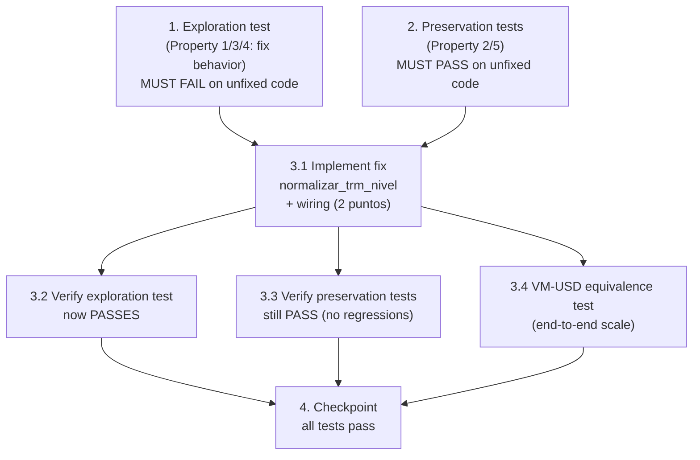

# Implementation Plan

## Overview

Bugfix: escala de la TRM de cierre en RF Internacional por tramos (sub-defecto 2B). El fix
es un **helper puro compartido** `normalizar_trm_nivel` en
`scripts/proyeccion_tramos_multiactivo.py`, cableado en los dos puntos de ingreso del input
de usuario: `InputsPorTramo.from_valores` (ruta por tramos) y `tools/multiescenarios.py`
(campo `trm_final`). NO se toca la valoración (`valorar_titulo`, `valorar_bono_yankee`) ni la
TRM t0 (implícita del 597).

Metodología de condición del bug: primero exploración (prueba que FALLA en código sin
corregir), luego preservación (pruebas que PASAN en código sin corregir), luego el fix, y
finalmente verificación + equivalencia del VM USD.

Pruebas en `tests/test_trm_escala_rf_intl.py` (pytest + Hypothesis + `tests/conftest.py`).
Banda plausible del diseño: `[500, 20000]`. Política fuera-de-banda no normalizable:
`ValueError`.

## Task Dependency Graph



```json
{
  "waves": [
    {
      "wave": 1,
      "description": "Exploration + preservation tests on UNFIXED code (parallel, no fix yet)",
      "tasks": ["1", "2"]
    },
    {
      "wave": 2,
      "description": "Implement normalizar_trm_nivel + wiring in both entry points",
      "tasks": ["3.1"]
    },
    {
      "wave": 3,
      "description": "Re-run tests + VM-USD equivalence (parallel)",
      "tasks": ["3.2", "3.3", "3.4"]
    },
    {
      "wave": 4,
      "description": "Final checkpoint",
      "tasks": ["4"]
    }
  ]
}
```

## Tasks

- [x] 1. Write bug condition exploration test (TRM mal escalada → VM USD ÷1000)
  - **Property 1/3/4: Expected Behavior / Fix** — normalización de unidad de la TRM de cierre
  - **CRITICAL**: This test MUST FAIL on unfixed code - failure confirms the bug exists
  - **DO NOT attempt to fix the test or the code when it fails** - the failure is the expected outcome of this task
  - **NOTE**: This test encodes the EXPECTED behavior (`F'`); it will validate the fix when it passes after task 3.1
  - **GOAL**: Surface counterexamples where a mis-scaled `trm_cierre` (unit error ×1000) is NOT normalized and reaches the engine as-is
  - **Scoped PBT Approach**: encode as a Hypothesis property over generated TRM levels in band `[500, 20000]` and a 1000-factor `k ∈ {-2, -1, 1, 2}`, plus deterministic `@example`s for the verified real cases (`3.9`, `3_900_000`, `150`)
  - Create `tests/test_trm_escala_rf_intl.py`. The test calls `InputsPorTramo.from_valores(trm_cierre=trm_cruda)` (and/or the shared helper `normalizar_trm_nivel` once it exists; before the fix the helper does not exist, so the exploration test asserts the EXPECTED behavior through `from_valores`, which currently does NOT normalize)
  - Assert the EXPECTED (post-fix) behavior so the test FAILS on unfixed code:
    - For `trm_cruda = trm_correcta / 1000` (e.g. `3.9` for `3900`): `from_valores(trm_cierre=trm_cruda).trm_cierre` is in band `[500, 20000]` and ≈ `trm_correcta` (unfixed → stays `3.9`, out of band → FAILS)
    - For a non-normalizable out-of-band value (e.g. `150`): building the inputs raises `ValueError` (unfixed → no error, keeps `150` → FAILS)
  - Deterministic `@example` reproductions (verified) that must demonstrate the bug on unfixed code:
    - `trm_cierre = 3.9` → expected normalized `3900` (unfixed: stays `3.9`)
    - `trm_cierre = 3_900_000` → expected normalized `3900` (unfixed: stays `3_900_000`)
    - `trm_cierre = 150` → expected `ValueError` (unfixed: stays `150`, no error)
  - Run test on UNFIXED code
  - **EXPECTED OUTCOME**: Test FAILS (proves the TRM unit is not normalized / not validated)
  - Document counterexamples found (e.g. "from_valores(trm_cierre=3.9).trm_cierre == 3.9 instead of 3900")
  - Mark task complete when the test is written, run, and the failure is documented
  - _Bug_Condition: isBugCondition(X) where trm finita AND NOT en_banda(trm) AND es_normalizable_por_1000(trm)_
  - _Requirements: 1.1, 1.2, 1.3, 1.4, 2.1, 2.2, 2.4_

- [x] 2. Write preservation property tests (BEFORE implementing fix)
  - **Property 2/5: Preservation** — identidad en banda, default para vacío, campos no-TRM intactos, valoración intacta
  - **IMPORTANT**: Follow observation-first methodology — observe behavior on UNFIXED code, record it, then encode property-based tests that assert it
  - Observe on UNFIXED code and encode the following properties with Hypothesis (strategies: TRM en banda `[500, 20000]`, inputs crudos variados para los demás campos, series COP vs USD):
    - **Property 2 (identidad en banda):** para `trm` en `[500, 20000]`, `InputsPorTramo.from_valores(trm_cierre=trm).trm_cierre == trm` (sin cambio) — vale en código sin corregir (hoy `from_valores` ya no reescala TRM en banda) y DEBE seguir valiendo tras el fix
    - **Property 5 (default para vacío/no numérico):** para `trm_cierre` vacío / `None` / no numérico, `from_valores(...).trm_cierre == 4000.0` (default documentado) — comportamiento actual que NO debe cambiar (Req 3.2)
    - **Property 5 (campos no-TRM intactos):** para cualquier conjunto de inputs crudos, todos los campos de `InputsPorTramo` distintos de `trm_cierre` quedan idénticos a los que produce `from_valores` hoy (la guarda solo toca `trm_cierre`)
    - **Property 5 (valoración intacta):** `valorar_titulo` / `valorar_bono_yankee` producen el mismo VM que hoy cuando se les pasa un nivel de TRM dado (el fix no toca la valoración); verificar con un título COP (sin TRM) y un título USD con TRM en banda
  - Deterministic anchors (verified, must hold both before and after fix):
    - `from_valores(trm_cierre=4100).trm_cierre == 4100.0` (en banda, identidad)
    - `from_valores(trm_cierre="").trm_cierre == 4000.0` (default)
    - VM de un Yankee (nominal 1.000.000 USD) con `trm=3900` ≈ `4.543.211.556` COP (ancla de escala correcta)
  - Run tests on UNFIXED code
  - **EXPECTED OUTCOME**: Tests PASS (confirms the baseline behavior that must be preserved)
  - Mark task complete when tests are written, run, and passing on unfixed code
  - _Preservation: identidad para TRM en banda; default para vacío; campos no-TRM intactos; valoración intacta_
  - _Requirements: 2.3, 3.1, 3.2, 3.3, 3.4, 3.5, 3.6_

- [x] 3. Fix for escala de la TRM de cierre (helper puro + wiring en 2 puntos de ingreso)

  - [x] 3.1 Implement the fix (`normalizar_trm_nivel` + wiring)
    - En `scripts/proyeccion_tramos_multiactivo.py`, añadir las constantes de módulo `TRM_MIN_PLAUSIBLE = 500.0` y `TRM_MAX_PLAUSIBLE = 20000.0` (junto a `_DEFAULTS_INPUTS_TRAMO`)
    - Crear el helper puro `normalizar_trm_nivel(trm: float) -> float`:
      - Precondición: `trm` ya coercionado a `float` finito por el llamador
      - Si `TRM_MIN_PLAUSIBLE <= trm <= TRM_MAX_PLAUSIBLE` ⇒ devolver `trm` sin cambios (identidad, Property 2)
      - Si no, barrer `k` en `-3..3` (excluyendo `0`), por `|k|` ascendente; si `trm * (1000 ** k)` cae en banda, devolver ese valor y emitir `logger.warning` GENÉRICO (sin volcar el valor) (Property 1 y 3)
      - Si ningún `k` cae en banda ⇒ `raise ValueError("TRM de cierre fuera de banda plausible; revisa la unidad del input.")` (Property 4; mensaje genérico)
    - Cablear en `InputsPorTramo.from_valores`: tras obtener el `trm_cierre` coercionado por el flujo actual, aplicar `normalizar_trm_nivel` SOLO si el valor crudo era un número finito (no si cayó al default por vacío/no numérico — ese caso mantiene `4000.0`, Req 3.2). Los demás campos quedan EXACTAMENTE igual (Property 5)
    - Cablear en `tools/multiescenarios.py` (~L533): `trm_cierre = normalizar_trm_nivel(float(esc["trm_final"]))` (import desde `proyeccion_tramos_multiactivo`) — misma fuente de verdad
    - NO modificar `valorar_titulo`, `valorar_bono_yankee`, `motor_proyeccion` (valoración), la TRM t0 (`_trm_t0`), ni los demás campos de `InputsPorTramo`
    - _Bug_Condition: isBugCondition(X) → trm finita AND NOT en_banda(trm) AND es_normalizable_por_1000(trm)_
    - _Expected_Behavior: en_banda → identidad; error de ×1000 → normaliza al nivel; no normalizable → ValueError_
    - _Preservation: TRM vacía → default 4000; campos no-TRM intactos; valoración intacta; TRM t0 no se normaliza_
    - _Requirements: 2.1, 2.2, 2.3, 2.4, 2.5, 3.1, 3.2, 3.3, 3.4, 3.5, 3.6_

  - [x] 3.2 Verify bug condition exploration test now passes
    - **Property 1/3/4: Fix** — normalización de unidad de la TRM de cierre
    - **IMPORTANT**: Re-run the SAME test from task 1 - do NOT write a new test
    - Run the exploration test from task 1 (incluye los `@example` `3.9` / `3_900_000` / `150`)
    - **EXPECTED OUTCOME**: Test PASSES — `from_valores(trm_cierre=3.9).trm_cierre == 3900`, `trm_cierre=3_900_000 → 3900`, `trm_cierre=150 → ValueError` (confirma que el bug está corregido)
    - _Expected_Behavior: normaliza por 1000 a banda; ValueError si no normalizable_
    - _Requirements: 2.1, 2.2, 2.4_

  - [x] 3.3 Verify preservation tests still pass
    - **Property 2/5: Preservation** — identidad en banda, default para vacío, campos no-TRM, valoración
    - **IMPORTANT**: Re-run the SAME tests from task 2 - do NOT write new tests
    - Run the preservation property tests from task 2 (Properties 2 y 5)
    - **EXPECTED OUTCOME**: Tests PASS (confirms no regressions) — TRM en banda identidad, default `4000.0` para vacío, campos no-TRM idénticos, valoración sin cambio
    - _Preservation: identidad en banda; default para vacío; campos no-TRM intactos; valoración intacta_
    - _Requirements: 2.3, 3.1, 3.2, 3.3, 3.4, 3.5, 3.6_

  - [x] 3.4 VM-USD equivalence test (escala extremo a extremo)
    - **Property 3: Fix** — escala correcta del VM USD
    - Escribir un test de equivalencia que valore un título Yankee representativo (nominal 1.000.000 USD, precio base, vía `valorar_titulo` / `valorar_bono_yankee`) con tres TRM:
      - `trm=3900` (nivel correcto directo)
      - `normalizar_trm_nivel(3.9)` (nivel normalizado desde el error de ×1000)
      - `trm=3.9` (nivel mal escalado SIN normalizar, solo para contraste)
    - **EXPECTED OUTCOME**: el VM con `3900` y con `normalizar_trm_nivel(3.9)` son idénticos (tol. ~1e-6); el VM con `3.9` crudo es ÷1000 del normalizado (confirma el factor de unidad recuperado)
    - NO modificar `valorar_titulo` ni `valorar_bono_yankee`; solo invocarlos con distintas TRM para contrastar la escala
    - Si usa la BD real, flaguear como PBT/integración y aplicar la convención de ejecución (ruta absoluta, `--rootdir`, `-o addopts=""`, `deadline=None`)
    - _Expected_Behavior: VM_usd(normalizar_trm_nivel(trm/1000)) ≈ 1000 × VM_usd(trm/1000) ≈ VM_usd(trm)_
    - _Requirements: 2.1, 2.2_

- [x] 4. Checkpoint - Ensure all tests pass
  - Run the full suite in `tests/test_trm_escala_rf_intl.py` (exploration + preservation + equivalence) plus any affected existing tests (`tests/test_tramos_multiactivo_primitivas.py`, que ya cubre `from_valores`)
  - Confirm: exploration test PASSES after fix; preservation tests PASS; VM-USD equivalence PASSES; `from_valores` sigue respetando el default para vacío y la identidad en banda
  - Ensure all tests pass; ask the user if questions arise
  - _Requirements: 2.1, 2.2, 2.3, 2.4, 2.5, 3.1, 3.2, 3.3, 3.4, 3.5, 3.6_

## Notes

- **Metodología (orden exploratorio obligatorio):** Task 1 (exploración) debe FALLAR en el
  código sin corregir; Task 2 (preservación) debe PASAR en el código sin corregir; el fix
  (3.1) va DESPUÉS; luego se re-ejecutan las MISMAS pruebas (3.2 / 3.3) y se añade la
  equivalencia del VM USD (3.4). No se escriben pruebas nuevas en 3.2/3.3.
- **Alcance del fix:** únicamente `normalizar_trm_nivel` (nuevo) + wiring en
  `InputsPorTramo.from_valores` y `tools/multiescenarios.py`. NO se toca la valoración
  (`valorar_titulo`, `valorar_bono_yankee`, `motor_proyeccion`) ni la TRM t0, por lo que las
  propiedades de preservación se cumplen por construcción.
- **Banda y política (del diseño):** banda plausible `[500, 20000]`; fuera de banda y no
  normalizable por 1000 ⇒ `ValueError` (no default silencioso). El caso vacío/no numérico NO
  llega al helper: lo intercepta antes el default `4000.0` de `from_valores`.
- **Fuera de alcance:** sub-defectos 2A (semántica `tasa_mercado` = T.Dcto) y 2C (usos
  sistémicos de `tasa_mercado`). No se tocan en este bugfix (documentados en
  `docs/deuda-tecnica.md`).
- **Mapa Property ↔ Requirements:** P1 → 2.1, 2.2 · P2 → 2.3, 3.1 · P3 → 2.1, 2.2 ·
  P4 → 2.4 · P5 → 3.3, 3.4, 3.5, 3.6.
- **Ejecución de pruebas (entorno):** terminal anclada en `scripts/`; usar ruta absoluta al
  test + `--rootdir "g:\Mi unidad\AXIS\AXIS"` + `-o addopts="" -p no:cacheprovider`. Las PBT
  con Hypothesis pueden tardar por el filesystem (Google Drive); usar `deadline=None` y
  suprimir `HealthCheck.too_slow`/`function_scoped_fixture` si la prueba toca el fixture de BD.
- **Regresión colateral a verificar:** `tests/test_tramos_multiactivo_primitivas.py`
  (Property 12 de `from_valores`) debe seguir en verde; el default `4000.0` y la coerción de
  los demás campos no cambian.
