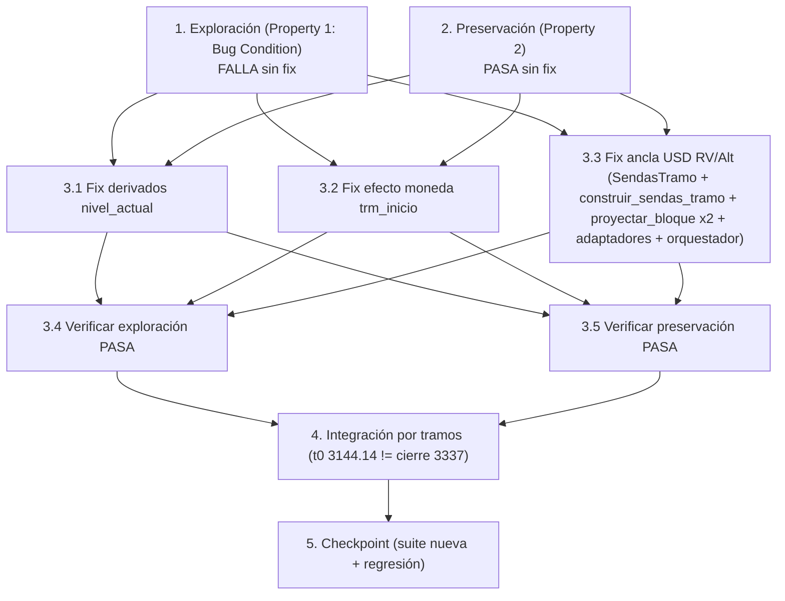

# Implementation Plan

Plan de Implementación — TRM inicial de tramo consistente (modo "por_tramos").

## Overview

> **Metodología de condición de bug (test-first).** Primero una prueba de EXPLORACIÓN que
> FALLA en el código SIN corregir (confirma que el bug existe), luego pruebas de PRESERVACIÓN
> que PASAN en el código SIN corregir (fijan la línea base a preservar), después el fix
> HÍBRIDO del diseño, re-ejecución de las mismas pruebas y un checkpoint de regresión.
>
> **Diseño a implementar: Opción HÍBRIDA (design.md).** Única fuente de verdad
> `trm_inicio_real` (reutilizando `_trm_tramo_ini`) propagada a los tres consumidores no-RF
> (derivados `nivel_actual`, efecto moneda `trm_inicio`, ancla USD de RV/Alt internacional)
> SIN tocar `interpolar_trm_tramo` ni los nodos mensuales de la senda, y SIN tocar RF.

## Convención de ejecución (Windows / Google Drive) — OBLIGATORIA

El repo vive en una ruta de Google Drive con espacios (`g:\Mi unidad\AXIS\AXIS`) y existe un
`.hypothesis` en `scripts/`. Para evitar que pytest reescanee el Drive, ejecutar SIEMPRE con
ruta absoluta y aislamiento:

```
python -m pytest "g:\Mi unidad\AXIS\AXIS\tests\test_trm_inicial_tramo_consistente.py" ^
  --rootdir "g:\Mi unidad\AXIS\AXIS" ^
  -o addopts="" ^
  -p no:cacheprovider ^
  -q
```

- `--rootdir "g:\Mi unidad\AXIS\AXIS"` fijo evita descubrimiento ascendente en el Drive.
- `-o addopts=""` ignora addopts heredados de un `pytest.ini`/`pyproject` global.
- `-p no:cacheprovider` evita escribir `.pytest_cache` en el Drive.
- Hypothesis: `@settings(deadline=None, max_examples=100)` como mínimo (≥100 ejemplos por
  propiedad); la latencia de E/S del Drive dispara falsos `DeadlineExceeded`.
- Si una prueba toca el fixture de BD (SQLite `scripts/resultado_proyeccion.db`), suprimir
  `HealthCheck.too_slow`: `@settings(deadline=None, max_examples=100,
  suppress_health_check=[HealthCheck.too_slow])`.
- Reglas de proyecto: sin defaults de TRM hardcodeados (los nuevos defaults son `None`/`0.0`
  que caen al comportamiento previo), logs genéricos (activo + fecha de corte +
  `type(e).__name__`), SQL de solo lectura parametrizado (sin concatenación), y firmas
  retrocompatibles (todos los parámetros nuevos con default).

---

## Tasks

- [x] 1. Escribir prueba(s) de EXPLORACIÓN de la condición de bug (ANTES del fix)
  - **Property 1: Bug Condition** - Nivel inicial consistente en todos los consumidores
  - **CRÍTICO**: estas pruebas DEBEN FALLAR en el código sin corregir — la falla confirma que
    el bug existe. **NO** intentar arreglar la prueba ni el código cuando falle.
  - **NOTA**: estas pruebas codifican el comportamiento ESPERADO post-fix; validarán el fix
    cuando pasen tras la implementación (ver tarea 3.4).
  - **GOAL**: surfacear contraejemplos que demuestran que los consumidores leen `senda[0]`
    (≈3337) en lugar de `trm_inicio_real` (3144.14).
  - **Enfoque PBT escopado (bug determinista)**: escopar la propiedad a los casos concretos
    de falla del tramo 0 donde la TRM t0 real difiere del cierre. Incluir `@example`
    determinista(s): `trm_t0_real=3144.14`, `trm_cierre=3337.0`. Añadir también una banda
    aleatoria de pares `(trm_t0_real, trm_cierre)` con `trm_t0_real != trm_cierre` (≥100
    ejemplos, `@settings(deadline=None, max_examples=100)`).
  - Crear el archivo `tests/test_trm_inicial_tramo_consistente.py`.
  - **Caso A — Efecto moneda tramo 0** (de design.md "Exploratory", caso 1): construir un
    escenario por tramos mínimo con tramo 0 (`trm_t0_real=3144.14`, `trm_cierre=3337.0`) y
    afirmar `informe_pyg_por_tramo.trm_inicio == 3144.14` (hoy registra ≈3337 vía
    `_extremos_senda_trm(sendas_tramo.senda_trm)[0]`, `app_dash` ~L8127/~L8228).
  - **Caso B — Derivados tramo 0** (caso 2): afirmar que el `nivel_actual` (spot m=0) usado
    por `_correr_derivados_tramo` (`app_dash` ~L7552, `nivel_actual = senda_trm[0]`) es
    `== 3144.14` (hoy es `senda[0]` ≈3337).
  - **Caso C — Ancla USD RV/Alt tramo 0** (caso 3): afirmar que el `trm_t0` que usa
    `proyectar_bloque` (`scripts/proyeccion_renta_variable.py` ~L143,
    `scripts/proyeccion_alternativos.py` ~L243) para convertir VM COP→USD es `== 3144.14`
    (hoy es `senda_trm[primera_fecha]` ≈3337).
  - **Caso D — Encadenamiento (caso límite, P4)**: cadena de 2 tramos; afirmar que el nivel
    inicial del tramo i>0 observado por los tres consumidores `== trm_cierre(i-1)`
    (encadenamiento limpio, hoy puede divergir, p. ej. 2027 arranca 3349.25 ≠ cierre 2026).
  - Ejecutar sobre el código SIN corregir con la convención Windows/Drive de arriba.
  - **EXPECTED OUTCOME**: las pruebas FALLAN (correcto — prueban que el bug existe).
  - Documentar los contraejemplos (p. ej. "efecto moneda trm_inicio=3337.0 en vez de
    3144.14"; "derivados nivel_actual=senda[0]≈3337"; "proyectar_bloque.trm_t0=senda[0]").
  - Marcar la tarea completa cuando las pruebas estén escritas, ejecutadas y la falla
    documentada.
  - _Requirements: 1.1, 1.2, 1.3, 1.4, 1.5, 2.1, 2.2, 2.3, 2.4, 2.5_

- [x] 2. Escribir pruebas de PRESERVACIÓN basadas en propiedades (ANTES del fix)
  - **Property 2: Preservation** - Invariantes a preservar (último nodo, RF, punta a punta,
    semántica de `interpolar_trm_tramo`)
  - **IMPORTANTE**: seguir la metodología de observación primero — correr el código SIN
    corregir con inputs NO-buggy, observar y registrar las salidas, y escribir propiedades que
    afirmen esas salidas sobre todo el dominio.
  - **Enfoque PBT**: `@settings(deadline=None, max_examples=100)` (≥100 ejemplos); si se toca
    el fixture de BD, añadir `suppress_health_check=[HealthCheck.too_slow]`.
  - **P2 — Último nodo de la senda == `trm_cierre`**: para `trm_inicio`/`trm_cierre`/cortes
    aleatorios, `interpolar_trm_tramo(...)` último nodo `== trm_cierre` sin residuo de
    redondeo (`scripts/proyeccion_tramos_multiactivo.py` ~L254-320). Observar que PASA hoy.
    _Requirements: 3.3_
  - **Semántica de `interpolar_trm_tramo`** (design.md Preservación caso 3): el PRIMER nodo
    sigue siendo `trm_inicio + (trm_cierre - trm_inicio)/n` (la función NO se toca). Observar
    que PASA hoy. _Requirements: 3.3_
  - **P3 — Valoración RF idéntica**: capturar la valoración de RF de un tramo (ruta
    `proyectar_portafolio(trm=_trm_tramo_ini, ...)`, `app_dash` ~L8072) sobre el código sin
    fix y afirmar igualdad numérica (línea base para comparar tras el fix). _Requirements:
    3.1, 3.2_
  - **P6 — Punta a punta inalterado**: capturar el resultado del modo no-por-tramos sobre el
    código sin fix como línea base a preservar. _Requirements: 3.4, 3.5_
  - Ejecutar sobre el código SIN corregir con la convención Windows/Drive.
  - **EXPECTED OUTCOME**: todas PASAN (confirma la línea base de comportamiento a preservar).
  - Marcar la tarea completa cuando las pruebas estén escritas, ejecutadas y pasando sin fix.
  - _Requirements: 3.1, 3.2, 3.3, 3.4, 3.5_

- [x] 3. Fix HÍBRIDO para la inconsistencia del TRM inicial de tramo

  - [x] 3.1 Derivados — usar `trm_inicio_real` como `nivel_actual` (spot m=0)
    - En `app_dash._correr_derivados_tramo` (~L7549-7552): añadir parámetro
      `trm_inicio_real=None` a la firma (default = comportamiento actual). Usar
      `nivel_actual = float(trm_inicio_real)` cuando `trm_inicio_real is not None`; en caso
      contrario mantener `senda_trm[0] if senda_trm else float(inputs_tramo.trm_cierre)`.
    - En `app_dash._ejecutar_escenario_por_tramos`, en la llamada a `_correr_derivados_tramo`
      (~L7998): pasar `trm_inicio_real=_trm_tramo_ini` (misma fuente de verdad que RF;
      consistente con `fecha_mercado=_fecha_pip_str` de `_cargar_curvas`).
    - Mantener el `SELECT` de `portafolio_clasificado` como solo lectura parametrizado y los
      logs genéricos (activo + fecha de corte + `type(e).__name__`).
    - _Bug_Condition: isBugCondition(X) donde consumidores_nivel_inicio(X) != trm_inicio_real(X) (derivados leen senda[0])_
    - _Expected_Behavior: nivel_actual(F', X) == trm_inicio_real(X) (P1, P5)_
    - _Preservation: default None preserva el comportamiento previo de todos los demás llamadores_
    - _Requirements: 2.2, 2.4, 2.5_

  - [x] 3.2 Efecto moneda — usar `trm_inicio_real` como `trm_inicio` (conservar `trm_cierre`)
    - En `app_dash._ejecutar_escenario_por_tramos` (~L8127): conservar
      `_trm_ini_tr, _trm_cie_tr = _extremos_senda_trm(sendas_tramo.senda_trm)` pero dejar de
      usar `_trm_ini_tr` como inicio; introducir `_trm_inicio_real = _trm_tramo_ini`.
    - En las llamadas a `calcular_efecto_moneda_tramo` (~L8158-8165) para `rv` y
      `alternativos`: pasar `trm_inicio=_trm_inicio_real`, manteniendo `trm_cierre=_trm_cie_tr`
      (== `trm_cierre`, correcto).
    - En el registro (~L8228): `_reg["trm_inicio"] = float(_trm_inicio_real) if
      _trm_inicio_real else None`; `_reg["trm_cierre"]` sin cambios.
    - _Bug_Condition: isBugCondition(X) (efecto moneda lee senda[0] vía _extremos_senda_trm(...)[0])_
    - _Expected_Behavior: trm_inicio_efecto_moneda(F', X) == trm_inicio_real(X) (P1); trm_cierre sin cambios (3.2)_
    - _Preservation: _trm_cie_tr (== trm_cierre) inalterado_
    - _Requirements: 2.1, 2.4, 2.5, 3.2_

  - [x] 3.3 RV/Alt internacional — anclar la conversión USD en `trm_inicio_real`
    - **SendasTramo** (`scripts/proyeccion_tramos_multiactivo.py` ~L629): añadir campo
      `trm_inicio_real: float = 0.0` (NUEVO, retrocompatible; no toca `senda_trm`).
    - **`construir_sendas_tramo`** (~L720-741): añadir parámetro `trm_t0_real=None`. Para el
      tramo 0 (`estado_previo is None`): `trm_inicio = trm_cierre` (senda intermedia SIN
      CAMBIOS) y `trm_inicio_real = _coerce_float_finito(trm_t0_real, default=trm_cierre)`.
      Para i>0: `trm_inicio_real = trm_inicio` (== `estado_previo.trm_cierre`). Devolver
      `SendasTramo(..., trm_inicio_real=trm_inicio_real)`. **No** modificar la llamada a
      `interpolar_trm_tramo(trm_inicio, trm_cierre, cortes)`.
    - **Orquestador** (`app_dash._ejecutar_escenario_por_tramos` ~L7963): pasar
      `trm_t0_real=_trm_t0` a `construir_sendas_tramo`.
    - **`proyectar_bloque`** en AMBOS motores (`scripts/proyeccion_renta_variable.py` ~L143 y
      `scripts/proyeccion_alternativos.py` ~L243): añadir `trm_inicio_ancla=None` (default =
      `senda[primera_fecha]`). Si `trm_inicio_ancla is not None and trm_inicio_ancla > 0`:
      `trm_t0 = float(trm_inicio_ancla)`; en caso contrario mantener la lógica actual
      (`senda_trm.get(primera_fecha)` con fallback a `list(senda_trm.values())[0]`). Los
      cortes mensuales siguen leyendo `senda_trm[periodo]` (forma intacta).
    - Propagar `trm_inicio_ancla` desde `proyectar_renta_variable` / `proyectar_alternativos`
      hacia su `proyectar_bloque` interno (default `None` preserva a todos los llamadores,
      incluido punta a punta).
    - **Adaptadores** `app_dash._correr_rv_tramo` (~L7339) y `_correr_alt_tramo` (~L7391):
      pasar `trm_inicio_ancla=sendas_tramo.trm_inicio_real` al motor correspondiente.
    - _Bug_Condition: isBugCondition(X) (proyectar_bloque.trm_t0 = senda[primera_fecha] en vez de trm_inicio_real)_
    - _Expected_Behavior: trm_t0_ancla_usd(F', X) == trm_inicio_real(X) (P1); nodos mensuales de senda_trm sin cambios_
    - _Preservation: trm_inicio_ancla=None y campo con default preservan senda_trm, RF y punta a punta_
    - _Requirements: 2.3, 2.4, 2.5_

  - [x] 3.4 Verificar que la prueba de EXPLORACIÓN ahora PASA
    - **Property 1: Expected Behavior** - Nivel inicial consistente en todos los consumidores
    - **IMPORTANTE**: re-ejecutar las MISMAS pruebas de la tarea 1 — NO escribir pruebas
      nuevas. Esas pruebas codifican el comportamiento esperado; cuando pasan, confirman que
      derivados (`nivel_actual`), efecto moneda (`trm_inicio`) y ancla USD de RV/Alt
      (`proyectar_bloque.trm_t0`) usan todos `trm_inicio_real` (= 3144.14 en el tramo 0) y que
      el encadenamiento `trm_inicio(i) == trm_cierre(i-1)` se cumple.
    - Ejecutar con la convención Windows/Drive.
    - **EXPECTED OUTCOME**: las pruebas PASAN (confirma que el bug está resuelto).
    - _Requirements: 2.1, 2.2, 2.3, 2.4, 2.5_

  - [x] 3.5 Verificar que las pruebas de PRESERVACIÓN siguen PASANDO
    - **Property 2: Preservation** - Invariantes preservados (último nodo, RF, punta a punta,
      semántica de `interpolar_trm_tramo`)
    - **IMPORTANTE**: re-ejecutar las MISMAS pruebas de la tarea 2 — NO escribir pruebas
      nuevas.
    - Ejecutar con la convención Windows/Drive.
    - **EXPECTED OUTCOME**: todas PASAN (sin regresiones: RF idéntica, último nodo ==
      `trm_cierre`, punta a punta inalterado, `interpolar_trm_tramo` intacto).
    - _Requirements: 3.1, 3.2, 3.3, 3.4, 3.5_

- [x] 4. Prueba de integración — flujo por tramos completo con tramo 0 t0 ≠ cierre
  - **Property 1 / Property 4: Fix Checking (integración)** - Consistencia y encadenamiento
    extremo a extremo
  - Correr el flujo por tramos completo (RF + RV + Alt + Derivados + efecto moneda) con un
    tramo 0 donde la TRM t0 real (3144.14) ≠ `trm_cierre` (3337).
  - Afirmar `informe_pyg_por_tramo.trm_inicio == 3144.14` para el tramo 0 y que los TRES
    consumidores (derivados `nivel_actual`, efecto moneda `trm_inicio`, ancla USD de RV/Alt)
    arrancan en 3144.14.
  - Encadenamiento 2026→2027: el inicio del tramo 2027 observado por todos los consumidores ==
    cierre del 2026 (no 3349.25) — cubre el encadenamiento del spot inicial de derivados que
    HOY carece de cobertura (design.md "Nota de cobertura", P4 aplicado a derivados).
  - Verificar que la valoración RF del informe NO cambia respecto al baseline capturado en la
    tarea 2 (P3).
  - Ejecutar con la convención Windows/Drive; si toca el fixture de BD,
    `@settings(deadline=None, suppress_health_check=[HealthCheck.too_slow])`.
  - _Requirements: 2.1, 2.2, 2.3, 2.5, 3.1_

- [x] 5. Checkpoint — suite nueva + suites de regresión en verde
  - Ejecutar la suite nueva `tests/test_trm_inicial_tramo_consistente.py` (todas las
    propiedades P1–P6, unitarios y la integración de la tarea 4).
  - Ejecutar las suites de regresión que DEBEN seguir en verde (la híbrida NO toca
    `interpolar_trm_tramo` y solo añade parámetros/campo con default retrocompatible), todas
    con la convención Windows/Drive (`--rootdir "g:\Mi unidad\AXIS\AXIS" -o addopts=""
    -p no:cacheprovider`):
    - `tests/test_tramos_multiactivo_primitivas.py` (pin semántica de `interpolar_trm_tramo`).
    - `tests/test_property_uvr_preservacion_por_tramos.py` (`interpolar_trm_tramo` /
      `construir_sendas_tramo` "no deben cambiar"; solo param/campo nuevos con default).
    - `tests/test_tramos_multiactivo_smoke.py` (contratos de firma de los motores).
    - `tests/test_property_vm_cierre_usd_por_tramos.py` (VM USD por tramos).
    - `tests/test_integracion_vm_cierre_usd_multitramo.py` (encadenamiento VM USD multitramo).
    - `tests/test_pyg_enero_integracion.py` (`_correr_rv_tramo` con `senda_trm` plana).
    - `tests/test_tramos_multiactivo_integracion.py` (orquestación/integración por tramos).
    - `tests/test_tramos_multiactivo_orquestador.py` (orquestación por tramos).
  - Asegurar que TODAS las pruebas pasan. Si surgen preguntas o aparece una regresión
    inesperada, consultar al usuario antes de modificar más código.
  - _Requirements: 3.1, 3.2, 3.3, 3.4, 3.5_

---

## Task Dependency Graph



### Execution Waves

```json
{
  "waves": [
    {
      "wave": 1,
      "description": "Pruebas test-first: exploración (falla sin fix) y preservación (pasa sin fix). Independientes entre sí.",
      "tasks": ["1", "2"]
    },
    {
      "wave": 2,
      "description": "Fix HÍBRIDO: los tres consumidores no-RF leen trm_inicio_real. Las subtareas tocan rutas distintas y pueden implementarse en paralelo.",
      "tasks": ["3.1", "3.2", "3.3"]
    },
    {
      "wave": 3,
      "description": "Verificación post-fix: re-ejecutar las MISMAS pruebas de las tareas 1 y 2.",
      "tasks": ["3.4", "3.5"]
    },
    {
      "wave": 4,
      "description": "Integración extremo a extremo del flujo por tramos con tramo 0 t0 != cierre y encadenamiento 2026->2027.",
      "tasks": ["4"]
    },
    {
      "wave": 5,
      "description": "Checkpoint: suite nueva completa + suites de regresión existentes en verde.",
      "tasks": ["5"]
    }
  ]
}
```

## Notes

- Mapeo propiedades → tareas: **P1** (consistencia de consumidores) → tareas 1, 3.1, 3.2,
  3.3, 3.4, 4; **P2** (último nodo == `trm_cierre`) → tareas 2, 3.5; **P3** (RF idéntica) →
  tareas 2, 3.5, 4; **P4** (encadenamiento) → tareas 1 (caso D), 4; **P5** (spot derivados ==
  TRM fecha de curvas) → tareas 1, 3.1; **P6** (punta a punta inalterado) → tareas 2, 3.5.
- La **Property 1** es la condición de bug (prueba de exploración que FALLA sin fix y PASA
  tras el fix). La **Property 2** es la preservación (PASA sin fix y sigue pasando tras el
  fix). El resto de propiedades (P3–P6) se verifican dentro de las tareas de preservación e
  integración.
- El fix es HÍBRIDO y de superficie mínima: NO toca `interpolar_trm_tramo` ni los nodos
  mensuales de la senda, NO toca la ruta de RF, y todas las firmas nuevas
  (`trm_inicio_real`, `trm_t0_real`, `trm_inicio_ancla`, campo `SendasTramo.trm_inicio_real`)
  son retrocompatibles con default, de modo que punta a punta y los demás llamadores quedan
  inalterados.
- Reglas de seguridad/estilo aplicadas en todas las tareas de implementación: sin TRM
  hardcodeada (tramo 0 usa `obtener_trm_para(fecha_base)` del 597), logs genéricos, SQL de
  solo lectura parametrizado y sin concatenación de input.
