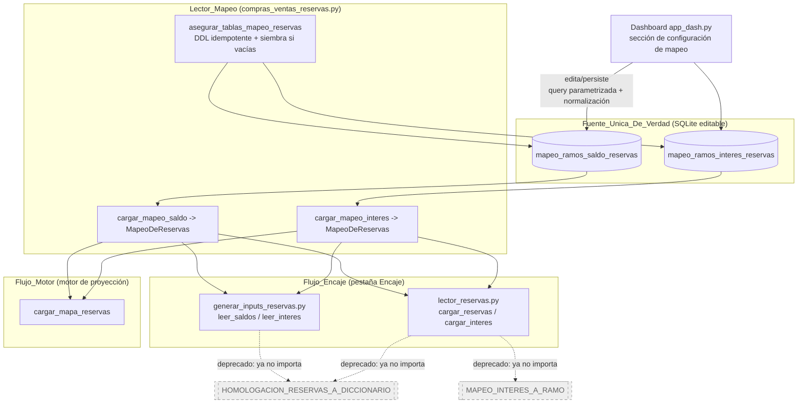
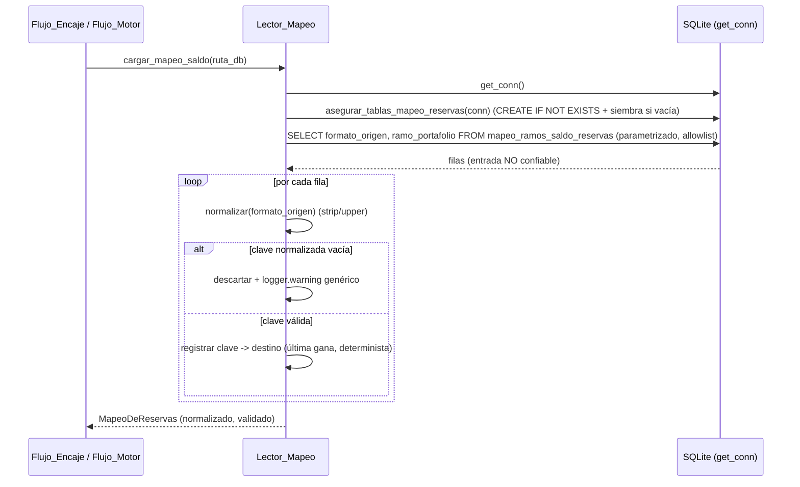

# Documento de Diseño

## Overview

Esta feature consolida en **una sola fuente de verdad** el conocimiento de negocio "traducir la Etiqueta_De_Reserva del Excel operativo al Ramo_De_Portafolio", hoy duplicado en tres definiciones (`HOMOLOGACION_RESERVAS_A_DICCIONARIO`, `MAPEO_INTERES_A_RAMO` y las semillas `_SEED_MAPEO_SALDO`/`_SEED_MAPEO_INTERES`). La fuente única serán las tablas SQLite editables `mapeo_ramos_saldo_reservas` y `mapeo_ramos_interes_reservas`, ya introducidas por `compras_ventas_reservas.py`.

El diseño gira en torno a un componente de acceso a datos centralizado, **`Lector_Mapeo`**, que:

- Asegura el esquema de forma idempotente (`CREATE TABLE IF NOT EXISTS`) desde la capa de aplicación, nunca desde el bootstrap destructivo `init_db.py`.
- Siembra una única vez las tablas vacías con las semillas de definición, respetando ediciones posteriores del usuario.
- Lee las tablas con **queries parametrizadas** y una **allowlist fija de columnas**, tratando cada fila como entrada NO confiable (normaliza, valida, descarta filas inválidas con advertencia genérica y sin abortar).
- Devuelve el `Mapeo_De_Reservas` normalizado y validado, con un tratamiento único del destino vacío (`""` ⇒ ignorar).

Los dos flujos que hoy leen los diccionarios hardcodeados —`scripts/lector_reservas.py` y `scripts/generar_inputs_reservas.py` (pestaña Encaje)— migran a leer del `Lector_Mapeo`. Los diccionarios hardcodeados se deprecan. Se aplican de forma única las dos decisiones de negocio ya confirmadas por Gerencia_Financiera:

- **Discrepancia_RIA:** "RESERVA INSUFICIENCIA DE ACTIVOS VIDA LIBERTY" se **ignora** (destino `""`).
- **Regla_Agregacion_Capitalizadora:** se usa la fila `TOTAL CAPI` como valor de CAPITALIZADORA (no la suma de sub-ramos DABUENAVIDA/MAGNATE/GANAMAS).

El objetivo transversal es **preservar el comportamiento observable** (retrocompatibilidad) de la pestaña Encaje y del motor, salvo la corrección intencional de la Discrepancia_RIA.

### Alcance de investigación y hallazgos clave

Se revisó el código existente para basar el diseño en los patrones ya establecidos. Hallazgos que condicionan el diseño:

1. **La fuente única ya existe y ya está en uso por el motor.** `compras_ventas_reservas.py` define `asegurar_tablas_mapeo_reservas(conn)` (DDL idempotente + siembra si vacías) y `cargar_mapeos_reservas(ruta_db) -> (mapeo_saldo, mapeo_interes)` que devuelve `{formato_origen_normalizado: ramo_portafolio}`. El motor consume este mapeo vía `cargar_mapa_reservas`. **Esta es la base sobre la que se construye el `Lector_Mapeo`**, no se reinventa.

2. **Divergencia estructural entre las dos representaciones de interés.** El diccionario hardcodeado `MAPEO_INTERES_A_RAMO` mapea `segmento → (compania, ramo)` (una tupla), mientras que la tabla `mapeo_ramos_interes_reservas` solo almacena `formato_origen → ramo_portafolio` (un string). Los flujos `lector_reservas._leer_series_interes` y `generar_inputs_reservas.leer_interes` usan la `compania` como parte de la clave de agrupación `(compania, ramo)`. El diseño debe recuperar la `compania` sin volver a hardcodearla (ver "Data Models → Derivación de compañía").

3. **La agregación Capitalizadora ya diverge entre flujos.** `generar_inputs_reservas.leer_saldos` ya usa la fila `TOTAL CAPI` (constante `FILA_TOTAL_CAPI = 53`) para CAPITALIZADORA y NO suma sub-ramos. En cambio `HOMOLOGACION_RESERVAS_A_DICCIONARIO` mapea DABUENAVIDA/MAGNATE/GANAMAS → CAPITALIZADORA. La Regla_Agregacion_Capitalizadora confirmada coincide con el comportamiento ya vigente de `leer_saldos`; por tanto **el Flujo_Encaje ya cumple la regla** y consolidar el mapeo no debe alterarlo. La corrección es eliminar los sub-ramos del diccionario hardcodeado y no reintroducirlos en la fuente única.

4. **La Discrepancia_RIA es la única diferencia observable intencional.** `_SEED_MAPEO_SALDO` ya asigna `""` (ignorar) a la etiqueta RIA; `HOMOLOGACION_RESERVAS_A_DICCIONARIO` la conserva como "VIDA INDIVIDUAL-RESERVA INSUFICIENCIA RIA". La decisión confirmada alinea todo con `""`. Como `lector_reservas.py` y `generar_inputs_reservas.py` hoy leen el diccionario hardcodeado, migrarlos a la fuente única cambiará el tratamiento de RIA en el Flujo_Encaje: pasará de conservarse a ignorarse. Este es el único cambio de comportamiento esperado.

5. **Patrón de acceso seguro ya consolidado.** `cargar_ramos_reserva_matematica` y `cargar_parametros_reservas` establecen el patrón del proyecto: allowlist fija de columnas/claves (`_COLUMNAS_CONFIG_RAMOS`, `_CLAVES_PARAMETROS_RESERVAS`), queries parametrizadas, validación de entrada NO confiable, descarte de filas inválidas con `logger.warning` genérico (sin volcar contenido), sin abortar. El `Lector_Mapeo` replica este patrón (consistencia arquitectónica).

6. **Conexión y rutas.** Todo el acceso pasa por `comun.db.get_conn()` (base principal `comun.rutas.DB_PATH`), con `check_same_thread=False` para los callbacks Dash. Los módulos de `scripts/*` reciben `ruta_db` por parámetro por convención de pruebas, aunque el acceso real es vía `get_conn()`.

7. **Stack y pruebas.** Python 3.12+, Dash, SQLite. La suite existente usa `pytest` + `hypothesis==6.140.3` (pineado) con una fixture `db_tmp` autouse (conftest) que monkeypatchea `get_conn` a una DB temporal. El diseño reutiliza esta infraestructura.

## Architecture

### Diagrama de componentes (estado objetivo)



### Decisiones de arquitectura y su justificación

| Decisión | Justificación |
|---|---|
| Colocar el `Lector_Mapeo` en `compras_ventas_reservas.py` (extendiendo `cargar_mapeos_reservas`) en vez de crear un módulo nuevo | La lógica de esquema/siembra/lectura de las tablas de mapeo ya vive ahí y el motor ya la consume. Un módulo nuevo duplicaría el punto de acceso y crearía otra posible fuente de divergencia. Regla de consistencia: replicar patrones existentes. |
| Devolver un objeto `MapeoDeReservas` (dataclass) en vez de un `dict` crudo | Da un tratamiento único y explícito del destino vacío (`ignora(etiqueta)`), evita que cada consumidor reimplemente la interpretación de `""`, y ofrece un punto único para la normalización de la clave de consulta. |
| Conservar `cargar_mapeos_reservas` (dicts) como API interna y exponer envoltorios de más alto nivel | El motor ya usa los dicts; mantenerlos evita regresiones (Req 8.3) mientras los nuevos consumidores usan la API tipada. |
| Derivar la `compania` del interés desde una tabla de referencia por ramo, no desde el mapeo | La tabla de interés no almacena compañía. La compañía es un atributo del ramo de portafolio, no del mapeo etiqueta→ramo; hardcodearla de nuevo recrearía una segunda fuente de verdad. |
| No tocar `init_db.py` | Req 1.4: el esquema de mapeo se crea desde la capa de aplicación (idempotente), no en el bootstrap destructivo. |

### Flujo de ejecución (lectura del mapeo)



## Components and Interfaces

### 1. `Lector_Mapeo` (en `scripts/compras_ventas_reservas.py`)

Componente centralizado de acceso a datos. Extiende lo ya existente (`asegurar_tablas_mapeo_reservas`, `cargar_mapeos_reservas`).

**Constantes (allowlist fija de columnas):**

```python
# Allowlist FIJA de columnas leídas de las tablas de mapeo. Literales controlados
# por el código; nunca se interpola entrada externa en el SQL.
_COLUMNAS_MAPEO_RESERVAS: tuple[str, str] = ("formato_origen", "ramo_portafolio")
```

**Interfaz pública:**

```python
def cargar_mapeo_saldo(ruta_db: str) -> "MapeoDeReservas":
    """Asegura el esquema y devuelve el Mapeo_De_Reservas de saldos (Req 2.1)."""

def cargar_mapeo_interes(ruta_db: str) -> "MapeoDeReservas":
    """Asegura el esquema y devuelve el Mapeo_De_Reservas de interés (Req 2.2)."""
```

Ambas funciones:
- Aseguran el esquema idempotente y siembran si vacías (`asegurar_tablas_mapeo_reservas`), sin depender de `init_db.py` (Req 1.3, 1.4, 1.5).
- Ejecutan una query **parametrizada** de solo lectura sobre la **allowlist fija** de columnas (Req 9.1, 9.5).
- Tratan cada fila como entrada NO confiable: normalizan la etiqueta (`_normalizar_ramo` = strip/upper), validan que la clave normalizada no sea vacía; si lo es, **descartan la fila** con `logger.warning` genérico (sin volcar contenido) y **continúan** (Req 9.2, 9.3, 9.4, 9.6).
- Ante claves normalizadas duplicadas, conservan una **única entrada determinista** (última fila en orden de lectura; documentado) (Req 2.4).
- Devuelven un `MapeoDeReservas` (ver Data Models), donde un destino vacío (`""`) representa la etiqueta como **ignorada** (Req 2.5, 6.2).

> **Nota de compatibilidad:** `cargar_mapeos_reservas` (que devuelve los dos dicts crudos) se conserva para el motor, y `cargar_mapeo_saldo`/`cargar_mapeo_interes` se construyen sobre la misma lectura. Así ambos comparten exactamente la misma normalización y el mismo resultado por etiqueta (Req 8.4).

### 2. `Modulo_Generar_Inputs` (`scripts/generar_inputs_reservas.py`)

- `leer_saldos(filas)` sustituye el uso de `HOMOL` (`HOMOLOGACION_RESERVAS_A_DICCIONARIO`) por el `MapeoDeReservas` de saldos obtenido del `Lector_Mapeo` (Req 4.1, 4.3). La homologación pasa de `HOMOL.get(nombre_str, nombre_str)` a `mapeo_saldo.destino(nombre_str)`, con el destino vacío interpretado como "ignorar".
- `leer_interes(ws_interes)` deja de indexar el diccionario local `MAPEO_INTERES_A_RAMO`; obtiene el destino del `MapeoDeReservas` de interés (Req 4.2, 4.4) y la `compania` de la tabla de referencia por ramo (ver Data Models).
- Se elimina la definición local `MAPEO_INTERES_A_RAMO` y la importación de `HOMOL` (Req 4.3, 4.4, 5.2). Si por compatibilidad temporal se conservara algún símbolo, se anota como deprecado apuntando a la Fuente_Unica_De_Verdad (Req 5.3).
- La agregación de Capitalizadora se mantiene con la fila `TOTAL CAPI` (`FILA_TOTAL_CAPI`), que ya es el comportamiento vigente (Req 7.1–7.5). No se reintroducen los sub-ramos.

### 3. `Modulo_Lector_Reservas` (`scripts/lector_reservas.py`)

- Deja de importar `HOMOLOGACION_RESERVAS_A_DICCIONARIO` desde `calcular_encaje.py` (Req 3.3).
- Deja de importar `MAPEO_INTERES_A_RAMO` desde `generar_inputs_reservas.py` (Req 3.4).
- Obtiene el mapeo de saldos y de interés desde el `Lector_Mapeo` (Req 3.1, 3.2). Como `cargar_reservas`/`cargar_interes` se apoyan en `leer_saldos`/`_leer_series_interes`, la migración se concentra en esas rutas y en `_leer_series_interes`, que pasa a usar el `MapeoDeReservas` de interés y la derivación de compañía.

### 4. `calcular_encaje.py` (deprecación)

- `HOMOLOGACION_RESERVAS_A_DICCIONARIO` queda sin consumidores externos tras la migración (Req 5.1). El único uso interno (`df["Ramo"].replace(HOMOLOGACION_RESERVAS_A_DICCIONARIO)` en `cargar_variaciones_reservas`) se evalúa: si esa ruta forma parte del Flujo_Encaje, migra al `Lector_Mapeo`; en cualquier caso, el símbolo se marca como **deprecado** con anotación que indica la Fuente_Unica_De_Verdad como reemplazo (Req 5.3), o se elimina si no queda ningún consumidor (Req 5.1, 5.4).

### 5. `Dashboard` (`app_dash.py`) — edición del mapeo

- Sección de configuración que muestra las entradas de ambas tablas (Req 10.1) y permite guardar entradas.
- Persistencia mediante **query parametrizada** (`INSERT ... ON CONFLICT(formato_origen) DO UPDATE`), aplicando `_normalizar_ramo` a la etiqueta antes de persistirla como clave (Req 10.2, 10.3).
- Validación: si la etiqueta queda vacía tras la normalización, **rechaza** la entrada y **notifica el motivo** al usuario (Req 10.5).
- Tras guardar, la siguiente lectura del `Lector_Mapeo` devuelve el valor persistido (Req 10.4), porque los flujos leen siempre de la tabla (no hay caché de proceso).

### Tabla de trazabilidad de interfaces → requisitos

| Interfaz / cambio | Requisitos |
|---|---|
| `cargar_mapeo_saldo` / `cargar_mapeo_interes` | 1.1, 1.2, 1.3, 1.5, 2.1, 2.2, 2.3, 2.4, 2.5, 9.1–9.6 |
| No modificar `init_db.py` | 1.4 |
| Migración `lector_reservas.py` | 3.1, 3.2, 3.3, 3.4 |
| Migración `generar_inputs_reservas.py` | 4.1, 4.2, 4.3, 4.4 |
| Deprecación diccionarios | 5.1, 5.2, 5.3, 5.4 |
| Reconciliación RIA (`""`) | 6.1, 6.2, 6.3, 6.4 |
| Regla `TOTAL CAPI` | 7.1, 7.2, 7.3, 7.4, 7.5 |
| Retrocompatibilidad | 8.1, 8.2, 8.3, 8.4 |
| Edición desde dashboard | 10.1–10.5 |
| Dependencias pineadas / Python 3.12+ | 11.1, 11.2 |

## Data Models

### `MapeoDeReservas` (nuevo, dataclass inmutable)

Representación normalizada y validada del `Mapeo_De_Reservas`, devuelta por el `Lector_Mapeo`. Encapsula el tratamiento único del destino vacío.

```python
from dataclasses import dataclass

@dataclass(frozen=True)
class MapeoDeReservas:
    """
    Mapeo Etiqueta_De_Reserva(normalizada) -> Ramo_De_Portafolio, leído de la
    Fuente_Unica_De_Verdad. Un destino "" significa IGNORAR la etiqueta.

    - entradas: {clave_normalizada: destino}. destino "" = ignorar.
    """
    entradas: dict[str, str]

    def destino(self, etiqueta: str) -> str:
        """Destino para una etiqueta (se normaliza internamente). Si no existe
        clave, devuelve la etiqueta normalizada tal cual (comportamiento actual
        de HOMOL.get(x, x)); si el destino es "", devuelve ""."""
        clave = _normalizar_ramo(etiqueta)
        return self.entradas.get(clave, clave)

    def ignora(self, etiqueta: str) -> bool:
        """True si la etiqueta está mapeada explícitamente a destino vacío."""
        return self.entradas.get(_normalizar_ramo(etiqueta), None) == ""
```

**Nota sobre `destino` para etiquetas ausentes:** el comportamiento actual de saldos es `HOMOL.get(nombre_str, nombre_str)` (si no está en el diccionario, se usa el nombre tal cual). Para preservar retrocompatibilidad (Req 8.1), `destino` devuelve la etiqueta normalizada cuando no hay clave. La distinción entre "ausente" (usar tal cual) e "ignorar" (`""`) se resuelve con `ignora(...)`.

### Tablas SQLite (existentes, sin cambio de esquema)

Ambas ya existen; el diseño no altera su DDL.

| Tabla | Columnas | Semántica |
|---|---|---|
| `mapeo_ramos_saldo_reservas` | `formato_origen TEXT PRIMARY KEY`, `ramo_portafolio TEXT NOT NULL` | Mapeo de saldos. `ramo_portafolio == ""` ⇒ ignorar. |
| `mapeo_ramos_interes_reservas` | `formato_origen TEXT PRIMARY KEY`, `ramo_portafolio TEXT NOT NULL` | Mapeo de interés. `ramo_portafolio == ""` ⇒ ignorar. |

`formato_origen` se persiste **normalizado** (strip/upper) como clave primaria (Req 2.3, 10.3). La `PRIMARY KEY` sobre `formato_origen` garantiza a nivel de esquema que no haya dos filas con la misma clave normalizada; el `Lector_Mapeo` refuerza el determinismo en lectura por si la tabla se poblara por otra vía.

### Derivación de compañía para el interés

El interés se agrupa por `(compania, ramo)`, pero la tabla de interés solo guarda `formato_origen → ramo_portafolio`. Para no reintroducir una segunda fuente de verdad con la compañía:

- La `compania` se deriva del **ramo de portafolio destino** mediante una tabla/función de referencia por ramo (por ejemplo, la relación ramo→compañía ya implícita en el diccionario de portafolios / `portafolio_clasificado`).
- Como la línea "Capitalizadora" es la única cuya compañía difiere estructuralmente (CAPITALIZADORA vs. BOLIVAR), y su destino de ramo es `CAPITALIZADORA`, la compañía puede derivarse por regla: `compania = "CAPITALIZADORA" if ramo == "CAPITALIZADORA" else "BOLIVAR"` para la hoja de interés (que solo contiene Bolívar + Capitalizadora). Esta regla replica exactamente el `MAPEO_INTERES_A_RAMO` actual sin hardcodear el mapa completo, preservando el comportamiento (Req 8.1, 8.4).

> Esta derivación mantiene el conocimiento de negocio del mapeo etiqueta→ramo en un único lugar (Req 5.4); la relación ramo→compañía es un dato ortogonal y estable, no parte del `Mapeo_De_Reservas`.

### Estructuras de datos de los flujos (sin cambio de forma)

- `leer_saldos` → `{ (compania, ramo_homologado): [13 saldos] }`.
- `leer_interes` / `_leer_series_interes` → `{ (compania, ramo_homologado): [12 valores] }`.
- `cargar_reservas` → `DataFrame[Ramo, Saldo_Actual, Compania]`.
- `cargar_interes` → `DataFrame[Ramo, Interes, Compania]`.

La forma de estas estructuras se preserva; solo cambia la **fuente** del mapeo (Req 8.1, 8.2).

## Correctness Properties

*Una propiedad es una característica o comportamiento que debe cumplirse en todas las ejecuciones válidas de un sistema —esencialmente, una afirmación formal sobre lo que el sistema debe hacer. Las propiedades son el puente entre las especificaciones legibles por humanos y las garantías de corrección verificables por máquina.*

Esta feature es apta para pruebas basadas en propiedades (PBT): la lógica central del `Lector_Mapeo` (normalización, deduplicación determinista, semántica del destino vacío, robustez ante entrada NO confiable) y la agregación de saldos son **funciones puras / con entrada-salida clara** sobre un espacio de entrada amplio (etiquetas arbitrarias, filas arbitrarias, hojas arbitrarias). La edición desde el dashboard aporta un round-trip de persistencia. Los aspectos de renderizado de UI (Req 10.1) y las verificaciones estructurales/estáticas (imports, `init_db.py`, allowlist, pineo de dependencias) NO son aptos para PBT y se cubren con pruebas de ejemplo/estáticas en la Testing Strategy.

Las propiedades siguientes se derivan del prework, tras la reflexión que consolidó redundancias (robustez 9.3+9.6 → P4; Capitalizadora 7.2+7.3+7.5 → P6; idempotencia/siembra 1.3+1.5 → P5; persistencia 10.2+10.3+10.4 → P9). Los casos RIA (6.x) son instancias puntuales de P3 y se prueban como ejemplos.

### Property 1: Invariancia a la normalización de la etiqueta

*Para toda* Etiqueta_De_Reserva y cualquier variante suya que difiera solo en espacios al inicio/fin o en mayúsculas/minúsculas, consultar el `Mapeo_De_Reservas` por la variante devuelve el mismo Ramo_De_Portafolio que consultar por la forma canónica.

**Validates: Requirements 2.3**

### Property 2: Deduplicación determinista por clave normalizada

*Para toda* colección de filas de mapeo en la que varias etiquetas coincidan tras la Normalizacion_Etiqueta, el `Mapeo_De_Reservas` resultante contiene exactamente una entrada por clave normalizada, y el resultado es determinista (la misma colección de entrada produce siempre el mismo `Mapeo_De_Reservas`).

**Validates: Requirements 2.4**

### Property 3: Destino vacío implica etiqueta ignorada

*Para toda* fila de mapeo cuyo destino sea la cadena vacía, el `Mapeo_De_Reservas` representa esa Etiqueta_De_Reserva como ignorada (`ignora(etiqueta)` es verdadero).

**Validates: Requirements 2.5, 6.2**

### Property 4: Robustez ante filas NO confiables

*Para toda* mezcla de filas válidas e inválidas (donde una fila es inválida si su Etiqueta_De_Reserva normaliza a la cadena vacía), el `Lector_Mapeo` no lanza excepción, no aborta, y el `Mapeo_De_Reservas` resultante contiene exactamente las entradas de las filas válidas, sin ninguna clave vacía.

**Validates: Requirements 9.3, 9.6**

### Property 5: Idempotencia del esquema y siembra que preserva ediciones

*Para todo* estado inicial de las tablas de mapeo, asegurar el esquema dos veces produce el mismo conjunto de filas que asegurarlo una vez (idempotencia); si las tablas están vacías se siembran exactamente con las semillas de definición, y si contienen ediciones del usuario esas filas no se modifican ni se sobrescriben.

**Validates: Requirements 1.3, 1.5**

### Property 6: CAPITALIZADORA se obtiene de la fila TOTAL CAPI

*Para toda* hoja de saldos que contenga una fila `TOTAL CAPI` y sub-ramos DABUENAVIDA/MAGNATE/GANAMAS con valores arbitrarios, el valor mensual del ramo CAPITALIZADORA en la salida de `leer_saldos` es igual, mes a mes, a la serie de la fila `TOTAL CAPI`, y no cambia al variar los valores de los sub-ramos.

**Validates: Requirements 7.2, 7.3, 7.5**

### Property 7: Equivalencia con el mapeo histórico salvo RIA

*Para toda* hoja de reservas, procesar el Flujo_Encaje leyendo la Fuente_Unica_De_Verdad (sembrada con las semillas de definición) produce, por Ramo_De_Portafolio, los mismos saldos e interés que producía leyendo los Diccionarios_Hardcodeados, excepto para las etiquetas afectadas por la corrección de la Discrepancia_RIA.

**Validates: Requirements 8.1**

### Property 8: Consistencia de destino entre flujos

*Para toda* Etiqueta_De_Reserva, el Ramo_De_Portafolio que resuelve el Flujo_Encaje y el que resuelve el Flujo_Motor a partir del `Mapeo_De_Reservas` son iguales (ambos leen la misma Fuente_Unica_De_Verdad con la misma Normalizacion_Etiqueta).

**Validates: Requirements 8.4**

### Property 9: Round-trip de persistencia bajo clave normalizada

*Para toda* Etiqueta_De_Reserva que no normalice a vacío y todo destino, persistir la entrada desde el Dashboard y luego cargar el `Mapeo_De_Reservas` devuelve ese destino bajo la clave normalizada de la etiqueta, con independencia de las variantes de espaciado/mayúsculas usadas al guardar.

**Validates: Requirements 10.2, 10.3, 10.4**

### Property 10: Rechazo de etiquetas vacías al persistir

*Para toda* Etiqueta_De_Reserva que normalice a la cadena vacía (vacía o solo espacios), la persistencia desde el Dashboard se rechaza (no crea ni actualiza fila) y se notifica el motivo.

**Validates: Requirements 10.5**

## Error Handling

El manejo de errores sigue el principio de **entrada NO confiable** ya establecido en `compras_ventas_reservas.py`, con errores genéricos hacia afuera y detalle solo interno (sin volcar contenido de filas).

| Situación | Manejo | Requisitos |
|---|---|---|
| Fila con `formato_origen` que normaliza a vacío | Se descarta la fila; `logger.warning` con **mensaje genérico** (sin incluir el valor de la fila); la corrida continúa. | 9.2, 9.3, 9.4, 9.6 |
| Fila con `ramo_portafolio` NULL | Se interpreta como destino `""` (ignorar), consistente con `cargar_mapeos_reservas` actual. | 2.5 |
| Colisión de clave normalizada al leer | Se conserva una única entrada determinista (última en orden de lectura); no se lanza. | 2.4 |
| Tablas inexistentes en la DB | `asegurar_tablas_mapeo_reservas` las crea idempotentemente antes de leer; nunca falla por tabla ausente. | 1.3 |
| Guardado desde el Dashboard con etiqueta vacía tras normalizar | Se **rechaza** la operación (no se persiste) y se **notifica el motivo** al usuario en la UI. | 10.5 |
| Etiquetas con caracteres especiales de SQL (`'`, `;`, `--`) | Se procesan como **datos** vía queries parametrizadas; no hay inyección. Se validan/normalizan como cualquier otra etiqueta. | 9.1, 9.2 |
| Excepción de acceso a SQLite (p. ej. DB bloqueada) | Propaga la excepción de conexión al llamador (comportamiento actual de `get_conn`); no se enmascara como dato válido. | — |

Convenciones:
- **Nunca** se interpola entrada externa en el SQL; solo placeholders `?` y nombres de columna de la allowlist fija `_COLUMNAS_MAPEO_RESERVAS` (Req 9.1, 9.5).
- Los mensajes de log son genéricos y no incluyen el contenido de las filas descartadas (Req 9.4), alineado con la política de no filtrar datos NO confiables en logs.
- Las filas inválidas nunca abortan la corrida (Req 9.6).

## Testing Strategy

Se aplica un enfoque dual (pruebas unitarias/de ejemplo + pruebas basadas en propiedades) reutilizando la infraestructura existente.

### Marco y convenciones (existentes en el proyecto)

- **Framework:** `pytest>=7.4.0`.
- **PBT:** `hypothesis==6.140.3` (ya pineado en `requirements.txt`; Req 11.1). No se implementa PBT desde cero.
- **Runtime:** Python 3.12+ (Req 11.2).
- **Aislamiento de DB:** fixture autouse `db_tmp` de `tests/conftest.py`, que monkeypatchea `comun.db.get_conn` a una DB SQLite temporal. Los tests que escriben limpian las tablas al inicio de cada input y suprimen `HealthCheck.function_scoped_fixture` (patrón ya usado en `test_config_reservas.py`).
- **Ubicación:** nuevo archivo `tests/test_mapeo_reservas.py` (más pruebas puntuales en los tests de flujo existentes).

### Pruebas basadas en propiedades

- Cada propiedad de la sección **Correctness Properties** se implementa con **una única** prueba basada en propiedades.
- Mínimo **100 iteraciones** por prueba (`@settings(max_examples=100, ...)`).
- Cada prueba se **etiqueta** con un comentario que referencia la propiedad del diseño, con el formato:
  `# Feature: unificar-mapeo-ramos-reservas, Property {número}: {texto de la propiedad}`

Estrategias de generación (Hypothesis):
- **Etiquetas:** `st.text` sobre un alfabeto pequeño con mayúsculas/minúsculas y espacios (para ejercitar la normalización), incluyendo caracteres especiales de SQL en un subconjunto para P4/P9.
- **Filas de mapeo:** listas de `(etiqueta, destino)` con colisiones inducidas tras normalizar (P2), destinos vacíos (P3) y etiquetas en blanco (P4).
- **Hojas de saldo:** generadores que construyen las filas mínimas (fila `TOTAL CAPI` + sub-ramos con series arbitrarias) para P6 y P7.

Mapa propiedad → prueba:

| Propiedad | Enfoque de prueba |
|---|---|
| P1 | Invariancia: `destino(variante) == destino(canónica)` para variantes de espaciado/caso. |
| P2 | Dedup determinista: una entrada por clave normalizada; misma entrada ⇒ mismo resultado. |
| P3 | Destino `""` ⇒ `ignora(etiqueta)` verdadero y `destino()` devuelve `""`. |
| P4 | Mezcla válidas/inválidas: no lanza; solo entradas válidas; sin claves vacías. |
| P5 | Idempotencia + preservación: asegurar 2×=1×; siembra si vacía; no toca ediciones. |
| P6 | Metamórfica: CAPITALIZADORA = serie `TOTAL CAPI`; variar sub-ramos no cambia el resultado. |
| P7 | Model-based: fuente única (sembrada) vs. diccionario histórico ⇒ iguales salvo RIA. |
| P8 | Consistencia: destino resuelto por Encaje == destino resuelto por Motor. |
| P9 | Round-trip: persistir→leer devuelve el destino bajo la clave normalizada. |
| P10 | Condición de error: etiqueta que normaliza a `""` ⇒ rechazo, sin fila persistida. |

### Pruebas unitarias / de ejemplo

- **Existencia de operaciones** (Req 2.1, 2.2): `cargar_mapeo_saldo`/`cargar_mapeo_interes` devuelven `MapeoDeReservas`.
- **RIA como ejemplos** (Req 6.1, 6.2, 6.3): `ignora("RESERVA INSUFICIENCIA DE ACTIVOS VIDA LIBERTY")` es verdadero; la etiqueta no aparece en la salida de Encaje ni de Motor.
- **Regla Capitalizadora como ejemplo** (Req 7.1): el agregado usa `TOTAL CAPI`.
- **Seguridad de acceso** (Req 9.1): ejemplo con etiquetas que contienen `'`, `;`, `--` confirmando que se tratan como dato (sin inyección) y se procesan correctamente.
- **Log genérico** (Req 9.4): al descartar una fila con etiqueta en blanco, el mensaje de log no contiene el valor de la fila.
- **Dashboard render** (Req 10.1): la sección de configuración muestra las filas de ambas tablas (test de callback/render de Dash).

### Pruebas estáticas / de integración

- **Verificaciones estructurales** (Req 1.1, 1.2, 3.1–3.4, 4.1–4.4, 5.1–5.4, 6.4, 7.4, 9.5): confirmar que `lector_reservas.py` y `generar_inputs_reservas.py` obtienen el mapeo del `Lector_Mapeo` y no importan `HOMOLOGACION_RESERVAS_A_DICCIONARIO` ni `MAPEO_INTERES_A_RAMO`; que no quedan usos residuales de esos símbolos fuera de la Fuente_Unica_De_Verdad; que los diccionarios conservados por compatibilidad llevan anotación de deprecación; que la allowlist de columnas es literal y fija.
- **`init_db.py` limpio** (Req 1.4): verificar que no crea las tablas de mapeo.
- **Suite existente** (Req 8.2, 8.3): ejecutar la suite de `compras_ventas_reservas` y confirmar que sigue pasando (retrocompatibilidad del motor).
- **Dependencias** (Req 11.1, 11.2): verificar pineo exacto en `requirements.txt` (sin `^`, `~`, `*`, `latest`) y runtime Python 3.12+.

### Comando de ejecución sugerido

Ejecutar la suite en modo único (sin watch), por ejemplo:

```
pytest tests/test_mapeo_reservas.py --run  # o el equivalente del proyecto
```

> Nota: las pruebas basadas en propiedades pueden tardar más por las 100+ iteraciones. Ejecutar manualmente en la terminal; no lanzar en modo watch.
