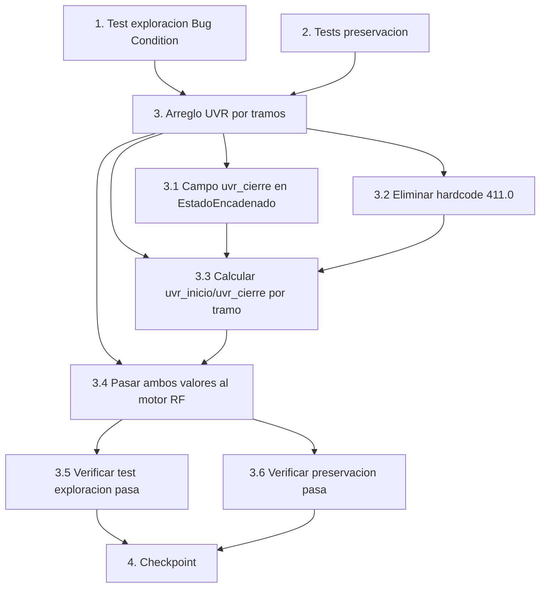

# Implementation Plan

## Overview

Plan de implementación para el bugfix "uvr-capitalizacion-por-tramos". Sigue la metodología
exploratoria de bugfix: primero se escriben los tests de exploración (Property 1: Bug Condition)
y de preservación (Property 2: Preservation) ANTES del arreglo, luego se implementa la corrección
de orquestación en `app_dash.py` y `scripts/proyeccion_tramos_multiactivo.py`, y finalmente se
verifica que el bug queda resuelto sin regresiones.

## Task Dependency Graph



```json
{
  "waves": [
    { "wave": 1, "tasks": ["1", "2"] },
    { "wave": 2, "tasks": ["3.1", "3.2"] },
    { "wave": 3, "tasks": ["3.3"] },
    { "wave": 4, "tasks": ["3.4"] },
    { "wave": 5, "tasks": ["3.5", "3.6"] },
    { "wave": 6, "tasks": ["4"] }
  ]
}
```

## Tasks

- [x] 1. Escribir test de exploración de la condición de bug (ANTES de implementar el arreglo)
  - **Property 1: Bug Condition** - La UVR se capitaliza y encadena por tramos
  - **CRITICAL**: Este test DEBE FALLAR sobre el código sin corregir — la falla confirma que el bug existe
  - **DO NOT attempt to fix the test or the code when it fails**
  - **NOTE**: Este test codifica el comportamiento esperado — validará el arreglo cuando pase tras la implementación
  - **GOAL**: Hacer aflorar contraejemplos que demuestren que el bug existe
  - **Scoped PBT Approach**: Para los casos deterministas, acotar la propiedad a casos concretos reproducibles (p. ej. horizonte de 3 años, inflación 5% EA, UVR t0 = 400) además de generar casos aleatorios
  - Construir un escenario `por_tramos` multiactivo con al menos un título UVR y tramos con inflación > 0 (satisface `isBugCondition`: `modo_proyeccion = "por_tramos" AND existe_titulo_UVR(portafolio) AND existe_tramo_con_inflacion_no_cero(tramos)`)
  - Capturar la senda de UVR efectiva (`_senda_uvr` del motor y/o `uvr_cierre` por tramo) tras correr `_ejecutar_escenario_por_tramos`
  - Las aserciones deben codificar las Correctness Properties del diseño (Property 1):
    - `uvr_crece_segun_inflacion_de_cada_tramo` — `uvr_cierre(tramo_i) == uvr_inicio * (1 + infl_ea) ^ (meses/12)` dentro de tolerancia numérica
    - `primer_tramo_escalado_por_fraccion_de_anio` — el primer tramo parcial (~5 meses) aplica `(1 + inflacion_ea) ^ (meses/12)`
    - `uvr_cierre(tramo_i) == uvr_inicio(tramo_{i+1})` (encadenamiento)
    - `infl_tramo >= 0` implica senda no decreciente (monotonía)
    - `NOT contiene_hardcode(411.0)` — con `uvr_t0` vacío debe abortar con error verificable, no inyectar 411.0
  - Usar Hypothesis (ya presente en el proyecto, ver `scripts/.hypothesis`)
  - Ejecutar el test sobre el código SIN corregir
  - **EXPECTED OUTCOME**: El test FALLA (esto es correcto — prueba que el bug existe)
  - Documentar los contraejemplos encontrados (p. ej. "la senda de UVR no crece pese a inflación positiva: `uvr_t0 == uvr_fin`"; "el inicio del tramo i+1 no es el cierre del tramo i"; "con `uvr_t0` vacío se inyecta 411.0 en vez de abortar")
  - Marcar la tarea completa cuando el test esté escrito, ejecutado y la falla documentada
  - _Requirements: 2.1, 2.2, 2.3, 2.4, 2.5, 2.6_

- [x] 2. Escribir tests de propiedad de preservación (ANTES de implementar el arreglo)
  - **Property 2: Preservation** - No cambia nada fuera de la condición de bug
  - **IMPORTANT**: Seguir la metodología de observación primero (observation-first)
  - Observar el comportamiento sobre el código SIN corregir para entradas que NO cumplen `isBugCondition`:
    - Flujo **punta a punta**: capturar la UVR de cierre de `_calcular_uvr_cierre_desde_inflacion` y el paso de `valor_uvr`/`valor_uvr_cierre` en el callback de escenario único
    - Títulos **no-UVR** (COP, IPC, moneda extranjera): capturar los resultados de valoración
    - Encadenamiento **TRM/repo/inflación** vía `EstadoEncadenado`: capturar `trm_cierre`, `repo_cierre`, `inflacion_cierre`
    - Portafolios **sin títulos UVR** en modo `por_tramos`: capturar resultados de proyección
    - Tramos con **inflación exactamente 0**: capturar que la UVR queda constante en el tramo
  - Escribir tests de propiedad con Hypothesis que capturen el comportamiento observado a través del dominio de entrada (modos, portafolios con/sin UVR, inflaciones cero y no cero), según las Preservation Requirements del diseño: `FOR ALL X WHERE NOT isBugCondition(X): F(X) = F'(X)`
  - El property-based testing genera muchos casos automáticamente para garantías más fuertes de que el comportamiento no cambia
  - Ejecutar los tests sobre el código SIN corregir
  - **EXPECTED OUTCOME**: Los tests PASAN (esto confirma la línea base de comportamiento a preservar)
  - Marcar la tarea completa cuando los tests estén escritos, ejecutados y pasando sobre el código sin corregir
  - _Requirements: 3.1, 3.2, 3.3, 3.4, 3.5, 3.6_

- [x] 3. Arreglo para la capitalización y encadenamiento de la UVR por tramos

  - [x] 3.1 Añadir el campo `uvr_cierre` a la dataclass `EstadoEncadenado`
    - En `scripts/proyeccion_tramos_multiactivo.py`, añadir el campo opcional `uvr_cierre: float | None = None`
    - Documentarlo igual que `trm_cierre`/`inflacion_cierre` (nivel de UVR al cierre del tramo, consumido como UVR de inicio del tramo siguiente; `None` en el estado inicial del primer tramo)
    - Ampliación aditiva que no altera el encadenamiento existente de TRM/repo/inflación
    - _Bug_Condition: isBugCondition(X) = modo_proyeccion="por_tramos" AND existe_titulo_UVR(portafolio) AND existe_tramo_con_inflacion_no_cero(tramos)_
    - _Expected_Behavior: encadenamiento `uvr_cierre(tramo_i) = uvr_inicio(tramo_{i+1})` (Property 1 del diseño)_
    - _Preservation: no alterar `trm_cierre`, `repo_cierre`, `inflacion_cierre` (Preservation Requirements del diseño)_
    - _Requirements: 2.4, 3.4_

  - [x] 3.2 Eliminar el hardcode 411.0 y abortar sin UVR t0 real
    - En `_ejecutar_escenario_por_tramos` (`app_dash.py`), reemplazar `_uvr = float(uvr_t0) if uvr_t0 else 411.0` por una guarda que, si no hay `uvr_t0` válido, devuelva el mismo contrato de error que la TRM (un `html.Span` de error en rojo) y no corra el loop
    - Mantener `_uvr_t0 = float(uvr_t0)` como nivel de inicio del PRIMER tramo (análogo a `_trm_t0`)
    - _Bug_Condition: isBugCondition(X) con uvr_t0 ausente (edge case del hardcode 411.0)_
    - _Expected_Behavior: abortar con error verificable; NOT contiene_hardcode(411.0) (Property 1 del diseño)_
    - _Preservation: patrón idéntico en espíritu al de la TRM (Preservation Requirements del diseño)_
    - _Requirements: 2.6, 1.4_

  - [x] 3.3 Calcular `uvr_inicio` y `uvr_cierre` por tramo y encadenarlos
    - Dentro del loop (rama `multiactivo`), calcular `factor_tramo = (1.0 + infl_ea) ** (meses_tramo / 12.0)` usando `infl_ea = float(inputs_tramo_i.inflacion_ea)` y `meses_tramo = tramo.sub_horizonte`
    - Calcular `_uvr_inicio` como la `uvr_cierre` del `estado_previo` cuando exista, o `_uvr_t0` en el primer tramo (encadenamiento)
    - Calcular `_uvr_cierre_tramo = _uvr_inicio * factor_tramo`
    - El exponente `meses_tramo / 12` cubre tanto el primer tramo parcial (p. ej. 5/12) como los tramos anuales completos (12/12 = 1), de modo que el escalado del primer tramo es un caso particular de la misma fórmula
    - Añadir `uvr_cierre=_uvr_cierre_tramo` al `EstadoEncadenado` construido entre tramos (análogo a `trm_cierre`)
    - _Bug_Condition: isBugCondition(X) = modo_proyeccion="por_tramos" AND existe_titulo_UVR(portafolio) AND existe_tramo_con_inflacion_no_cero(tramos)_
    - _Expected_Behavior: UVR crece según inflación de cada tramo, primer tramo escalado por fracción de año, encadenamiento, monotonía no decreciente para infl >= 0 (Property 1 del diseño)_
    - _Preservation: con infl_ea == 0, factor_tramo == 1 ⇒ UVR constante en el tramo (Preservation Requirements del diseño)_
    - _Requirements: 2.1, 2.3, 2.4, 2.5_

  - [x] 3.4 Pasar ambos valores de UVR al motor RF
    - En la llamada a `proyectar_portafolio`, cambiar `valor_uvr=_uvr` por `valor_uvr=_uvr_inicio, valor_uvr_cierre=_uvr_cierre_tramo`
    - El motor construye entonces `_senda_uvr` interpolando entre inicio y cierre (lógica existente, SIN tocar)
    - Actualizar el uso de `_uvr` en el detalle de informe (`_rf_det_tramo(..., uvr_cierre=_uvr)`) para que use `_uvr_cierre_tramo`
    - _Bug_Condition: isBugCondition(X) — la senda interna quedaba plana por faltar `valor_uvr_cierre`_
    - _Expected_Behavior: la senda interna del motor evoluciona en vez de quedar plana (Property 1 del diseño)_
    - _Preservation: NO modificar `proyectar_portafolio`, `valorar_titulo` ni la construcción de `_senda_uvr` (Preservation Requirements del diseño)_
    - _Requirements: 2.2, 3.3_

  - [x] 3.5 Verificar que el test de exploración de la condición de bug ahora pasa
    - **Property 1: Expected Behavior** - La UVR se capitaliza y encadena por tramos
    - **IMPORTANT**: Re-ejecutar el MISMO test de la tarea 1 — NO escribir un test nuevo
    - El test de la tarea 1 codifica el comportamiento esperado; cuando pasa, confirma que el comportamiento esperado se satisface
    - Ejecutar el test de exploración de la condición de bug de la tarea 1
    - **EXPECTED OUTCOME**: El test PASA (confirma que el bug está arreglado)
    - _Requirements: 2.1, 2.2, 2.3, 2.4, 2.5, 2.6_

  - [x] 3.6 Verificar que los tests de preservación siguen pasando
    - **Property 2: Preservation** - No cambia nada fuera de la condición de bug
    - **IMPORTANT**: Re-ejecutar los MISMOS tests de la tarea 2 — NO escribir tests nuevos
    - Ejecutar los tests de propiedad de preservación de la tarea 2
    - **EXPECTED OUTCOME**: Los tests PASAN (confirma que no hay regresiones)
    - Confirmar que todos los tests siguen pasando tras el arreglo (flujo punta a punta, títulos no-UVR, encadenamiento TRM/repo/inflación, portafolios sin UVR, inflación cero)
    - _Requirements: 3.1, 3.2, 3.3, 3.4, 3.5, 3.6_

- [x] 4. Checkpoint - Asegurar que todos los tests pasan
  - Ejecutar la suite completa (tests de exploración, preservación, unitarios, de propiedad e integración del diseño)
  - Confirmar que la corrida `por_tramos` multiactivo con títulos UVR hace crecer la UVR de forma compuesta a través de los tramos
  - Confirmar que la corrida con primer tramo parcial refleja el escalado por fracción de año y encadena al segundo tramo
  - Confirmar que la corrida punta a punta de regresión es idéntica al resultado previo al arreglo
  - Asegurar que todos los tests pasan; preguntar al usuario si surgen dudas

## Notes

- **Orden crítico**: las tareas 1 y 2 (tests de exploración y preservación) DEBEN escribirse y
  ejecutarse ANTES del arreglo (tarea 3). El test de la tarea 1 debe FALLAR sobre el código sin
  corregir; los tests de la tarea 2 deben PASAR sobre el código sin corregir.
- **Alcance del arreglo**: solo orquestación. NO se modifica `scripts/motor_proyeccion.py`
  (`proyectar_portafolio`, `valorar_titulo`, construcción de `_senda_uvr`) ni el flujo punta a punta
  (`_calcular_uvr_cierre_desde_inflacion`).
- **Property-based testing**: se usa Hypothesis, ya presente en el proyecto (`scripts/.hypothesis`).
- **Archivos temporales**: cualquier script temporal de verificación (p. ej. `_tmp_*.py`,
  `_smoke_*.py`, salidas `.txt`) se conserva hasta que el usuario autorice su borrado al final de la
  spec.
